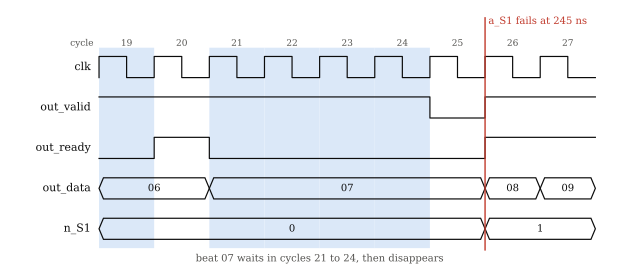

# Assertions for interface rules

This page answers: *the scoreboard says a beat came out wrong. How do you get a check that names
the rule the design broke, and the cycle it broke it in?*

You'll need the answer as soon as you start Lab 05. Your Lab 04 testbench already catches one of
that lab's bugs, B10, but the first thing it prints is
`[OUT] output 0: got 04 in cycle 56, expected 03`. That's the first wrong beat a sink *took*. The
scoreboard sees only the beats that are taken, so it can't notice a beat going wrong while the
beat waits on a stalled output, and Part 1 of the lab has you work out how many cycles earlier the
router broke its rule. A check that watches the pins themselves fires in the cycle in which the
rule is broken, and its message can say which rule it was. That check is a SystemVerilog **concurrent assertion**,
and in [Lab 05, Part 2](../labs/lab-05-protocol-rules-and-backpressure-overview.md#part-2-assertions-for-the-output-rules)
you'll write three of them for the router's outputs and bind them into the router.

So that this page doesn't do that part for you, its examples use a smaller design of our own: a
one-beat valid/ready stage, which takes a beat on its input and holds it on its output until the
sink takes it. Its source, its checker and the test that drives it are in
[`guide-examples/assertions-for-interface-rules/`](https://github.com/uoftasic/dd105-a/tree/main/guide-examples/assertions-for-interface-rules),
and every output quoted below comes from a run of it in the course image.

## Three rules

The stage promises three things, in the same style as the router specification's
[Valid/ready rules](../reference/router-spec.md#validready-rules):

- **S1**. Once `out_valid` is 1, it stays 1 until the handshake.
- **S2**. While `out_valid` is 1 and `out_ready` is 0, `out_data` doesn't change.
- **S3**. While the stage is empty (`out_valid` is 0), `in_ready` is 1.

S1 and S2 are the router's O1 and O2 for a design with one output. We planted two bugs in the
stage, switched on at run time with `+BUG=`: `drop` throws away a beat that has waited four
cycles, which breaks S1, and `bubble` holds `in_ready` at 0 for a cycle after each beat leaves,
which breaks S3.

## A rule as a property

Here is S1 as the checker writes it:

```systemverilog
a_S1: assert property (@(posedge clk) disable iff (!rst_n)
                       out_valid && !out_ready |=> out_valid)
  else begin n_S1++; $error("S1: out_valid fell without a handshake"); end
```

Read it from the left. `@(posedge clk)` says the property is evaluated at every rising edge, and
the values it uses are the ones the signals had just before that edge. That's the same value a
clocking block's `#1step` input gives you, and it's what the specification means by the value of a
signal "in a cycle", so the property sees each cycle the way your monitor does.

The expression left of `|=>`, `out_valid && !out_ready`, is the **antecedent**: it picks the
cycles the rule talks about, here the cycles in which a beat is on offer and isn't taken. `|=>`
means "then, in the next cycle", and the expression after it, the **consequent**, is what must
hold in that next cycle. In a cycle where the antecedent is false the property has nothing to say
and passes. The action block after `else` runs only on a failure. Ours counts the failure and
calls `$error` with the rule's name, so the message tells you which rule broke without your having
to look up a line number.

S2 has the same antecedent and a different consequent, `$stable(out_data)`, which is 1 when
`out_data` has the same value as it had in the previous cycle. S3 is about a single cycle, so it
uses the other implication:

```systemverilog
a_S3: assert property (@(posedge clk) disable iff (!rst_n)
                       !out_valid |-> in_ready)
```

`|->` checks the consequent in the same cycle as the antecedent. A rule of the form "whenever this
is true, that is true too" uses `|->`; a rule about what happens next uses `|=>`. Lab 05's O6 is
of the first kind, because it's about the beat in the cycle of its own handshake.

`disable iff (!rst_n)` switches the property off while `rst_n` is 0, and abandons any attempt that
was waiting for its next cycle when the reset came. The router specification explains why every
rule about normal operation needs it: a reset ends a handshake without one, and the router lowers
`out_valid` at once, which is what S1 and O1 forbid. Rules about what happens *during* a
reset are the other way round, and you'll write those without `disable iff` in Lab 07.

## Binding the checker into the design

The assertions live in their own module, `stage_sva`, with the stage's pins as its inputs. One
line, in its own file, puts a copy of that module inside the stage:

```systemverilog
bind stage stage_sva u_sva (
  .clk(clk), .rst_n(rst_n),
  .in_valid(in_valid), .in_ready(in_ready),
  .out_valid(out_valid), .out_ready(out_ready), .out_data(out_data)
);
```

`bind` instantiates `stage_sva` as `u_sva` in every instance of `stage`, and the names on the right
of each connection are signals inside `stage`, so the checker sees the design's own ports. The
stage's RTL doesn't change. The top module reads the failure count back out through the design
instance, as `dut.u_sva.n_fail`. Lab 05's
`tb/router_sva_bind.sv` does the same for the router, and Part 2 asks you why the testbench is
built that way.

## Failure messages on Verilator

The checker is plain SystemVerilog, but a failure goes through the simulator, not through UVM, so
it doesn't look like the `UVM_ERROR` lines you're used to. Here is the `drop` bug, run with
Verilator's default settings (`make run BUG=drop PLUSARGS=`, which also clears the error limit
our Makefile sets):

```text
UVM_INFO @ 0: reporter [RNTST] Running test stage_test...
[245000] %Error: stage_sva.sv:37: Assertion failed in stage_tb_top.dut.u_sva.a_S1: S1: out_valid fell without a handshake
%Error: guide-examples/assertions-for-interface-rules/stage_sva.sv:37: Verilog $stop
Aborting...
```

The number in brackets is the simulation time in picoseconds, 245 ns. Our clock has a 10 ns period
with its first rising edge at 5 ns, so the edge that ends cycle $n$ is at $10n - 5$ ns, and the
failure was found at the edge that ends cycle 25. A `|=>` failure is reported in the cycle of the
consequent, so the beat was still waiting in cycle 24 and `out_valid` was 0 in cycle 25. The
waveform of the same run shows it:

{width=720 fig-alt="A timing diagram of five signals over cycles 19 to 27: clk, out_valid, out_ready, out_data and n_S1. Cycles 19 and 21 to 24 are shaded, because in them out_valid is 1 and out_ready is 0. out_data holds 06 in cycles 19 and 20, 07 in cycles 21 to 25, then 08 and 09. out_ready is 1 only in cycle 20 and from cycle 26. out_valid is 1 except in cycle 25. A red line at the edge between cycles 25 and 26 is labelled a_S1 fails at 245 ns, and n_S1 goes from 0 to 1 there. A note under the diagram says beat 07 waits in cycles 21 to 24, then disappears."}

*The shaded cycles are the ones in which the antecedent of S1 holds: a beat is on offer and isn't
taken. Beat `07` waits in cycles 21 to 24, and in cycle 25 `out_valid` is 0 with no handshake. At
the edge that ends cycle 25 the assertion fails and `n_S1` counts it. (The stage takes `08` in
cycle 25, so the output is busy again from cycle 26.)*

The name in the message is the full path of the assertion, `stage_tb_top.dut.u_sva.a_S1`, which
tells you which instance of the checker fired; the router's has one for each output.

The run stopped at that failure. Verilator's default error limit is 1, so the first `$error` ends the
simulation with exit status 1, before the test's report phase and before UVM's summary. The
course's grader reads the log rather than trusting the exit status, and it called this run
`caught: 1 assertion`.

`+verilator+error+limit+<value>` raises the limit (`verilator --help` lists it as "Set error
limit"). Every lab from Lab 05 on passes `+verilator+error+limit+100000`, and our example's
Makefile passes 1000, so the same bug gives every failure:

```text
[245000] %Error: stage_sva.sv:37: Assertion failed in stage_tb_top.dut.u_sva.a_S1: S1: out_valid fell without a handshake
-Info: guide-examples/assertions-for-interface-rules/stage_sva.sv:37: Verilog $stop, ignored due to +verilator+error+limit
[375000] %Error: stage_sva.sv:37: Assertion failed in stage_tb_top.dut.u_sva.a_S1: S1: out_valid fell without a handshake
[605000] %Error: stage_sva.sv:37: Assertion failed in stage_tb_top.dut.u_sva.a_S1: S1: out_valid fell without a handshake
[1165000] %Error: stage_sva.sv:37: Assertion failed in stage_tb_top.dut.u_sva.a_S1: S1: out_valid fell without a handshake
UVM_ERROR guide-examples/assertions-for-interface-rules/stage_tb.sv(79) @ 2025000: uvm_test_top [SVA] the bound assertions counted 4 failures
```

The `-Info` line appears once, after the first failure. A raised limit still stops the run at the
error that reaches it, again before UVM's summary, which is why the labs use a number that no run
will reach.

The `UVM_ERROR` on the last line is there because our test puts it there. UVM's report server
counts only `UVM_ERROR`s and `UVM_FATAL`s, and an assertion's `$error` is neither. With
`+IGNORE_SVA`, which skips that one line of the test, the same run printed the same four `%Error`
lines and then `DD105: TEST PASSED`, and its exit status was 0. So any testbench that relies on
assertions needs something that turns their failures into a `UVM_ERROR` before the test ends. In
the labs, the top module passes `dut.u_sva.n_fail` to the scoreboard, which reports it as an
`[SVA]` error at the end of the test if it isn't 0.

## When the antecedent never holds {#an-assertion-checks-only-what-happens}

Here is the same buggy stage again, with the sink ready in every cycle
(`+READY_PCT=100`):

```text
UVM_INFO guide-examples/assertions-for-interface-rules/stage_tb.sv(85) @ 2025000: uvm_test_top [STAGE] 132 beats in, 131 out; a beat waited in 0 cycles (cover property: 0); 0 assertion failures
```

and the grader's verdict on it was `MISSED`. The bug is still there, but no beat ever waited, so
the antecedent of S1 was false in every cycle, and the assertion passed in every cycle without
checking anything. An assertion that passes says only that its rule wasn't broken in the cycles
where its antecedent held, and in this run there weren't any. One of Lab 05's bugs hides from its
assertion this way until your virtual sequence gives it something to check.

For this reason the checker also counts its antecedents. `n_tried` is a counter beside the
assertions, and `c_S1` asks the same question with a cover property:

```systemverilog
c_S1: cover property (@(posedge clk) disable iff (!rst_n) out_valid && !out_ready)
  n_covered++;
```

On the golden stage with the sink ready half the time, both said 90, and with the sink always
ready both said 0. Verilator also writes the cover property's count into `coverage.dat`, as a
`user` point named `stage_tb_top.dut.u_sva.c_S1` with the count 90, which `verilator_coverage`
reports as `user : 100.0% (1/1)`. The course's `make cov` lists only covergroup bins, though, so
in the labs the evidence that a rule was exercised comes from covergroups such as Lab 05's
`cg_wait`, which counts packets by how long their beats waited.

## Which rules suit an assertion

Rules about one or two cycles at a time are what assertions do best: I1, I2, O1, O2 and, as the
specification says, most of its other rules each become a short property like S1. They name the
rule, they fire in the cycle in which it's broken, and they need no model of the design, so they
keep working in any testbench that binds the file. The specification's Valid/ready rules section
lists the rules that need more than a short property:

- O5, O6 and O8 need state kept for each output (the order of the beats, how many beats the
  current packet has had, and when each beat went in). They belong in the scoreboard, or in an
  assertion with tracking code beside it. Lab 05's O6 uses a small counter of the beats in the
  current packet, written for you in `router_sva_out`.
- I4, O3 and O7 say what a signal does *not* depend on. No single trace can show that, so a model
  that predicts the outputs checks them, and an assertion can only catch their consequences.
- I3 is a rule for your own source, so it belongs in the driver.

A testbench needs both kinds of check. The scoreboard knows what every beat should be, so it
catches far more kinds of bug than the assertions do, and the assertions tell you where and when
to look. In Lab 05 you'll see both fire on the same bugs, often many cycles apart.

## Check yourself

1. The `drop` run's first failure printed `[245000]`. In which cycle did `out_valid` fall, and why
   is the failure reported then rather than in the cycle before?

   <details>
   <summary>Answer</summary>

   245 ns is the edge that ends cycle 25 ($10 \times 25 - 5 = 245$), so `out_valid` was 0 in
   cycle 25. The antecedent held in cycle 24, when the beat was on offer and not taken, and `|=>`
   checks the consequent one cycle later, so the failure can't be known until the edge that ends
   cycle 25.

   </details>

2. A test of yours prints three `%Error: ... Assertion failed` lines and then
   `DD105: TEST PASSED`, with exit status 0. What is it missing?

   <details>
   <summary>Answer</summary>

   Something that turns the assertions' failure count into a `UVM_ERROR`. UVM counts only its own
   reports, so `dd105_base_test` saw no errors and passed the test. The labs pass the count from
   the bound checker to the scoreboard, which reports it at the end of the test.

   </details>

3. With the sink always ready, the `drop` bug passed. Which number in that run's `[STAGE]` line
   tells you that S1 was never tried?

   <details>
   <summary>Answer</summary>

   `a beat waited in 0 cycles`, which is `n_tried`, and the cover property's count beside it, both
   0. Every assertion whose rule matters should have such a count beside it, or a coverage bin
   that shows the situation happened.

   </details>

4. Which implication would you use for the router's O6, "a beat taken when the packet has already
   had 7 beats has `out_last` = 1", and why?

   <details>
   <summary>Answer</summary>

   `|->`. The rule is about the beat in the cycle of its own handshake, so the consequent has to be
   checked in the same cycle as the antecedent. With `|=>` the check would look at `out_last` in
   the cycle after, when it belongs to a different beat or to no beat at all.

   </details>

## Further reading

ChipVerify's assertion pages are a good reference for the syntax. Their example output comes from
commercial simulators, so the failure messages look different from Verilator's.

- [Property Implication](https://chipverify.com/systemverilog/systemverilog-assertions-property-implication):
  `|->` against `|=>`, and vacuous success, with the same trace read both ways.
- [disable iff](https://chipverify.com/systemverilog/systemverilog-assertions-disable-iff): where
  it goes, and why gating the antecedent instead isn't the same thing.
- [$rose, $fell, $stable](https://chipverify.com/systemverilog/systemverilog-sequence-rose-fell-stable).
- [Handshake Properties](https://chipverify.com/formal-verification/handshake-properties), in the
  formal section: the valid/ready rules, which side's rules are assertions and which are
  assumptions, and why a sink that is always ready hides a sender bug.
- [assert, assume & cover](https://chipverify.com/systemverilog/assertions-assert-assume-cover).
- [SystemVerilog Assertions](https://chipverify.com/systemverilog/systemverilog-assertions), the
  overview. Correction: it writes an immediate assertion as `$assert(...)`, which isn't
  SystemVerilog (the keyword is `assert`), and its practice solution asserts a bare sequence with
  no implication, so it fails in every cycle where `req` is 0.
- [Assertion Based Verification](https://chipverify.com/verification/assertion-based-verification).
  Correction: it says `assume` has no effect in simulation; the standard says a simulator checks an
  assumed property the same way as an assertion.
- [SystemVerilog Assertions in a UVM Testbench](https://www.chipverify.com/uvm/uvm-assertions-in-testbench):
  which checks belong in assertions, which in the monitor and which in the scoreboard.

Next: [Reactive agents and backpressure](../guide/reactive-agents-and-backpressure.md).
