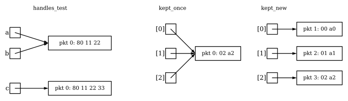

# Classes for testbenches

This page answers: *what does a class give a testbench that a module doesn't, and what do I need to
know about handles before I write a monitor and a scoreboard?*

Lab 01's UVM testbench was made of classes. You read them in Part 3, and in Part 5 you added the
flag checks to one of them, `alu_scoreboard`. In
[Lab 02](../labs/lab-02-a-class-testbench-without-uvm-overview.md) you'll write the router's monitor
and scoreboard, two plain SystemVerilog classes with no UVM in them. This page covers what those two
classes need: objects that are made while the simulation runs, the handles that point at them, and
the difference between functions and tasks. Static members and inheritance with virtual methods
come last. Lab 02's classes use neither, but Lab 01's tests shared one `run_phase` through
inheritance, and UVM calls your `build_phase` and `run_phase` through virtual methods.

We ran every example on this page in the course image. The source is in
[`guide-examples/classes-for-testbenches/`](https://github.com/uoftasic/dd105-a/tree/main/guide-examples/classes-for-testbenches).
The commands that produced each output are at the top of that folder's Makefile, and in the README
one level up, `guide-examples/README.md`.

## Modules and classes

A module behaves like hardware. Its instances are fixed when the design is elaborated, before
simulated time starts, and each one exists for the whole run. That suits a design, and it suits the
top module of a testbench, which holds the clock, the interfaces and the design under test.

A class is a type. The things made from it are called **objects**, and they're created while the
simulation runs, as many as the testbench needs. Most of a testbench is written as classes for that
reason. Lab 02's generator makes a new `packet` object for every packet the test sends, 100 of them
by default, and puts each one in a mailbox for the driver. Your monitor will make one for each packet
it sees on a stream. A transaction like that has no fixed place in the hardware. It exists from the
moment something makes it until nothing refers to it any more.

The classes of a testbench go in a package. Lab 02's `router_tb_pkg.sv` is a list of `` `include ``
lines for `packet.svh`, `generator.svh` and the rest, so any file that imports `router_tb_pkg` can
use every class in those files.

## A class

`handles_test`, `reuse_test` and `null_test` use this class. It's a cut-down version of Lab 02's
`packet`, with a serial number added:

```systemverilog
class pkt;
  static int unsigned n_made;   // one variable, shared by every pkt
  int unsigned        id;       // one per object
  bit [7:0]           data[$];

  function new();
    id = n_made;
    n_made++;
  endfunction

  function string sprint();
    string s;
    s = $sformatf("pkt %0d:", id);
    foreach (data[i]) s = {s, $sformatf(" %02h", data[i])};
    return s;
  endfunction
endclass
```

It has three **members** (`n_made`, `id` and `data`, a queue of bytes) and two **methods** (`new()`
and `sprint()`). `new()` is the constructor, and it runs once each time you call `new()` to make an
object. A constructor can take arguments, and Lab 02 uses them to connect its pieces. `env::new()`
makes three mailboxes and passes each one to the constructors of the two classes that use it, and
every class that touches the pins is given its virtual interface the same way. When an argument has
the same name as a member, `this.` picks out the member, so `this.vif = vif` copies the argument
`vif` into the member `vif`, as Python's `self.vif = vif` does.

## Handles

`pkt a;` declares a **handle**, a variable that can point at a `pkt` object. It doesn't make a
packet. Until something is assigned to it, the handle points at nothing, and its value is `null`.
`new()` makes an object and returns a handle to it. After that, assigning one handle to another
copies the handle and not the object. The example `handles_test` does this:

```systemverilog
pkt a, b, c;
$display("a is %s", a == null ? string'("null") : string'("an object"));
a = new();
a.data = '{8'h80, 8'h11};
b = a;
b.data.push_back(8'h22);
c = new a;
c.data.push_back(8'h33);
```

and prints:

```text
a is null
a: pkt 0: 80 11 22
b: pkt 0: 80 11 22
c: pkt 0: 80 11 22 33
a == b is 1, a == c is 0, pkt::n_made is 1
```

{fig-alt="Two drawings. On the left, small squares labelled a and b both have arrows to one box reading pkt 0: 80 11 22, and a square labelled c has an arrow to a separate box reading pkt 0: 80 11 22 33. On the right, under kept_once, three squares labelled [0], [1] and [2] all have arrows to one box reading pkt 0: 02 a2. Under kept_new, three squares labelled [0], [1] and [2] each have an arrow to its own box: pkt 1: 00 a0, pkt 2: 01 a1 and pkt 3: 02 a2."}

*Left, `handles_test`: `a` and `b` point at one object, and `c` points at a copy of it. Right,
`reuse_test`: the first queue, `kept_once`, holds three handles to one reused object, and the second,
`kept_new`, holds three handles to three objects. The values are the ones the tests printed.*

`b = a` gave the one object a second name, so the `22` pushed through `b` shows up when you print
`a`. `a == b` compares the handles, and it's 1 because they point at the same object. Two different
objects with the same contents compare unequal, which is why Lab 02's `packet` has a `same()` method
that compares the beats one by one.

`c = new a` makes a new object and copies every member of `a` into it, so `c` has its own queue, and
the `33` pushed onto it doesn't appear in `a`. The copy doesn't run the constructor, so `c` kept
`a`'s `id` of 0, and `n_made` stayed at 1. It's also a *shallow* copy, which means that if `pkt` had
a member that was itself a handle, `c` would get a copy of that handle, and the two objects would
share whatever it pointed at.

You won't often copy objects in the labs, but you'll pass handles around all the time, and every
place that keeps a handle to an object shares that object with every other place that kept one. The
next example shows what happens when you forget that, and it's the class bug you're most likely to
write in Lab 02.

## The same object kept three times

`reuse_test` has two loops, and each one stands in for a monitor. Each loop builds the same three
two-byte packets and keeps them in a queue, as Lab 02's scoreboard keeps the packets it expects. The
first loop makes one `pkt` before it starts and reuses it for every packet, and the second makes a
new `pkt` for each packet:

```systemverilog
p = new();
for (int k = 0; k < 3; k++) begin
  p.data.delete();
  p.data.push_back(8'(k));
  p.data.push_back(8'hA0 + 8'(k));
  kept_once.push_back(p);
end

for (int k = 0; k < 3; k++) begin
  p = new();
  p.data.push_back(8'(k));
  p.data.push_back(8'hA0 + 8'(k));
  kept_new.push_back(p);
end
```

```text
one pkt, reused:   [0] pkt 0: 02 a2
one pkt, reused:   [1] pkt 0: 02 a2
one pkt, reused:   [2] pkt 0: 02 a2
a new pkt each:    [0] pkt 1: 00 a0
a new pkt each:    [1] pkt 2: 01 a1
a new pkt each:    [2] pkt 3: 02 a2
```

`kept_once` holds three handles to one object, and that object holds the last packet, `02 a2`, so
the queue shows it three times and the first two packets are gone. A mailbox behaves the same way,
because what you put into it is a handle. That's why the `TODO` in Lab 02's `monitor.svh` has you
start a new packet when `p` is null, and set `p = null` once you've put a finished packet into the
mailbox. The next packet then gets an object of its own, and the object the scoreboard was given
keeps the beats it had.

## Null handles

If you use a handle before it points at anything, the run stops. `null_test` declares `pkt p;`,
prints a line, and then asks for `p.data.size()`. This is everything in its log after UVM's
`Running test null_test...` line:

```text
%Error: guide-examples/classes-for-testbenches/classes_demo_pkg.sv:112: Null pointer dereferenced
Aborting...
```

The file and line in the error are where the null handle was used. Nothing after that line ran,
including UVM's report summary. The labs' graders mark a run like this BROKEN rather than caught,
because a null handle is an error in the testbench and not a check that fired. The line that the test
printed just before the error isn't in the log either, so when a run aborts, look at the line the
error names, not at the last thing that was printed. In Lab 02 you'll see this error if your monitor
pushes a beat onto `p.data` before it has made `p`.

## Functions and tasks

A class has two kinds of method. A **function** runs in zero simulated time and can return a value.
`sprint()` and Lab 02's `packet::same()` are functions. A **task** can wait for a clock edge with
`@`, for a delay with `#`, or for a mailbox to have something in it, so any method that follows the
simulation through time has to be a task. In Lab 02 the `run()` methods of the monitor, the driver
and the scoreboard are all tasks, and the scoreboard's `run()` waits on two mailboxes.

Verilator checks this rule before it builds anything, so a function with `#10;` in it fails
`make lint` with this error:

```text
%Error-FUNCTIMECTL: guide-examples/classes-for-testbenches/classes_demo_pkg.sv:120:5: Functions cannot contain time-controlling statements (IEEE 1800-2023 13.4)
```

Methods of a class are *automatic*, which means that each call gets its own copy of the method's
local variables. That's what lets two threads run the same task at the same time without disturbing
each other, and [Threads, mailboxes and events](../guide/threads-mailboxes-and-events.md) shows where
it matters.

## Static members

A `static` member belongs to the class rather than to any one object, so there's one `n_made`
however many packets exist, and code outside the class reads it as `pkt::n_made`. The usual use is a
counter like this one, which numbers objects as they're made. Members that aren't static exist once
per object, so every `pkt` has its own `id` and `data`.

## Inheritance and virtual methods

A class can **extend** another class. It inherits all of that class's members and methods, and it
can override any of those methods with a version of its own. In `dispatch_test`, the
class `base_test` has a `run()` task that calls `name()`, which isn't virtual, and `stimulus()`,
which is declared `virtual`. The class `rand_test` extends `base_test` and overrides both:

```systemverilog
class base_test;
  function string name();
    return "base_test";
  endfunction
  virtual task stimulus();
    $display("  stimulus() of base_test: no stimulus");
  endtask
  task run();
    $display("run() of %s", name());
    stimulus();
  endtask
endclass

class rand_test extends base_test;
  function string name();
    return "rand_test";
  endfunction
  virtual task stimulus();
    $display("  stimulus() of rand_test: 2000 random vectors");
  endtask
endclass
```

The test makes one `rand_test` object and calls `run()` on it twice, once through a `base_test`
handle and once through a `rand_test` handle:

```text
through a base_test handle:
run() of base_test
  stimulus() of rand_test: 2000 random vectors
through a rand_test handle:
run() of base_test
  stimulus() of rand_test: 2000 random vectors
```

`run()` is defined only in `base_test`, so both calls run that code. Inside it, the call to
`stimulus()` went to `rand_test`'s version, because `stimulus()` is virtual, and a virtual call goes
to the method of the object's own class, whatever type of handle you called it through. The call to
`name()` went to `base_test`'s version both times, even though the object is a `rand_test`. A call to
a method that isn't virtual is bound when the code is compiled, by the type of the handle it's made
through. Inside `run()`, `name()` is called through `this`, and in code written in `base_test`,
`this` is a `base_test` handle.

Lab 01's two tests share one run phase this way. `alu_base_test::run_phase()` raises an objection,
calls `stimulus()`, waits three cycles and drops the objection. `stimulus()` is a virtual task, and
`alu_rand_test` and `alu_directed_test` each override it to start their own sequence. UVM calls
your code the same way. `build_phase`, `run_phase` and the other phase methods are declared virtual
in the UVM library, so when UVM calls them on your components, it runs your versions.

A method that overrides another can still call the version it replaced, through `super`. Lab 01's
`alu_base_test::build_phase()` starts with `super.build_phase(phase)`, which runs
`dd105_base_test`'s `build_phase()`, where the course checks that the constraint solver works. If
you leave the `super` call out, the check doesn't run, and no message tells you it was skipped.

## Check yourself

1. A scoreboard reports that every packet it expected has the same beats as the last packet. Its
   monitor runs `p = new()` once, in the monitor's constructor. What's wrong, and how do you fix
   it?

   <details>
   <summary>Answer</summary>

   The monitor puts the same object into the mailbox for every packet and refills it each time,
   so every handle the scoreboard kept points at one object, and that object holds whatever was
   written into it last. Make a new `packet` for each packet the monitor sees, and stop using the
   old one once it's in the mailbox, which is what setting `p = null` after the `put()` does.

   </details>

2. In `dispatch_test`, the call through the `rand_test` handle still printed `run() of base_test`.
   Why, and what would it print if `name()` were declared `virtual`?

   <details>
   <summary>Answer</summary>

   `run()` is `base_test`'s code. Inside it, `name()` is called through `this`, which there is a
   `base_test` handle, and because `name()` isn't virtual, the call was bound to `base_test::name()`
   when the class was compiled. The type of the handle you called `run()` through doesn't come into
   it. If `name()` were virtual, the call would go to the object's own class, and both lines would
   read `run() of rand_test`.

   </details>

3. After `c = new a`, `c.id` is 0, the same as `a.id`, and `pkt::n_made` is still 1. Why didn't the
   copy get a new number?

   <details>
   <summary>Answer</summary>

   `new a` copies the members of `a` into a new object without calling the constructor, and the
   constructor is the only code that numbers objects. If a copy needs its own number, give `pkt` a
   copy method of its own that makes the object with `new()` and then copies the data.

   </details>

4. Which of these has to be a task: the monitor's `run()`, `packet::sprint()`, the scoreboard's
   `predict()`?

   <details>
   <summary>Answer</summary>

   Only the monitor's `run()`, because it waits for clock edges. `sprint()` builds a string, and
   `predict()` decides whether a packet should come out of output 0. Neither has to wait for
   anything, so both are functions, and that's how Lab 02 ships them.

   </details>

## Further reading

ChipVerify has a page on each of the class features below, and most of them include a complete
example. The logs on its SystemVerilog pages mostly come from Cadence simulators, not from Verilator,
and the course doesn't reuse its code.

- [Class](https://chipverify.com/systemverilog/systemverilog-class) and
  [Class Handle](https://chipverify.com/systemverilog/systemverilog-class-handle-object): objects,
  handles, `null`, and two handles to one object.
- [Class Constructor](https://chipverify.com/systemverilog/systemverilog-class-constructor):
  `new()`, default arguments, and `super.new()`.
- [Copying Objects](https://chipverify.com/systemverilog/systemverilog-copying-objects): shallow
  copies with `new`, and deep copies written by hand.
- [Static Variables & Functions](https://chipverify.com/systemverilog/systemverilog-static-variables-functions).
- [Inheritance](https://chipverify.com/systemverilog/systemverilog-inheritance),
  [Virtual Methods](https://chipverify.com/systemverilog/systemverilog-virtual-methods) and
  [super Keyword](https://chipverify.com/systemverilog/systemverilog-super). The Virtual Methods page
  runs the same code with and without `virtual`, as `dispatch_test` does.
- [Polymorphism](https://chipverify.com/systemverilog/systemverilog-polymorphism): base handles
  to derived objects, and `$cast`. Correction: it says that a failed `$cast` returns 0 and the
  simulation goes on, which is true only when `$cast` is called as a function. Called as a task, a
  failed cast is a run-time error, as the page's own log shows.
  [Cast Dynamic](https://chipverify.com/systemverilog/systemverilog-dynamic-cast) gets this right.

Next: [Interfaces, clocking blocks and virtual interfaces](../guide/interfaces-clocking-blocks-and-virtual-interfaces.md).
