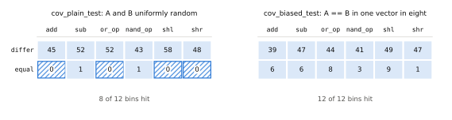

# Functional coverage you can read

This page answers: *how do I find out what my random stimulus actually reached, on a simulator
whose coverage percentage doesn't follow the standard?*

DD104's coverage was a list of questions you kept yourself (have I run `SUB` with two different
operands? have I taken a backward branch?) and answered with a `for` loop and a set. A
**covergroup** is the same list written in SystemVerilog: you name the values you care about, the
simulator counts how often the stimulus produced each one, and the counts go into a file that
tools can merge and report. In
[Lab 03, Part 2](../labs/lab-03-constraints-and-coverage-overview.md#part-2-a-covergroup-you-can-read)
you write one for the router's packets, and it shows you two holes that a passing test was
hiding.

On Verilator 5.050 the counts are right, and almost everything built from them, the percentage
included, works differently from the standard. This page shows how to write a covergroup that
this simulator keeps, where its numbers go, and how to read them. The example,
[`guide-examples/functional-coverage-you-can-read/`](https://github.com/uoftasic/dd105-a/tree/main/guide-examples/functional-coverage-you-can-read),
samples random ALU vectors.

## Coverpoints, bins and crosses

Here is a covergroup for ALU vectors. It counts the operations, three kinds of value for `A`, and
whether the two operands were equal:

```systemverilog
covergroup cg_alu with function sample(int op, bit [7:0] a, bit eq);
  cp_op: coverpoint op {
    bins add = {0}; bins sub = {1}; bins or_op = {2};
    bins nand_op = {3}; bins shl = {4}; bins shr = {5};
  }
  cp_a: coverpoint a {
    bins zero  = {8'h00};
    bins ones  = {8'hFF};
    bins other = {[8'h01:8'hFE]};
  }
  cp_eq: coverpoint eq {
    bins differ = {0};
    bins equal  = {1};
  }
  x_op_eq: cross cp_op, cp_eq;
endgroup
```

Each **bin** is one question, and its count is the number of samples that answered yes. A
**coverpoint** groups the bins for one value, and a **cross** makes one bin for every combination
of two coverpoints' bins, here 6 × 2 = 12, from `add_x_differ` to `shr_x_equal`. The
`equal` bins in the cross are the DD104 question about symmetric operands: `SUB rX, rX` and
`NAND rX, rX` are idioms SimProc programs use, and they're also the vectors where an operand swap
can't show.

The covergroup takes its values as arguments of `sample()`, and whoever calls `sample()` passes
them in. That's not the way most examples write a covergroup in a class. They let the coverpoints
read a member of the class, `coverpoint v.op`, and call `sample()` with no arguments. Verilator
5.050 doesn't support that form, and the example's `CG_MEMBER` build shows what it does instead:

```text
%Warning-COVERIGN: guide-examples/functional-coverage-you-can-read/cov_pkg.sv:48:25: Unsupported: 'covergroup' coverpoint referencing enclosing class member; ignoring covergroup '__vlAnonCG_cg_alu'
%Error: Exiting due to 1 warning(s)
```

It ignores the whole covergroup. The course's build turns every warning it hasn't been told to
allow into an error, so the build stopped there after 4 s, and you find out from the build
rather than from a coverage report with no bins in it. You meet this warning on purpose in
Lab 03, Part 2, and Lab 04's coverage subscriber uses the `with function sample` form for the
same reason.

## coverage.dat and make cov

The course's `uvm.mk` builds every simulator with Verilator's `--coverage-user`, and every run
writes the count of every bin to `coverage.dat` in its run folder. `make cov` merges every
`coverage.dat` under `build/runs` with `verilator_coverage` and lists every bin, the empty ones
first. After one run of `cov_plain_test`, 300 vectors with `A` and `B` uniformly random:

```text
 verilator_coverage: covergroup : 82.9% (34/41)
------------------------------------------------------------------------
 41 covergroup bins, 34 hit at least once:
  __vlAnonCG_cg_alu.cp_a                          3 of 3    bins hit
  __vlAnonCG_cg_alu.cp_eq                         2 of 2    bins hit
  __vlAnonCG_cg_alu.cp_op                         6 of 6    bins hit
  __vlAnonCG_cg_alu.x_op_eq                       8 of 12   bins hit
  __vlAnonCG_cg_arr.cp_alone                      4 of 4    bins hit
  __vlAnonCG_cg_arr.cp_crossed                    1 of 1    bins hit
  __vlAnonCG_cg_arr.cp_half                       2 of 2    bins hit
  __vlAnonCG_cg_arr.x_w_half                      2 of 2    bins hit
  __vlAnonCG_cg_ign.cp_op                         6 of 9    bins hit
------------------------------------------------------------------------
 7 bins never hit:
    __vlAnonCG_cg_alu.x_op_eq.add_x_equal
    __vlAnonCG_cg_alu.x_op_eq.or_op_x_equal
    __vlAnonCG_cg_alu.x_op_eq.shl_x_equal
    __vlAnonCG_cg_alu.x_op_eq.shr_x_equal
    __vlAnonCG_cg_ign.cp_op.op[6]
    __vlAnonCG_cg_ign.cp_op.op[7]
    __vlAnonCG_cg_ign.cp_op.unused
```

(The summary also lists line, toggle and the other kinds of coverage, all at `0.0% ( 0/ 0)`,
because the course's builds collect covergroups only. `__vlAnonCG_cg_alu` is the name Verilator
gives the covergroup `cg_alu`.) The file `build/coverage/bins.txt` has every bin with its count.

The two other covergroups in the list, `cg_arr` and `cg_ign`, are there to show how this simulator
counts, and the next section comes back to them. In `cg_alu`, every operation and every kind of
`A` came up, but four of the twelve cross bins are empty: no `ADD`, `OR`, `SHL` or `SHR` ever ran
with equal operands. Only 2 of the 300 vectors had `A == B`, about what uniform random operands
give (one in 256). `cov_biased_test` makes one vector in eight have equal operands, and fills the
cross:



*The 12 bins of `x_op_eq`, one run each. With uniform operands, the `equal` row has a 1 for `sub`
and `nand_op` and nothing else. With one vector in eight made equal, every bin is hit.*

That's what the list of empty bins is for: each one names a question your stimulus never asked.

## The percentage

Verilator's `82.9% (34/41)` is the number of bins hit over the number of bins, counting every
bin of every covergroup the same, crosses included. The standard's formula is different: a
covergroup's coverage is the average of its coverpoints' and crosses' coverage. For `cg_alu`
alone the run's own report gives:

```text
[COV] cg_alu: get_inst_coverage() = 82.61, get_coverage() = 0.00
```

`get_inst_coverage()` is Verilator's formula again, 19 bins hit of 23. The standard's would
average `cp_op`, `cp_a` and `cp_eq` (100% each) with `x_op_eq` (8 of 12, 67%), which gives 92%.
`get_coverage()`, which the standard defines for the covergroup type as a whole, returned 0.

Two more differences change the bins themselves, and the example's other covergroups show them:

```systemverilog
covergroup cg_arr with function sample(int v, int w);
  cp_alone:   coverpoint v { bins v[] = {[0:3]}; }
  cp_crossed: coverpoint w { bins w[] = {[0:3]}; }
  cp_half:    coverpoint v { bins lo = {[0:1]}; bins hi = {[2:3]}; }
  x_w_half:   cross cp_crossed, cp_half;
endgroup

covergroup cg_ign with function sample(int op);
  cp_op: coverpoint op { bins op[] = {[0:7]}; ignore_bins unused = {6, 7}; }
endgroup
```

- **An array of bins on a crossed coverpoint becomes one bin.** `bins v[] = {[0:3]}` gave four
  bins on `cp_alone`, but the same line on `cp_crossed` gave a single bin, `w`, which counted all
  300 samples, and the cross has 2 bins where the standard gives 8. So in a coverpoint that's
  part of a cross, write every bin out by name, as Lab 03 asks you to.
- **`ignore_bins` don't leave the count.** The standard drops 6 and 7 from `cp_op`, leaving 6
  bins, all hit: 100%. Here `op[6]` and `op[7]` are still bins, the ignored set is listed as a
  bin of its own, `unused`, and `verilator_coverage` counts 6 of 9. `get_inst_coverage()` gave a
  third answer, 75.00, which is 6 of 8.

None of this changes a single count. Every bin's count in `coverage.dat` is right, and that's what
`make cov` is built to show you. Lab 03, Part 2 works the same sums for the router's covergroup,
46.3% by Verilator's formula and 61% by the standard's, and comes to the same advice: to see
which bins matter, read the list.

## Three kinds of empty bin

An empty bin is a question, and it has one of three answers. Some bins can't be hit by any test,
because the specification rules them out: `op[6]` and `op[7]` above, since SimProc has no
operation 6 or 7, or the router's `full_x_low` in Lab 03, since a FULL drop needs a level above 8.
Some can be hit, but not by this testbench, because of how it was built: Lab 03's tracker takes
output 1's level as 0, so `out1_x_low` stays empty until Lab 04 fixes that. And some are holes in
the stimulus, like the `equal` bins above, and those are the ones worth your time, because a bug
can sit in them. Lab 03 Part 2 asks you to sort the router's 41 bins into these three groups, and
the two planted bugs turn out to be in the third.

## Check yourself

1. A coverpoint `cp_kind` has `bins k[] = {[0:3]}` and is crossed with a coverpoint that has two
   bins. How many bins does the cross have on Verilator 5.050, and what do you change?

   <details>
   <summary>Answer</summary>

   Two, because `k[]` becomes a single bin on a crossed coverpoint. Write the four bins out by
   name (`bins k0 = {0}; bins k1 = {1};` and so on), and the cross gets 4 × 2 = 8.

   </details>

2. A run's report prints `get_coverage() = 0.00` for its covergroup. Was nothing covered?

   <details>
   <summary>Answer</summary>

   Not necessarily: on this simulator `get_coverage()` returned 0 even for a run whose cross had
   every bin hit. Read the counts from `make cov` instead.

   </details>

3. After `cov_plain_test`, `make cov` reports `82.9% (34/41)`. Which of the 7 empty bins would
   more seeds of the same test fill, and which can no test fill?

   <details>
   <summary>Answer</summary>

   More seeds would slowly fill the four `equal` bins, at about one vector in 256 with equal
   operands, spread over six operations. `op[6]` and `op[7]` can't be hit, because SimProc has no
   such operations, and `unused` is the ignored set, which no sample is meant to hit.

   </details>

## Further reading

ChipVerify's coverage pages explain the language well; their numbers come from commercial
simulators.

- [Covergroup and Coverpoint](https://chipverify.com/systemverilog/systemverilog-covergroup-coverpoint).
  Correction: it says a 32-bit coverpoint with default bins would make billions of bins; the
  standard caps automatic bins at `auto_bin_max`, 64 by default, so it makes 64 range bins.
- [Coverpoint Bins](https://chipverify.com/systemverilog/systemverilog-coverpoint-bins), for
  `bins x[]`, `bins x[N]` and `default`. It doesn't cover `ignore_bins` or `illegal_bins` on a
  coverpoint, or transition bins.
- [Cross Coverage](https://chipverify.com/systemverilog/systemverilog-cross-coverage), for
  `binsof` and `intersect`. On Verilator 5.050 the total is computed differently (bins hit over
  all bins), and an array of bins on a crossed coverpoint becomes one bin.
- [Functional Coverage](https://chipverify.com/systemverilog/systemverilog-functional-coverage).
  Correction: its `sample()` example constructs the covergroup with `CovGrp = new;`, which assigns
  to the type name; it needs an instance variable. It also repeats the "one bin per value" claim.
- [UVM Functional Coverage](https://www.chipverify.com/uvm/uvm-functional-coverage), for a
  coverage subscriber. Its covergroup reads a member of the class, which Verilator 5.050 drops;
  write it `with function sample`, as Lab 04's `router_coverage` is.
