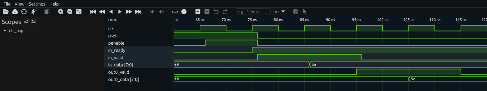

# Interfaces, clocking blocks and virtual interfaces

This page answers: *how does a class, which isn't part of the design, drive the design's pins and
read them back without racing its flip-flops?*

In Lab 01 you read a driver that wrote `vif.drv_cb.A <= req.A` and a monitor that read
`vif.mon_cb.ALUout`. In [Lab 02](../labs/lab-02-a-class-testbench-without-uvm-overview.md) you'll
write a monitor for the router's valid/ready streams, and every line of it reads the router through
something like `vif.cb.valid`. Three pieces of SystemVerilog are involved. An **interface**
bundles the signals, a **clocking block** says when the testbench samples and drives them, and a
**virtual interface** is how a class gets hold of them at all. This page takes them in that order,
with an example that drives the router.

We ran the examples in the course image. Their source is in
[`guide-examples/interfaces-clocking-blocks-and-virtual-interfaces/`](https://github.com/uoftasic/dd105-a/tree/main/guide-examples/interfaces-clocking-blocks-and-virtual-interfaces),
which drives the golden router from `labs/common/rtl`, and its README gives the command for each
output.

## Interfaces

An interface is a named bundle of signals that you declare once and instantiate like a module. The
example's interface holds the router's APB port, its input stream and the `ready` of both outputs.
Shortened, it reads:

```systemverilog
interface rtr_pins_if (input logic clk, input logic rst_n);
  logic        psel = 1'b0, penable = 1'b0, pwrite = 1'b0;
  logic [7:0]  paddr = 8'h00;
  logic [31:0] pwdata = 32'h0;
  logic        pready;
  logic        in_valid = 1'b0, in_last = 1'b0;
  logic [7:0]  in_data = 8'h00;
  logic        in_ready;
  logic        out0_valid;
  logic [7:0]  out0_data;
  ...
  clocking cb @(posedge clk);
    default input #1step output #1;
    output psel, penable, pwrite, paddr, pwdata, in_valid, in_data, in_last;
    input  pready, in_ready, out0_valid, out0_data, rst_n;
  endclocking
endinterface
```

The top module makes one, `rtr_pins_if pins (clk, rst_n);`, and wires its signals to the router's
ports: `.in_valid(pins.in_valid)`, `.in_ready(pins.in_ready)` and so on. From then on, anything that
can see `pins` can see every signal in it.

An interface can also say who drives what. Lab 01's `alu_if` does it with two modports, `DRV` and
`MON`, each exposing one clocking block, so the driver is handed `alu_if.DRV` and the monitor
`alu_if.MON`. Lab 02 does it with three interface types instead: `stream_src_if` for the input,
where the testbench drives `valid`, `stream_snk_if` for an output, where it drives `ready`, and
`stream_mon_if`, whose signals are all inputs. The monitor class holds a `stream_mon_if`, so it can
watch the input and output 0 with the same code, and it can't drive either of them by mistake.

## Virtual interfaces

A class can't contain an interface instance, and the standard doesn't let code in a package name
anything in the module hierarchy, so a class can't reach `pins` by its name either. It holds a
**virtual interface** instead: a variable whose type is
`virtual rtr_pins_if`, and whose value is a handle to one particular instance, assigned while the
simulation runs.

```systemverilog
class edge_demo;
  virtual rtr_pins_if vif;

  function new(virtual rtr_pins_if vif);
    this.vif = vif;
  endfunction
  ...
endclass
```

The course hands virtual interfaces over in two steps. The top module stores each instance in UVM's
configuration database before it starts the test:

```systemverilog
uvm_config_db#(virtual rtr_pins_if)::set(null, "uvm_test_top", "pins_vif", pins);
run_test();
```

and the test fetches it and passes it on to the classes that need it:

```systemverilog
if (!uvm_config_db#(virtual rtr_pins_if)::get(this, "", "pins_vif", vif))
  `uvm_fatal("NOVIF", "the top module didn't set pins_vif")
d = new(vif);
```

Lab 02's `router_class_test` does exactly this for its six interfaces and hands them to
`env::new()`, which passes each one to the class that uses it. In Lab 01 the UVM driver and monitor
fetch their own, in `build_phase`.

### A typedef of a virtual interface type

On Verilator 5.050 there's one way of writing the type that you have to avoid. The example's
`typedef_test` brings the router out of reset and sets `CTRL.EN`, while two monitor classes in the
same package print what their clocking block sampled at each rising edge. One declares its handle
as `virtual rtr_mon_if`, and the other as `rtr_mon_vif_t`, after
`typedef virtual rtr_mon_if rtr_mon_vif_t;`. The interface has two identical clocking blocks,
`cb_a` and `cb_b`, and each class reads its own, so that each block is read one way only;
otherwise the two classes are the same:

```text
45 ns: virtual rtr_mon_if: rst_n 1 in_ready 0 out0_valid 0
45 ns: rtr_mon_vif_t:      rst_n 0 in_ready 0 out0_valid 0
55 ns: virtual rtr_mon_if: rst_n 1 in_ready 0 out0_valid 0
55 ns: rtr_mon_vif_t:      rst_n 0 in_ready 0 out0_valid 0
65 ns: virtual rtr_mon_if: rst_n 1 in_ready 1 out0_valid 0
65 ns: rtr_mon_vif_t:      rst_n 0 in_ready 0 out0_valid 0
75 ns: virtual rtr_mon_if: rst_n 1 in_ready 1 out0_valid 0
75 ns: rtr_mon_vif_t:      rst_n 0 in_ready 0 out0_valid 0
```

The reset is over at every one of these edges, and `in_ready` goes to 1 once `CTRL.EN` is set, but
through the typedef every clocking-block input reads 0. Verilator gave no warning at build time and
no error at run time. That's why every class in the labs writes `virtual stream_mon_if` and the
like out in full, as Lab 02's `driver.svh` says.

## Clocking blocks

At a rising edge, two things happen at the same moment of simulated time: the design's flip-flops
take their new values, and your testbench, which was waiting for that edge, wakes up. When the
testbench then reads a flip-flop's output from the pin, whether it gets the old value or the new
one depends on where in that moment it woke up, and that depends on what it was waiting for.

The example's `edge_test` shows what Verilator does. After it sets up a route, it writes 1 to
`CTRL.EN`, which takes effect at the rising edge that ends the write and makes `in_ready` 1 from
then on. Then it offers a two-beat packet. At every rising edge it prints `in_ready` twice: once as
the clocking block sampled it, and once read straight from the pin at the same moment.

```text
65 ns edge: in_ready cb 0 pin 0 | in_valid pin 0 | out0_valid cb 0 pin 0
75 ns: CTRL.EN written
75 ns edge: in_ready cb 0 pin 1 | in_valid pin 0 | out0_valid cb 0 pin 0
76 ns: in_valid pin changes to 1
85 ns: handshake on beat 00
85 ns edge: in_ready cb 1 pin 1 | in_valid pin 1 | out0_valid cb 0 pin 0
95 ns: handshake on beat 5a
95 ns edge: in_ready cb 1 pin 1 | in_valid pin 1 | out0_valid cb 0 pin 1
96 ns: in_valid pin changes to 0
105 ns edge: in_ready cb 1 pin 1 | in_valid pin 0 | out0_valid cb 1 pin 1
115 ns edge: in_ready cb 1 pin 1 | in_valid pin 0 | out0_valid cb 1 pin 0
```

At 75 ns the pin already reads 1, because the flip-flop had updated before the class read it. The
clocking block reads 0, which is what `in_ready` was during the cycle that 75 ns ends. That's the
value the router's specification means by "`in_ready` in that cycle", and it's the one a monitor
needs, because a handshake is `valid` and `ready` both 1 *in the same cycle*. A monitor that read
`out0_valid` from the pin would get each value one cycle early (look at 95 ns and 105 ns), and it
would pair it with the wrong `ready`.

The clocking block's first line sets this up:

```systemverilog
clocking cb @(posedge clk);
  default input #1step output #1;
```

- `@(posedge clk)` is the clocking event, and `@(vif.cb)` waits for it.
- `input #1step` makes every input in the block a sample taken just before the edge, so
  `vif.cb.in_ready` is the value in the cycle that the edge ends, whatever the flip-flops do at
  the edge itself.
- `output #1` makes every drive through the block land 1 ns after the edge. The class wrote
  `vif.cb.in_valid <= 1` right after the edge at 75 ns, and the pin changed at 76 ns. Nothing the
  testbench drives changes at the moment anything is sampled.

Here is the same run in Surfer, from 60 ns to 120 ns:



*`in_ready` rises exactly at the 75 ns edge, because it comes from a flip-flop. `psel` and
`penable` fall and `in_valid` rises at 76 ns, 1 ns after the edge, because the class drove them
through the clocking block. The router takes `00` at 85 ns and `5a` at 95 ns, and `out0_valid` is
high from 95 ns to 115 ns.*

With both skews in place, a driver or a monitor is a loop that does one clock cycle per pass: drive
what the next cycle should hold, wait with `@(vif.cb)`, then look at what was sampled. This is the
task in the example that offers one beat:

```systemverilog
task send_beat(bit [7:0] data, bit last);
  vif.cb.in_valid <= 1'b1;
  vif.cb.in_data  <= data;
  vif.cb.in_last  <= last;
  do @(vif.cb); while (!vif.cb.in_ready);
endtask
```

Each pass of the `do` loop ends at an edge and asks whether `in_ready` was 1 in the cycle just
ended. If it was, `in_valid` was 1 in that cycle too, so that was the handshake, and the beat moved
at that edge. Lab 02's `driver::run()` is this loop with a time limit added.

## Module code and nonblocking assignments

There's one more reason the course drives every design through a clocking block. On Verilator
5.050, a module task that raises a signal for one cycle with nonblocking assignments, and is called
several times in a `repeat` loop, can lose assignments. The example's top module raises one signal
three times with such a task, and a second signal three times through a clocking block, and counts
the rising edges at which each was high:

```systemverilog
task automatic pulse_by_task();
  by_task <= 1'b1;
  @(posedge clk);
  by_task <= 1'b0;
endtask
```

```text
module task, <= on the signal:           high at 1 of 3 edges
module task, through a clocking block:   high at 3 of 3 edges
```

Each call's `by_task <= 1` runs after the previous call's `by_task <= 0`, in the same time step, so
by the standard the signal stays high at all three edges. Verilator commits the two in source
order instead, and two of the three pulses vanish. In the shapes the course measured,
listed in [`labs/common/README.md`](https://github.com/uoftasic/dd105-a/tree/main/labs/common),
only a module task called in a `repeat` loop lost assignments: the same task with its three calls
written out, and every class driver tried, kept them all. A clocking block gave three of three
everywhere, so the course uses one everywhere and doesn't have to remember which shapes are safe.

## Check yourself

1. At the 75 ns edge, `edge_test` printed `in_ready cb 0 pin 1`. What was `in_ready` in the cycle
   that ended at 75 ns, and why would a monitor that used the pin value be wrong?

   <details>
   <summary>Answer</summary>

   It was 0, which is what the clocking block sampled just before the edge. The pin already showed
   the value the flip-flop took at the edge, which belongs to the next cycle. A monitor that used
   it would pair this cycle's `valid` with next cycle's `ready`, and would see handshakes that
   didn't happen.

   </details>

2. A driver executes `vif.cb.in_valid <= 1` right after the edge at 75 ns, and `in_ready` is 1
   from then on. When does the pin change, and at which edge does the beat move?

   <details>
   <summary>Answer</summary>

   The pin changes at 76 ns, one output skew after the edge. The cycle from 75 ns to 85 ns then
   has `in_valid` and `in_ready` both 1, so the beat moves at the 85 ns edge, which is when
   `edge_test` printed `handshake on beat 00`.

   </details>

3. Lab 02's monitor holds a `virtual stream_mon_if` rather than the `stream_snk_if` the sink
   holds. What does that buy?

   <details>
   <summary>Answer</summary>

   Every signal in `stream_mon_if` is an input, so the monitor can't drive the stream it watches,
   and the same `monitor` class can watch the input stream and output 0, because the top module
   makes a `stream_mon_if` for each of them and wires it to that stream's four signals.

   </details>

4. Your monitor reads 0 from every clocking-block input, though the waveform shows the signals
   going to 1. What's the first thing to look for in your code?

   <details>
   <summary>Answer</summary>

   A typedef of the virtual interface type. On Verilator 5.050 a class that reaches the interface
   through `typedef virtual ... t;` reads 0 from every clocking-block input, with no warning.
   Write the type out in full, as `virtual stream_mon_if`.

   </details>

## Further reading

ChipVerify's pages on interfaces explain each construct at more length. Most of the logs on its
SystemVerilog pages come from Cadence simulators rather than Verilator, and the course doesn't
reuse its code.

- [Interface](https://chipverify.com/systemverilog/systemverilog-interface): an overview of the
  whole chapter.
- [Clocking Blocks Part 1](https://chipverify.com/systemverilog/systemverilog-clocking-blocks) and
  [Clocking Blocks Part 2](https://chipverify.com/systemverilog/systemverilog-clocking-blocks-part2):
  input and output skews, `#1step`, and the race a clocking block removes. Part 2 has a log whose
  sample times match its skews.
- [Modport](https://chipverify.com/systemverilog/systemverilog-modport): modports with a clocking
  block in them, as Lab 01's `alu_if` uses.
- [Virtual Interface](https://chipverify.com/systemverilog/systemverilog-virtual-interface): how a
  class gets its handle, and driving through `vif.cb`.
- [Scheduling Semantics](https://chipverify.com/systemverilog/systemverilog-scheduling-semantics):
  the regions of a time step, which decide what "the same moment" means at an edge. Correction: it
  lists seven regions and leaves out the Re-Inactive and Re-NBA regions, which clocking-block
  drives depend on.

Next: [Threads, mailboxes and events](../guide/threads-mailboxes-and-events.md).
