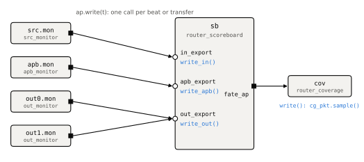

# Monitors, analysis ports and scoreboards

This page answers: *how does what a monitor sees on the pins get to the scoreboard and the
coverage, and what does the scoreboard do with it?*

Lab 01's UVM testbench for the ALU already used an analysis port. Its monitor wrote each vector to
the port, and the scoreboard checked each vector in its `write` function. Lab 02's router
testbench was built without UVM, and its classes passed packets through mailboxes. Your monitor
turned the handshakes on a stream into whole packets and put them in a mailbox, and the scoreboard
ran two threads of its own, one for each mailbox, that took them out. Lab 03 added a tracker, with
a loop of its own, that watched the pins directly.

In [Lab 04](../labs/lab-04-the-same-testbench-in-uvm-overview.md) the router testbench is rewritten
in UVM, and it uses **analysis ports**, as Lab 01's did. Each of its monitors writes every beat, or
every APB transfer, to its analysis port as soon as it sees it, and the scoreboard has no thread at
all. It's a class with three `write` functions, and the monitors call them. This page shows how
that works on the ALU, what Lab 04's scoreboard does when a beat arrives, and what goes wrong when
a monitor reuses one object for every write.

The example for this page,
[`guide-examples/monitors-analysis-ports-and-scoreboards/`](https://github.com/uoftasic/dd105-a/tree/main/guide-examples/monitors-analysis-ports-and-scoreboards),
tests SimProc's ALU with a complete agent, made of a sequencer, the driver from the example for
*Sequences, sequencers and drivers*, and a monitor. The environment connects three subscribers to
the monitor's one analysis port: a scoreboard, a coverage collector and a history that keeps every
item it's given. The ALU is the one from Lab 01, and its bug switch works here too. You set it when
you run the simulator, so `make run BUG=A01` runs the same test, on the same build, with the ALU
whose `SUB` computes `B - A`.

## The monitor

A monitor reads the pins and reports what it saw. It doesn't drive anything, and it doesn't know
what the driver sent or what the answer should be, so the same monitor can feed a scoreboard, a
coverage collector and anything else you add later. The example's monitor reads the pins through a
clocking block that has only inputs, so it sees each signal as it was just before the clock edge,
which is the value the signal held during the cycle that the edge ends:

```systemverilog
virtual function alu_item next_item();
  return alu_item::type_id::create("seen");     // a new item every time
endfunction

task run_phase(uvm_phase phase);
  alu_item t;
  forever begin
    @(vif.mon_cb);
    if (vif.mon_cb.valid) begin
      t        = next_item();
      t.op     = alu_op_e'(vif.mon_cb.ALUop);
      t.A      = vif.mon_cb.A;
      t.B      = vif.mon_cb.B;
      t.ALUout = vif.mon_cb.ALUout;
      t.N      = vif.mon_cb.N;
      t.Z      = vif.mon_cb.Z;
      n_seen++;
      ap.write(t);
    end
  end
endtask
```

(`next_item()` is a separate function only so that a test can swap in a monitor that gets its
items some other way, as `mon_alias_test` does in "One object per write", below.)

Lab 04's monitors do the same for the router's streams, with one `stream_beat` per handshake,
stamped with its cycle number, and for its APB port, with one `apb_item` per completed transfer.

## Analysis ports

`ap` is a `uvm_analysis_port #(alu_item)`. Its `write(t)` is a function, so it can't wait, and it
calls the `write` function of every subscriber connected to the port, one after another, before it
returns. A port with no subscribers is allowed, and `write` then does nothing. The monitor can't
tell who, if anyone, is connected to its port. The environment makes the connections, in its
`connect_phase`:

```systemverilog
agent.mon.ap.connect(sb.imp);
agent.mon.ap.connect(cov.analysis_export);
agent.mon.ap.connect(hist.analysis_export);
```

On the receiving end, the example's scoreboard declares an imp,
`uvm_analysis_imp #(alu_item, alu_scoreboard)`, and the imp calls the scoreboard's own
`write(alu_item t)`. A class that extends `uvm_subscriber #(alu_item)` gets its receiving end
already built, as a member called `analysis_export`, and you write only its `write` function. The
example's coverage collector and history both extend `uvm_subscriber`.

A scoreboard with several inputs needs a separate `write` function for each one, but an imp can
call only a function named `write`. The macro `` `uvm_analysis_imp_decl(_in) `` declares a new imp
class, `uvm_analysis_imp_in`, that calls `write_in()` instead. Lab 04's `router_env_pkg` declares
three of these classes at package scope, for the input stream, the outputs and the APB port, and
its scoreboard has one imp of each. The figure shows which monitors write to each one.



*The connections that Lab 04's `router_env::connect_phase` makes once you've done Part 2, which
adds output 1's agent. Before Part 2, only output 0's monitor is connected. Both output monitors
write to the same `out_export`, and each `stream_beat` carries its port number, so `write_out()`
can tell which output a beat came from. The scoreboard decides what happens to each packet and
writes a `pkt_fate` record for it to its own analysis port, `fate_ap`, which the coverage collector
subscribes to.*

Here are the report lines from one run of `mon_rand_test`, which sends 200 vectors. The history
kept 200 items and the scoreboard checked 200, the same number that the monitor wrote:

```text
UVM_INFO guide-examples/monitors-analysis-ports-and-scoreboards/mon_pkg.sv(238) @ 3995000: uvm_test_top.env.cov [COV] cg: 100.0% of its bins hit
UVM_INFO guide-examples/monitors-analysis-ports-and-scoreboards/mon_pkg.sv(260) @ 3995000: uvm_test_top.env.hist [HIST] kept 200 handles to 200 different objects
UVM_INFO guide-examples/monitors-analysis-ports-and-scoreboards/mon_pkg.sv(217) @ 3995000: uvm_test_top.env.sb [SB] 200 vectors checked: 0 wrong
UVM_INFO guide-examples/monitors-analysis-ports-and-scoreboards/mon_pkg.sv(313) @ 3995000: uvm_test_top [MON] the monitor wrote 200 items
```

## The scoreboard

A scoreboard predicts what the design should have done and compares that with what the monitors
saw. The example's scoreboard does all its work inside `write`. It gets the expected answer from
`predict()`, a model of the ALU written from SimProc's instruction set, as Lab 01's scoreboard
does, and compares it with the item:

```systemverilog
virtual function void write(alu_item t);
  bit [7:0] want = predict(t);
  bit       bad  = (t.ALUout != want);
  if (check_flags) bad |= (t.N != want[7]) || (t.Z != (want == 8'h00));
  n_checked++;
  if (bad) begin
    n_bad++;
    `uvm_error("SB", $sformatf("%s, expected ALUout=%02h N=%0b Z=%0b", t.convert2string(),
               want, want[7], want == 8'h00))
  end
endfunction
```

On the ALU with bug A01 the run reports 33 errors, and this is the first one:

```text
UVM_ERROR guide-examples/monitors-analysis-ports-and-scoreboards/mon_pkg.sv(207) @ 35000: uvm_test_top.env.sb [SB] SUB A=1f B=34 -> ALUout=15 N=0 Z=0, expected ALUout=eb N=1 Z=0
```

In `check_phase` the scoreboard also makes sure that it checked at least one vector, because a
scoreboard that was never called would report no errors either.

Because `write` is a function, a scoreboard can't wait inside it for the design's answer. The ALU
is combinational, so the monitor reads its inputs and its result in the same cycle, and they arrive
in the same item. In the router, a packet goes in on one stream and comes out on another several
cycles later, so Lab 04's scoreboard splits the work between its write functions. When a packet's
header comes in, `write_in()` decides what the router must do with the packet: forward it to
output 0 or 1, or drop it as NOROUTE or FULL. It decides from the routing table, as it has seen it
written over APB, and from the level of each output. If the router should forward the packet,
`write_in()` queues each beat that it expects to come out of that output. `write_out()` takes the
next expected beat off the queue for the output that the beat came from, and compares the two.
`write_apb()` keeps the scoreboard's copy of the routing table up to date, and checks every read of
`DROP_CNT` against the drops the scoreboard has counted. At the end of the test, `check_phase`
reports any beats still left in the queues, because those are beats the router never delivered.
(As shipped, `write_in()` queues only output 0's beats, and `level()` takes output 1's level as 0.
Parts 2 and 3 of Lab 04 have you change those.)

A scoreboard catches only the bugs that show up in what it compares. With `check_flags` off, which
is the default, the example's scoreboard compares `ALUout` and nothing else. Against Lab 01's three
bugs, `make check-all` gives:

```text
  caught  tier 1  A01_sub_operands_swapped         33 UVM_ERROR                    0.2s
  caught  tier 1  A02_nand_is_nor                  26 UVM_ERROR                    0.2s
  MISSED  tier 1  A03_zero_flag_low_nibble         0 UVM_ERROR, 0 UVM_FATAL        0.2s
```

A03 makes the zero flag look only at the low four bits of `ALUout`. The monitor put every wrong `Z`
into an item, but no subscriber compared `Z` with anything. The next page,
[The factory and config_db](the-factory-and-config-db.md), turns `check_flags` on from a test,
without editing the scoreboard.

## One object per write

`ap.write(t)` passes the same handle to every subscriber, so they all see one object. That's
cheap, and it's safe as long as no code changes the object after the write. The example's
monitor makes a new `alu_item` for every vector. `mon_alias_test` swaps in a monitor that makes
one item and fills it in again for every vector. (The swap is a factory override, which the next
page explains.) The history subscriber keeps every handle it's given, and at the end of that test
it prints this:

```text
UVM_INFO guide-examples/monitors-analysis-ports-and-scoreboards/mon_pkg.sv(260) @ 3995000: uvm_test_top.env.hist [HIST] kept 200 handles to 1 different objects
UVM_INFO guide-examples/monitors-analysis-ports-and-scoreboards/mon_pkg.sv(262) @ 3995000: uvm_test_top.env.hist [HIST] vector 0: ADD A=c7 B=91 -> ALUout=58 N=0 Z=0
UVM_INFO guide-examples/monitors-analysis-ports-and-scoreboards/mon_pkg.sv(262) @ 3995000: uvm_test_top.env.hist [HIST] vector 1: ADD A=c7 B=91 -> ALUout=58 N=0 Z=0
UVM_INFO guide-examples/monitors-analysis-ports-and-scoreboards/mon_pkg.sv(262) @ 3995000: uvm_test_top.env.hist [HIST] vector 2: ADD A=c7 B=91 -> ALUout=58 N=0 Z=0
UVM_INFO guide-examples/monitors-analysis-ports-and-scoreboards/mon_pkg.sv(217) @ 3995000: uvm_test_top.env.sb [SB] 200 vectors checked: 0 wrong
```

All 200 handles point at one object, which holds the last vector. In `mon_rand_test` the first
three vectors were an `OR`, a `SUB` and a `SHL`. The scoreboard still passed, because it finishes
with each item inside `write`, before the monitor fills the object in with the next vector. A
subscriber that keeps the handle for later, or queues it to compare when the answer arrives, sees
the wrong values. So a monitor should make a new object for every `write`. A subscriber that keeps
anything should either copy the values it needs, as Lab 04's scoreboard does when it queues
`{last, data}` for each expected beat, or keep the handle and never change the object.

## Coverage as a subscriber

A coverage collector is the simplest kind of subscriber, because its `write` only samples a
covergroup. On Verilator 5.050 the covergroup has to take its values as arguments, as in
`covergroup cg with function sample(int op, bit eq)`. Verilator leaves out a covergroup whose
coverpoints read a member of the class, and prints only a warning.
[Functional coverage you can read](functional-coverage-you-can-read.md) shows the warning.

What a collector subscribes to depends on what it covers. The example covers what went into the
ALU, so it subscribes to the monitor. Lab 04's `router_coverage` covers each packet's fate and the
level of its route's output when its header came in. Only the scoreboard works those out, so
`router_coverage` subscribes to the scoreboard's `fate_ap`.

## Check yourself

1. `write()` on an analysis port is a function. What does that rule out for a scoreboard's
   `write`, and how does Lab 04's scoreboard live with it?

   <details>
   <summary>Answer</summary>

   The scoreboard's `write` can't wait for anything, so it can't use `@`, `#` or a blocking `get`.
   The router's answer comes out cycles after the packet goes in, so `write_in()` predicts and
   queues the expected beats, and `write_out()` compares each beat when an output monitor reports
   it. The scoreboard doesn't need a thread of its own for any of that.

   </details>

2. In `mon_alias_test` the scoreboard passed and the history was wrong. Would a scoreboard that
   pushed each input item onto a queue and compared it when an output arrived have passed?

   <details>
   <summary>Answer</summary>

   No. Every handle on its queue would point at the one object, which by the time an output
   arrives holds a later vector, so the scoreboard would compare the wrong inputs with each
   output. The example's scoreboard passed only because it finished with each item inside `write`.

   </details>

3. Two monitors write `stream_beat`s to the same `out_export`. How does `write_out()` tell
   output 0's beats from output 1's?

   <details>
   <summary>Answer</summary>

   Each output monitor stamps `b.port` on every beat, from its `out_cfg`, and `write_out()` uses
   `b.port` to pick which queue of expected beats to compare with.

   </details>

## Further reading

- ChipVerify's [UVM Monitor](https://www.chipverify.com/uvm/uvm-monitor) builds a monitor for a
  register file. Correction: it says a monitor that didn't get its virtual interface can keep
  running after a `uvm_error`. It can't keep running, because its `run_phase` uses the interface
  straight away, so use `uvm_fatal` there, as its driver page does. It also sets two knobs through
  `config_db` that the monitor never reads.
- [UVM TLM Analysis Port](https://www.chipverify.com/uvm/uvm-tlm-analysis-port), with a broadcast
  to three subscribers. Its log comes from UVM 1.1d, which is older than the UVM library the course
  uses.
- [Using _decl macro in TLM](https://www.chipverify.com/uvm/using-decl-macro-in-tlm) builds a
  two-input scoreboard. Correction: it says the macro can't go inside a class because
  SystemVerilog doesn't allow a class inside another class. Nested classes are legal, but package
  scope, where Lab 04 puts the macro, is still the right place for it.
- [UVM Scoreboard](https://www.chipverify.com/uvm/uvm-scoreboard) and
  [UVM Scoreboard Architecture](https://www.chipverify.com/uvm/uvm-scoreboard-architecture), for
  in-order and out-of-order comparison. The second page recommends checking at the end of the
  test that nothing is left waiting for a match and that the match count isn't zero. Neither of
  its examples checks the match count, and the in-order one doesn't check for leftovers either.
- [UVM Subscriber](https://www.chipverify.com/uvm/uvm-subscriber). Its covergroup reads a member of
  the class, so Verilator 5.050 would leave it out. Write yours `with function sample`.

Next: [The factory and config_db](../guide/the-factory-and-config-db.md).
