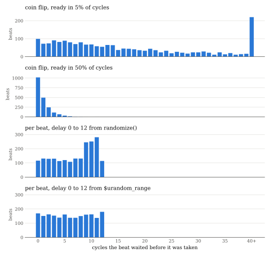

# Reactive agents and backpressure

This page answers: *the design decides when each beat appears on its output. How does a testbench
answer each one, and what kind of backpressure finds bugs?*

Your Lab 04 sink flipped a coin in every cycle: `out_ready` was 1 with probability `ready_pct`
percent, whether or not a beat was on offer. That is backpressure, but one number decides
everything about it. In [Lab 05, Part 1](../labs/lab-05-protocol-rules-and-backpressure-overview.md#part-1-the-lab-04-testbench-against-this-labs-bugs)
the covergroup `cg_wait` counts the packets of the graded test by the longest any of their beats
waited, and with Lab 04's sinks it says:

```text
         0  __vlAnonCG_cg_pkt.cp_len.oversize
       257  __vlAnonCG_cg_wait.cp_wait.none
         2  __vlAnonCG_cg_wait.cp_wait.short_wait
        18  __vlAnonCG_cg_wait.cp_wait.long_wait
        57  __vlAnonCG_cg_wait.cp_wait.stalled
```

Two packets out of 334 had a longest wait of 1 to 3 cycles. A bug that shows only when a beat
waits a cycle or two would hide from that test however many times you ran it. In
[Part 3](../labs/lab-05-protocol-rules-and-backpressure-overview.md#part-3-a-sink-that-answers-each-beat)
you'll finish a sink driver that answers each beat on its own terms, with an item from a sequence.
This page explains how an agent like that is put together, and measures what each kind of sink
produces, on a small design of our own in
[`guide-examples/reactive-agents-and-backpressure/`](https://github.com/uoftasic/dd105-a/tree/main/guide-examples/reactive-agents-and-backpressure).

## Who starts a transfer

Every agent you've written so far was **active**: the testbench decides when something happens.
The source driver calls `get_next_item()`, waits until its sequence hands over a packet, and then
puts the packet on the input. Nothing happens on the input until the testbench decides it should,
so the driver can wait as long as it likes.

A **reactive** agent works the other way round. The design decides when something happens, and the
testbench answers. A sink is the simplest example: the router puts a beat on an output when the
beat gets there, and the sink decides how long to keep it waiting. A memory model that answers a
processor's read requests is another, and a bus slave is a third. The agent has the usual pieces
(an item, a sequence, a sequencer, a driver and a monitor), but each item describes an *answer*
rather than an action, and the driver has to keep driving its side of the interface in every
cycle, whether or not it has an item.

Our example's design, `beat_src`, numbers its beats 0, 1, 2 and so on, and leaves its output idle
for 1 to 4 cycles after each handshake, picked by an LFSR, before the next beat appears. The sink
agent has two modes. In `coin` mode its driver does what Lab 04's did. In `beat` mode each beat is
answered by one `snk_item`, and the item says how many cycles the beat waits after it first
appears:

```systemverilog
class snk_item extends uvm_sequence_item;
  rand bit [4:0] delay;
  int unsigned   max_delay = 12;
  constraint c_delay { int'(delay) <= max_delay; }
  ...
```

A delay of 0 means `ready` is already 1 when the beat appears.

## A sequence that never ends

The sink's sequence makes one item per beat, for as long as the test runs:

```systemverilog
task body();
  forever begin
    it = snk_item::type_id::create("it");
    start_item(it);
    it.max_delay = cfg.max_delay;
    ok = it.randomize();
    if (ok == 0) `uvm_fatal("RAND", "snk_item randomize() failed")
    finish_item(it);
  end
endtask
```

The test never starts it. The agent's own `run_phase` starts it on the agent's sequencer at
time 0, and it never returns. It also raises no objection. The test's objection decides when the
test ends, and a sequence that never finishes would keep the test alive forever if it raised one.
Lab 05's `out_agent` starts its `out_ready_seq` the same way.

Each call to `finish_item()` blocks until the driver has taken the item and called `item_done()`,
so the sequence is never more than one item ahead of the beats. The item the driver holds is the
answer to the beat on offer, or, if no beat is on offer yet, to the next one.

## A driver that can't wait

The driver's loop has two halves, one for each half of the clock cycle:

```systemverilog
forever begin
  @(vif.cb);                                  // a rising edge
  vif.cb.ready <= rdy;                        // ready for the cycle that starts here
  @(negedge vif.clk);                         // the middle of the cycle
  if (vif.valid && rdy) begin                 // a handshake at the next edge
    seq_item_port.item_done();
    it = null;
  end else if (...)
    ...                                       // one more cycle of this beat's wait
  if (it == null)
    seq_item_port.try_next_item(it);          // returns at once, with or without an item
  rdy = ...;                                  // ready in the next cycle
end
```

It drives `ready` just after the rising edge, through the clocking block, and it looks at `valid`
at the falling edge, when everything has settled. At that point it knows whether a beat moves at the
coming edge. If one does, that beat has had its answer, so the driver calls `item_done()`.

The important call is `try_next_item()`. `get_next_item()` blocks until the sequence hands over an
item; `try_next_item()` returns straight away, and leaves the handle `null` if the sequence has
nothing ready. Then the driver keeps `ready` at 0 for that cycle and asks again in the next one.
Lab 05's driver has the same shape, and Part 3 asks you why it is built that way.

The split between the edge and the middle of the cycle matters on this simulator. The comment at the
top of `tb/router_agents_pkg.sv` in Labs 04 to 07 records what the labs found on Verilator 5.050: a drive
issued in the same time step as a clock edge, but after the sequencer has handed over an item,
lands a cycle late. Asking for items in the middle of the cycle and driving only from an edge
keeps the two apart.

The rest of the loop counts the cycles the beat has been on offer, starting from the first cycle it
appears, and sets `rdy` once the item's delay has gone by. You'll write that countdown for the
router in Part 3, so it's left out above.

## Measured waits for each sink

We ran 2,000 beats through each sink and counted, for each beat, the cycles it waited between
appearing and being taken. The buckets are the ones `cg_wait` uses: 0, 1 to 3, 4 to 20, and more
than 20.

| Sink | Waited 0 | 1 to 3 | 4 to 20 | More than 20 | Mean wait |
|---|---|---|---|---|---|
| coin flip, 5% | 99 | 237 | 1014 | 650 | 18.27 |
| coin flip, 50% | 1017 | 854 | 129 | 0 | 0.98 |
| coin flip, 95% | 1907 | 93 | 0 | 0 | 0.05 |
| per beat, delays 0 to 12 from `randomize()` | 116 | 390 | 1494 | 0 | 6.81 |
| per beat, delays 0 to 12 from `$urandom_range` | 169 | 466 | 1365 | 0 | 6.01 |

{width=720 fig-alt="Four bar charts, one above the other, sharing an x-axis of wait in cycles from 0 to 40 or more. Coin flip at 5 percent: about 70 to 100 beats at each wait up to 10, falling slowly, with a tall last bar of 220 beats at 40 or more. Coin flip at 50 percent: 1017 beats at 0, 495 at 1, 246 at 2, halving each cycle to almost nothing by 8. Per beat from randomize, delays 0 to 12: bars of about 110 to 130 from 0 to 8 and at 12, and bars of about 245 to 281 at 9, 10 and 11. Per beat from urandom_range: bars of about 140 to 180 at every wait from 0 to 12, and nothing after."}

A coin-flip sink gives each beat the same chance of being taken in every cycle, so its waits fall
off geometrically. A beat waits $w$ cycles with probability $p\,(1-p)^{w}$, and the mean wait is
$(1-p)/p$: 19 cycles at $p = 5\%$ and 1 cycle at 50%, against our measured 18.27 and 0.98, so one
number sets the whole shape. At 5% almost every beat waits a long time, and only 237 of 2,000
waited 1 to 3 cycles; at 50%, no beat waited more than 11; and at 95% the sink is nearly always
ready. There is no setting of `ready_pct` that gives you plenty of short waits *and* plenty of long
ones. That's why the test you inherit from Lab 04, whose sinks are ready in 5% or 100% of cycles,
produced only two short-wait packets.

A per-beat sink sets each wait directly, so you get whatever mix you ask for, independent of how
fast the design produces beats. The delays 0 to 12 gave between 1,365 and 1,494 beats in the
middle bucket and none above 20. Lab 05's `out_cfg.mode` offers both kinds: `SNK_PCT` is Lab 04's
coin, and `SNK_FAST`, `SNK_SLOW` and `SNK_RANDOM` answer each beat from an item.

## Check the distribution you got

The delays in the fourth row weren't uniform, as the figure shows. With delays from
`randomize()`, the values 9, 10 and 11 came up about twice as often as the others (245, 251 and 281
times out of 2,000 on seed 1, and 234, 235 and 260 on seed 2, where a uniform choice would give
about 154 each). With `$urandom_range(12)` in place of `randomize()`, every value from 0 to 12 came
up between 137 and 180 times. The constraint `delay <= 12` says which values are legal, not how
often the solver picks each one, and on Verilator 5.050 it didn't pick them equally often. That is
the same lesson as Lab 03's: look at what the stimulus actually produced. Lab 05's
`out_ready_item` picks which range a delay comes from in `pre_randomize()`, with `randcase`, and
leaves only the value inside that range to the solver, and `cg_wait` is how you check the result.

## The sink's configuration object

The sink's driver reads its mode and `ready_pct` from a configuration object, `snk_cfg`, in every
cycle, and its sequence reads `max_delay` for every item. So a test, or a virtual sequence, can
change the backpressure in the middle of a run just by writing a field of that object, without
starting anything on the sink's sequencer. In Lab 05, Part 4, `backpressure()` does exactly that
for both outputs, changing each sink's mode every 30 to 250 cycles while packets go in, and
[Virtual sequences](virtual-sequences.md) explains how a sequence gets hold of the object.

## Check yourself

1. A coin-flip sink has `ready_pct` set to 20. What fraction of beats is taken in the cycle it
   appears, and what is the mean wait?

   <details>
   <summary>Answer</summary>

   20% of beats wait 0 cycles, because the coin comes up 1 in the beat's first cycle with
   probability 0.2. The mean wait is $(1-p)/p = 0.8/0.2 = 4$ cycles.

   </details>

2. Why does the sink's sequence raise no objection?

   <details>
   <summary>Answer</summary>

   It never finishes: it makes one item per beat for as long as the design produces beats. If it
   raised an objection, the run phase could never end. The test's own objection, held while the
   source sends its packets and the sinks drain them, decides when the test is over.

   </details>

3. An item with a delay of 0 reaches the driver while the design's output is idle. What does the
   driver drive, and how long does the beat wait when it appears?

   <details>
   <summary>Answer</summary>

   It drives `ready` = 1 from the next edge on, because the item's wait is already over. When the
   beat appears, `ready` is already 1, so the handshake happens in the beat's first cycle and it
   waits 0 cycles. A coin-flip sink can't promise that for any one beat.

   </details>

## Further reading

- [UVM Reactive Sequence](https://www.chipverify.com/uvm/uvm-reactive-sequence): the responder
  pattern for a slave agent, with a sequence that answers requests from a memory model and is
  started in the background with no objection.
- [Using get_next_item()](https://www.chipverify.com/uvm/uvm-using-get-next-item): the
  driver-sequencer handshake, which call blocks and what releases it, and `try_next_item()`.
- [UVM Driver](https://www.chipverify.com/uvm/uvm-driver). Correction: its "simplified" loop
  calls `item_done()` after one edge and never clears the request, which is the mistake the same
  page warns against further down.
- [Using get() and put()](https://www.chipverify.com/uvm/driver-using-get-and-put). Its log comes
  from a different version of the code: the driver's path in the log has an environment the test
  never creates.
- [Handshake Properties](https://chipverify.com/formal-verification/handshake-properties), in the
  formal section, on why a sink that is always ready hides bugs in the sender.

Next: [Virtual sequences](../guide/virtual-sequences.md).
