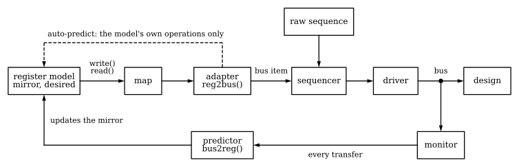

# Register models

This page answers: *what does a UVM register model know about a design's registers, and what does
it do for you that raw bus transfers don't?*

Up to the end of Lab 05, your testbench reached the router's registers with raw APB transfers,
such as `wr(A_ROUTE0, ...)` to set up a route and `rd(A_DROP_CNT)` to read the two drop counters.
The scoreboard checked reads of one register, `DROP_CNT`, and nothing in the testbench read any of
the other nine. So the testbench had no way to notice a register that reset to the wrong value, or
one that read back with its fields swapped. [Lab 06](../labs/lab-06-the-register-block-overview.md)
plants one bug of each of those kinds among its five, and your Lab 05 testbench misses all five. In
that lab you'll give the testbench a **register model**, which is a set of UVM classes that
describes every register and field as the specification's
[Register map](../reference/router-spec.md#register-map) does. The model can also turn an operation
such as "write 1 to `CTRL.EN`" into a bus transfer.

We wrote a small register block for this page, `regblk`, and a testbench for it with a register
model, an adapter and a predictor. Both are in
[`guide-examples/register-models/`](https://github.com/uoftasic/dd105-a/tree/main/guide-examples/register-models),
and the sections below use them to show how those parts work together. The
[UVM register layer](../reference/register-layer.md) reference page has the arguments, policies
and messages you'll look up while you work.

## The example block

`regblk` has four 16-bit registers on a simple bus. Each transfer takes one cycle, in which
`sel` is 1. The block answers in that same cycle, and a write takes effect at the rising edge that
ends it.

| Address | Register | Access | Fields |
|---|---|---|---|
| `0x0` | `ID` | RO | [15:0], reads `105A` |
| `0x4` | `CTRL` | RW | [0] `EN`, [3:1] `MODE`; resets to 0 |
| `0x8` | `FLAGS` | W1C | [0] `OVF`, [1] `ERR`; set by the design when an event happens |
| `0xC` | `COUNT` | RO | [7:0], the number of events since reset |

Apart from a reset, only a write changes `CTRL`, so it holds whatever software last wrote to it,
which here means the testbench. `FLAGS` and `COUNT` change on their own, whenever the design sees
an event. A register model has to treat the two kinds of register differently, and the sections on
volatile fields and on the built-in sequences show how.

## Fields, registers and the map

Each register is a class, and its `build()` creates the register's fields and configures each one.
This is `CTRL`'s:

```systemverilog
virtual function void build();
  en   = uvm_reg_field::type_id::create("en");
  mode = uvm_reg_field::type_id::create("mode");
  en.configure  (this, 1, 0, "RW", 0, 0, 1, 1, 0);
  mode.configure(this, 3, 1, "RW", 0, 0, 1, 1, 0);
endfunction
```

The arguments after `this` are, in order, the field's width, its lowest bit, its access policy,
whether it's **volatile** (changed by the design on its own), its reset value, whether it has a
reset value, whether `randomize()` may choose it, and whether it's alone in its register. Both
fields of `FLAGS` are configured as `"W1C"` with volatile set to 1, and the field in `COUNT` as
`"RO"`, also with volatile set to 1. The register block creates the four registers and puts each
one at its address in a map:

```systemverilog
default_map = create_map("map", 0, 2, UVM_LITTLE_ENDIAN, 1);   // 2 bytes per register
default_map.add_reg(id,    'h0, "RO");
default_map.add_reg(ctrl,  'h4, "RW");
default_map.add_reg(flags, 'h8, "RW");
default_map.add_reg(count, 'hC, "RO");
```

For every field, the model keeps two values. The **mirror** is what the model believes the design
holds right now. The **desired** value is what the testbench last asked for. A read with a check,
such as `mirror(UVM_CHECK)`, compares what the design returns with the mirror, and `update()`
compares the desired value with the mirror to decide whether to write the register. The sections
below show both.

## From a register operation to a transfer

A test calls `regs.ctrl.write(status, 'h0005)`. The model looks up `CTRL` in the map, finds its
address, and hands an abstract operation (a write of `0005` to address `4`) to an **adapter**. The
adapter's `reg2bus()` turns that operation into the sequence item that your bus agent uses, and
the map starts that item on the agent's sequencer, so it goes through the same driver as every other
transfer. When the driver has finished, the adapter's `bus2reg()` turns the item back into an
operation, with the read data and a status, which is `UVM_IS_OK`, or `UVM_NOT_OK` if the bus
reported an error. Those two functions are the only code in the register layer that knows what
your bus looks like, and in Lab 06, Part 2 you'll write them for the router's APB agent.

{width=720 fig-alt="A block diagram. On the left is the register model, which holds a mirror and a desired value for each field. An arrow labelled write and read goes from the model to the map, and further arrows carry the operation on through the adapter's reg2bus, the bus agent's sequencer and the driver, and along the bus into the design. A box labelled raw sequence has its own arrow straight to the sequencer, so its transfers never pass through the model. The bus agent's monitor watches the bus and sends every transfer it sees to a predictor, which calls bus2reg and updates the mirror. A dashed arrow labelled auto-predict runs from the adapter back to the model, for the model's own operations only."}

## Auto-predict and the predictor

The model's mirror follows the bus only if something tells the model about each transfer, and
there are two ways to do that. With **auto-predict** on (`set_auto_predict(1)` on the map), the
model updates the mirror after each operation that it sends itself. The other way is a
**predictor** (`uvm_reg_predictor`), which you connect to the bus monitor's analysis port. It
updates the mirror after every transfer the monitor sees, whoever started it.

Our example's `reg_mirror_test` writes `0005` to `CTRL` through the model, then writes `000b` with
a raw bus sequence that goes around the model, the way Lab 05's `wr()` does. Then it calls
`regs.ctrl.mirror(status, UVM_CHECK)`, which reads `CTRL` and compares the value with the mirror.
We ran it three times, with `+PREDICT=` choosing a different way of keeping the mirror each time:

| `+PREDICT=` | Mirror after the model's write | After the raw write | `mirror(UVM_CHECK)` |
|---|---|---|---|
| `predictor` | `0005` | `000b` | passes |
| `auto` | `0005` | `0005` | `UVM_ERROR` |
| `none` | `0000` | `0000` | `UVM_ERROR` |

With auto-predict, the error was:

```text
UVM_ERROR third_party/uvm/src/reg/uvm_reg.svh(2812) @ 95000: reporter [RegModel] Register "regs.CTRL" value read from DUT (0x000000000000000b) does not match mirrored value (0x0000000000000005) (valid bit mask = 0x000000000000000f)
UVM_INFO third_party/uvm/src/reg/uvm_reg.svh(2833) @ 95000: reporter [RegModel] Field mode (regs.CTRL[3:1]) mismatch read=3'h5 mirrored=3'h2
```

In the first line, the valid bit mask has a 1 for each bit that was compared, which here is all
four bits of `CTRL`'s two fields. The second line names the one field that differs, `MODE`, whose
bits 3 to 1 are `101` (5) in `000b` and `010` (2) in `0005`. The design returned `000b`, the value
that the raw write put there, and the mirror still held `0005` because auto-predict never saw that
write. `regblk` ran as the golden design, with no bug switched on, and a check that fails on the
golden design means the testbench is wrong. This testbench needs a predictor. In Lab 06, Part 3 you connect one
to the APB monitor, which the scoreboard already listens to.

## Volatile fields

`FLAGS` is set by the design, so the model can't know its value until it reads it. The test pulses
the design's `ev_ovf` input, which sets `FLAGS.OVF`, and prints the mirror of `FLAGS` before and
after a `mirror(UVM_CHECK)` of it. These lines are from the run with the predictor:

```text
UVM_INFO guide-examples/register-models/regblk_tb.sv(366) @ 125000: uvm_test_top [RAL] after an overflow event, the mirror of FLAGS is 0000
UVM_INFO guide-examples/register-models/regblk_tb.sv(368) @ 145000: uvm_test_top [RAL] after mirror(UVM_CHECK) reads FLAGS, the mirror is 0001
```

The mirror said `0000` while the design held `0001`, and `mirror(UVM_CHECK)` reported no error,
because the register layer doesn't compare a volatile field when it reads one. The predictor saw
the read and set the mirror to the value read, which is why the second line says `0001`. UVM also
warns you whenever you ask for the mirror of a volatile field. Asking for the mirror of `FLAGS`
printed one warning for each of its two fields, such as
`[UVM/FLD/GET_MIRRORED_VAL/VOL] Mirrored value returned for volatile field "regs.FLAGS.ovf" may not
reflect the actual current value.` So the register model can't check a register like `FLAGS` for
you. The router's `STATUS`, `DROP_CNT` and `LEVEL` are all volatile. In Lab 06 the scoreboard keeps
its own copies of `STATUS` and `INT_EN`, which it updates cycle by cycle the way the router does,
and checks `STATUS` reads and `irq` against them.

## Desired and mirrored values

`set()` changes only the desired value. `update()` then writes the register if the desired value
differs from the mirror. With the predictor connected, the test printed:

```text
UVM_INFO guide-examples/register-models/regblk_tb.sv(373) @ 145000: uvm_test_top [RAL] after set(3) on CTRL.MODE: desired 0007, mirror 000b, needs_update 1
UVM_INFO guide-examples/register-models/regblk_tb.sv(376) @ 165000: uvm_test_top [RAL] after update(): desired 0007, mirror 0007, needs_update 0
```

`MODE` is bits 3 to 1, so setting it to 3, with `EN` still 1, makes the desired value `0111` in
binary, which is `0007`. The mirror held `000b` from the raw write, which the predictor saw. With
`+PREDICT=none` the last line read `desired 0007, mirror 0000, needs_update 1`. The write
happened, but nothing told the mirror about it, so the model would write the register again on
every `update()`.

## The built-in sequences

A register model also gives you stimulus without your writing any, because it knows every
register's access policy and reset value. UVM has built-in sequences that work from the model
alone, and Lab 06 uses two of them. Neither of the two runs on a sequencer of its own. You set its
`model` to the register block and start it with `start(null)`, and it sends its transfers through the model.

`uvm_reg_hw_reset_seq` resets the model to its reset values, then reads every register it can
check and compares each read with the reset value. On `regblk` it printed

```text
... [uvm_reg_hw_reset_seq] Verifying reset value of register regs.ID in map "regs.map"...
... [uvm_reg_hw_reset_seq] Verifying reset value of register regs.CTRL in map "regs.map"...
```

and nothing for `FLAGS` or `COUNT`. Every field in those two registers is volatile, so a read of
either would compare nothing, and the sequence skips a register like that. With the planted bug
`en_reset_1`, which makes `CTRL.EN` reset to 1, it reported

```text
UVM_ERROR third_party/uvm/src/reg/uvm_reg.svh(2812) @ 75000: reporter [RegModel] Register "regs.CTRL" value read from DUT (0x0000000000000001) does not match mirrored value (0x0000000000000000) (valid bit mask = 0x000000000000000f)
UVM_INFO third_party/uvm/src/reg/uvm_reg.svh(2833) @ 75000: reporter [RegModel] Field en (regs.CTRL[0:0]) mismatch read=1'h1 mirrored=1'h0
```

The reset sequence has to run while the design still holds its reset values, which means before
anything has written a register, or straight after a reset.

`uvm_reg_bit_bash_seq` tests every bit it can check, one at a time. For each bit it writes the
register with that bit the opposite of its desired value, reads the register back, and compares
the read with the desired value, and then it does all of that a second time. On a bit you can
write, the second write puts the bit back where it was. The sequence skips the bits of volatile
fields, and it treats a bit with no field as read-only, so it still checks that bits 2 to 15 of
`FLAGS` and 8 to 15 of `COUNT` read 0. On `regblk` it printed `Verifying bits in register` for all
four registers. With the planted bug `mode_stuck`, which makes bit 3 of `CTRL` impossible to set,
it reported the same line once for each of its two writes:

```text
UVM_ERROR third_party/uvm/src/reg/sequences/uvm_reg_bit_bash_seq.svh(211) @ 1595000: reporter@@s.reg_single_bit_bash_seq [uvm_reg_bit_bash_seq] Writing a 1 in bit #3 of register "regs.CTRL" with initial value 'h0000000000000000 yielded 'h0000000000000000 instead of 'h0000000000000008
```

Neither sequence knows anything about `regblk` beyond what the register model describes. In Lab 06
the same two sequences catch two of the five planted bugs, B14 and B03, without a test step written
for either bug.

The model can't send a transfer to an address that has no register, because there's no register
to name, so the router's 246 bad addresses still need raw transfers (Lab 06, Part 4). The model
also knows nothing about what the registers *do* to the rest of the design. The router's `irq`
output depends on `STATUS` and `INT_EN`, and the scoreboard checks it (Part 5).

## The back door

A **back-door** access reads (`peek()`) or writes (`poke()`) a register through the name of the
signal that holds it, with no bus transfer and no simulation time. UVM finds the signal through
VPI, and Verilator lets VPI see a signal only if it's marked public. Lab 06's
`tb/router_regs.vlt` marks the five signals that hold `CTRL`, `STATUS`, `INT_EN` and `DROP_CNT`
(`DROP_CNT`'s two counters are separate signals), one line each. It names them one at a time
because the flag that makes every signal public, `--public-flat-rw`, breaks the UVM build on
Verilator 5.050.

Lab 06's `router_backdoor_test` measures whether a poke sticks on the router. It pokes `CTRL`,
`INT_EN` and `DROP_CNT`, and peeks each one at once, one rising edge later and two rising edges
later. Every peek returned the poked value. These are the lines for `DROP_CNT`:

```text
165000 ps  poke DROP_CNT with                     505   (UVM_IS_OK)
165000 ps    peek at once:                        505   (UVM_IS_OK)
175000 ps    peek one rising edge later:          505   (UVM_IS_OK)
185000 ps    peek two rising edges later:         505   (UVM_IS_OK)
```

That's a measurement of three registers in one design, so before you rely on a poke anywhere else,
peek the register after a rising edge, as that test does. A poke updates the register model's
mirror, as a write of the same value would, but it puts nothing on the bus, so a scoreboard that
keeps its own copy of the register never hears about it. Lab 06's scoreboard learns `DROP_CNT`
only from the transfers it sees on the bus, so after a poke its copy and the router's disagree. In
Part 6 you read the poked value through the front door to see what the scoreboard makes of it. A
peek changes nothing in the design, so it can't leave a copy out of date, and that makes `peek()`
the safer of the two.

## Check yourself

1. A testbench has auto-predict on and no predictor. A test sets up the routing table with raw
   transfers, then runs `mirror(UVM_CHECK)` on `ROUTE0`. What happens, and is the router at
   fault?

   <details>
   <summary>Answer</summary>

   The read returns what the raw transfer wrote, but the mirror still holds the reset value, so
   the register model reports a `[RegModel] ... does not match mirrored value` error, unless the
   raw transfer happened to write the reset value. The router is right. Auto-predict updates the
   mirror only after the model's own operations, so the testbench needs a predictor on the
   monitor, which sees every transfer.

   </details>

2. Why did `uvm_reg_hw_reset_seq` read only `ID` and `CTRL` on `regblk`, and what does the bit
   bash still test in `FLAGS`?

   <details>
   <summary>Answer</summary>

   Every field of `FLAGS` and `COUNT` is volatile, and the register layer doesn't compare a
   volatile field, so a read of either register would check nothing and the reset sequence skips
   them. The bit bash skips the bits of volatile fields too, but bits 2 to 15 of `FLAGS` hold no
   field, so it treats them as read-only and checks that they still read 0 after it writes 1 to
   each.

   </details>

3. After `set(3)` on `CTRL.MODE`, `needs_update` was 1. Which two values differed, and what made
   them equal again?

   <details>
   <summary>Answer</summary>

   The desired value, `0007`, and the mirror, `000b`. `update()` wrote the desired value to the
   register, and the predictor saw the write and set the mirror to `0007`.

   </details>

## Further reading

ChipVerify's register-layer pages (section 12) build one model for one small APB block, across
several pages. Read 12.1 to 12.6 in order.

- [UVM Register Abstraction Layer](https://www.chipverify.com/uvm/uvm-register-layer): registers,
  fields, maps, and the path of a model write down to the bus.
- [UVM Register Model Classes](https://www.chipverify.com/uvm/uvm-register-model), the clearest
  account of the desired and mirrored values. Correction: its block maps the status register with
  `"RO"` rights, but its write-1-to-clear bit can only be cleared through a map that allows writes.
- [UVM Register Environment](https://www.chipverify.com/uvm/uvm-register-environment): the adapter,
  and auto-predict against a predictor.
- [Connecting register env](https://www.chipverify.com/uvm/connecting-register-env): the map's
  sequencer and the predictor's connection, and why each goes in the phase it does.
- [UVM Register Access Methods](https://www.chipverify.com/uvm/uvm-register-access-methods).
  Correction: it says a front-door `write()` or `read()` always updates the mirror. That's true
  only with auto-predict on or a predictor connected, which the same page says further down.
- [UVM Register Model Example](https://www.chipverify.com/uvm/uvm-register-model-example), the whole
  model in one place. It has no top module, so it doesn't run as shown, and its bus item's address
  constraint leaves out the status register the test reads.
- [UVM Register Sequences](https://www.chipverify.com/uvm/uvm-register-sequences): the built-in
  sequences, why the reset test goes before the bit bash, and how to leave a register out.
- [UVM Register Backdoor Access](https://www.chipverify.com/uvm/uvm-register-backdoor-access). On
  Verilator a back door needs UVM's DPI code, `--vpi` and the signals listed in a `.vlt` file, as
  Lab 06 does.

Next: [Regressions and seeds](../guide/regressions-and-seeds.md).
