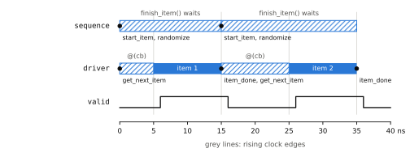
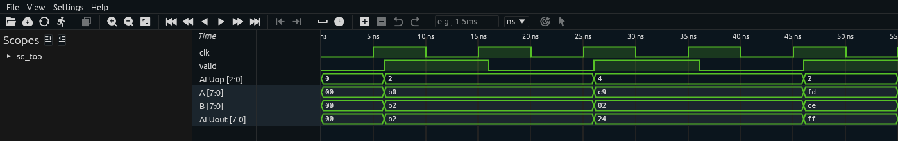

# Sequences, sequencers and drivers

This page answers: *how does a transaction get from the code that makes it to the design's
pins?*

In Labs 02 and 03 the generator made packets and put them into a mailbox, and the driver took
them out one at a time and drove them. In
[Lab 04](../labs/lab-04-the-same-testbench-in-uvm-overview.md) the same job is split three ways.
A **sequence** makes the items, a **sequencer** passes them on, and a **driver** puts each one on
the pins. The table in Lab 04's Part 5 sums up the change: `start_item` and `finish_item`
replace the mailbox `put`, and `get_next_item` and `item_done` replace the mailbox `get`. The
driver's own work, the idle gaps and the clocking-block drives, moved across unchanged.

This page follows one item through that path. The example,
[`guide-examples/sequences-sequencers-and-drivers/`](https://github.com/uoftasic/dd105-a/tree/main/guide-examples/sequences-sequencers-and-drivers),
drives SimProc's ALU from Lab 01 and prints a line at every step, with the time.

## The pieces

The item is a `uvm_sequence_item`, an object with `rand` fields, like Lab 04's `router_pkt` or
the example's `alu_item` (an operation and two operands).

A sequence is also an object, not a component. It extends `uvm_sequence #(alu_item)`, and its
`body()` task makes items and sends them. It exists only while something runs it: a test makes
one, sets its knobs and calls `seq.start(sequencer)`, and `start()` returns when `body()` has
finished.

The sequencer is a component in the agent. It sits between any number of sequences and one
driver, and hands the driver one item at a time. You hardly ever write one; Lab 04 declares each
of its two sequencers with a `typedef`:

```systemverilog
typedef uvm_sequencer #(router_pkt) src_sequencer;
```

The driver is a component that extends `uvm_driver #(router_pkt)`. That base class gives it a
port, `seq_item_port`, which the agent connects to the sequencer in `connect_phase`:

```systemverilog
drv.seq_item_port.connect(sqr.seq_item_export);
```

The driver's port connects to the sequencer, and not the other way round, because the driver
asks for an item whenever it's ready for one; the sequencer never pushes one at it. That lets the
driver set the pace: it takes the next item only when the pins can take it, and the sequence
waits until then.

## One item through the handshake

Here is the example sequence's loop and the driver's:

```systemverilog
// alu_rand_seq::body()
req = alu_item::type_id::create("req");
start_item(req);                       // wait until the driver asks for an item
if (!req.randomize()) `uvm_fatal("RAND", "randomize() failed")
finish_item(req);                      // hand it over; wait until the driver is done

// alu_driver::run_phase()
forever begin
  seq_item_port.get_next_item(req);    // wait for an item
  @(vif.drv_cb);                       // drive from a clock edge
  vif.drv_cb.valid <= 1'b1;
  vif.drv_cb.ALUop <= req.op;
  vif.drv_cb.A     <= req.A;
  vif.drv_cb.B     <= req.B;
  @(vif.drv_cb);                       // the vector holds for one cycle
  vif.drv_cb.valid <= 1'b0;
  seq_item_port.item_done();           // let finish_item() return
end
```

(The real files also print a line at each step, and tag each item with its sequence's name.)
`sq_timeline_test` runs it for three items, with a 10 ns clock whose first rising edge is at
5 ns:

```text
0    ns  [drv]    get_next_item: waiting for an item
0    ns  [seq a]  start_item(req): waiting for the sequencer
0    ns  [seq a]  start_item returned; randomize()
0    ns  [drv]    get_next_item returned a: OR A=b0 B=b2
15   ns  [drv]    item_done, ALUout was b2
15   ns  [drv]    get_next_item: waiting for an item
15   ns  [seq a]  finish_item returned: a: OR A=b0 B=b2 is done
15   ns  [seq a]  start_item(req): waiting for the sequencer
15   ns  [seq a]  start_item returned; randomize()
15   ns  [drv]    get_next_item returned a: SHL A=c9 B=02
35   ns  [drv]    item_done, ALUout was 24
```

`start_item()` returns once the sequencer has picked this sequence and the driver is waiting for
an item. At time 0 the driver was already waiting, so it returned at once. The sequence then
randomizes the item, and `finish_item()` hands it over: the driver's `get_next_item()` returns
with it in the same time step, and `finish_item()` blocks. The driver waits for the clock edge at
5 ns, drives the vector through its clocking block (it reaches the pins 1 ns later, the block's
output skew), holds it through the edge at 15 ns, and calls `item_done()`. Only then does
`finish_item()` return, so the sequence's loop runs at the driver's pace, one item every 20 ns
here. In the timing diagram:



*The handshake for the first two items of `sq_timeline_test`. The sequence spends most of its
time blocked in `finish_item()`, and the driver spends most of its time waiting on clock edges.*

And on the ALU's pins, recorded with `make waves`:



*The three vectors on the ALU's pins. Each one goes on 1 ns after a rising edge and holds for one
cycle, and `ALUout` shows the ALU's answer (`b2`, `24`, `ff`). The cycle with `valid` low between
them is the driver's `valid <= 0` before it asks for the next item.*

The sequence randomizes the item after `start_item()` returns, so the item gets its values at
the moment the driver is ready for it rather than when the sequence made it. The constraints can
use anything the sequence sets before that. Lab 04's `router_rand_seq` gives each packet
the enable bits of the routing table the test wrote for the phase (`route_en`) before it
randomizes the packet, and the packet's `c_dst` constraint uses them to keep it on an enabled
route.

## Two sequences on one sequencer

A sequencer can serve several sequences at once, which is how one test can run background
traffic and a directed burst on the same agent. `sq_two_test` starts two sequences, `a` and `b`,
of two items each, in a `fork`:

```text
0    ns  [seq a]  start_item(req): waiting for the sequencer
0    ns  [seq b]  start_item(req): waiting for the sequencer
0    ns  [seq a]  start_item returned; randomize()
0    ns  [drv]    get_next_item returned a: SUB A=05 B=80
15   ns  [seq a]  finish_item returned: a: SUB A=05 B=80 is done
15   ns  [seq a]  start_item(req): waiting for the sequencer
15   ns  [seq b]  start_item returned; randomize()
15   ns  [drv]    get_next_item returned b: OR A=cc B=ea
35   ns  [seq b]  finish_item returned: b: OR A=cc B=ea is done
35   ns  [seq b]  start_item(req): waiting for the sequencer
35   ns  [seq a]  start_item returned; randomize()
35   ns  [drv]    get_next_item returned a: SHR A=79 B=bd
```

The items alternate. The sequencer's default arbitration grants requests in the order they
arrived, and each sequence asks again only after its last item is done, so `b`'s waiting request
is always older than `a`'s new one. A second sequence on a busy sequencer competes with the one
already there, which is why Lab 05's virtual sequence steers each sink's backpressure through its
`out_cfg` rather than by starting another sequence on the sink's sequencer.

## Sequences that start sequences

A sequence's `body()` can start other sequences on the same sequencer with
`child.start(m_sequencer, this)`, where `m_sequencer` is the sequencer the parent is running on.
That lets you build larger sequences out of small ones that each do one thing.
`sq_nested_test` runs a sequence that sends two random vectors and then two directed SUBs:

```text
35   ns  [seq r]  finish_item returned: r: SHR A=db B=14 is done
35   ns  [drv]    get_next_item returned sub: SUB A=5a B=5a
55   ns  [drv]    item_done, ALUout was 00
55   ns  [seq sub] sent sub: SUB A=5a B=5a
55   ns  [drv]    get_next_item returned sub: SUB A=5a B=21
75   ns  [drv]    item_done, ALUout was 39
```

The directed sequence doesn't call `randomize()` at all. It sets `op`, `A` and `B` by hand
between `start_item()` and `finish_item()`. That's the simplest way to send exactly the item you
mean, and on this simulator it also avoids the failures that `randomize() with { ... }` has when a
field has a `dist` (see [Constrained random on Verilator](constrained-random-on-verilator.md)).

A test is the outermost caller. Lab 04's base test writes a register by starting a one-item
sequence on the APB agent's sequencer:

```systemverilog
task write_reg(bit [7:0] addr, bit [31:0] data);
  apb_rw_seq s = apb_rw_seq::type_id::create("wr");
  s.write = 1;
  s.addr  = addr;
  s.wdata = data;
  s.start(env.apb.sqr);
endtask
```

`read_reg()` does the same with `write = 0`, and reads the result out of the item afterwards.
That works because the APB driver fills in `rdata` before it calls `item_done()`, and
`start()` doesn't return until then.

## Driving from a clock edge

Lab 04's drivers wait for a clock edge before their first drive of an item, as the example's does
with `@(vif.drv_cb)` straight after `get_next_item()`. The reason is a timing
detail of this simulator that the course's reference testbench found
([`labs/ref/README.md`](https://github.com/uoftasic/dd105-a/tree/main/labs/ref), "A
clocking-block drive issued after an NBA-region wait lands a cycle late"). `try_next_item()`
doesn't return until the nonblocking assignments of its time step have been made, and a
clocking-block drive issued after that, in the same time step as a clock edge, takes effect at the
next edge instead of this one. Lab 04's drivers ran into the same delay with items that the
sequencer handed over in the time step of an edge. Waiting for an edge after getting the item puts every
drive at the start of a time step. Lab 01's driver gets the same result the other way round: it
calls `try_next_item()` before it waits for the edge.

Drive through the clocking block, too, as every driver here does. On Verilator 5.050 a
module-level task that does `x <= 1; @(posedge clk); x <= 0;`, called in a `repeat` loop, loses
some of its assignments; class drivers kept every assignment in every shape the course tried, but
the clocking block is correct everywhere (`labs/common/README.md`, "Drive through a clocking
block").

## Check yourself

1. In `sq_timeline_test`, `finish_item()` for the first item returns at 15 ns, not at 0 ns. What
   is it waiting for?

   <details>
   <summary>Answer</summary>

   The driver's `item_done()`. The driver got the item at 0 ns, drove it after the edge at 5 ns,
   held it through the edge at 15 ns and only then called `item_done()`, which let
   `finish_item()` return.

   </details>

2. At what time is the second item randomized, and what has to happen first?

   <details>
   <summary>Answer</summary>

   At 15 ns. Its `start_item()` can't return until the driver asks for another item, and the
   driver asks only after it has driven the first item, held it through the edge at 15 ns and
   called `item_done()`.

   </details>

3. Lab 04's `close_holes()` needs its fill packets to arrive exactly as it built them, with set
   lengths. Should it use `router_rand_seq` with `randomize() with { len == n; }`?

   <details>
   <summary>Answer</summary>

   No. `router_pkt` has a `dist` on `kind`, and an inline constraint that rules out the entry the
   `dist` picked makes the call fail. It makes the packets by hand (`router_pkt::make()`) and
   sends each one with a sequence that only calls `start_item()` and `finish_item()`, which is what
   Lab 04's `router_one_seq` does.

   </details>

## Further reading

ChipVerify's walkthrough builds these pieces for a small register file:
[Defining the Transaction Class](https://www.chipverify.com/uvm/uvm-defining-the-transaction-class),
[UVM Sequence](https://www.chipverify.com/uvm/uvm-sequence),
[UVM Sequencer](https://www.chipverify.com/uvm/uvm-sequencer) and
[UVM Driver](https://www.chipverify.com/uvm/uvm-driver). Two corrections for those pages: the
driver page's "simplified" `get_next_item()` loop never clears the request signals, which is the
mistake that page's own list of common mistakes warns about, and the transaction page's exercise
solution adds an `idle` field that can never be 1 while the original constraint stays in.

- [Using get_next_item()](https://www.chipverify.com/uvm/uvm-using-get-next-item), for the
  handshake in more detail, with `try_next_item()` and responses.
- [How to execute sequences via start()](https://www.chipverify.com/uvm/how-to-execute-sequences-via-start-method),
  for the arguments of `start()` and the hooks around `body()`. Its example test starts a sequence
  without raising an objection, which works there only because the sequence uses no simulated
  time.
- [UVM Sequence Arbitration](https://www.chipverify.com/uvm/uvm-sequence-arbitration), for the
  other ways a sequencer can choose between sequences.
- [Executing Sequences with uvm_do Macros](https://www.chipverify.com/uvm/how-to-execute-sequences-via-uvm-do-macros)
  shows what the macros expand into. This course writes `start_item` and `finish_item` out
  instead, and the macros' expansions on that page come from an older version of UVM than the
  course's library.

Next: [Monitors, analysis ports and scoreboards](../guide/monitors-analysis-ports-and-scoreboards.md).
