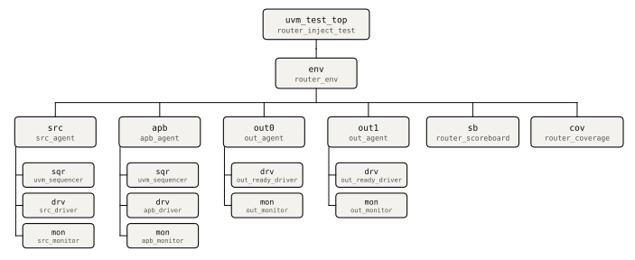
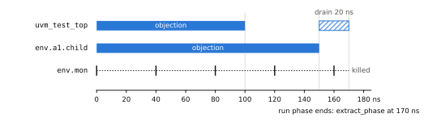

# The UVM skeleton

This page answers: *what are the pieces of a UVM testbench, and in what order does UVM run
them?*

Labs 02 and 03 used one piece of UVM, the test. Your test extended `dd105_base_test` so that
`make` could choose it with `+UVM_TESTNAME` and read UVM's report at the end, and inside its
`run_phase` it fetched the virtual interfaces from `config_db`, made the environment with `new()`
and ran it like any other class. In
[Lab 04](../labs/lab-04-the-same-testbench-in-uvm-overview.md) the whole testbench becomes UVM
classes. Lab 04's Part 5 counts what that costs in lines, and most of those lines go into the
structure this page describes: every piece becomes a component in a tree, UVM builds the tree
and connects it in a fixed order, and a few rules decide when the run ends.

The example for this page,
[`guide-examples/the-uvm-skeleton/`](https://github.com/uoftasic/dd105-a/tree/main/guide-examples/the-uvm-skeleton),
has no design at all. It's a test, an environment and two agents with one child each, and every
one of them prints a line when each of its phases runs, so you can watch the order.

## Objects and components

Everything in a UVM testbench extends one of two classes.

A **`uvm_object`** is data: a packet, an APB transfer, a set of knobs for an agent. You make one
whenever you need it, pass it around and drop it, and many of them come and go in a run. Lab 04's
`router_pkt`, `stream_beat`, `apb_item` and `out_cfg` are objects.

A **`uvm_component`** is a part of the testbench's structure. It's made once, at the start, and
lasts for the whole run. Every component has a name and a parent, given to its constructor as
`new(name, parent)`, and the parents link the components into a tree. Lab 04's tree looks like
this:



*The components that `router_base_test` and `router_env` build in Lab 04. Every name you see in a
UVM message is a path down this tree, such as `uvm_test_top.env.out1.mon` for the monitor on
output 1.*

The top of the tree is always the test, and UVM always names it `uvm_test_top`. The test makes
the environment, `env`, and the environment makes the agents, the scoreboard and the coverage
collector. An agent bundles the pieces that deal with one interface: a driver that drives its
pins, a monitor that watches them, and, if the agent sends items, a sequencer that hands the
driver its items.

The library has a class for each of these jobs: `uvm_test`, `uvm_env`, `uvm_agent`, `uvm_driver`,
`uvm_monitor`, `uvm_sequencer`, `uvm_scoreboard` and `uvm_subscriber`. Most of them add little or
nothing to `uvm_component`. `uvm_driver` adds the port it gets items through and
`uvm_subscriber` adds the port it receives transactions on, which the next two pages describe,
but `uvm_monitor` and `uvm_scoreboard` are plain components with a name that says what they're
for. Lab 04's output agent shows the difference: `out_ready_driver` takes no items, so it extends
`uvm_component` rather than `uvm_driver`.

Every class also has a registration line, `` `uvm_object_utils(router_pkt) `` or
`` `uvm_component_utils(router_env) ``, which tells UVM's factory the class exists, and the
components are made with `router_env::type_id::create("env", this)` instead of `new()`. The
[factory page](the-factory-and-config-db.md) explains what that buys; for now, it's the reason
`+UVM_TESTNAME` can name a test that nothing in the code mentions.

## run_test() and +UVM_TESTNAME

Every lab's top module ends the same way: it makes the clock, the design and the interfaces, puts
each interface into `config_db` for the components that will need it, and calls `run_test()`.
`run_test()` reads `+UVM_TESTNAME`, asks the factory for a component of that class, names it
`uvm_test_top`, and starts the phases. That's how one build serves every test in a lab.

If the name doesn't match a registered class, no test is built. This is
`make run UVM_TESTNAME=sk_phase_tset`, with two letters swapped:

```text
UVM_WARNING @ 0: reporter [BDTYP] Cannot create a component of type 'sk_phase_tset' because it is not registered with the factory.
UVM_FATAL @ 0: reporter [INVTST] Requested test from command line +UVM_TESTNAME=sk_phase_tset not found.
```

and the simulator's exit status was 0. The last section of this page comes back to that.

## Phases

UVM doesn't let components run as soon as they're made. It calls a fixed list of methods, the
**phases**, on every component in the tree, and finishes each phase everywhere before it starts
the next. A component overrides the phases it needs. The ones you'll write are:

| Phase | Kind | Order in the tree | What goes in it |
|---|---|---|---|
| `build_phase` | function | top down | make the children; read configuration |
| `connect_phase` | function | bottom up | connect ports between children |
| `end_of_elaboration_phase` | function | bottom up | print or check the finished tree |
| `start_of_simulation_phase` | function | bottom up | last settings before time moves |
| `run_phase` | task | all at once | everything that takes simulated time |
| `extract_phase`, `check_phase`, `report_phase` | function | bottom up | collect results, look for leftovers, print summaries |
| `final_phase` | function | top down | the very end |

The function phases take no simulated time. The run phase is a task, and UVM starts every
component's `run_phase` at the same moment, each in its own thread. Here is the start of
`sk_phase_test`'s output:

```text
0    ns  build_phase                uvm_test_top
0    ns  build_phase                uvm_test_top.env
0    ns  build_phase                uvm_test_top.env.a0
0    ns  build_phase                uvm_test_top.env.a0.child
0    ns  build_phase                uvm_test_top.env.a1
0    ns  build_phase                uvm_test_top.env.a1.child
0    ns  build_phase                uvm_test_top.env.mon
0    ns  connect_phase              uvm_test_top.env.a0.child
0    ns  connect_phase              uvm_test_top.env.a0
0    ns  connect_phase              uvm_test_top.env.a1.child
0    ns  connect_phase              uvm_test_top.env.a1
0    ns  connect_phase              uvm_test_top.env.mon
0    ns  connect_phase              uvm_test_top.env
0    ns  connect_phase              uvm_test_top
```

The build phase has to go from the top down, because a component's children don't exist until
its own `build_phase` makes them: `env` can't be built before the test's `build_phase` has created
it. Within each parent, this library visited the children in name order (`a0`, `a1`, `mon`),
although `env` made them in the order `mon`, `a1`, `a0`.

The connect phase goes from the bottom up, so by the time `env` connects its agents' monitors to
the scoreboard, every agent has already connected its own pieces. That's also why a component
connects ports in `connect_phase` and never in `build_phase`: in `build_phase` the component on
the other end may not exist yet.

In `end_of_elaboration_phase` the test asks UVM to print the tree it has built:

```text
Name            Type           Size  Value
------------------------------------------
<unnamed>       uvm_root       -     @64  
  uvm_test_top  sk_phase_test  -     @150 
    env         sk_env         -     @220 
      a0        sk_agent       -     @244 
        child   sk_leaf        -     @252 
      a1        sk_agent       -     @236 
        child   sk_leaf        -     @260 
      mon       sk_watcher     -     @228 
```

## Objections

The run phase has no natural end. A driver loops forever asking for items and a monitor loops
forever watching pins, so UVM needs another way to know that the test is finished. It counts
**objections**. A component that is in the middle of something calls
`phase.raise_objection(this)`, and `phase.drop_objection(this)` when it's done, and the run phase
ends once nobody holds an objection. A component can also set a **drain time**, which keeps the
phase open for that long after the last objection drops, so that anything still in flight can
arrive.

In `sk_phase_test` the test holds an objection for 100 ns and sets a drain time of 20 ns,
`env.a1.child` holds one for 150 ns, and `env.mon` loops forever, printing every 40 ns:

```text
0    ns  run_phase starts           uvm_test_top.env.a0.child
0    ns  run_phase starts           uvm_test_top.env.a1.child
0    ns  run_phase: still looping   uvm_test_top.env.mon
0    ns  run_phase starts           uvm_test_top
40   ns  run_phase: still looping   uvm_test_top.env.mon
80   ns  run_phase: still looping   uvm_test_top.env.mon
100  ns  drops after 100 ns         uvm_test_top
120  ns  run_phase: still looping   uvm_test_top.env.mon
150  ns  drops after 150 ns         uvm_test_top.env.a1.child
160  ns  run_phase: still looping   uvm_test_top.env.mon
170  ns  extract_phase              uvm_test_top.env.a0.child
```



*The run phase of `sk_phase_test`. When the test dropped its objection at 100 ns, `a1.child`
still held one. The phase ended 20 ns after that one dropped, at 170 ns, and UVM killed the
monitor's loop, which had been running the whole time without holding the phase open.*

`sk_noobj_test` is the same environment with nobody raising an objection. Every `run_phase` starts
at 0 ns, and the phase ends at once:

```text
0    ns  run_phase starts           uvm_test_top
0    ns  extract_phase              uvm_test_top.env.a0.child
```

That's an easy way for a new UVM test to pass without testing anything: the test starts its
sequence in `run_phase` and forgets the objection, so the run ends before the first item reaches
the driver. Lab 04's `router_base_test` raises its objection at the start of `run_phase`,
runs the test's `body()` and drops the objection when `body()` returns, so every test built on it
gets this right. It also runs a watchdog beside `body()`, which reports an error if the test is
still running after `+MAX_CYCLES` cycles, because a test that holds its objection forever never
ends on its own either.

## After the run phase

The three phases after the run phase are where the checks that need the whole run happen.
Lab 04's scoreboard uses `check_phase` to report every beat it expected and never saw, and
`report_phase` to print the `[SB]` lines you'll read in every run. Then UVM prints its report
summary, which counts every message by severity.

Verilator ends a UVM run with exit status 0 even when the summary counts errors, so a script that
trusts the exit status would call a failing test a pass. `dd105_base_test`, which every test in
the course extends, fixes that. In its `final_phase`, and in `pre_abort` when a `UVM_FATAL` ends
the run early, it prints `DD105: TEST PASSED` or `DD105: TEST FAILED`, and calls `$fatal` if UVM
counted any error or fatal. `sk_error_test` reports one `UVM_ERROR` at 50 ns:

```text
UVM_ERROR guide-examples/the-uvm-skeleton/sk_pkg.sv(186) @ 50000: uvm_test_top [CHECK] a check failed at 50 ns
```

and ends with

```text
DD105: TEST FAILED (1 UVM_ERROR, 0 UVM_FATAL)
[150000] %Fatal: dd105_pkg.sv:89: Assertion failed in dd105_pkg.dd105_base_test.m_end_of_test: DD105: UVM counted errors, so the exit status is nonzero
```

and an exit status of 1. The `UVM_ERROR` line has the same shape as every UVM message in the
labs: the severity, the file and line that reported it, `@` and the time, the full name of the
component, the message's ID in brackets, and the text. The time is in picoseconds, the
simulator's precision, so `@ 50000` is 50 ns.

The misspelt test name earlier is the one case the base test can't help with: no test was built,
so there was no `final_phase` to hook, and the `UVM_FATAL` run exited with status 0. That's why the
course's `make run` reads the log as well as the exit status, and it called that run
`BROKEN: UVM_FATAL [INVTST]`.

## Check yourself

1. Why can't a scoreboard connect a monitor's analysis port to itself in its `build_phase`?

   <details>
   <summary>Answer</summary>

   The monitor may not exist yet. It's made in its agent's `build_phase`, and the agent's
   `build_phase` can run after the scoreboard's. In Lab 04, `env`'s children are built in name
   order, as `a0`, `a1` and `mon` were above, so `sb` is built before `src`, and `src.mon`
   doesn't exist yet when `sb`'s `build_phase` runs. By `connect_phase` every component has been
   built.

   </details>

2. A test's `run_phase` starts a sequence of 200 packets on the input agent and doesn't raise an
   objection. What happens, and what would the scoreboard's `check_phase` see?

   <details>
   <summary>Answer</summary>

   The run phase ends at time 0, as `sk_noobj_test`'s did, before any packet reaches the pins.
   The scoreboard expected nothing and saw nothing, so `check_phase` finds no leftover beats. A
   scoreboard that also counts what it checked can catch this, as the one in
   [Monitors, analysis ports and scoreboards](monitors-analysis-ports-and-scoreboards.md) does by
   reporting an error when it checked nothing.

   </details>

3. A run's log ends with a `UVM_FATAL`, and the simulator exited with status 0. Was the test
   built?

   <details>
   <summary>Answer</summary>

   No. A test that extends `dd105_base_test` turns a `UVM_FATAL` into a nonzero exit status in
   `pre_abort`, so a fatal with status 0 means no such test existed, as with a misspelt
   `UVM_TESTNAME`. `make tests` lists the names the lab knows.

   </details>

## Further reading

- ChipVerify's [Build Your First UVM Testbench](https://www.chipverify.com/uvm/uvm-build-your-first-testbench)
  walkthrough builds one testbench for a small register file over 17 pages, one component per
  page, and assembles it on the last,
  [Full UVM Testbench](https://www.chipverify.com/uvm/full-uvm-testbench). Two things to know as
  you read it: its testbench top module ([UVM Testbench Top](https://www.chipverify.com/uvm/uvm-testbench-top))
  never drives reset, which only the last page fixes; and its coverage collector
  ([UVM Subscriber](https://www.chipverify.com/uvm/uvm-subscriber)) has coverpoints that read a
  class member, which Verilator 5.050 drops with a `COVERIGN` warning (see
  [Functional coverage you can read](functional-coverage-you-can-read.md)).
- [UVM Phases](https://www.chipverify.com/uvm/uvm-phases) and
  [UVM Objection](https://www.chipverify.com/uvm/uvm-objection), for every phase including the
  twelve run-time sub-phases this course doesn't use, and objections raised from sequences.
- [UVM Component](https://www.chipverify.com/uvm/uvm-component) and
  [UVM Object](https://www.chipverify.com/uvm/uvm-object).

Next: [Sequences, sequencers and drivers](../guide/sequences-sequencers-and-drivers.md).
