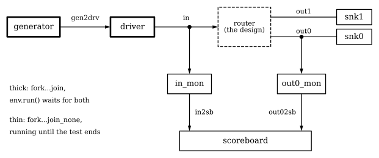

# Threads, mailboxes and events

This page answers: *a testbench has to drive, watch and check all at once. How do SystemVerilog
classes run side by side, and how do they hand packets to each other?*

Lab 02's environment runs seven objects at the same time: a generator, a driver, two monitors, two
sinks and a scoreboard. Each object's `run()` task is a separate **thread**, a piece of code that
runs alongside the others and can wait for a clock edge, a delay or a packet without holding them
up. The objects pass packets to each other through three **mailboxes**. The scoreboard
you'll write in [Lab 02](../labs/lab-02-a-class-testbench-without-uvm-overview.md), Part 3 runs two
threads of its own, one for each mailbox it reads. This page covers `fork` and its three kinds of
`join`, what goes wrong when you fork threads in a loop, mailboxes, events, and how to stop threads
you no longer want.

{fig-alt="A block diagram. A generator box has an arrow labelled gen2drv to a driver box, which has an arrow labelled in to a dashed box labelled router (the design). The router's outputs out1 and out0 go to boxes labelled snk1 and snk0. A dot on the in arrow leads down to an in_mon box, and a dot on the out0 line leads down to an out0_mon box. Arrows labelled in2sb and out02sb lead from the two monitors to a scoreboard box at the bottom. The generator and driver have thick outlines; the note says thick boxes are started with fork...join and env.run() waits for both, and thin boxes with fork...join_none, running until the test ends."}

*From Lab 02's `env.svh`. Each solid box is an object whose `run()` is one thread, and the dashed
box is the router. The arrows labelled `gen2drv`, `in2sb` and `out02sb` are the three mailboxes,
and `in`, `out0` and `out1` are the router's streams. The generator and the driver, in thick boxes,
are started with `fork ... join`. The sinks, the monitors and the scoreboard are started with
`fork ... join_none` and run until the test ends.*

We ran every example on this page in the course image. The source is in
[`guide-examples/threads-mailboxes-and-events/`](https://github.com/uoftasic/dd105-a/tree/main/guide-examples/threads-mailboxes-and-events),
and `guide-examples/README.md` gives the command for each output, in its section for this page.

## fork and its three joins

`fork` starts each statement between it and its `join` as a thread of its own. The thread that ran
the `fork` is called the parent, and the three kinds of `join` differ only in how long the parent
waits before it goes on. The example's `fork_test` forks the same three threads three times, once
with each kind of `join`. Threads A, B and C finish 10, 20 and 30 ns after they start:

```systemverilog
fork
  #10 $display("%0d ns:   A finished", $time);
  #20 $display("%0d ns:   B finished", $time);
  #30 $display("%0d ns:   C finished", $time);
join            // then join_any, then join_none
```

```text
0 ns: fork...join
10 ns:   A finished
20 ns:   B finished
30 ns:   C finished
30 ns: the parent goes on after join
30 ns: fork...join_any
40 ns:   A finished
40 ns: the parent goes on after join_any
50 ns:   B finished
60 ns:   C finished
60 ns: wait fork returns
60 ns: fork...join_none
60 ns: the parent goes on after join_none
70 ns:   A finished
80 ns:   B finished
90 ns:   C finished
90 ns: wait fork returns
```

- `join` waits for every thread, so the parent went on at 30 ns, when the slowest one finished.
- `join_any` waits for the first thread to finish, so the parent went on at 40 ns, when A finished.
  It doesn't stop the other two, and B and C kept running until 50 and 60 ns.
- `join_none` doesn't wait at all, so the parent went on at 60 ns, the moment it forked them.
- `wait fork` waits until every thread the parent has forked so far has finished. The example calls
  it after `join_any` and after `join_none`, so that all three threads have finished before it
  moves on.

Lab 02's `env::run()` uses two of these. It starts the sinks, the monitors and the scoreboard with
`fork ... join_none`, because each of them runs a `forever` loop that never finishes. Then it starts
the generator and the driver with `fork ... join`, because the rest of the test has to wait until
the driver has sent every packet. Once they've finished, it waits 50 cycles for the outputs to
drain and calls the scoreboard's `report()`. The `forever` threads are still running at that
point, and they run on until the test ends.

## Threads forked in a loop

A forked thread shares its variables with the code around it. That's what you want when two
threads share a counter, but not when you fork a thread in each pass of a loop and each thread is
meant to see the value from its own pass. `capture_test` forks three threads that each print the
loop variable 1 ns later, and then three that each print a copy of it made inside the loop:

```systemverilog
for (int i = 0; i < 3; i++)
  fork
    #1 $display("%0d ns:   i = %0d", $time, i);
  join_none
#5;
for (int i = 0; i < 3; i++) begin
  int j = i;
  fork
    #1 $display("%0d ns:   j = %0d", $time, j);
  join_none
end
```

```text
0 ns: three threads print the loop variable i
1 ns:   i = 3
1 ns:   i = 3
1 ns:   i = 3
5 ns: three threads print j, a copy made in each pass
6 ns:   j = 0
6 ns:   j = 1
6 ns:   j = 2
```

The three threads in the first loop share one `i`, and by the time they print it, the loop has
finished and left it at 3. In the second loop, `j` is declared inside the loop body. This code is
in a method of a class, and as [Classes for testbenches](../guide/classes-for-testbenches.md)
explained, a method's local variables are automatic. Each pass through the loop body therefore
makes a new `j`, and each thread keeps the `j` from its own pass.

The same loop goes wrong in a module's `initial` block, where variables are static unless you
declare them `automatic`. There, `int j = i;` declares a single variable, and its initializer runs
once, before the simulation starts, so all three threads print the same `j`. The example's top
module runs the loop in its `initial` block twice, first with `int j = i;` and then with
`automatic int j = i;`:

```text
0 ns: in a module's initial block, int j = i
1 ns:   j = 0
1 ns:   j = 0
1 ns:   j = 0
5 ns: in a module's initial block, automatic int j = i
6 ns:   j = 0
6 ns:   j = 1
6 ns:   j = 2
```

Verilator warns about this (`%Warning-IMPLICITSTATIC`, "The initializer value will only be set
once"), but `IMPLICITSTATIC` is one of the five warnings the labs' build turns off, so you'll only
see it from `make lint`. Write `automatic` whenever you declare a variable with an initializer
inside an `initial` or `always` block, or inside a task or function that isn't in a class.

## Mailboxes

A mailbox carries values from threads that `put()` them to threads that `get()` them, in the order
they were put. `get()` waits while the mailbox is empty, and if you gave the mailbox a size when you
made it, `put()` waits while it's full. `mailbox_test` has a generator that makes four items as fast
as it can and a driver that takes 10 ns over each, joined by a `mailbox #(int)`. We ran it once with
no limit on the mailbox and once with room for one item:

```text
mailbox bound 0 (unbounded)
0 ns: gen put 0
0 ns: gen put 1
0 ns: gen put 2
0 ns: gen put 3
0 ns: gen has made all four
0 ns:   drv got 0
10 ns:   drv got 1
20 ns:   drv got 2
30 ns:   drv got 3
```

```text
mailbox bound 1
0 ns: gen put 0
0 ns:   drv got 0
0 ns: gen put 1
10 ns:   drv got 1
10 ns: gen put 2
20 ns:   drv got 2
20 ns: gen put 3
20 ns: gen has made all four
30 ns:   drv got 3
```

With the unbounded mailbox, the generator made all four items at 0 ns, and the driver worked
through them, one every 10 ns. With room for one, each `put()` waited until the driver had taken
the item before it, so the generator kept pace with the driver and finished at 20 ns. The driver
got the same items at the same times both ways.

Lab 02's mailboxes are all unbounded (`gen2drv = new();`), so its generator makes every packet at
the start and the driver works through them. The monitors' mailboxes are the other way round, with
the reader waiting for the writer. A monitor puts a packet into its mailbox each time one finishes
on its stream, and the scoreboard's `get()` waits until the next one arrives. The scoreboard reads
both of these mailboxes, which it calls `from_in` and `from_out0`, and the two fill at their own
pace. A thread waiting in
`from_out0.get()` can't take a packet from `from_in` at the same time, so the scoreboard runs two
threads. One predicts each input packet as it arrives, and the other checks each packet from output
0 against the predictions made so far.

The `#(int)` in `mailbox #(int)` is the type of value the mailbox carries. Lab 02's mailboxes are
`mailbox #(packet)`, so they carry handles to packets, and a `get()` hands the receiving thread
the same object that the sender made.
[Classes for testbenches](../guide/classes-for-testbenches.md#the-same-object-kept-three-times)
showed the same thing with a queue.

## Events

An `event` lets one thread signal others without passing a value. `->done` triggers the event
`done`, and every thread waiting for it goes on. There are two ways to wait for an event, and they
differ in what happens when the trigger comes before the wait. `event_test` triggers `done` at
10 ns and then, in the same time step, starts one thread that waits with `@done` and another that
waits with `wait (done.triggered)`:

```text
10 ns: ->done
10 ns:   wait (done.triggered) returns
30 ns: end of the demo
```

`@done` waits for the next time `done` is triggered, so a thread that reaches it after the trigger,
even in the same time step, misses that trigger and waits for another. `event_test` never triggers
`done` again, so its `@done` thread never prints. `done.triggered` stays true for the rest of the
time step in which `done` was triggered, so `wait (done.triggered)` doesn't miss it. Use
`wait (e.triggered)` whenever the wait might start in the same time step as the trigger.

## Stopping threads

`disable fork` ends every still-running thread that the current thread has forked, along with any
threads those have forked. It's often used for a wait with a time limit. You fork the thing you're
waiting for and a timer, wait with `join_any` for whichever finishes first, and then `disable fork`
ends the one that's left. It also ends any threads that the same thread forked earlier for another
job, such as a monitor started with `join_none`.

`disable_test` shows this with a monitor, a `forever` loop that counts a tick every 10 ns. It starts
the monitor with `join_none` and then waits with a time limit, using this task:

```systemverilog
task wait_with_timeout();
  fork
    #25  $display("%0d ns:   the thing we waited for happened", $time);
    #100 $display("%0d ns:   timeout", $time);
  join_any
  disable fork;
endtask
```

The test does all of this twice, with a new monitor each time. The first time, the thread that
started the monitor calls the task directly. The second time, it calls the task from a thread
forked just for it (`fork wait_with_timeout(); join`). Each time, 50 ns after the wait, it prints
how many ticks the monitor has counted:

```text
25 ns:   the thing we waited for happened
75 ns: with a bare disable fork: the monitor has counted 2 ticks
100 ns:   the thing we waited for happened
150 ns: with the wait in its own fork: the monitor has counted 7 ticks
```

The first time, `disable fork` ended the monitor along with the timer, because the same thread had
forked both, and the monitor stopped at 2 ticks. The second time, the task ran in a thread of its
own, which had forked only the two threads in the wait, so `disable fork` ended the timer and the
monitor kept counting. In Lab 02's `env::run()`, the sinks, the monitors and the scoreboard are
forked from the same thread that forks the driver, so a bare `disable fork` added there would stop
them too.

## Check yourself

1. `env::run()` starts the sinks, the monitors and the scoreboard with `fork ... join_none`. What
   would happen if it used `fork ... join` instead?

   <details>
   <summary>Answer</summary>

   The sinks' `run()` is a `forever` loop, and once you've written the monitor and the scoreboard,
   their `run()` tasks never finish either, so a `join` would wait for ever. `env::run()` would never get to the
   generator and the driver, no packet would be sent, and the run would go on until `make` stopped
   it after `RUN_TIMEOUT`, 300 s by default.

   </details>

2. You copy the second loop of `capture_test`, the one with `int j = i;` in its body, into a
   module's `initial` block. What does it print, and what one-word change fixes it?

   <details>
   <summary>Answer</summary>

   It prints `j = 0` three times. In an `initial` block `j` is static, so there is only one `j`.
   Its initializer runs once, before the simulation starts, and the loop never sets it again.
   Declaring it `automatic int j = i;` makes a new `j` in each pass, and the threads print 0, 1
   and 2.

   </details>

3. The generator puts four items into `mailbox #(int) mb = new(1)` and the driver takes 10 ns over
   each. When does the generator finish, and when would it finish with `new()`?

   <details>
   <summary>Answer</summary>

   With room for one item, the generator finishes at 20 ns, because each `put()` waits until the
   driver has taken the item before it. With `new()` the mailbox is unbounded, and the generator
   finishes at 0 ns. `mailbox_test` printed both.

   </details>

4. To give `env::run()` a time limit, you add a timer thread to the fork that starts the generator
   and the driver, change its `join` to `join_any`, and put a bare `disable fork` after it. The
   test now reports `[SB] 0 packets in`. What happened?

   <details>
   <summary>Answer</summary>

   The generator puts every packet into its unbounded mailbox at the start and returns, so
   `join_any` returned before the driver had sent anything. Then `disable fork` ended every thread
   that `env::run()` had forked. That included the driver and the timer, and also the sinks, the
   monitors and the scoreboard, just as it ended the monitor in `disable_test`. Start the generator
   outside the timed fork, and put the driver and the timer in a `fork ... join_any` inside a
   `fork ... join` of its own, so that `disable fork` only reaches those two threads.

   </details>

## Further reading

ChipVerify covers threads, mailboxes, events and semaphores in more detail than this page. Most of
the logs on its SystemVerilog pages come from Cadence simulators rather than Verilator, and the
course doesn't reuse its code.

- [Processes](https://chipverify.com/systemverilog/systemverilog-processes): a short overview of
  the chapter.
- [fork join](https://chipverify.com/systemverilog/systemverilog-fork-join),
  [fork join_any](https://chipverify.com/systemverilog/systemverilog-fork-join-any) and
  [fork join_none](https://chipverify.com/systemverilog/systemverilog-fork-join-none). The
  join_none page covers the loop-variable problem and its `automatic` fix.
- [wait fork](https://chipverify.com/systemverilog/systemverilog-wait-fork).
- [disable fork join](https://chipverify.com/systemverilog/systemverilog-disable-fork). It warns
  that `disable fork` reaches further than you might expect, but it doesn't show the fix this page
  uses, which is to put the wait in a `fork ... join` of its own.
- [Mailbox](https://chipverify.com/systemverilog/systemverilog-mailbox): bounded and unbounded
  mailboxes, `try_put`, `try_get` and `peek`.
- [Event](https://chipverify.com/systemverilog/systemverilog-event): `@e` against `e.triggered`.
- [Semaphore](https://chipverify.com/systemverilog/systemverilog-semaphore): the third way threads
  coordinate, for sharing something only one of them may use at a time.

Next: [Lab 02: A class testbench without UVM](../labs/lab-02-a-class-testbench-without-uvm-overview.md).
