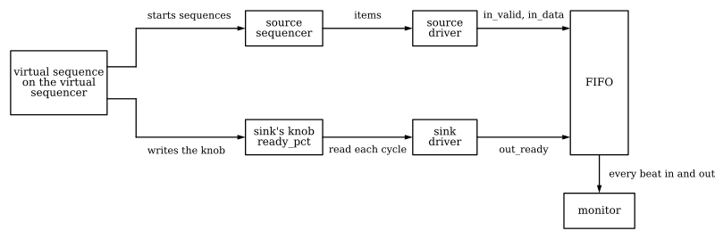

# Virtual sequences

This page answers: *the routing table, the packets and the backpressure are each driven by a
different agent. How do you make them change together, from one place?*

Lab 04's tests did one thing at a time, in the test's `body()`. A test wrote the routing table,
set the sinks, sent packets, drained, read `DROP_CNT` and then started again, and each step waited
for the one before it to finish. In
[Lab 05, Part 4](../labs/lab-05-protocol-rules-and-backpressure-overview.md#part-4-a-virtual-sequence)
you'll want routes that move to the other output while packets are still going in, and both sinks
changing their behaviour at the same time. So the APB agent, the source agent and both sinks'
agents all have work to do at the same time, in an order that you choose. In UVM you do this with a
**virtual sequence**, which is a sequence that starts other sequences on several agents' sequencers
and changes those agents' knobs, but makes no items of its own.

This page builds one for a small design of our own, a FIFO that holds four beats and has a
valid/ready stream on each side. The files are in
[`guide-examples/virtual-sequences/`](https://github.com/uoftasic/dd105-a/tree/main/guide-examples/virtual-sequences).
A source agent drives the FIFO's input, and its sequences send one beat per item. A sink driver
drives `out_ready` on the output side, and how often it's ready depends on `ready_pct`, a knob in a
configuration object. Neither of the two knows about the other. The sink has no sequencer at all.
Lab 05's sinks do have one, but a virtual sequence steers them the way you steer this sink, by
changing their configuration rather than by sending them items, so this sink is a good stand-in
for them.

## A sequencer that holds handles

An ordinary sequence runs on its agent's sequencer, and in the labs each virtual sequence runs on a
sequencer too. A **virtual sequencer** is a sequencer with no driver connected to it. It's there to
hold handles to everything that the virtual sequence needs to reach, and ours holds four:

```systemverilog
class vs_vsequencer extends uvm_sequencer;
  `uvm_component_utils(vs_vsequencer)
  uvm_sequencer #(src_item) src_sqr;   // the source agent's sequencer
  snk_cfg                   snk;       // the sink's knob
  vs_monitor                mon;       // what has come out, for the sequence to report
  virtual vs_if             vif;       // a clock to count cycles with
  ...
```

The environment makes it in `build_phase`, like any other component, and fills in its handles in
`connect_phase`, when everything that they point to exists. Lab 05's `router_vsequencer` holds the
same kinds of thing for the router. It has the sequencers of the source agent and the APB agent,
the sequencer and the `out_cfg` object of each sink, the scoreboard, and the APB interface.

{width=720 fig-alt="A block diagram. On the left, a box labelled virtual sequence on the virtual sequencer. One line from it, labelled starts sequences, goes to the source sequencer, which passes items to the source driver, which drives in_valid and in_data into the FIFO. A second line, labelled writes the knob, goes to the sink's knob, ready_pct, which the sink driver reads each cycle; the sink driver drives out_ready into the FIFO. Below the FIFO, a monitor watches every beat in and out."}

*Our example's testbench. The virtual sequence reaches the source through the source's sequencer,
and the sink through the sink's configuration object, using handles that the virtual sequencer
holds. The monitor checks every beat, whatever caused it.*

The virtual sequence reaches the virtual sequencer through `p_sequencer`. That's a handle of the
virtual sequencer's own type, and the `uvm_declare_p_sequencer` macro declares it and fills it in
when the sequence starts:

```systemverilog
class vs_base_vseq extends uvm_sequence;
  `uvm_object_utils(vs_base_vseq)
  `uvm_declare_p_sequencer(vs_vsequencer)
  ...
  task send(int unsigned n, bit [7:0] base);   // n beats, through the source agent
    src_seq s = src_seq::type_id::create($sformatf("src_%h", base));
    s.n    = n;
    s.base = base;
    s.start(p_sequencer.src_sqr, this);
  endtask
  function void sink(int unsigned pct);        // the sink's readiness from now on
    p_sequencer.snk.ready_pct = pct;
    ...
```

`s.start(p_sequencer.src_sqr, this)` runs the source agent's own sequence on the source agent's
sequencer, as a test would, with the virtual sequence as its parent. `sink()` only writes the knob,
without starting anything, and the sink's driver reads the new value at its next clock edge.
Lab 05's `router_base_vseq` gives you eleven helpers like these, among them `route()`, `ctrl()`,
`burst()`, `send_rand()`, `stall()` and `drain()`. Most of them are the base test's steps from
Lab 04, rewritten as tasks of a sequence.

You can also do without a virtual sequencer. The test then hands the virtual sequence its handles
itself and starts it with `start(null)`, and that works too. The labs use a virtual sequencer
because then the environment fills in the handles once, for every virtual sequence and every test.

## Doing two things at once

The test starts our virtual sequence, `vs_demo_vseq`, on the virtual sequencer. The sequence's
first step stalls the sink and then, in a `fork`, sends six beats in one branch while a second
branch waits 15 cycles and lets the sink go:

```systemverilog
sink(0);
fork
  begin
    send(6, 8'h10);
    `uvm_info("VSEQ", "step 1: all 6 beats have gone in", UVM_LOW)
  end
  begin
    cycles(15);
    `uvm_info("VSEQ", $sformatf("step 1: the FIFO holds %0d beats", p_sequencer.vif.level), UVM_LOW)
    sink(100);
  end
join
```

It printed:

```text
UVM_INFO guide-examples/virtual-sequences/vseq_tb.sv(218) @ 26000: uvm_test_top.env.vsqr@@v [VSEQ] sink ready 0% of cycles
UVM_INFO guide-examples/virtual-sequences/vseq_tb.sv(241) @ 175000: uvm_test_top.env.vsqr@@v [VSEQ] step 1: the FIFO holds 4 beats
UVM_INFO guide-examples/virtual-sequences/vseq_tb.sv(218) @ 175000: uvm_test_top.env.vsqr@@v [VSEQ] sink ready 100% of cycles
UVM_INFO guide-examples/virtual-sequences/vseq_tb.sv(237) @ 235000: uvm_test_top.env.vsqr@@v [VSEQ] step 1: all 6 beats have gone in
```

By 175 ns the FIFO held four beats and was full, and `send()` still had two of its six beats to
send. It could only return once the sink had taken some beats, and the sink would only take beats
once something set `ready_pct` again. If you wrote the two as statements one after the other,
`send()` and then `sink(100)`, they would deadlock, because `send()` waits for the sink and the
line that releases the sink waits for `send()` to return. With `fork ... join` the two branches run
at the same time, and `join` waits for both, so the step ended at 235 ns, when the last beat had
gone in.

Every message carries the path `uvm_test_top.env.vsqr@@v`, which means that the report came from
the sequence `v` running on `env.vsqr`. The path is how you tell a virtual sequence's messages
apart from an agent's.

## A loop that ends with the traffic

The second step sends 30 beats while another branch keeps changing how often the sink is ready.
That branch can't know how long the traffic will take, so it loops until the traffic branch sets a
flag, `traffic_done`:

```systemverilog
traffic_done = 0;
fork
  begin
    send(30, 8'h40);
    traffic_done = 1;
  end
  while (!traffic_done) begin
    sink(pick[$urandom_range(2)]);     // 0, 30 or 100 percent
    cycles($urandom_range(12, 4));
  end
join
```

The loop set the sink twelve times between 335 ns and 1415 ns, and the last beat went in at
1445 ns. Step 4 of the sequence you write in Lab 05, Part 4 has the same shape, with
`backpressure()` as the looping branch and a third branch that moves routes. If the traffic branch
didn't set `traffic_done`, the loop would go on changing the sink for ever, and `join` would never
return.

None of these sequences checks anything. In this example the monitor does the checking, and in the
labs the scoreboard and the assertions do. The monitor watches both sides of the FIFO in every
cycle and checks every beat that comes out, whatever is driving the FIFO, and at the end of this
run it said `44 beats in, 44 out, 0 out of order`.

## Two sequences on one sequencer

The third step starts two source sequences at once on the same sequencer. Each sends four beats.
The first numbers its beats from `80`, and the second from `a0`:

```systemverilog
fork
  send(4, 8'h80);
  send(4, 8'hA0);
join
```

and the beats came out of the FIFO as

```text
step 3: the sink took 80 a0 81 a1 82 a2 83 a3
```

A sequencer takes one item at a time from the sequences that are running on it. Each
`start_item()` is a request for the driver, and the sequencer grants them in turn, so the two
sequences alternated item by item. Sometimes that's what you want, for example to mix two traffic
streams together. It also means that a sequence you start on a sequencer that already has one
running shares the driver with the first one rather than replacing it. Each of Lab 05's sinks runs
a sequence that never ends, and Part 4 asks you why the virtual sequencer holds each sink's
`out_cfg` and not only its sequencer.

## Configuration changes and the scoreboard

With a virtual sequence it's easy to change the configuration while traffic is moving, and then
the scoreboard has to apply each change from the right cycle. In Lab 04 the tests wrote the
routing table only between phases, so the scoreboard could apply a write as soon as it saw it.
In Lab 05 a route can change between one header and the next, and the specification
says that a header accepted in the same cycle as the write completes still uses the old route.
Lab 05's scoreboard stamps each write with the cycle it completed in, and Part 4 asks you why it
uses the cycle rather than the order in which the two monitors report.

On Verilator 5.050, making a sequence and starting it both change the random values drawn after
them, in the thread that does it and in other threads too. A sequence added at the start of a test therefore
changes every random choice made after it, even if the sequence itself does nothing, so it matters
where in a test you put a new one. In Lab 06, Part 1 you'll see this happen to `router_test`, and
Lab 07 puts its new sequence at the end of `router_test` for this reason.
[Regressions and seeds](regressions-and-seeds.md) has the measurements.

## Check yourself

1. In step 1, the release could have gone in a branch that waits for the FIFO's level to reach 4,
   instead of waiting 15 cycles. Why can't it simply follow `send(6, 8'h10)` in the same branch?

   <details>
   <summary>Answer</summary>

   `send()` returns only when all six beats have gone into the FIFO, and the FIFO holds four. The
   fifth beat waits for `in_ready`, which comes back only when the sink takes a beat, and the sink
   takes beats only after `sink(100)`. In the same branch as `send()`, `sink(100)` would never be
   reached.

   </details>

2. What does `join` wait for in step 2, and what would happen if the traffic branch forgot to set
   `traffic_done`?

   <details>
   <summary>Answer</summary>

   For both branches to finish. Without the flag the backpressure loop never ends, so the
   virtual sequence never returns, the test never drops its objection, and the run goes on until
   something stops it from outside. In the course that's `make`'s run timeout, and a run that it
   stops is graded BROKEN.

   </details>

3. You want the four beats from `80` to go in before the four from `a0`, with both sends still
   started by the virtual sequence. What do you change?

   <details>
   <summary>Answer</summary>

   Start them one after the other instead of in a `fork`: `send(4, 8'h80); send(4, 8'hA0);`. The
   second sequence then starts only when the first has returned.

   </details>

## Further reading

- [UVM Virtual Sequencer](https://www.chipverify.com/uvm/uvm-virtual-sequencer): declaring one,
  making it in the environment and filling in its handles in `connect_phase`. Its log was made from
  a different version of the code than the page shows, so the names in it don't match.
- [UVM Virtual Sequence](https://www.chipverify.com/uvm/uvm-virtual-sequence): both styles,
  `p_sequencer` and `start(null)`. Correction: two of its three example virtual sequences create
  their child sequences in `pre_body()` and start them without a parent, against the page's own
  advice.
- [UVM Sequence Arbitration](https://www.chipverify.com/uvm/uvm-sequence-arbitration): how a
  sequencer chooses between sequences that run on it at the same time, mode by mode, with logs.
- [UVM Lock & Grab](https://www.chipverify.com/uvm/uvm-lock-grab): how one sequence keeps a
  sequencer to itself.
- [How to execute sequences via start()](https://www.chipverify.com/uvm/how-to-execute-sequences-via-start-method).
  Its example test starts a sequence without raising an objection, which works only because that
  sequence takes no simulation time.

Next: [Lab 05: Protocol rules and backpressure](../labs/lab-05-protocol-rules-and-backpressure-overview.md).
