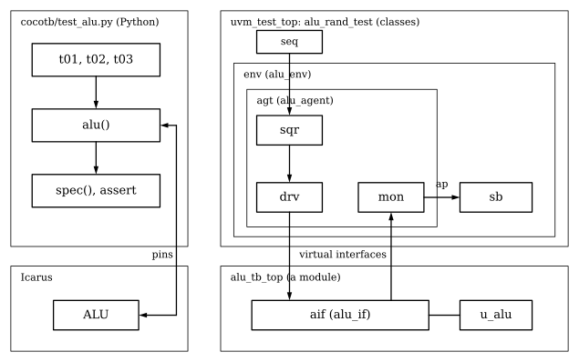

# What a framework buys you

This page answers: *what is UVM for, and what does it cost on the simulator this course uses?*

A testbench framework is a library of base classes plus a set of rules for how the pieces you build
from them fit together and when each one runs. UVM, the Universal Verification Methodology, is the
one this course uses. In
[Lab 01](../labs/lab-01-one-alu-two-testbenches-overview.md) you'll test SimProc's ALU twice, once
with the cocotb test you know from DD104 and once with a UVM testbench, and you'll measure what each
costs in lines, build time and run time, and what each reports on three planted bugs. This page goes
through what we measured when we ran the lab, so you know what you're looking at when your own
numbers come in. The numbers here are the lab's; yours will be close but not the same.

## What UVM is

UVM is a library of SystemVerilog classes, standardised as IEEE 1800.2. It isn't part of the
simulator, and the course image doesn't ship one, so the course carries its own copy in
`third_party/uvm`: UVM 2020-3.2 from `chipsalliance/uvm-verilator` at commit `5d72b66`, which
compiles on the course's Verilator 5.050. Every lab's build compiles it along with your testbench.

What the library gives you is a base class for each job a testbench does, and the machinery that
connects them. Lab 01's testbench uses most of it:

- base classes for the pieces: `uvm_sequence_item` for one transaction, `uvm_sequence` for a
  stream of them, and `uvm_driver`, `uvm_monitor`, `uvm_scoreboard`, `uvm_agent`, `uvm_env` and
  `uvm_test` for the components;
- **phases**, which build every component, connect them, run them and ask each for its report, in
  that order, and **objections**, which decide when the run phase is over;
- `uvm_config_db`, which carries the virtual interfaces from the top module to the driver and the
  monitor;
- **analysis ports**, which send every transaction the monitor sees to whatever is connected to
  it, here the scoreboard;
- a **report server**, which counts every `` `uvm_error `` by its ID and prints the counts at the
  end;
- `+UVM_TESTNAME`, which picks the test when the simulator starts.

The factory, which lets a test swap one class for another without editing the code that makes it,
comes in [Lab 04](../labs/lab-04-the-same-testbench-in-uvm-overview.md).

## The two testbenches

{fig-alt="Two drawings side by side. On the left, a frame labelled cocotb/test_alu.py (Python) holds three boxes stacked with arrows between them: t01, t02, t03; alu(); and spec(), assert. A line with an arrowhead at each end joins alu() to an ALU box in a separate frame labelled Icarus, and is labelled pins. On the right, a frame labelled uvm_test_top: alu_rand_test (classes) holds a seq box above a frame labelled env (alu_env). Inside env is a frame labelled agt (alu_agent) with boxes sqr, drv and mon, and outside the agent but inside env a box sb. Arrows go from seq to sqr and from sqr to drv, and an arrow labelled ap goes from mon to sb. Below, a frame labelled alu_tb_top (a module) holds a box aif (alu_if) joined to a box u_alu. An arrow goes down from drv to aif and another goes up from aif to mon, labelled virtual interfaces."}

*Lab 01's two testbenches. On the left the Python test runs beside Icarus and reaches into the ALU
through its pins. On the right everything is compiled into one simulator: the classes on top, the
module with the interface and the ALU below.*

Both testbenches do the same three things: make vectors, put them on the ALU's pins, and compare
what comes back with a model. The cocotb test does all three in one file of plain functions:
`alu()` drives the pins and reads them back, `spec()` is the model, and each test function loops
over its vectors and asserts.

The UVM testbench gives each job its own class. A sequence makes `alu_item` objects and hands them
to the sequencer, which passes them to the driver. The driver puts each one on the pins through the
interface's clocking block, one per clock cycle. The monitor, which knows nothing about stimulus,
reads the pins back into an `alu_item` in every cycle that carries a vector, and writes it to its
analysis port. The
scoreboard receives each item, runs `predict()` and compares. The agent and the environment do no
testing at all: they create the pieces and connect them. The test picks which sequence to start.
Lab 01, Part 3 has a table that matches each class with the part of `test_alu.py` that does the
same job.

## What it costs

These are the costs Lab 01 measured, in the course image on 2 CPUs:

| | cocotb, on Icarus | UVM, on Verilator |
|---|---|---|
| Lines of code (not counting blank lines and comments) | 94 | 282 |
| First build | 0.6 s | 102 s |
| Rebuild after you change the testbench | none | 26 s to 99 s |
| Run | 23.8 s, 17.5 s of it in `t02`'s 393,216 vectors | 1.17 s for 2000 vectors |
| Time per vector | about 0.04 ms | about 0.6 ms |

**Lines.** The UVM testbench has three times the code, and most of the difference is in pieces the
cocotb test doesn't need: an agent and an environment that only create and connect, a constructor
and a registration macro in every class, and a driver and a monitor that do in two classes what
`alu()` does in four lines.

**Build.** Verilator turns the testbench, the ALU and the whole UVM library into C++, and g++
compiles it. Lab 01's build report says the sources came to 24 MB in 386 modules, and that g++
spent 98.5 s of the 102. The ALU is 34 lines of that. The lab's optional last part runs the cocotb
test on Verilator instead of Icarus, where Verilator compiles only the ALU, and that build took
13.3 s, which gives you a feel for how much of the 102 s is the library.

**Rebuilds.** A change to a Python test costs nothing before the next run. A change to a
SystemVerilog class costs a rebuild, and how long depends on what you changed. The course keeps a
compiler cache (ccache) in your clone, so a rebuild can reuse whatever didn't change. Changing a
line inside a function body rebuilt in 26 s, with 35 of 36 compiled files taken from the cache.
Adding one member to the scoreboard class rebuilt in 93 s, with only 10 of 36 taken from the cache,
because a new member changes the class's layout and most of the C++ that Verilator generates
changes with it. So when you can, iterate on function bodies and on plusargs, which need no rebuild
at all.

**Speed.** The UVM testbench isn't faster per vector; it's more than ten times slower. The run is
still quick, 1.17 s, because the test sends 2000 random vectors rather than sweeping all 393,216 as
DD104's `t02` does.

There are also costs that come from running UVM on Verilator rather than on a commercial simulator.
On Verilator 5.050 a UVM run that reports errors still exits with status 0, and a constrained
`randomize()` with no solver available fails without stopping the run. The course pays for both
once: every lab's makefile sets up the solver, and every test extends `dd105_base_test`, which
checks the solver at the start and turns any `UVM_ERROR` into a nonzero exit status at the end.

## What it buys

On one ALU, what you get back is modest, but each item is something the cocotb test doesn't have.

- **Checking kept apart from stimulus.** In Lab 01, Part 5 you add a check of the `N` and `Z` flags
  to the scoreboard, in one class. Both tests use it without being edited, because neither test
  does any checking of its own. In `test_alu.py`, `t01` and `t02` each do their own comparison, so a
  new check has to be written into each.
- **A new test without a rebuild.** `alu_directed_test` is one short sequence and one short test
  class that reuse the driver, the monitor and the scoreboard. `+UVM_TESTNAME` picks it when the
  simulator starts, so trying it needs no rebuild, and the whole command took 0.17 s. Every lab in
  the course builds once and picks tests, seeds and planted bugs this way.
- **Counting for free.** With bug A01 on, the shipped scoreboard reported 282 errors, and UVM's
  report server printed `[VALUE]   282` in its counts by ID. Give the flag check its own ID and the
  summary counts value mismatches and flag mismatches separately, which is the two-bucket report
  DD104 Lab 03's `t02` builds by hand.

What the framework doesn't do is decide what to check. Against Lab 01's three bugs, the shipped UVM
scoreboard caught A01 (282 errors) and A02 (255) and missed A03 with no errors at all, while the
cocotb test caught all three, because its `t02` compares the flags and the shipped scoreboard
doesn't. Once you add the flag check, the UVM test catches A03 with 131 errors in 2000 vectors.

The return grows with the design. The router you'll test from Lab 02 on has a register bus, an
input stream and two output streams, so a testbench for it has one driver and monitor per
interface, and a scoreboard that predicts which output each packet comes out of. That's the kind of
design the structure is for. Labs 02 and 03 build that testbench from plain classes first, so that
each UVM piece has an obvious job when it appears, and Lab 04 moves it into UVM and counts what
moved and what was added.

## Check yourself

1. In Lab 01's scoreboard you change the body of `predict()`. About how long will the rebuild take?
   And if you add an `int unsigned` counter to the scoreboard class instead?

   

   
Answer

   About 26 s for a change inside a function body, because the ccache supplies almost every
   compiled file. Close to a full build, about 93 s in our run, for a new member, because it changes
   the class's layout and most of the generated C++ with it.

   

2. Without `dd105_base_test`, what exit status would Lab 01's UVM run have with 282 errors in its
   log, and why does that matter?

   

   
Answer

   0, because on Verilator 5.050 a UVM run that reports errors still exits with status 0. Anything
   that judges the run by its exit status, `make` or a regression script, would count it as a
   pass. `dd105_base_test` calls `$fatal` at the end of the test if UVM counted any error.

   

3. The shipped UVM testbench misses A03 and the cocotb test catches it. Does that tell you anything
   about UVM?

   

   
Answer

   No. The cocotb test compares the flags and the shipped scoreboard compares only the value, so the
   two testbenches check different things. With the flag check added, the UVM testbench catches A03
   too.

   

## Further reading

ChipVerify's UVM section explains the library one class at a time. The logs on its pages come from
Cadence simulators running UVM 1.1d or 1.2, not from Verilator with the 1800.2 library this course
uses, and the course doesn't reuse its code.

- [UVM Tutorial](https://www.chipverify.com/uvm/uvm-tutorial): a map of the library's main pieces
  and the SystemVerilog it assumes you know.
- [UVM Introduction](https://www.chipverify.com/uvm/uvm-introduction): why UVM exists, and the
  difference between components and objects. Correction: its monitor fragment never constructs its
  analysis port, so as written its `ap.write()` would use a null handle.

Next: [From cocotb to SystemVerilog classes](../guide/from-cocotb-to-systemverilog-classes.md).
