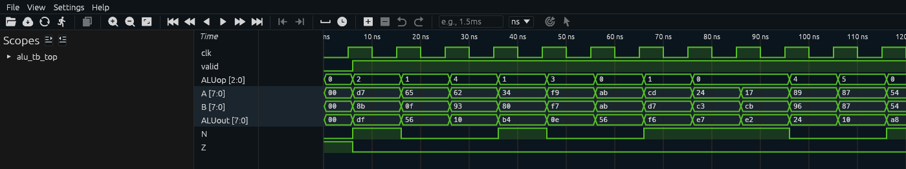
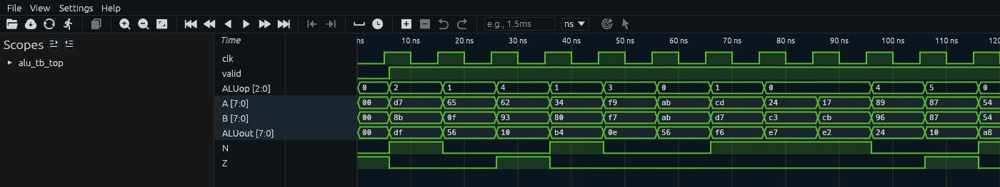

# Lab 01: One ALU, two testbenches

You'll test SimProc's ALU from DD104 twice: once with the cocotb test from DD104 Lab 03, and once
with a UVM testbench written in SystemVerilog. You'll measure what each one costs in lines, build
time and run time, see what each one reports on three planted bugs, and then extend the UVM
scoreboard until it catches the flags bug that the shipped one misses.

Package: [`labs/lab-01-one-alu-two-testbenches/`](https://github.com/uoftasic/dd105-a/tree/main/labs/lab-01-one-alu-two-testbenches)

## Before you start

- Finish [DD104](https://uoftasic.com/dd104/), and
  [Lab 03](https://uoftasic.com/dd104/labs/lab-03-three-blocks-before-the-processor-overview.html)
  in particular. You don't need its files, because this lab ships the ALU and a reference copy of
  the finished Lab 03 test, but you'll get more from the comparison if you wrote that test yourself.
- Read [Getting started](../guide/getting-started.md).
- Copy this table into your notes. You'll fill it in as you go, and the questions at the end ask
  you to compare the two columns.

  | | cocotb | UVM |
  |---|---|---|
  | Lines (all / code) | | |
  | First build | | |
  | Rebuild after you change the testbench | | |
  | Run | | |
  | A01 | | |
  | A02 | | |
  | A03 | | |

Time: about 1 h 30 min.

## Part 1: Load the course

Can you reach DD105-A's files, on the tool versions this lab's outputs were recorded with? If you
haven't set up the workbench yet, do
[IC101 Lab 03](https://uoftasic.com/ic101/labs/lab-03-launch-the-workbench-overview.html) first.

1. From your `workspace` clone, start the desktop (`./scripts/start_vnc.sh`, or
   `scripts\start_vnc.bat` on Windows), open <http://localhost/> and open a terminal on the
   desktop. Type every command from here on in that terminal.

2. Load the environment and get the course files:

   ```bash
   . /foss/designs/common/.designinit   # in every new terminal
   mod add dd105-a                      # first time only: clones github.com/uoftasic/dd105-a
   mod dd105-a                          # every time, including the first
   ```

   `mod dd105-a` prints:

   ```text
   cwd: /foss/designs/modules/dd105-a
   ```

3. Check the tool versions, because every exact number in this lab depends on them:

   ```bash
   verilator --version
   iverilog -V 2>&1 | head -1
   cocotb-config --version
   yices-smt2 --version | head -1
   surfer --version
   ```

   You should see:

   ```text
   Verilator 5.050 2026-07-01 rev v5.050
   Icarus Verilog version 14.0 (devel) (s20260301-391-g64f13540-dirty)
   2.0.1
   Yices 2.7.0
   surfer 0.7.0 (git: v0.7.0)
   ```

   Yices is the constraint solver Verilator runs for every constrained `randomize()` in a
   SystemVerilog testbench, and the course's makefile tells Verilator to use it.

| If you see | Do this |
|---|---|
| `bash: /foss/designs/common/.designinit: No such file or directory` | The workspace isn't mounted, so relaunch `start_vnc` from your `workspace` clone. In the meantime you can run this lab from a plain `git clone` of `github.com/uoftasic/dd105-a` inside the workbench image, because `make` needs neither `.designinit` nor `mod`. |
| `bash: mod: command not found` | You haven't loaded `.designinit` in this terminal (the first line of step 2). Every new terminal starts without it. |
| `mod: no such module: dd105-a` | You ran `mod dd105-a` before `mod add dd105-a`. |
| `VERILATOR_SOLVER is "yices-smt2 --incremental", and yices-smt2 is not on PATH.` | You ran `make` outside the course image. Without a solver every constrained `randomize()` fails, nothing is randomized and the test still passes, so the makefile refuses to go on. Run it in the workbench terminal. |

For anything else, see IC101's [Troubleshooting](https://uoftasic.com/ic101/reference/troubleshooting.html) page.

Check: `verilator --version` prints `5.050` and you are in `/foss/designs/modules/dd105-a`.

## Part 2: The cocotb testbench

What does the cocotb test cost to build and run, and what does it report on each bug?

1. Go to the lab folder:

   ```bash
   cd labs/lab-01-one-alu-two-testbenches
   ```

2. Open `rtl/alu.sv`. It's the `ALU` module from DD104 (lines 790 to 823 of
   `simproc_system.sv`) with the same name and ports, so a cocotb test written for DD104 drives it
   without changes. Three of its lines now choose between the correct expression and a bug, and
   an `initial` block at the bottom reads `+BUG` from the simulator's command line at time 0. The
   bugs are DD104's three ALU bugs, renamed so you can't confuse them with the router's bugs later
   in the course:

   | Bug | What's wrong | DD104 name |
   |---|---|---|
   | A01 | `SUB` computes `B - A` instead of `A - B` | `B01_sub_operands_swapped` |
   | A02 | `NAND` computes NOR instead of NAND | `B02_nand_is_nor` |
   | A03 | `Z` looks only at `ALUout[3:0]` | `B03_zero_flag_low_nibble` |

   With no `+BUG` you get the correct ALU, and with `+BUG=A03` you get A03. Every lab in this course
   compiles its bugs into the design this way, because a UVM build takes long enough that building
   one simulator per bug would cost you minutes each time.

3. `cocotb/test_alu.py` is DD104 Lab 03's reference solution, with only its docstring changed. If
   you'd rather run your own, copy it in under a new name and add `TB=test_alu_mine` to every
   `make cocotb` and `make loc` command in this lab:

   ```bash
   cp /foss/designs/modules/dd104/labs/lab-03-three-blocks-before-the-processor/test_alu.py cocotb/test_alu_mine.py
   ```

   The outputs below come from the reference. Your messages may be worded differently, but the
   counts should match.

4. Run the test on the correct ALU:

   ```bash
   make cocotb
   ```

   It takes about 25 seconds, and Icarus runs it, as in DD104. You should see, at the end:

   ```text
   393224.00ns INFO     cocotb.regression                  ********************************************************************************************************
                                                           ** TEST                                            STATUS  SIM TIME (ns)  REAL TIME (s)  RATIO (ns/s) **
                                                           ********************************************************************************************************
                                                           ** test_alu.t01_one_vector_per_operation            PASS           6.00           0.00       6710.89  **
                                                           ** test_alu.t02_every_vector_the_alu_can_be_given   PASS      393216.00          17.50      22472.77  **
                                                           ** test_alu.t03_the_undefined_opcodes               PASS           2.00           0.00       8264.64  **
                                                           ********************************************************************************************************
                                                           ** TESTS=3 PASS=3 FAIL=0 SKIP=0                               393224.00          17.50      22468.63  **
                                                           ********************************************************************************************************
   ALU: no bug switched on, this is the golden ALU
   ========================================================================
    cocotb, test_alu on icarus, the golden ALU: build 0.6 s, run 23.8 s
   ========================================================================
   ```

   The line between the last two rules is the lab's makefile timing the two halves. The build is
   Icarus compiling a 34-line module, which takes well under a second (a build with nothing to do
   took 0.4 s, all of it `make` itself). The run is mostly `t02` driving all 393,216 vectors, and
   the rest is starting Python and cocotb. Write both times in your table. Times are ballpark, but
   the counts in this lab are exact.

5. Before you run the test against the bugs, write down which of `t01`, `t02` and `t03` you expect
   to fail on each one. Then run it on all three:

   ```bash
   make cocotb-all
   ```

   It takes about 85 seconds. You should see:

   ```text
   ========================================================================
   ** test_alu.t01_one_vector_per_operation            PASS           6.00           0.00       8089.30  **
   ** test_alu.t02_every_vector_the_alu_can_be_given   PASS      393216.00          17.42      22569.25  **
   ** test_alu.t03_the_undefined_opcodes               PASS           2.00           0.00      11199.74  **
   ** TESTS=3 PASS=3 FAIL=0 SKIP=0                               393224.00          17.43      22565.68  **
   ALU: no bug switched on, this is the golden ALU
    cocotb, test_alu on icarus, the golden ALU: build 0.6 s, run 23.1 s
   ========================================================================
   AssertionError: SUB(0xC8, 0x3C) gave out=0x74 N=0 Z=0, expected out=0x8C N=1 Z=0
   AssertionError: 65024 of 393216 vectors have the wrong VALUE: {'SUB': 65024}.
   ** test_alu.t01_one_vector_per_operation            FAIL           2.00           0.00       2269.65  **
   ** test_alu.t02_every_vector_the_alu_can_be_given   FAIL      393216.00          17.84      22044.46  **
   ** test_alu.t03_the_undefined_opcodes               PASS           2.00           0.00       9446.63  **
   ** TESTS=3 PASS=1 FAIL=2 SKIP=0                               393220.00          17.85      22033.48  **
   ALU: bug A01 switched on
    cocotb, test_alu on icarus, A01: build 0.4 s, run 19.9 s
   ========================================================================
   AssertionError: NAND(0xC3, 0x1D) gave out=0x20 N=0 Z=0, expected out=0xFE N=1 Z=0
   AssertionError: 65280 of 393216 vectors have the wrong VALUE: {'NAND': 65280}.
   ** test_alu.t01_one_vector_per_operation            FAIL           4.00           0.00       4213.26  **
   ** test_alu.t02_every_vector_the_alu_can_be_given   FAIL      393216.00          17.54      22419.88  **
   ** test_alu.t03_the_undefined_opcodes               PASS           2.00           0.00       8551.08  **
   ** TESTS=3 PASS=1 FAIL=2 SKIP=0                               393222.00          17.55      22408.87  **
   ALU: bug A02 switched on
    cocotb, test_alu on icarus, A02: build 0.4 s, run 19.6 s
   ========================================================================
   AssertionError: Every value is correct, and 25726 of 393216 vectors have the wrong FLAGS: {'ADD': 3840, 'SUB': 3840, 'OR': 255, 'NAND': 255, 'SHL': 14400, 'SHR': 3136}.
   ** test_alu.t01_one_vector_per_operation            PASS           6.00           0.00       8040.20  **
   ** test_alu.t02_every_vector_the_alu_can_be_given   FAIL      393216.00          17.73      22172.35  **
   ** test_alu.t03_the_undefined_opcodes               PASS           2.00           0.00      10796.15  **
   ** TESTS=3 PASS=2 FAIL=1 SKIP=0                               393224.00          17.74      22161.85  **
   ALU: bug A03 switched on
    cocotb, test_alu on icarus, A03: build 0.4 s, run 19.7 s
   ========================================================================
   ```

   The counts 65,024, 65,280 and 25,726 are the ones you derived by hand in DD104 Lab 03, so the
   copied ALU and its switch behave like DD104's three broken ALUs. Write what the test reported on
   each bug in your table.

6. `t01` compares the value and both flags of six vectors, and it fails on A01 and A02 but passes
   on A03. Why does it miss A03?

   <details>
   <summary>Answer</summary>

   The six results are `0x04`, `0x8C`, `0xFF`, `0xFE`, `0x84` and `0x1F`. A03 gets `Z` wrong
   only when the result isn't zero but its low four bits are, and none of the six results is like
   that, so on these vectors the broken `Z` and the correct one agree.

   </details>

Check: `TESTS=3 PASS=3` on the correct ALU, and `t02` failing on all three bugs with 65024, 65280
and 25726 wrong vectors.

## Part 3: The UVM testbench

What does the same job cost when it's built the UVM way?

1. Start the UVM build now, because it's the slowest step in the lab:

   ```bash
   make build
   ```

   The banner the build starts with estimates 1.5 to 2.5 minutes for a cold build, and on the
   course's 2 CPUs it took us 102 s. It ends with:

   ```text
   - V e r i l a t i o n   R e p o r t: Verilator 5.050 2026-07-01 rev v5.050
   - Verilator: Built from 24.157 MB sources in 386 modules, into 22.688 MB in 2501 C++ files needing 112.631 MB
   - Verilator: Walltime 102.681 s (elab=0.759, cvt=2.699, bld=98.503); cpu 4.510 s on 2 threads; allocated 307.551 MB
   ========================================================================
    built /foss/designs/modules/dd105-a/labs/lab-01-one-alu-two-testbenches/build/sim in 102 s (47M; the 888M of generated C++ was deleted, SLIM=0 keeps it)
    ccache:  Hits: 0 / 36 ( 0.00%)  Misses: 36 / 36 (100.0%)
   ========================================================================
    /foss/designs/modules/dd105-a/labs/lab-01-one-alu-two-testbenches/build/sim is up to date.
   ```

   Verilator turned the three testbench files, the ALU and the whole UVM library (24 MB of
   source in 386 modules) into C++, and `bld=98.503` says that g++ spent almost all of the 102 s
   compiling it. The ALU is 34 lines of that. The ccache keeps the compiled C++ in your clone, so
   a later build can reuse whatever didn't change. Write the build time in your table.

2. While it builds, read `tb/alu_pkg.sv`, `tb/alu_if.sv` and `tb/alu_tb_top.sv`. Most pieces of
   the UVM testbench do a job that the cocotb test also does:

   | UVM piece | Its job | In `test_alu.py` |
   |---|---|---|
   | `alu_if` | the ALU's pins, plus a clock and a `valid` signal | `dut` |
   | `alu_item` | one vector and the ALU's answer | the `(op, a, b)` and `got` values |
   | `alu_rand_seq`, `alu_directed_seq` | make the vectors | the loops in `t02`, the list in `t01` |
   | `alu_driver` | puts each vector on the pins | the three `.value =` lines in `alu()` |
   | `alu_monitor` | reads the pins back into an `alu_item` | the `return` line of `alu()` |
   | `alu_scoreboard` | `predict()` and the comparison | `spec()` and `if got != want` |
   | `alu_agent`, `alu_env` | create the pieces and connect them | nothing |
   | `alu_rand_test`, `alu_directed_test` | choose the stimulus | the `@cocotb.test()` functions |
   | `alu_tb_top` | the clock, the ALU, the interface and `run_test()` | cocotb's makefile |

   The ALU is combinational, so the cocotb test sets the inputs and waits 1 ns. A UVM driver and
   monitor work in clock cycles instead, so the interface adds a clock and a `valid` signal, and
   neither of them goes to the ALU. The driver writes through the interface's clocking block, which
   is how this course drives every design. Two comments in `alu_item` explain how its constraints
   work around Verilator 5.050's random number generation. The tests extend `dd105_base_test`,
   which turns any `UVM_ERROR` into a nonzero exit status, because on this simulator a UVM run
   that reports errors otherwise still exits with status 0.

3. When the build has finished, run the random test, which sends 2000 random vectors:

   ```bash
   make run
   ```

   The first thing it prints is the UVM library's release notes, which you can ignore. You should
   see:

   ```text
   UVM_INFO @ 0: reporter [RNTST] Running test alu_rand_test...
   UVM_INFO labs/lab-01-one-alu-two-testbenches/tb/alu_pkg.sv(284) @ 20025000: uvm_test_top.env.sb [SB] 2000 vectors checked: 0 value mismatches
   DD105: TEST PASSED
   ```

   followed by UVM's report summary and, last:

   ```text
   ------------------------------------------------------------------------
    ok: 0 UVM_ERROR, 0 UVM_FATAL   1.17 s   log: build/runs/alu_rand_test-s1/run.log
   ------------------------------------------------------------------------
   ```

   UVM prints times in picoseconds here, so `@ 20025000` is 20 µs: 2000 vectors, one per 10 ns
   clock cycle. Write the run time in your table.

4. Run the other test, without rebuilding:

   ```bash
   make run UVM_TESTNAME=alu_directed_test
   ```

   It sends DD104's six `t01` vectors. You should see `[SB] 6 vectors checked: 0 value mismatches`
   and `ok: 0 UVM_ERROR, 0 UVM_FATAL   0.04 s`, and the whole command took 0.17 s when we timed
   it. The test is picked by `+UVM_TESTNAME` when the simulator starts, so trying another test,
   seed or bug never rebuilds anything, and every lab in the course works this way.

5. Count each testbench's lines:

   ```bash
   make loc
   ```

   You should see:

   ```text
   cocotb testbench:
     file                 lines    code
     cocotb/test_alu.py     189      94
   UVM testbench:
     file               lines    code
     tb/alu_if.sv          28      17
     tb/alu_pkg.sv        377     252
     tb/alu_tb_top.sv      19      13
     total                424     282
   ```

   `code` leaves out blank lines and comments, and counts Python docstrings as comments. The UVM
   testbench has three times as many code lines as the cocotb test. Using the table in step 2,
   where do the extra lines go?

   <details>
   <summary>Answer</summary>

   Mostly into pieces the cocotb test doesn't need. The agent and the environment only create and
   connect the other pieces, every class has a constructor and a `` `uvm_component_utils `` or
   `` `uvm_object_utils `` line, and the driver and monitor do in two classes what `alu()` does in
   four lines, because cocotb reads and writes the design's signals directly from Python.

   </details>

6. Record a waveform of the random test and open it:

   ```bash
   make waves
   surfer build/runs/alu_rand_test-s1/waves.fst &
   ```

   Add `clk` from `alu_tb_top`, `valid` from `aif` and the six ports from `u_alu`, and look at the
   first 120 ns:

   

   *The correct ALU. The first vector, `ALUop` 2 (`OR`) with `A=d7` and `B=8b`, gives `df`.*

   Each vector holds the pins for one clock cycle. The driver writes it 1 ns after a rising edge,
   which is the clocking block's output skew, and the monitor samples it, with the ALU's answer,
   just before the next rising edge.

Check: `2000 vectors checked: 0 value mismatches` and `ok`, and your table has a line count, a
build time and a run time in each column.

## Part 4: Both testbenches on the bugs

Which bugs does the UVM testbench catch, and why?

1. Read `write()` in `alu_scoreboard`, in `tb/alu_pkg.sv`. Write down which of A01, A02 and A03
   you expect it to catch.

2. Run the random test against the correct ALU and each bug:

   ```bash
   make check-all
   ```

   Each of the four runs takes about 1.1 s, because they all use the simulator you already built.
   You should see:

   ```text
         ok  the golden design                        0 UVM_ERROR, 0 UVM_FATAL        1.1s
   ------------------------------------------------------------------------
     MISSED  tier 1  A03_zero_flag_low_nibble         0 UVM_ERROR, 0 UVM_FATAL        1.1s
     caught  tier 1  A01_sub_operands_swapped         282 UVM_ERROR                   1.1s
     caught  tier 1  A02_nand_is_nor                  255 UVM_ERROR                   1.1s
   ------------------------------------------------------------------------
    2 of 3 caught.
   ```

   `make` then prints an error line, because the verdict is a fail, not because the makefile
   broke.

3. Look at one of the catches in full:

   ```bash
   make run BUG=A01
   ```

   It prints 282 errors. The first three are:

   ```text
   UVM_ERROR labs/lab-01-one-alu-two-testbenches/tb/alu_pkg.sv(260) @ 25000: uvm_test_top.env.sb [VALUE] SUB A=65 B=0f -> ALUout=aa N=1 Z=0, expected ALUout=56
   UVM_ERROR labs/lab-01-one-alu-two-testbenches/tb/alu_pkg.sv(260) @ 45000: uvm_test_top.env.sb [VALUE] SUB A=34 B=80 -> ALUout=4c N=0 Z=0, expected ALUout=b4
   UVM_ERROR labs/lab-01-one-alu-two-testbenches/tb/alu_pkg.sv(260) @ 75000: uvm_test_top.env.sb [VALUE] SUB A=cd B=d7 -> ALUout=0a N=0 Z=0, expected ALUout=f6
   ```

   and near the end of the log:

   ```text
   UVM_INFO labs/lab-01-one-alu-two-testbenches/tb/alu_pkg.sv(284) @ 20025000: uvm_test_top.env.sb [SB] 2000 vectors checked: 282 value mismatches (SUB 282)
   ...
   ** Report counts by id
   [RNTST]     1
   [SB]     1
   [UVM/RELNOTES]     1
   [VALUE]   282

   DD105: TEST FAILED (282 UVM_ERROR, 0 UVM_FATAL)
   [20025000] %Fatal: dd105_pkg.sv:89: Assertion failed in dd105_pkg.dd105_base_test.m_end_of_test: DD105: UVM counted errors, so the exit status is nonzero
   ```

   The `%Fatal` line is `dd105_base_test` making the exit status nonzero, as Part 3 described.
   UVM's report server has counted the errors by their ID, `[VALUE]`, which you'll use in Part 5.

4. The cocotb test drove all 65,536 `SUB` vectors to find A01, and the UVM test caught it on its
   second vector (`@ 25000` is 25 ns) out of 2000 random ones. Why does a random sample find A01
   and A02 so easily, when no number of random vectors would find A03 with this scoreboard?

   <details>
   <summary>Answer</summary>

   A01 and A02 change the value on almost every `SUB` and `NAND` vector (65,024 and 65,280 of
   65,536 each), so any sample with a handful of those operations in it shows the bug. A03 changes
   only `Z`, and this scoreboard never reads `Z`. DD104 Lab 03, Part 5 showed the same thing with a
   sweep of all 393,216 vectors that checked only the values.

   </details>

5. Write what the UVM testbench reported on each bug in your table.

Check: `2 of 3 caught`, with A03 `MISSED`.

## Part 5: Check the flags

What does it take to make the UVM scoreboard catch A03, and what does the change cost to rebuild?

1. See the verdict you're going to change:

   ```bash
   make check BUG=A03
   ```

   You should see:

   ```text
         ok  the golden design                        0 UVM_ERROR, 0 UVM_FATAL        1.3s
     MISSED  A03_zero_flag_low_nibble                 0 UVM_ERROR, 0 UVM_FATAL        1.2s
   ------------------------------------------------------------------------
    VERDICT: FAIL -- your test passes A03_zero_flag_low_nibble too.
   ```

2. Extend `alu_scoreboard` in `tb/alu_pkg.sv`, following the `TODO` in `write()`. `predict()`
   already works out `n` and `z`, and the monitor already fills in `t.N` and `t.Z`, so you only
   need to compare them. Count flag mismatches separately from value mismatches, with a counter and
   a per-operation array like `n_bad_value` and `bad_value`, report each one with
   `` `uvm_error("FLAGS", ...) ``, and add the flag count to the line `report_phase` prints. Use a
   different ID from `"VALUE"`, because UVM's report summary counts by ID, and that gives you
   DD104's two separate counts without any code of your own.

3. You changed one file, and the ccache holds everything from the first build. Write down how long
   you expect the rebuild to take, then run it:

   ```bash
   make build
   ```

   With the reference solution's edit you should see:

   ```text
    built /foss/designs/modules/dd105-a/labs/lab-01-one-alu-two-testbenches/build/sim in 99 s (47M; the 888M of generated C++ was deleted, SLIM=0 keeps it)
    ccache:  Hits: 10 / 72 (13.89%)  Misses: 62 / 72 (86.11%)
   ```

   An earlier run of the same edit took 87 s. The ccache counts add up across builds, so this build
   looked up 36 compiled files and found 10. Write your rebuild time in your table. Why did it cost
   almost as much as the first build?

   <details>
   <summary>Answer</summary>

   Because the edit adds members, the new counters, to a class. We timed two one-line edits to
   compare. A change inside a function body, `repeat (3)` to `repeat (4)` in `alu_base_test`,
   rebuilt in 26 s, with 35 of the 36 compiled files taken from the ccache. Adding one
   `int unsigned` member to the scoreboard rebuilt in 93 s, with 10 of 36 from the ccache. Adding a
   member changes the class's layout, and most of the C++ that Verilator generates changes with
   it. So iterate on function bodies and plusargs where you can, and expect a change to what a
   class holds to cost close to a full build. If your own edit changed only function bodies, your
   rebuild was closer to 26 s. A cocotb test needs no build at all when you change it, because
   Python isn't compiled.

   </details>

4. Ask for the verdict again:

   ```bash
   make check BUG=A03
   ```

   With the reference solution you should see:

   ```text
         ok  the golden design                        0 UVM_ERROR, 0 UVM_FATAL        1.2s
     caught  A03_zero_flag_low_nibble                 131 UVM_ERROR                   1.2s
           UVM_ERROR [FLAGS] SHL A=62 B=93 -> ALUout=10 N=0 Z=1, expected N=0 Z=0
           UVM_ERROR [FLAGS] SHR A=87 B=87 -> ALUout=10 N=0 Z=1, expected N=0 Z=0
           UVM_ERROR [FLAGS] SHL A=30 B=60 -> ALUout=30 N=0 Z=1, expected N=0 Z=0
   ------------------------------------------------------------------------
    VERDICT: PASS
   ```

   If the golden row says `FAIL` instead of `ok`, your check fires on the correct ALU, so compare
   it with `predict()` again. If `make build` stopped with an error, fix the line it names and
   build again.

5. Run all three bugs again:

   ```bash
   make check-all
   ```

   You should see `3 of 3 caught`. With the reference solution, which reports one `[FLAGS]` error
   for each vector whose flags are wrong, the counts are 564, 394 and 131 `UVM_ERROR`s for A01, A02
   and A03, so A01 and A02 went up from 282 and 255. Why is A01's exactly double, when A02's isn't?

   <details>
   <summary>Answer</summary>

   A wrong value can bring wrong flags with it, and then the vector is reported twice, once as
   `[VALUE]` and once as `[FLAGS]`. Under A01 the ALU returns `B - A`, the negative of the right
   answer, and a byte and its negative differ in bit 7 unless the byte is `0x00` or `0x80`, which
   are the cases A01 gets right. So every wrong `SUB` also has a wrong `N`: 282 and 282. Under A02,
   bit 7 of `~(A | B)` and `~(A & B)` differ only when exactly one of `A[7]` and `B[7]` is 1, so
   only some of the 255 wrong `NAND` values also have wrong flags.

   </details>

6. Record the failure and open it:

   ```bash
   make waves BUG=A03
   surfer build/runs/alu_rand_test-s1-A03/waves.fst &
   ```

   

   *A03. The vectors are the same as in Part 3's picture, because the seed is the same, and `Z`
   goes high at 26 ns and again at 106 ns, where `ALUout` is `10`.*

   The first `[FLAGS]` error is stamped `@ 35000`, which is 35 ns: the monitor sampled the
   `SHL A=62 B=93` vector just before the rising edge at 35 ns, after the driver had written it at
   26 ns. Compare it with Part 3's picture, where `Z` stays low once the first vector arrives at
   6 ns.

7. `alu_directed_test` sends the same six vectors as `t01`, and it now goes through your flag
   check, because both tests share the scoreboard. Predict whether it catches A03, then run it:

   ```bash
   make run UVM_TESTNAME=alu_directed_test BUG=A03
   ```

   You should see `[SB] 6 vectors checked: 0 value mismatches, 0 flag mismatches` and
   `MISSED: 0 UVM_ERROR, 0 UVM_FATAL`. It misses A03 for the reason `t01` does, which you worked
   out at the end of Part 2.

Check: `VERDICT: PASS` from `make check BUG=A03`, and `3 of 3 caught` from `make check-all`.

## Finishing

You're done when `make check BUG=A03` prints `VERDICT: PASS` with the scoreboard you extended in
`tb/alu_pkg.sv`.

Questions:

1. Using your table, what did the UVM structure cost you in this lab, and what did it give you
   that the cocotb test didn't?

   <details>
   <summary>Answer</summary>

   It cost about three times the code (282 lines against 94), a first build of about 100 s
   against under a second, and a rebuild of 26 to 99 s every time you changed the testbench,
   against nothing for a Python test. It isn't faster per vector either: 2000 vectors in about
   1.2 s is about 0.6 ms each, and cocotb's 393,216 in about 17 s is about 0.04 ms each.

   What it gave you shows in Part 5. The flag check went into one class, and both tests used it
   without being edited, because stimulus and checking are separate pieces; in `test_alu.py`,
   `t01` and `t02` each do their own comparison. `alu_directed_test` is one sequence and one short
   test class that reuse the driver, monitor and scoreboard, and it's chosen when you run, without a
   rebuild. The report server
   counted your two kinds of mismatch by ID for you. On one combinational block that's a modest
   return. The router you'll test from Lab 02 on has a register bus, an input stream and two
   output streams, and that's the kind of design the structure is for.

   </details>

2. On A03 your scoreboard counted 131 flag mismatches in 2000 vectors, and the cocotb test
   counted 25,726 in 393,216. What can each number tell you?

   <details>
   <summary>Answer</summary>

   131 of 2000 is 6.6%, and 25,726 of 393,216 is 6.5%, so the random run estimates the fraction of
   vectors A03 breaks, from whichever 2000 vectors its seed picked. Only the sweep gives the exact
   count, which you can derive from the bug by hand, as you did in DD104 Lab 03, Part 6. Both runs
   agree on the part that diagnoses the bug: no value mismatches, and some flag mismatches.

   </details>

Submit: nothing for this lab.

## Going further (optional)

Run the cocotb test on Verilator instead of Icarus:

```bash
make cocotb COCOTB_SIM=verilator
```

Its first build took 13.3 s and its run 17.3 s:

```text
                                                        ** TESTS=3 PASS=3 FAIL=0 SKIP=0                               393224.00          11.48      34242.85  **
                                                        ********************************************************************************************************
ALU: no bug switched on, this is the golden ALU
- :0: Verilog $finish
========================================================================
 cocotb, test_alu on verilator, the golden ALU: build 13.3 s, run 17.3 s
========================================================================
```

Verilator compiles only the ALU for cocotb, so this shows how much of the UVM build's 102 s goes
to the UVM library rather than to the design.

Next on the [Course path](../index.md#course-path): the reading on classes, interfaces and
threads, then Lab 02: A class testbench without UVM.
