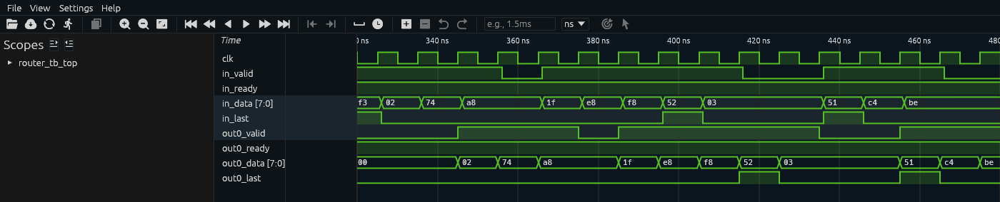
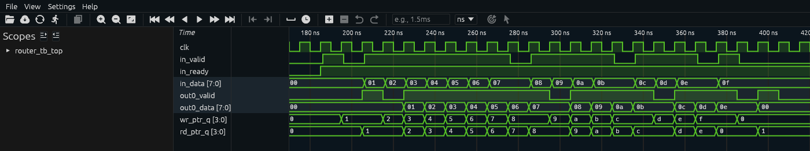

# Lab 02: A class testbench without UVM

You'll finish a class testbench for the router. Every class in it is plain SystemVerilog except
the test, which is a UVM test that the top module starts with `run_test()`. You write the
monitor, which turns the handshakes on a valid/ready stream into packets, and the scoreboard,
which predicts the packets that should come out of output 0 and checks the ones that do. Then you'll use the testbench to
catch two planted bugs, and rerun it with different plusargs to find out what each catch depends on.

Package: [`labs/lab-02-a-class-testbench-without-uvm/`](https://github.com/uoftasic/dd105-a/tree/main/labs/lab-02-a-class-testbench-without-uvm)

## Before you start

- Finish [Lab 01](lab-01-one-alu-two-testbenches-overview.md). This lab uses the same `make`
  targets, the same terminal and the same course folder.
- Read [Classes for testbenches](../guide/classes-for-testbenches.md),
  [Interfaces, clocking blocks and virtual interfaces](../guide/interfaces-clocking-blocks-and-virtual-interfaces.md)
  and [Threads, mailboxes and events](../guide/threads-mailboxes-and-events.md).
- Read [The router in one page](../reference/the-router-in-one-page.md), and keep the
  [specification](../reference/router-spec.md) open. You'll use its Packets, Routing and
  The outputs sections, and the stream rules under Valid/ready rules.

Time: about 2 h. The three builds in it took us 90 s, 89 s and 86 s.

## Part 1: The starter

What does the shipped testbench do, and what does it check?

1. Open a terminal on the workbench desktop, as in Lab 01, and go to the lab folder:

   ```bash
   . /foss/designs/common/.designinit   # a new terminal loads this by itself; safe to rerun
   mod dd105-a
   cd labs/lab-02-a-class-testbench-without-uvm
   ```

2. Start the build now, because it's the slowest step:

   ```bash
   make build
   ```

   The banner estimates 1.5 to 2.5 minutes, and with an empty ccache it took us 90 s. It ends with:

   ```text
   - V e r i l a t i o n   R e p o r t: Verilator 5.050 2026-07-01 rev v5.050
   - Verilator: Built from 48.403 MB sources in 393 modules, into 23.194 MB in 2538 C++ files needing 80.303 MB
   - Verilator: Walltime 89.763 s (elab=0.694, cvt=2.551, bld=85.825); cpu 4.237 s on 2 threads; allocated 312.547 MB
   ========================================================================
    built /w/labs/lab-02-a-class-testbench-without-uvm/build/sim in 90 s (48M; the 898M of generated C++ was deleted, SLIM=0 keeps it)
    ccache:  Hits: 0 / 36 ( 0.00%)  Misses: 36 / 36 (100.0%)
   ========================================================================
    /w/labs/lab-02-a-class-testbench-without-uvm/build/sim is up to date.
   ```

   We ran it with the course folder mounted at `/w`, so your paths start with
   `/foss/designs/modules/dd105-a` instead. The ccache counts add up over every build in your
   clone, Lab 01's included, so yours will be higher.

3. While it builds, read the files in `tb/`. Each class has one job. The generator hands its
   packets to the driver through a mailbox, and each monitor hands the packets it sees to the
   scoreboard through a mailbox of its own.

   | File | Class | Its job |
   |---|---|---|
   | `packet.svh` | `packet` | one packet: its beats, header first |
   | | `router_cfg` | the test's knobs, read from plusargs |
   | `generator.svh` | `generator` | makes the packets and puts them in a mailbox |
   | `driver.svh` | `driver` | offers each beat on the input until the router takes it |
   | | `sink` | holds one output's ready (`out0_ready` or `out1_ready`) at 1, and counts its beats |
   | | `apb_master` | writes the routing table and `CTRL.EN` |
   | `monitor.svh` | `monitor` | yours: turns a stream's handshakes into packets |
   | `scoreboard.svh` | `scoreboard` | yours: predicts output 0 and checks it |
   | `env.svh` | `env` | makes the classes above from `generator` to `scoreboard`, connects them, and runs the test |
   | `router_test_pkg.sv` | `router_class_test` | the one UVM class |
   | `router_tb_top.sv` | (module) | the clock, the reset, the interfaces, the router and `run_test()` |

   Read `env::run()` closely. It waits for reset and writes the configuration, then starts the
   sinks, the monitors and the scoreboard in a `fork ... join_none`. It sends the packets, waits
   50 cycles for the outputs to drain, and asks the scoreboard for its report. Nothing in it waits
   for the monitors or the scoreboard, so the test ends after those 50 cycles however much of them
   you've written.

   `router_class_test` makes the `env` and calls `run()`. It's a UVM test only so that this lab
   runs the way Lab 01 did, with `make` picking the test by name with `+UVM_TESTNAME` and the
   graders reading UVM's report summary at the end of every log. If the driver or the scoreboard
   counted any errors, the test reports a single `UVM_ERROR` saying how many, and the base test
   turns that into a failing exit status.

4. When the build has finished, run the test:

   ```bash
   make run
   ```

   After UVM's release notes you should see:

   ```text
   UVM_INFO @ 0: reporter [RNTST] Running test router_class_test...
   [ENV] 100 packets, DST from 0123, routes 0110, 1 to 8 beats
   [ENV] sent 100 packets (448 beats); output 0 took 252 beats and output 1 took 196
   [SB] 0 packets in, 0 predicted for output 0, 0 checked, 0 errors
   DD105: TEST PASSED
   ```

   followed by UVM's report summary and, last:

   ```text
   ------------------------------------------------------------------------
    ok: 0 UVM_ERROR, 0 UVM_FATAL   0.07 s   log: build/runs/router_class_test-s1/run.log
   ------------------------------------------------------------------------
   ```

   The first `[ENV]` line gives the test's knobs, which are plusargs (the package README lists
   them). `routes 0110` is the routing table, one character per entry from `ROUTE0` to `ROUTE3`,
   so packets for `DST` 0 and 3 go to output 0, and packets for `DST` 1 and 2 go to output 1.

5. `make check-all` runs the test on the golden router and on the two bugs this lab hunts. Write
   down what you expect it to report, then run it:

   ```bash
   make check-all
   ```

   You should see:

   ```text
         ok  the golden design                        0 UVM_ERROR, 0 UVM_FATAL        0.1s
   ------------------------------------------------------------------------
     MISSED  tier 2  B05_dst_field_off_by_one         0 UVM_ERROR, 0 UVM_FATAL        0.1s
     MISSED  tier 3  B09_write_pointer_power_of_two   0 UVM_ERROR, 0 UVM_FATAL        0.1s
   ------------------------------------------------------------------------
    0 of 2 caught.
    Still hiding from this test:
      B05_dst_field_off_by_one
         hides behind: sending to DST 0 only, or setting every route the same way
      B09_write_pointer_power_of_two
         hides behind: short tests: fewer than 16 beats through one output
   ```

   On the golden router, output 0 delivered 252 beats and the test passed. It passed on both
   broken routers as well. Why?

   <details>
   <summary>Answer</summary>

   The `[SB]` line says the scoreboard saw 0 packets and checked 0, because the starter's monitor
   and scoreboard are empty, so nothing compared those 252 beats with anything. A pass means only
   that no check fired, and with no checks the test passes on the golden router and on both bugs
   alike.

   </details>

Check: `0 of 2 caught`, and `[SB] 0 packets in` in `make run`.

## Part 2: The monitor

What goes into the router, and what comes out of output 0, packet by packet?

1. Open `tb/monitor.svh` and `tb/stream_if.sv`. The monitor holds a `virtual stream_mon_if`, an
   interface whose signals are all inputs, so a monitor can't drive the stream it watches. The top
   module makes two of these interfaces, `in_mon` wired to the input's four signals and `out0_mon`
   wired to output 0's. Both have the same type, so one `monitor` class watches either. The
   clocking block samples with `#1step`, so after `@(vif.cb)` returns at a rising edge,
   `vif.cb.valid` is the value that `valid` had just before that edge, which the specification
   calls its value in the cycle that the edge ends. The type is written out in full,
   `virtual stream_mon_if`, and never through a `typedef`, because on Verilator 5.050, when a class
   in a package reaches an interface through a typedef of its virtual interface type, the class
   reads 0 from every clocking-block input, with no warning.

2. This is the golden router taking one packet on its input and delivering it on output 0:

   

   *Seed 1, 320 to 480 ns. The input takes `02` at the rising edge at 335 ns, and `02` is on
   `out0_data` from 345 ns. `out0_ready` is 1 throughout.*

   A beat moves at a rising edge where `valid` and `ready` were both 1. Find `a8` on `in_data`.
   At how many rising edges is it on `in_data`, and how many beats is it?

   <details>
   <summary>Answer</summary>

   It's on `in_data` at two edges, 355 ns and 365 ns, and it's one beat. The driver put it there
   at 346 ns, the router took it at the edge at 355 ns, and the driver then left one idle cycle
   with `in_valid` at 0, so at 365 ns the pins still show `a8` but nothing moves. A monitor that
   looked only at `in_data` would record it twice. The output shows the same gap two cycles
   later.

   </details>

3. Write `monitor::run()`, following the `TODO`. Each time round a `forever` loop, wait with
   `@(vif.cb)`; drop any half-assembled packet while `vif.cb.rst_n` is 0; and in a handshake cycle
   add the beat to the packet `p`, starting a new one when `p` is null. When the beat has
   `last` = 1, the packet is finished, so put it in `to_sb` and set `p` back to null for the next
   one. Keep the `$display` format that the `TODO` gives, so that your output can be compared with
   the one below.

4. Check the syntax, which takes a few seconds, then build:

   ```bash
   make lint
   make build
   ```

   `make lint` ends with `0 warnings, by kind:` when your code is clean, and it prints any
   syntax error with its line number. With the reference monitor the build took 89 s, nearly as
   long as the first one, because filling in the empty task changed most of the C++ that
   Verilator generates, and the ccache could reuse only 10 of the 36 compiled files.

5. `+SHOW=5` makes each monitor print the first 5 packets it sees, with the time of the edge at
   which each packet's last beat moved. The clock period is 10 ns. Using the routing table `0110`
   and rule O8 of the specification, write down which input packets you expect to see again on
   output 0, and how many ns after its `[in]` line each `[out0]` line should come. Then run it:

   ```bash
   make run PLUSARGS="+SHOW=5"
   ```

   You should see, with the reference monitor:

   ```text
   [ENV] 100 packets, DST from 0123, routes 0110, 1 to 8 beats
   [in] 235 ns: dst 2, 5 beats: 80 b4 e5 26 c1
   [in] 325 ns: dst 2, 6 beats: 81 f3 06 8e bc f3
   [in] 405 ns: dst 0, 7 beats: 02 74 a8 1f e8 f8 52
   [out0] 425 ns: dst 0, 7 beats: 02 74 a8 1f e8 f8 52
   [in] 445 ns: dst 0, 2 beats: 03 51
   [out0] 465 ns: dst 0, 2 beats: 03 51
   [in] 575 ns: dst 3, 8 beats: c4 be 9e 50 be fe e2 92
   [out0] 595 ns: dst 3, 8 beats: c4 be 9e 50 be fe e2 92
   [out0] 685 ns: dst 0, 2 beats: 08 df
   [out0] 835 ns: dst 0, 1 beat: 0b
   [ENV] sent 100 packets (448 beats); output 0 took 252 beats and output 1 took 196
   ```

   The header's low six bits are the packet's sequence number, so `80` is packet 0, `81` packet
   1 and `02` packet 2. Why are packets 0 and 1 missing from output 0, and why does each `[out0]`
   line come 20 ns after the `[in]` line of the same packet?

   <details>
   <summary>Answer</summary>

   Their headers, `80` and `81`, have `DST` 2 in bits 7:6, and `ROUTE2` sends packets to output
   1, which this testbench doesn't watch. The 20 ns is two clock cycles. Rule O8 puts each beat
   on the output from the second cycle after its input handshake, as example E2 in the
   specification shows, unless the beat before it is still waiting there, as in E3. Here the sink
   takes every beat in the first cycle it's offered, so nothing waits, and each packet's last
   beat leaves output 0 two cycles after it went in.

   </details>

Check: your `[in]` and `[out0]` lines match the ones above. The seed is the same, so the packets
are too.

## Part 3: The scoreboard

Which packets should come out of output 0, and did they?

1. Read the comment at the top of `tb/scoreboard.svh`. The rule you're checking is O5, which says
   that an output delivers the beats of the packets routed to it in the order the router accepted
   them, unchanged. In this lab the sinks never stall, so no packet is dropped for a full output,
   and a packet goes to output 0 exactly when `ROUTE[DST]` is enabled with `PORT` 0.

2. Write the four `TODO`s:

   - `run()`: a `fork ... join` of two `forever` loops, one taking packets from `from_in` and
     calling `predict()`, the other taking packets from `from_out0` and calling `check()`.
   - `predict()`: push the packet onto `expected` if it will come out of output 0.
   - `check()`: compare what came out with the oldest packet in `expected`, using `packet::same()`.
     A packet that comes out while `expected` is empty is an error too.
   - `report()`: report an error for each packet still in `expected`, because it never came out,
     and one more if the test checked no packets at all.

   Report each error with `$error`, which takes a format string like `$display`, and count it:

   ```systemverilog
   n_errors++;
   $error("out0 delivered %s at %0d ns; expected %s", got.sprint(), got.t_last, want.sprint());
   ```

   Lab 01's `` `uvm_error `` won't work here, because this package doesn't import UVM. We tried
   it, and `make lint` stopped with two `Can't find definition of task/function` errors, one for
   `uvm_get_report_object` and one for `uvm_report_error`.

3. Run `make lint` and `make build`. With the reference scoreboard the build took 86 s. A small
   edit after that rebuilds faster. When we changed the text of one `$error`, the rebuild took
   21 s.

4. Run the test on the golden router:

   ```bash
   make run
   ```

   You should see `[SB] 100 packets in, 51 predicted for output 0, 51 checked, 0 errors`,
   `DD105: TEST PASSED` and `ok`. If an error fires here, the golden router is right, so the
   mistake is in your scoreboard or your monitor.

5. Run it on five seeds:

   ```bash
   make seeds NSEEDS=5
   ```

   You should see `5 ok  (5 runs)`. The coverage report under it says there are no covergroup
   bins, because this testbench has no covergroup yet. You'll add one in Lab 03.

6. Write down what you now expect from `make check-all`, then run it. With the reference
   scoreboard you should see:

   ```text
         ok  the golden design                        0 UVM_ERROR, 0 UVM_FATAL        0.1s
   ------------------------------------------------------------------------
     caught  tier 2  B05_dst_field_off_by_one         1 UVM_ERROR, 50 assertions      0.1s
     caught  tier 3  B09_write_pointer_power_of_two   1 UVM_ERROR, 46 assertions      0.1s
   ------------------------------------------------------------------------
    2 of 2 caught.
   ```

   The grader counts each `$error` as an assertion, because Verilator prints a `$error` and a
   failed assertion the same way, so the 50 and 46 are the reference scoreboard's errors. The one
   `UVM_ERROR` is the test's summary of them. Your counts depend on how your scoreboard reports,
   so they may differ.

7. Look at the first error on B05:

   ```bash
   make run BUG=B05
   ```

   With the reference scoreboard, the first two lines after `[ENV]` are:

   ```text
   [255000] %Error: scoreboard.svh:65: Assertion failed in router_tb_pkg.scoreboard.check: out0 delivered dst 2, 5 beats: 80 b4 e5 26 c1 at 255 ns, and no packet was expected
   -Info: labs/lab-02-a-class-testbench-without-uvm/tb/scoreboard.svh:65: Verilog $stop, ignored due to +verilator+error+limit
   ```

   The `-Info` line appears only once, after the first error. By default Verilator stops a run at
   its first `$error`. When we ran `build/sim` by hand without the plusarg, it stopped at this
   error with `Verilog $stop`, before the scoreboard's report and UVM's summary. That's why the
   lab's Makefile adds `+verilator+error+limit+100` to every run, so that your runs go on past
   each error until the 100th.

   The header is `80`, which is `1000_0000`. Which routing table entry should the router have
   used, which one did it use, and which bits of the header did it read?

   <details>
   <summary>Answer</summary>

   `DST` is bits 7:6, `10`, so it should have used `ROUTE2`, which sends to output 1. The packet
   came out of output 0, which only `ROUTE0` and `ROUTE3` send to. Bits 6:5 of `80` are `00`, so
   the router read the field one bit too low and used `ROUTE0`. That's B05, `dst_field_off_by_one`.

   </details>

8. Now the first error on B09:

   ```bash
   make run BUG=B09
   ```

   ```text
   [895000] %Error: scoreboard.svh:72: Assertion failed in router_tb_pkg.scoreboard.check: out0 delivered dst 3, 13 beats: c4 be 9e 50 be fe 02 74 a8 1f e8 f8 52 at 895 ns; expected dst 3, 8 beats: c4 be 9e 50 be fe e2 92, which went in at 455 ns
   ```

   The first six beats are right. Compare the other seven with your Part 2 printout. Where have
   you seen them before?

   <details>
   <summary>Answer</summary>

   They're packet 2, `02 74 a8 1f e8 f8 52`, the first packet that output 0 delivered in this run.
   Its beats came out of the buffer a second time, and its `last` flag ended the packet, which is
   why this one has 13 beats. Before it went wrong, output 0 had delivered all 7 beats of packet 2,
   both beats of packet 3 and the first 6 of packet 4's 8, which is 15 beats, so the 16th beat
   (packet 4's seventh, `e2`) is the first bad one. Part 4 shows why.

   </details>

Check: `2 of 2 caught` from `make check-all`.

## Part 4: What each catch depends on

Which property of the stimulus does each catch depend on? The test's knobs are plusargs, so each
of these runs reuses the simulator you built.

1. `+ROUTES=0000` sets all four routes to output 0. Predict whether your test still catches B05,
   then run:

   ```bash
   make check BUG=B05 PLUSARGS="+ROUTES=0000"
   ```

   You should see `ok` on the golden design, `MISSED` on B05 and `VERDICT: FAIL`. Why does the
   test miss B05 now?

   <details>
   <summary>Answer</summary>

   B05 changes which routing table entry the router reads. With all four entries set the same
   way, every entry sends the packet to output 0, so whichever one the router reads, the packet
   still comes out of output 0 in the order it went in, and nothing at the pins shows which entry
   was used. A test checks the `DST` field only when each of its values, and each of its bits,
   has an effect of its own on where a packet goes.

   </details>

2. `+DSTS=0` sends every packet to `DST` 0. Predict both results, then run:

   ```bash
   make check BUG=B05 PLUSARGS="+DSTS=0 +N=32"
   make check BUG=B05 PLUSARGS="+DSTS=0"
   ```

   The first prints `MISSED`. The second, with the default 100 packets, prints

   ```text
     caught  B05_dst_field_off_by_one                 1 UVM_ERROR, 68 assertions      0.1s
   ```

   and its first error is:

   ```text
   [4725000] %Error: scoreboard.svh:72: Assertion failed in router_tb_pkg.scoreboard.check: out0 delivered dst 0, 1 beat: 00 at 4725 ns; expected dst 0, 8 beats: 20 69 85 07 03 c1 02 4b, which went in at 2435 ns
   ```

   Why does `DST` 0 alone catch B05 with 100 packets and not with 32?

   <details>
   <summary>Answer</summary>

   The header's other six bits are the sequence number, which counts 0 to 63 and wraps. For
   packets 0 to 31, bits 7:5 are all 0, so bits 6:5 read `00`, the same as `DST`, and the bug has
   no effect. Packet 32's header is `20`, `0010_0000`, whose bits 6:5 are `01`, so the router uses
   `ROUTE1` and sends packets 32 to 63 to output 1. The error shows this. Output 0 was expecting
   packet 32 (`20`), and the next packet it delivered was packet 64, whose sequence number has
   wrapped to 0, so its header is `00`. With 100 packets, the sequence number's top bit
   happened to give header bit 5 an effect of its own.

   </details>

3. In Part 1, `make check-all` said that B09 hides behind short tests, with fewer than 16 beats
   through one output. With `+DSTS=0 +LEN=1`, every packet is one beat long and goes to output 0.
   Work out the smallest `+N` that should catch B09 and write it down. Then try it and the number
   below it:

   ```bash
   make check BUG=B09 PLUSARGS="+DSTS=0 +LEN=1 +N=15"
   make check BUG=B09 PLUSARGS="+DSTS=0 +LEN=1 +N=16"
   ```

   You should see, from the two commands:

   ```text
     MISSED  B09_write_pointer_power_of_two           0 UVM_ERROR, 0 UVM_FATAL        0.0s
   ```

   ```text
     caught  B09_write_pointer_power_of_two           1 UVM_ERROR, 1 assertion        0.0s
           UVM_ERROR [TB] the testbench reported 1 error
           scoreboard.svh:72: Assertion failed in router_tb_pkg.scoreboard.check: out0 delivered dst 0, 1 beat:
   ```

   `make run` with the same `BUG` and `PLUSARGS` prints the whole error:
   `out0 delivered dst 0, 1 beat: 00 at 405 ns; expected dst 0, 1 beat: 0f, which went in at 385 ns`.

4. Record the 16-beat run and open it:

   ```bash
   make waves BUG=B09 PLUSARGS="+DSTS=0 +LEN=1 +N=16"
   surfer build/runs/router_class_test-s1-B09/waves.fst &
   ```

   Add `clk` from `router_tb_top`, `in_valid`, `in_ready`, `in_data`, `out0_valid` and
   `out0_data` from `dut`, and `wr_ptr_q` and `rd_ptr_q` from `dut.u_buf0`, output 0's buffer:

   

   *B09. Beats `00` to `0e` come out as they went in. `wr_ptr_q` goes on from `e` to `f` while
   `rd_ptr_q` wraps from `e` to `0`, and the 16th beat comes out as `00` instead of `0f`.*

   The buffer holds 16 beats, one in the output register that drives the pins and 15 in a small
   RAM behind it (`labs/common/rtl/router_fifo.sv`), so both pointers should wrap after entry
   `e`. Why does the 16th beat come out as `00`?

   <details>
   <summary>Answer</summary>

   The write pointer wrapped at 16, as if the RAM had 16 entries, so beat `0f` was written to
   entry `f`, which doesn't exist, and was lost. The read pointer wrapped correctly to entry 0,
   which still held beat `00` from the start of the test. Up to the 15th beat, each beat is read
   from the entry it was written to, so no test that puts fewer than 16 beats through an output
   can see the bug.

   </details>

Check: `MISSED` with `+ROUTES=0000` and with `+N=15`, and `caught` with `+N=16`.

## Finishing

You're done when `make check-all` prints `2 of 2 caught.` with the monitor and scoreboard you wrote
in `tb/monitor.svh` and `tb/scoreboard.svh`.

Questions:

1. In Lab 01 the UVM testbench was split into the same kinds of pieces. Which jobs did UVM do there
   that the shipped classes, or you, did by hand here?

   <details>
   <summary>Answer</summary>

   UVM connected the pieces in Lab 01. Here `env::new()` makes three mailboxes and passes each one
   to its two ends by hand. In Lab 01, UVM's phases started each component and its objections
   decided when the test was over. Here `env::run()` forks every `run()` task itself and ends the
   test after a fixed 50-cycle drain. UVM's report server counted every `` `uvm_error `` by its
   ID, while here the driver and the scoreboard each keep their own `n_errors`, and
   `env::n_errors()` adds them up for the test. In Lab 01 each test was its own class, picked by
   name with `+UVM_TESTNAME`, and every test reused the same driver, monitor and scoreboard. Here
   there is one test, its variations are the plusargs that `router_cfg` reads, and anything those
   can't express needs a change to `env::run()`. In Lab 04 you'll finish a UVM port of this
   testbench as it stands after Lab 03, and compare the two piece by piece.

   </details>

2. On B09 the reference scoreboard's second error is
   `out0 delivered dst 0, 2 beats: 03 51 at 935 ns; expected dst 0, 2 beats: 08 df, which went in at 655 ns`.
   Is that a second bug, and which error should you read first when a scoreboard reports many?

   <details>
   <summary>Answer</summary>

   It's the same bug. `03 51` is packet 3, the second packet that output 0 delivered, coming out
   of the buffer again. After the first wrong packet the buffer keeps handing back old beats, so
   the packets that output 0 delivers no longer line up with the ones in `expected`, and most of
   the later errors follow from the first. Read the first error first. The later ones count
   comparisons that failed after the two fell out of step, so their number says little about how
   many packets the router got wrong.

   </details>

Submit: nothing for this lab.

## Going further (optional)

Watch output 1 as well. The top module needs a third `stream_mon_if`, wired to `out1` and set in
`config_db`, and `router_class_test` has to get it and pass it to the `env`. The `env` needs a
third monitor, and a fourth mailbox to carry that monitor's packets to the scoreboard. The
scoreboard needs a second queue of expected packets, which `predict()` fills for routes with
`PORT` 1. Rebuild and run `make seeds NSEEDS=5` to check that the golden router still passes.

Next on the [Course path](../index.md#course-path): the reading on constrained random and
functional coverage, then Lab 03: Constraints and coverage.
