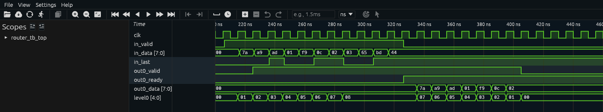

# Lab 03: Constraints and coverage

You'll add a covergroup to a class testbench for the router and use it to see what the testbench's
random stimulus really sends. Then you'll constrain the packet so that the simulator produces the
distribution you ask for, and write the stimulus that reaches two coverage holes, which is where
this lab's two planted bugs are.

Package: [`labs/lab-03-constraints-and-coverage/`](https://github.com/uoftasic/dd105-a/tree/main/labs/lab-03-constraints-and-coverage)

## Before you start

- Finish Lab 02. The testbench in this lab is a class testbench of the kind you built there:
  drivers and monitors that reach the pins through virtual interfaces, mailboxes, a reference model
  and a scoreboard. The package ships our version of it, with three files for you to finish.
- Read [Constrained random on Verilator](../guide/constrained-random-on-verilator.md) and
  [Functional coverage you can read](../guide/functional-coverage-you-can-read.md).
- Keep the [router specification](../reference/router-spec.md) open, and read its
  [Routing](../reference/router-spec.md#routing) section again: this lab is about the level of an
  output and what the router does with a packet at each level.
- In a terminal on the workbench desktop, load the course and go to the lab folder:

  ```bash
  . /foss/designs/common/.designinit
  mod dd105-a
  cd labs/lab-03-constraints-and-coverage
  ```

Time: about 1 h 30 min. About 6 minutes of that is waiting for four builds of the simulator, each
of which took 93 to 100 s on 2 CPUs when we timed them.

## Part 1: The testbench you start from

What does the starting testbench check, and does it catch this lab's two bugs?

1. Start the build now, because it takes a while:

   ```bash
   make build
   ```

   With an empty ccache it took 93 s, and it ends with:

   ```text
   - Verilator: Walltime 92.524 s (elab=0.711, cvt=2.632, bld=88.490); cpu 4.360 s on 2 threads; allocated 316.547 MB
   ========================================================================
    built .../labs/lab-03-constraints-and-coverage/build/sim in 93 s (49M; the 922M of generated C++ was deleted, SLIM=0 keeps it)
    ccache:  Hits: 0 / 36 ( 0.00%)  Misses: 36 / 36 (100.0%)
   ```

2. While it builds, read the files in `tb/`. The test is the one UVM class: `router_rand_test`
   extends `dd105_base_test`, which turns any `UVM_ERROR` into a failing exit status, and its
   `run_phase` creates the testbench and runs the stimulus. Everything else is a plain class:

   | File | What it does |
   |---|---|
   | `packet.svh` | the input packet; `kind` picks a range for the length, and `post_randomize()` picks the length |
   | `drivers.svh` | the APB master, the source, and a sink on each output whose `stall` knob holds `out_ready` at 0 |
   | `monitors.svh` | report every beat, APB transfer and cycle, stamped with the cycle number |
   | `model.svh`, `scoreboard.svh` | the router as the specification describes it, run cycle by cycle on what the monitors saw |
   | `coverage.svh` | empty: Part 2 fills it in |
   | `router_test_pkg.sv` | four phases of 200 random packets, each with a random routing table and sinks that are always ready, then `close_holes()`, which is empty: Part 4 fills it in |

   The scoreboard tracks both outputs' levels, predicts every drop, and checks `irq` in every
   cycle and every register the test reads, `STATUS` and `DROP_CNT` included.

3. Run the test:

   ```bash
   make run
   ```

   You should see, near the end:

   ```text
   UVM_INFO labs/lab-03-constraints-and-coverage/tb/scoreboard.svh(246) @ 32975000: reporter [SB] 3298 cycles; 2007 input beats in 800 packets: 511 forwarded, 289 NOROUTE, 0 FULL, 72 oversize; 1227 output beats
   UVM_INFO labs/lab-03-constraints-and-coverage/tb/scoreboard.svh(248) @ 32975000: reporter [SB] 32 register reads checked, 32 writes; irq wrong in 0 cycles
   DD105: TEST PASSED
   ```

   and last, `ok: 0 UVM_ERROR, 0 UVM_FATAL   0.44 s`.

4. This lab's bugs are B07, which counts a packet for a disabled route as a FULL drop as well when
   the output its route names is too full, and B08, which drops a packet that arrives when its
   output holds exactly 8 beats. The scoreboard would report either one as a wrong `irq` or a wrong
   `DROP_CNT`. Write down whether you expect `router_rand_test` to catch them, then run it against
   both:

   ```bash
   make check-all
   ```

   You should see:

   ```text
         ok  the golden design                        0 UVM_ERROR, 0 UVM_FATAL        0.4s
   ------------------------------------------------------------------------
     MISSED  tier 2  B07_full_counted_on_disabled_route 0 UVM_ERROR, 0 UVM_FATAL        0.4s
     MISSED  tier 3  B08_admission_off_by_one         0 UVM_ERROR, 0 UVM_FATAL        0.4s
   ------------------------------------------------------------------------
    0 of 2 caught.
   ```

   followed by what each bug hides behind, and an error line from `make`, because the verdict is a
   fail. The run reported `0 FULL`: the test never dropped a packet for a full output. Why can't
   it, on any seed?

   <details>
   <summary>Answer</summary>

   Both sinks are always ready, so every beat leaves its output in the first cycle it's on the
   pins, and beats don't pile up (Part 2 measures how high the levels got). A FULL drop needs a level of 9 or more, B08 needs a
   header at exactly 8, and B07 needs a disabled route whose `PORT` names an output above 8. The
   seed changes the packets and the routing tables, but every seed keeps the sinks ready.

   </details>

Check: `ok` on the golden design and `0 of 2 caught.`

## Part 2: A covergroup you can read

What does `router_rand_test` actually send the router, and where does it never go?

1. Read `post_randomize()` in `tb/packet.svh`. Write down how many of the 800 packets you expect to
   be 1 beat long.

2. Open `tb/coverage.svh`. The scoreboard calls `sample_pkt()` once for every packet, with a
   `router_pkt_info` (in `items.svh`) that holds its length, its DST, its fate (`FATE_NOROUTE`,
   `FATE_FULL`, `FATE_OUT0` or `FATE_OUT1`, which are 0 to 3) and the level of the output its route
   names in the cycle its header was accepted. Write a covergroup `cg_pkt` with these coverpoints
   and bins, using these names, because the outputs below use them:

   | Coverpoint | Bins |
   |---|---|
   | `cp_len` | `len1` to `len8` for 1 to 8, `oversize` for `[9:64]` |
   | `cp_dst` | `dst0` to `dst3` |
   | `cp_fate` | `noroute`, `full`, `out0`, `out1` for 0 to 3 |
   | `cp_level` | `empty` for 0, `low` for `[1:7]`, `at_8`, `at_9`, `high` for `[10:16]` |
   | `x_fate_level` | `cross cp_fate, cp_level` |

   Write every bin out by name, as `bins low = {[1:7]};`. An array of bins such as
   `bins b[] = {[0:3]}` becomes a single bin on this simulator when its coverpoint is in a cross.

   Write it first the way most examples write a covergroup in a class: keep the record in a member
   (`router_pkt_info info;`), let the coverpoints read it (`cp_len: coverpoint info.len { ... }`),
   construct the covergroup in `new()` (`cg_pkt = new();`), and in `sample_pkt()` store the record
   and call `cg_pkt.sample()`.

3. Build it:

   ```bash
   make build
   ```

   It stops after about 4 s with:

   ```text
   %Warning-COVERIGN: labs/lab-03-constraints-and-coverage/tb/coverage.svh:18:24: Unsupported: 'covergroup' coverpoint referencing enclosing class member; ignoring covergroup '__vlAnonCG_cg_pkt'
   %Error: Exiting due to 1 warning(s)
   ```

   with your own line and column. Verilator 5.050 doesn't support a coverpoint that reads a member
   of the class the covergroup is in, and the warning says what it does instead: it ignores the
   whole covergroup. The course's build stops on any warning it hasn't been told to ignore, so you
   find out here rather than from a coverage report with no bins in it.

4. Rewrite it so the values arrive as arguments of `sample()`:

   ```systemverilog
   covergroup cg_pkt with function sample(int len, int dst, int fate, int level);
   ```

   with coverpoints on `len`, `dst`, `fate` and `level`, and in `sample_pkt()`:

   ```systemverilog
   cg_pkt.sample(i.len, i.dst, int'(i.fate), i.level);
   ```

   Delete the `info` member. Then `make build` again: adding a covergroup changes the class, and
   the rebuild took 94 s.

5. Every run writes the hit count of every bin to `coverage.dat` in its run folder, and `make cov`
   merges every `coverage.dat` under `build/runs`, so delete the old runs first and then run the
   test and read its coverage:

   ```bash
   rm -rf build/runs
   make run
   make cov
   ```

   The coverage summary also lists line, toggle and other kinds at `0.0% ( 0/ 0)`, because this
   build collects only covergroups. After them you should see:

   ```text
    verilator_coverage: covergroup : 57.1% (24/42)
   ------------------------------------------------------------------------
    42 covergroup bins, 24 hit at least once:
     __vlAnonCG_cg_pkt.cp_dst                        4 of 4    bins hit
     __vlAnonCG_cg_pkt.cp_fate                       3 of 4    bins hit
     __vlAnonCG_cg_pkt.cp_len                        9 of 9    bins hit
     __vlAnonCG_cg_pkt.cp_level                      2 of 5    bins hit
     __vlAnonCG_cg_pkt.x_fate_level                  6 of 20   bins hit
   ```

   then the 18 empty bins by name: `cp_fate.full`, `cp_level.at_8`, `at_9` and `high`, and 14 of
   the cross's bins. `__vlAnonCG_cg_pkt` is the name Verilator gives the covergroup.

6. `build/coverage/bins.txt` has every bin with its count. Look at `cp_len`:

   ```bash
   grep cp_len build/coverage/bins.txt
   ```

   ```text
          634  __vlAnonCG_cg_pkt.cp_len.len1
            6  __vlAnonCG_cg_pkt.cp_len.len2
            7  __vlAnonCG_cg_pkt.cp_len.len3
            6  __vlAnonCG_cg_pkt.cp_len.len4
            7  __vlAnonCG_cg_pkt.cp_len.len5
            5  __vlAnonCG_cg_pkt.cp_len.len6
            9  __vlAnonCG_cg_pkt.cp_len.len7
           54  __vlAnonCG_cg_pkt.cp_len.len8
           72  __vlAnonCG_cg_pkt.cp_len.oversize
   ```

   Compare 634 with what you wrote down in step 1. Why are four packets in five a single beat?

   <details>
   <summary>Answer</summary>

   Each of the four kinds should come out about 200 times, so about 200 packets should be 1 beat.
   But `kind` is a `rand` enum that no constraint names, and here it came out as its first value,
   `LEN_ONE`, in 634 of 800 draws, with no error or warning. The test passed anyway, because a pass
   doesn't look at the distribution. You'll measure the skew on its own in Part 3.

   </details>

7. Read the hides-behind lines that `make check-all` printed in Part 1. Which empty bins would a
   packet hit if it met B08's condition, and which if it met B07's? And of the cross's 20 bins,
   which can no test ever hit?

   <details>
   <summary>Answer</summary>

   B08 needs a packet admitted at exactly 8: `out0_x_at_8` or `out1_x_at_8`. B07 needs a NOROUTE
   drop while the output its route names holds more than 8: `noroute_x_at_9` or `noroute_x_high`.
   Seven bins are impossible by the specification: a FULL drop happens only at 9 or more
   (`full_x_empty`, `full_x_low`, `full_x_at_8`), and a packet is admitted only at 8 or less
   (`out0_x_at_9`, `out0_x_high`, `out1_x_at_9`, `out1_x_high`). So this covergroup can't get past
   35 of 42.

   That's also why you read the bins rather than the percentage. Verilator's 57.1% is hit bins over
   all bins, crosses included. The standard's formula averages the five items instead (100, 100,
   75, 40 and 30%), which gives 69%. To see which bins matter, read the list.

   </details>

Check: `covergroup : 57.1% (24/42)`, and `len1` at 634.

## Part 3: Constraints the simulator honours

How do you get the length distribution you ask for on this simulator, and how do you know you got
it?

1. Open `traps/traps.sv`. It has six small experiments, each a class randomized many times, in the
   shapes this lab's packet and tests use. For each numbered line it prints, write down what the
   SystemVerilog standard says it should show.

2. Run it. It builds with plain Verilator, without UVM, in seconds:

   ```bash
   make traps
   ```

   You should see:

   ```text
   1  rand enum, no constraint names it        LEN_ONE  799  LEN_MID   59  LEN_MAX   64  LEN_OVER   78
   1  the same, with kind inside {...}         LEN_ONE  272  LEN_MID  256  LEN_MAX  254  LEN_OVER  218
   2  kind dist {LEN_ONE := 20, ...}           LEN_ONE  261  LEN_MID  248  LEN_MAX  256  LEN_OVER  235
   2  kind dist {0 := 20, ...}                 LEN_ONE  195  LEN_MID  498  LEN_MAX  212  LEN_OVER   95
   3  len dist {...} and len <= 10             randomize() failed 67 times in 1000
   3  kind dist {...}, len from kind, len <= 10  randomize() failed 0 times in 1000
   3  the same, with { len == 3; }             randomize() failed 498 times in 1000
   3  the same, c_kind.constraint_mode(0)      randomize() failed 0 times in 1000
   4  solve big before len                     big in 20 of 1000
   4  the same without solve...before          big in 22 of 1000
   5  lens.sum() == 8, dynamic array           randomize() failed 20 times in 20
   5  lens.sum() == 8, fixed array of 8        randomize() failed 0 times in 20; the sum was 8 in 20
   6  unique {a}, a is bit [3:0] a[4]          a value repeated in 337 of 1000
   6  unique {w, x, y, z}                      a value repeated in 0 of 1000
   ========================================================================
    traps: build 4.2 s, run 4.4 s, seed 1; 1668 UNSATCONSTR warnings in build/traps/run.log
   ========================================================================
   ```

   The first build of `traps.sv` took us 8.1 s, and later ones about 4 s. Each failed `randomize()`
   prints UNSATCONSTR warnings, which the target counts instead of showing. Compare each line with
   what you wrote.

   <details>
   <summary>Answer</summary>

   1. The standard makes an unconstrained enum uniform, about 250 each. Here the first value came
      out 799 times. A constraint that names `kind`, here `inside` with all four values, gave
      272, 256, 254 and 218.
   2. Both should give about 200, 500, 200 and 100. With the weights' values written as the enum's
      names, the weights were ignored and the four came out about equally; written as numbers,
      they were honoured.
   3. None of the four should fail: `len <= 10` leaves a value in every weighted range, and with
      `len == 3` the solver should choose `kind` 1. Here a `dist` behaves as if it draws its value
      first and only then solves the other constraints, so a draw that another constraint rules
      out fails. On `len` itself, `len <= 10` rules out 11 and 12, and 67 calls failed. With the
      weights on a selector, `kind`, the length is solved inside whichever range was drawn, and
      none failed. But `len == 3` rules out three kinds that hold half the weight, and 498 calls
      failed. Turning the `dist` off for that call stops the failures.
   4. With `solve big before len`, the standard decides `big` first, at 50/50, so about 500.
      Without it, each of the 8 solutions is equally likely and `big` is 1 in 8, about 125. Here
      both gave about 20: `solve...before` is ignored, and the solver doesn't choose evenly among
      the solutions either.
   5. Both should work. `sum()` on a dynamic array can't be solved here and fails every time; on a
      fixed-size array it works.
   6. Neither should repeat a value. `unique` on an array isn't enforced: 337 of 1000 is about the
      one draw in three that four random 4-bit values repeat with no constraint at all. On separate
      variables it works.

   </details>

3. Now fix the packet. In `tb/packet.svh`, make `len` a `rand` field, give the four kinds weights
   of 20, 50, 20 and 10 with a `dist` on `kind` whose values are written as the numbers 0 to 3, and
   let a constraint choose `len` from `kind`: `(kind == LEN_ONE) -> len == 1;` and so on for 2 to 7,
   8 and 9 to 12. Then `post_randomize()` only needs to call `build(1)`. Weights in variables, such
   as `0 := w_one`, also work, and let a test change them.

4. Before you rebuild, write down how many of the 800 packets you expect in each `cp_len` bin. Then
   build, run and read the coverage:

   ```bash
   make build
   rm -rf build/runs
   make run
   make cov
   grep cp_len build/coverage/bins.txt
   ```

   The rebuild took 100 s. With the reference solution you should see:

   ```text
          182  __vlAnonCG_cg_pkt.cp_len.len1
          100  __vlAnonCG_cg_pkt.cp_len.len2
           88  __vlAnonCG_cg_pkt.cp_len.len3
           50  __vlAnonCG_cg_pkt.cp_len.len4
           51  __vlAnonCG_cg_pkt.cp_len.len5
           42  __vlAnonCG_cg_pkt.cp_len.len6
           48  __vlAnonCG_cg_pkt.cp_len.len7
          144  __vlAnonCG_cg_pkt.cp_len.len8
           95  __vlAnonCG_cg_pkt.cp_len.oversize
   ```

   and the run's scoreboard line says `3894 input beats in 800 packets`. The four kinds came out
   182, 379, 144 and 95 times, close to the 160, 400, 160 and 80 you asked for. Your own constraints
   may give different counts with the same seed, but they should be about as close. If each of the four
   kinds came out about 200 times, look at line 2 of the experiments.

5. The six lengths from 2 to 7 share their kind's 379 packets, but not evenly: 100 and 88 for 2 and
   3, and 42 to 51 for the rest. What does that tell you about a constraint such as
   `len inside {[2:7]}`?

   <details>
   <summary>Answer</summary>

   The standard makes each of the six equally likely, about 63 each. This simulator's solver
   favours some of them, as line 4 of the experiments also showed. A constraint says which values
   are allowed, and on this simulator it doesn't promise how often each one comes, so you count
   them in the coverage.

   </details>

Check: `len1` near 160, `len8` near 160, and `oversize` near 80.

## Part 4: Close the two holes

What stimulus reaches B07's and B08's bins, and does the scoreboard catch the bugs once it does?

1. Work it out on paper first, from the specification's Routing section. Output 0 is empty and its
   sink is stalled. Which packets put it at exactly 8? What happens to the next packet for an
   enabled route to output 0, and then to a packet for a disabled route whose `PORT` is 0?

   <details>
   <summary>Answer</summary>

   Any packets for an enabled route to output 0 whose lengths add up to 8 beats. Nothing leaves
   while the sink is stalled, so the level in the next header's cycle is 8, and a packet for that
   route is admitted (`out0_x_at_8`, B08's bin) and raises the level to between 9 and 16. A packet
   for a disabled route is then a NOROUTE drop at that level (`noroute_x_at_9` or
   `noroute_x_high`, B07's bin), and the specification says it's never counted as FULL as well.

   </details>

2. In `tb/router_test_pkg.sv`, before `router_base_test`, write a class `fill_plan` with
   `rand int unsigned lens[8]`, each 0 to 8, constrained so that `lens.sum()` is 8. A 0 means "no
   packet". The array has a fixed size because of line 5 of the experiments.

3. Fill in `close_holes()`. For each output `port`, 0 and then 1:

   - `route(0, 1, port)` and `route(1, 0, port)`: DST 0 enabled to this output, DST 1 disabled
     with its `PORT` naming it;
   - `wr(A_INT_EN, 32'h2)`, so `irq` rises at every FULL event and at nothing else, and
     `wr(A_CTRL, 32'h1)`;
   - `stall(port, 1)` and then `cycles(2)`, so the stall reaches the pin before any beat can;
   - randomize a `fill_plan` and `send(packet::make(0, n))` for each length `n` that isn't 0;
   - three random packets for DST 0, 1 and 0, each from `randomize() with { dst == ...; }` and
     `send()`;
   - `wait_sent()`, `cycles(4)`, `read_events()`, `drain()`, `read_events()` and `clear_events()`.

   The fill packets come from `packet::make()` rather than `randomize() with { len == n; }`,
   because with the weights from Part 3 on, about half of those calls would fail (line 3 of the
   experiments). A `uvm_info` that prints the plan's lengths will help you read the waveform later.
   The scoreboard checks `irq` and every read, so `close_holes()` itself checks nothing.

4. Build, then run the short test that does nothing but `close_holes()`:

   ```bash
   make build
   rm -rf build/runs
   make run UVM_TESTNAME=router_fill_test
   ```

   The rebuild took 95 s. With the reference solution you should see its two messages and `ok`:

   ```text
   UVM_INFO labs/lab-03-constraints-and-coverage/tb/router_test_pkg.sv(243) @ 605000: uvm_test_top [HOLES] output 0 stalled and filled to 8 by packets of 2 4 2 beats, then packets of 8, 1 and 8 beats for DST 0, 1 and 0
   UVM_INFO labs/lab-03-constraints-and-coverage/tb/router_test_pkg.sv(243) @ 1645000: uvm_test_top [HOLES] output 1 stalled and filled to 8 by packets of 2 6 beats, then packets of 2, 6 and 8 beats for DST 0, 1 and 0
   ...
    ok: 0 UVM_ERROR, 0 UVM_FATAL   0.07 s   log: build/runs/router_fill_test-s1/run.log
   ```

   If the golden router doesn't pass here, read the first `UVM_ERROR` or `UVM_FATAL` in the log:
   with the golden router, it points at your stimulus.

5. Run the graded test too, and read the coverage of both runs:

   ```bash
   make run
   make cov
   ```

   With the reference solution you should see `covergroup : 81.0% (34/42)` and 8 bins never hit:
   the seven impossible ones from Part 2, and `noroute_x_at_8`. Could a test hit that last one?

   <details>
   <summary>Answer</summary>

   Yes. It needs a packet for a disabled route while the output its `PORT` names holds exactly 8:
   send it straight after the fill, before the packet that's admitted at 8.

   </details>

6. Now ask for the verdict:

   ```bash
   make check-all
   ```

   With the reference solution you should see:

   ```text
         ok  the golden design                        0 UVM_ERROR, 0 UVM_FATAL        1.4s
   ------------------------------------------------------------------------
     caught  tier 2  B07_full_counted_on_disabled_route 6 UVM_ERROR                     1.4s
     caught  tier 3  B08_admission_off_by_one         15 UVM_ERROR                    2.1s
   ------------------------------------------------------------------------
    2 of 2 caught.
   ```

   `make check BUG=B07` shows the first check that fired, and it's `irq`:

   ```text
   UVM_ERROR [SB] irq is 1 from cycle 6155, but STATUS = 001 and INT_EN = 010 make it 0
   ```

7. Record both routers running `router_fill_test` and open them:

   ```bash
   make waves UVM_TESTNAME=router_fill_test
   make waves UVM_TESTNAME=router_fill_test BUG=B08
   surfer build/runs/router_fill_test-s1/waves.fst &
   surfer build/runs/router_fill_test-s1-B08/waves.fst &
   ```

   From `dut`, add `in_valid`, `in_data`, `in_last`, `out0_valid`, `out0_ready`, `out0_data`,
   `level0` and `irq`, and look at 600 to 900 ns. `level0` is the router's own count of the beats in
   output 0, the value `LEVEL` reads, and Surfer shows it in hex.

   

   *The golden router. The fill packets `00 c0`, `01 a9 ad 19` and `02 0c` go in from 615 to
   695 ns with `out0_ready` low, and `level0` counts up to 08. The header `03` is accepted in the
   cycle that ends at 705 ns, at level 8, so its packet is admitted and `level0` climbs to 10 (16).
   `irq` rises at 865 ns, after the header `05` of the third packet is dropped as FULL.*

   

   *B08. The same packets, and `level0` stops at 08, because the header `03` is dropped. `irq`
   rises at 705 ns.*

   `in_data` holds random values in the cycles where `in_valid` is 0, because the source puts them
   there and the router must ignore them. In the B08 run, the scoreboard's first error is
   `irq is 1 from cycle 72, but STATUS = 000 and INT_EN = 010 make it 0`. Which edge in the
   picture is cycle 72's?

   <details>
   <summary>Answer</summary>

   Cycle n is the clock period that ends at the rising edge at $10n - 5$ ns, so cycle 71, in which
   the header `03` is accepted, ends at 705 ns. B08 drops the packet at that edge and sets
   `STATUS.FULL`, so `irq` is 1 throughout cycle 72, from 705 to 715 ns. The model kept `STATUS` at
   0, because at level 8 the packet is admitted.

   </details>

Check: `2 of 2 caught.`

## Finishing

You're done when `make check-all` prints `2 of 2 caught.` with your own covergroup in
`tb/coverage.svh`, your constraints in `tb/packet.svh` and your `close_holes()` in
`tb/router_test_pkg.sv`.

Questions:

1. The scoreboard you started with already modelled the levels and checked `irq` and `DROP_CNT`,
   and the test passed. What did the coverage tell you that the passing test couldn't?

   <details>
   <summary>Answer</summary>

   That the checks never had anything to check in the places the bugs were. A pass says the
   router agreed with the model on everything the stimulus did; the empty bins said the stimulus
   never made a FULL drop, never had an output above 7 beats when a header arrived, and sent four
   packets in five as a single beat. B07 and B08 sat in two of those empty bins, and once the
   stimulus reached them, the existing checks caught both, with no change to the scoreboard.

   </details>

2. Would running the starter on more seeds (`make seeds` runs seeds 1 to 10) have found B08?

   <details>
   <summary>Answer</summary>

   No. Every seed keeps the sinks always ready, so no seed lets an output reach 8. More seeds help
   only with holes that random stimulus can reach, and Part 1's answer explains why it can't reach
   these two.

   </details>

Submit: nothing for this lab.

## Going further (optional)

- Run `make traps SEED=2` and see which lines move. Then change a class in `traps/traps.sv`,
  predict its line, and run it again. Each run takes under 15 s.
- Cover `noroute_x_at_8` as well, and check with `make cov`.

Next on the [Course path](../index.md#course-path): the reading on the UVM skeleton, sequences,
monitors and the factory, then Lab 04: The same testbench in UVM.
