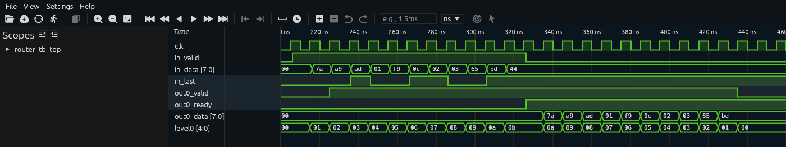

# Lab 03: Constraints and coverage

You'll add a covergroup to your Lab 02 testbench and use it to see what the testbench's random
stimulus really sends the router. Then you'll constrain the packet so that the simulator produces
the length distribution you ask for, and write the stimulus that reaches two coverage holes, which
is where this lab's two planted bugs are.

Package: [`labs/lab-03-constraints-and-coverage/`](https://github.com/uoftasic/dd105-a/tree/main/labs/lab-03-constraints-and-coverage)

## Before you start

- Finish [Lab 02](lab-02-a-class-testbench-without-uvm-overview.md). This lab's package is the
  Lab 02 testbench, with our solution's `monitor.svh` and `scoreboard.svh` in `tb/` and some new
  pieces around them, which Part 1 walks through. If your own monitor and scoreboard passed
  Lab 02's `make check-all`, you can copy them over ours (the error counts quoted on this page come
  from ours, so yours may differ):

  ```bash
  cp ../lab-02-a-class-testbench-without-uvm/tb/monitor.svh ../lab-02-a-class-testbench-without-uvm/tb/scoreboard.svh tb/
  ```

- Read [Constrained random on Verilator](../guide/constrained-random-on-verilator.md) and
  [Functional coverage you can read](../guide/functional-coverage-you-can-read.md).
- Keep the [router specification](../reference/router-spec.md) open, and read its
  [Routing](../reference/router-spec.md#routing) section again: this lab is about the level of an
  output and what the router does with a packet at each level.
- In a terminal on the workbench desktop, load the course and go to the lab folder:

  ```bash
  . /foss/designs/common/.designinit
  mod dd105-a
  cd labs/lab-03-constraints-and-coverage
  ```

Time: about 1 h 30 min. The builds in it took us 107 s (the first), 4 s (the one that stops in
Part 2), 100 s, 89 s and 89 s on 2 CPUs, and `make traps` took 9 s.

## Part 1: The testbench you start from

What does the starting testbench check, and does it catch this lab's two bugs?

1. Start the build now, because it takes a while:

   ```bash
   make build
   ```

   With an empty ccache it took us 107 s (our other cold builds of this package took 94 to
   110 s), and it ends with:

   ```text
   - V e r i l a t i o n   R e p o r t: Verilator 5.050 2026-07-01 rev v5.050
   - Verilator: Built from 48.441 MB sources in 400 modules, into 23.435 MB in 2578 C++ files needing 82.126 MB
   - Verilator: Walltime 106.553 s (elab=0.708, cvt=2.588, bld=102.550); cpu 4.308 s on 2 threads; allocated 314.551 MB
   ========================================================================
    built /w/labs/lab-03-constraints-and-coverage/build/sim in 107 s (49M; the 905M of generated C++ was deleted, SLIM=0 keeps it)
    ccache:  Hits: 0 / 36 ( 0.00%)  Misses: 36 / 36 (100.0%)
   ========================================================================
    /w/labs/lab-03-constraints-and-coverage/build/sim is up to date.
   ```

   We ran it with the course folder mounted at `/w`, so your paths start with
   `/foss/designs/modules/dd105-a` instead. Your ccache already holds the builds of Labs 01 and
   02, so its counts will be higher than ours.

2. While it builds, read the files in `tb/`. Most of them are Lab 02's:

   | File | What it is |
   |---|---|
   | `stream_if.sv`, `apb_if.sv`, `router_tb_top.sv` | Lab 02's interfaces and top module, with the same code |
   | `monitor.svh`, `scoreboard.svh` | Lab 02's monitor and scoreboard: our solution, or yours |
   | `driver.svh` | Lab 02's driver, sink and APB master, with two additions: `sink.stall`, which holds `out_ready` at 0 from the next rising edge while it's 1, and `apb_master.read()` |
   | `packet.svh` | Lab 02's `packet` and `router_cfg`, and a new `rand_packet`, whose DST (`hdr_dst`) and length kind (`kind`) come from `randomize()`. Its constraint `c_dst` keeps a packet on an enabled route. Part 3 adds the rest. `router_cfg` still reads `+N`, `+ROUTES` and `+SHOW`, but not Lab 02's `+DSTS` or `+LEN`, because the constraints now choose the DST and the length. |
   | `generator.svh` | randomizes `rand_packet`s, where Lab 02's generator called `$urandom` |
   | `tracker.svh` | new: follows output 0's level and decides each packet's fate |
   | `coverage.svh` | empty: Part 2 fills it in |
   | `env.svh` | Lab 02's `env`, with `run()` split into steps a test can call one by one, and a `DROP_CNT` check |
   | `router_test_pkg.sv` | `router_rand_test`, `router_fill_test` and Lab 02's `router_class_test`. `close_holes()` is empty: Part 4 fills it in. |

   The tracker watches the input and output 0 once per cycle, at the falling edge, and handles the
   cycle's input handshake before its output handshake, so the level a header sees counts only
   earlier cycles, as the Routing section defines it. From the routing table and that level it
   decides each packet's fate: NOROUTE, FULL, or forwarded to output 0 or 1. Nothing watches
   output 1, and its sink is always ready, so its level never comes near 8 and the tracker takes it
   as 0. It counts the drops it predicts, and `env.check_drops()` reads `DROP_CNT` over APB and
   reports a `$error` if the two disagree. Lab 02's scoreboard checks the packets that come out;
   the `DROP_CNT` check is the only one that looks at the router's counters.

   `router_rand_test` sets `CTRL.EN` and runs four phases. Each phase writes a random routing table
   with at least one disabled route and an enabled route to each output, sends 200 random packets
   with both sinks ready, waits for the outputs to drain and checks `DROP_CNT`. Then it calls
   `close_holes()` and checks `DROP_CNT` once more.

3. Run the test:

   ```bash
   make run
   ```

   After UVM's release notes you should see:

   ```text
   UVM_INFO @ 0: reporter [RNTST] Running test router_rand_test...
   [PHASE] 1 of 4: routes 011-, 200 packets
   [DROP] DROP_CNT 00000000 as expected
   [PHASE] 2 of 4: routes -10-, 200 packets
   [DROP] DROP_CNT 00000000 as expected
   [PHASE] 3 of 4: routes -01-, 200 packets
   [DROP] DROP_CNT 00000000 as expected
   [PHASE] 4 of 4: routes -011, 200 packets
   [DROP] DROP_CNT 00000000 as expected
   [DROP] DROP_CNT 00000000 as expected
   [ENV] sent 800 packets (3578 beats); output 0 took 1405 beats and output 1 took 2173
   [TRK] 800 packets: 321 to output 0, 479 to output 1, 0 NOROUTE, 0 FULL; the highest level a header saw was 2
   [SB] 800 packets in, 321 predicted for output 0, 321 checked, 0 errors
   DD105: TEST PASSED
   ```

   and last, `ok: 0 UVM_ERROR, 0 UVM_FATAL   0.63 s   log: build/runs/router_rand_test-s1/run.log`.
   The routes are written as Lab 02's `+ROUTES` was: one character per route, `0` or `1` for the
   output, `-` for disabled.

4. This lab's bugs are B07, which counts a packet for a disabled route as a FULL drop as well when
   the output its route names holds more than 8 beats, and B08, which drops a packet that arrives
   when its output holds exactly 8 beats. B07 changes no packet that comes out, only `FULL_CNT`
   (and `STATUS.FULL`), which is why the package reads `DROP_CNT`: no other check in it could see
   B07. Write down whether you expect `router_rand_test` to catch them, then run it against both:

   ```bash
   make check-all
   ```

   You should see:

   ```text
         ok  the golden design                        0 UVM_ERROR, 0 UVM_FATAL        0.7s
   ------------------------------------------------------------------------
     MISSED  tier 2  B07_full_counted_on_disabled_route 0 UVM_ERROR, 0 UVM_FATAL        0.6s
     MISSED  tier 3  B08_admission_off_by_one         0 UVM_ERROR, 0 UVM_FATAL        0.6s
   ------------------------------------------------------------------------
    0 of 2 caught.
    Still hiding from this test:
      B07_full_counted_on_disabled_route
         hides behind: testing each drop reason on its own
      B08_admission_off_by_one
         hides behind: keeping the outputs drained, or flooding them, and never stopping at exactly 8
   ```

   followed by an error line from `make`, because the verdict is a fail. Using the `[TRK]` line
   from step 3, explain why `router_rand_test` can't reach either bug, on any seed.

   <details>
   <summary>Answer</summary>

   Both sinks are always ready, so every beat leaves its output within a couple of cycles of
   arriving and beats don't pile up: in 800 packets the highest level a header saw was 2. B08
   needs a header that arrives at exactly 8. B07 needs a NOROUTE drop while the output its route
   names holds more than 8, and `c_dst` keeps every random packet on an enabled route, so there
   isn't a NOROUTE drop at all (`0 NOROUTE`). The seed changes the packets and the routing tables,
   but not the sinks or `c_dst`.

   </details>

Check: `ok` on the golden design and `0 of 2 caught.`

## Part 2: A covergroup you can read

What does `router_rand_test` actually send the router, and where does it never go?

1. Read `post_randomize()` in `tb/packet.svh`, and how `kind` is declared. No constraint names
   `kind`. Write down how many of the 800 packets you expect to be 1 beat long, and how many 8.

2. Open `tb/coverage.svh`. The tracker calls `sample_pkt()` once for every packet, with a
   `pkt_fate` (in `tracker.svh`) that holds its length, its DST, its fate (`FATE_NOROUTE`,
   `FATE_FULL`, `FATE_OUT0` or `FATE_OUT1`, which are 0 to 3) and the level of the output its route
   names in the cycle its header was accepted. Write a covergroup `cg_pkt` with these coverpoints
   and bins, using these names, because the outputs below use them:

   | Coverpoint | Bins |
   |---|---|
   | `cp_len` | `len1` to `len8` for 1 to 8 |
   | `cp_dst` | `dst0` to `dst3` |
   | `cp_fate` | `noroute`, `full`, `out0`, `out1` for 0 to 3 |
   | `cp_level` | `empty` for 0, `low` for `[1:7]`, `at_8`, `at_9`, `high` for `[10:16]` |
   | `x_fate_level` | `cross cp_fate, cp_level` |

   Write every bin out by name, as `bins low = {[1:7]};`. An array of bins such as
   `bins b[] = {[0:3]}` becomes a single bin on this simulator when its coverpoint is in a cross.

   Write it first the way most examples write a covergroup in a class: keep the record in a member
   (`pkt_fate rec;`), let the coverpoints read it (`cp_len: coverpoint rec.len { ... }`),
   construct the covergroup in `new()` (`cg_pkt = new();`), and in `sample_pkt()` store the record
   and call `cg_pkt.sample()`.

3. Build it:

   ```bash
   make build
   ```

   It stops after about 4 s with these two lines, and then prints them again under
   `BUILD FAILED after 4 s`, with the source line they point at:

   ```text
   %Warning-COVERIGN: labs/lab-03-constraints-and-coverage/tb/coverage.svh:16:24: Unsupported: 'covergroup' coverpoint referencing enclosing class member; ignoring covergroup '__vlAnonCG_cg_pkt'
   %Error: Exiting due to 1 warning(s)
   ```

   with your own line and column. Verilator 5.050 doesn't support a coverpoint that reads a member
   of the class the covergroup is in, and the warning says what it does instead: it ignores the
   whole covergroup. The course's build stops on any warning it hasn't been told to ignore, so you
   find out here rather than from a coverage report with no bins in it.

4. Rewrite it so the values arrive as arguments of `sample()`:

   ```systemverilog
   covergroup cg_pkt with function sample(int len, int dst, int fate, int level);
   ```

   with coverpoints on `len`, `dst`, `fate` and `level`, and in `sample_pkt()`:

   ```systemverilog
   cg_pkt.sample(f.len, f.dst, int'(f.fate), f.level);
   ```

   Delete the `rec` member. Then `make build` again: adding a covergroup changes the class, and
   the rebuild took 100 s.

5. Every run writes the hit count of every bin to `coverage.dat` in its run folder, and `make cov`
   merges every `coverage.dat` under `build/runs`, so delete the old runs first and then run the
   test and read its coverage:

   ```bash
   rm -rf build/runs
   make run
   make cov
   ```

   The coverage summary also lists line, toggle and other kinds at `0.0% ( 0/ 0)`, because this
   build collects only covergroups. After them you should see:

   ```text
    verilator_coverage: covergroup : 46.3% (19/41)
   ------------------------------------------------------------------------
    41 covergroup bins, 19 hit at least once:
     __vlAnonCG_cg_pkt.cp_dst                        4 of 4    bins hit
     __vlAnonCG_cg_pkt.cp_fate                       2 of 4    bins hit
     __vlAnonCG_cg_pkt.cp_len                        8 of 8    bins hit
     __vlAnonCG_cg_pkt.cp_level                      2 of 5    bins hit
     __vlAnonCG_cg_pkt.x_fate_level                  3 of 20   bins hit
   ```

   then the 22 empty bins by name: `cp_fate.noroute` and `full`, `cp_level.at_8`, `at_9` and
   `high`, and 17 of the cross's bins. `__vlAnonCG_cg_pkt` is the name Verilator gives the
   covergroup.

6. `build/coverage/bins.txt` has every bin with its count. Look at `cp_len`:

   ```bash
   grep cp_len build/coverage/bins.txt
   ```

   ```text
          260  __vlAnonCG_cg_pkt.cp_len.len1
           50  __vlAnonCG_cg_pkt.cp_len.len2
           58  __vlAnonCG_cg_pkt.cp_len.len3
           38  __vlAnonCG_cg_pkt.cp_len.len4
           51  __vlAnonCG_cg_pkt.cp_len.len5
           34  __vlAnonCG_cg_pkt.cp_len.len6
           39  __vlAnonCG_cg_pkt.cp_len.len7
          270  __vlAnonCG_cg_pkt.cp_len.len8
   ```

   Compare 260 and 270 with what you wrote down in step 1. Nothing in the packet says how often
   each kind should come out, so where does a third each come from?

   <details>
   <summary>Answer</summary>

   The standard makes an unconstrained `rand` enum uniform over its named values, so each of the
   three kinds should come out about 267 times, and here they came out 260, 270 and 270. The six
   lengths from 2 to 7 share `LEN_MID`'s 270, so each is about 45. The simulator did what the
   standard says for this enum, but line 1 of Part 3's experiments shows an enum for which it
   doesn't. Nobody chose this mix, though: a third of the packets are single beats and a third are
   8 beats long only because the enum has three names. In Part 3 you give the kinds weights of
   your own.

   </details>

7. Read the hides-behind lines that `make check-all` printed in Part 1. Which empty bins would a
   packet hit if it met B08's condition, and which if it met B07's? And of the 41 bins, which can
   no test ever hit, and which can't this testbench hit?

   <details>
   <summary>Answer</summary>

   B08 needs a packet admitted to output 0 at exactly 8: `out0_x_at_8`. B07 needs a NOROUTE drop
   while the output its route names holds more than 8: `noroute_x_at_9` or `noroute_x_high`.

   Seven bins are impossible by the specification: a FULL drop happens only at 9 or more
   (`full_x_empty`, `full_x_low`, `full_x_at_8`), and a packet is admitted only at 8 or less
   (`out0_x_at_9`, `out0_x_high`, `out1_x_at_9`, `out1_x_high`). Two more are out of this
   testbench's reach, because the tracker takes output 1's level as 0: `out1_x_low` and
   `out1_x_at_8`. And three could be hit on the router, but no test in this lab makes a FULL drop
   (Part 4 says why): `cp_fate.full`, `full_x_at_9` and `full_x_high`. That leaves 29 of 41.

   That's also why you read the bins rather than the percentage. Verilator's 46.3% is hit bins
   over all bins, crosses included. The standard's formula averages the five items instead (100,
   100, 50, 40 and 15%), which gives 61%. To see which bins matter, read the list.

   </details>

Check: `covergroup : 46.3% (19/41)`, and `len1` at 260.

## Part 3: Constraints the simulator honours

How do you get the length distribution you ask for on this simulator, and how do you know you got
it?

1. Open `traps/traps.sv`. It has six small experiments, each a class randomized many times. Lines
   1 to 3 use the shapes of this lab's packet, and lines 4 to 6 shapes a test might use. For each
   line it prints, write down what the SystemVerilog standard says it should show.

2. Run it. It builds with plain Verilator, without UVM, in seconds:

   ```bash
   make traps
   ```

   You should see:

   ```text
   1  three names, no constraint names kind    LEN_ONE  313  LEN_MID  348  LEN_MAX  339
   1  four names, no constraint names op       OP_ADD  809  OP_SUB   74  OP_AND   64  OP_OR   53
   1  four names, with op inside {...}         OP_ADD  254  OP_SUB  244  OP_AND  269  OP_OR  233
   2  kind dist {LEN_ONE := 25, ...}           LEN_ONE  251  LEN_MID  227  LEN_MAX  522
   2  kind dist {0 := 25, ...}                 LEN_ONE  262  LEN_MID  483  LEN_MAX  255
   3  len dist {...} and len != 7              randomize() failed 72 times in 1000
   3  kind dist {...}, len from kind, len != 7  randomize() failed 0 times in 1000
   3  the same, with { len == 3; }             randomize() failed 478 times in 1000
   3  the same, c_kind.constraint_mode(0)      randomize() failed 0 times in 1000
   4  solve big before len                     big in 33 of 1000
   4  the same without solve...before          big in 41 of 1000
   5  lens.sum() == 8, dynamic array           randomize() failed 20 times in 20
   5  lens.sum() == 8, fixed array of 8        randomize() failed 0 times in 20; the sum was 8 in 20
   6  unique {a}, a is bit [3:0] a[4]          a value repeated in 315 of 1000
   6  unique {w, x, y, z}                      a value repeated in 0 of 1000
   ========================================================================
    traps: build 4.4 s, run 4.3 s, seed 1; 1618 UNSATCONSTR warnings in build/traps/run.log
   ========================================================================
   ```

   Each failed `randomize()` prints UNSATCONSTR warnings, which the target counts instead of
   showing. Compare each line with what you wrote.

   <details>
   <summary>Answer</summary>

   1. The standard makes an unconstrained enum uniform over its names: about 333 each for three
      names, 250 for four. The packet's three-name enum came out 313, 348 and 339. The enum whose
      four names fill its two bits came out as its first name 809 times in 1000, with no warning,
      and a constraint that names it, here `inside` with all four values, gave 254, 244, 269 and
      233. So give every `rand` enum a constraint that names it, even one that allows every value.
   2. Both should give about 250, 500 and 250. Written with the enum's names, the weight of 50
      went to `LEN_MAX` (522) instead of `LEN_MID` (227); written as numbers, the weights landed
      where they were written.
   3. None of the four should fail: `len != 7` leaves a value in every weighted range, and with
      `len == 3` the solver should choose `kind` 1. Here a `dist` behaves as if it draws its value
      first and only then solves the other constraints, so a draw that another constraint rules
      out fails. On `len` itself, `len != 7` rules out one of the six values that share the weight
      of 50, and 72 calls failed. With the weights on a selector, `kind`, the length is solved
      inside whichever range was drawn, and none failed. But `len == 3` rules out two kinds that
      hold half the weight, and 478 calls failed. Turning the `dist` off for that call stops the
      failures.
   4. With `solve big before len`, the standard decides `big` first, at 50/50, so about 500.
      Without it, each of the 8 solutions is equally likely and `big` is 1 in 8, about 125. Here
      they gave 33 and 41: `solve...before` is ignored, and the solver doesn't choose evenly among
      the solutions either.
   5. Both should work. `sum()` on a dynamic array can't be solved here and fails every time; on a
      fixed-size array it works.
   6. Neither should repeat a value. `unique` on an array isn't enforced: 315 of 1000 is about the
      one draw in three that four random 4-bit values repeat with no constraint at all. On separate
      variables it works.

   </details>

3. Now fix the packet. In `rand_packet` in `tb/packet.svh`:

   - make `len` a `rand` field;
   - add weights `int unsigned w_one = 25, w_mid = 50, w_max = 25;` and a constraint `c_kind`
     with a `dist` on `kind` whose values are written as the numbers 0 to 2, as in
     `0 := w_one`. Weights in variables let a test change them before it calls `randomize()`;
   - add a constraint `c_len` that chooses `len` from `kind`: `(kind == LEN_ONE) -> len == 1;`
     and so on for 2 to 7 and for 8;
   - in `post_randomize()`, delete the `case` that set `len`, so that only `build(1)` is left.

4. Before you rebuild, write down how many of the 800 packets you expect in each `cp_len` bin. Then
   build, run and read the coverage:

   ```bash
   make build
   rm -rf build/runs
   make run
   make cov
   grep cp_len build/coverage/bins.txt
   ```

   The rebuild took 89 s. With the reference solution you should see:

   ```text
          189  __vlAnonCG_cg_pkt.cp_len.len1
          108  __vlAnonCG_cg_pkt.cp_len.len2
          110  __vlAnonCG_cg_pkt.cp_len.len3
           49  __vlAnonCG_cg_pkt.cp_len.len4
           47  __vlAnonCG_cg_pkt.cp_len.len5
           47  __vlAnonCG_cg_pkt.cp_len.len6
           50  __vlAnonCG_cg_pkt.cp_len.len7
          200  __vlAnonCG_cg_pkt.cp_len.len8
   ```

   and the run's `[ENV]` line says `sent 800 packets (3398 beats)`. The three kinds came out 189,
   411 and 200 times, close to the 200, 400 and 200 you asked for. Your own constraints may give
   different counts with the same seed, but they should be about as close. If `len8` came out
   near 400, look at line 2 of the experiments.

5. The six lengths from 2 to 7 share their kind's 411 packets, but not evenly: 108 and 110 for 2
   and 3, and 47 to 50 for the rest. What does that tell you about a constraint such as
   `len inside {[2:7]}`?

   <details>
   <summary>Answer</summary>

   The standard makes each of the six equally likely, about 68 each. This simulator's solver
   favours some of them, as line 4 of the experiments also showed. A constraint says which values
   are allowed, and on this simulator it doesn't promise how often each one comes, so you count
   them in the coverage.

   </details>

Check: `len1` near 200, `len8` near 200, and the lengths from 2 to 7 adding up to near 400.

## Part 4: Close the two holes

What stimulus reaches B07's and B08's bins, and does the testbench catch the bugs once it does?

1. Work it out on paper first, from the specification's Routing section. Output 0 is empty and its
   sink is stalled. Which packets put it at exactly 8? What happens to the next packet for an
   enabled route to output 0, and then to a packet for a disabled route whose `PORT` is 0?

   <details>
   <summary>Answer</summary>

   Any packets for an enabled route to output 0 whose lengths add up to 8 beats. Nothing leaves
   while the sink is stalled, so the level in the next header's cycle is 8, and a packet for that
   route is admitted (`out0_x_at_8`, B08's bin) and raises the level to between 9 and 16. A packet
   for a disabled route is then a NOROUTE drop at that level (`noroute_x_at_9` or
   `noroute_x_high`, B07's bin), and the specification says it's never counted as FULL as well.

   </details>

2. In `tb/router_test_pkg.sv`, before `router_base_test`, write a class `fill_plan` with
   `rand int unsigned lens[8]`, each 0 to 8, constrained so that `lens.sum()` is 8. A 0 means "no
   packet". The array has a fixed size because of line 5 of the experiments.

3. Fill in `close_holes()`. The test's environment is `e`, and the steps are:

   - `e.write_routes("0---")`: `ROUTE0` enabled to output 0, the other three disabled (with
     `PORT` 0);
   - `e.snk0.stall = 1;` and then `e.cycles(2);`, so the stall reaches the pin before any beat can;
   - randomize a `fill_plan`, and for each length `n` that isn't 0, put
     `rand_packet::make(0, n)` on a queue of `rand_packet`s;
   - one random packet for DST 0: `p = e.gen.new_packet();`, then `p.randomize() with
     { hdr_dst == 0; }`, and onto the queue;
   - one random packet for DST 1, the same way but with `p.c_dst.constraint_mode(0);` before
     `randomize()`, because `c_dst` would otherwise forbid a disabled route and every call would
     fail;
   - `e.send()` with the queue, which returns when the last packet has gone in; then
     `e.snk0.stall = 0;` and `e.drain();`.

   `router_rand_test` checks `DROP_CNT` after `close_holes()` returns, so `close_holes()` itself
   checks nothing. The fill packets come from `rand_packet::make()` rather than
   `randomize() with { len == n; }`, because with the weights from Part 3 on, such a call fails
   whenever the `dist` draws a kind whose range doesn't hold `n`: in line 3 of the experiments the
   call with `len == 3` failed 478 times in 1000. A `$display` that prints the plan's lengths will
   help you read the waveform later.

4. The list stops after the packet for DST 1, with output 0 still stalled and holding 9 to 16
   beats. Suppose it sent one more random packet for DST 0 there. What would the golden router do
   with it, and what would this testbench report? Write down your answer before you open ours.

   <details>
   <summary>Answer</summary>

   The router drops it as FULL, because output 0 holds more than 8 beats. The tracker predicts
   that, so the `DROP_CNT` check passes. But Lab 02's scoreboard expects every packet for an
   enabled route with `PORT` 0 to come out of output 0, so it reports the packet missing, on the
   golden router. We tried it (a 7-beat packet, which cost an 89 s rebuild), and
   `router_fill_test` printed

   ```text
   [DROP] DROP_CNT 00000101 as expected
   [935000] %Error: scoreboard.svh:83: Assertion failed in router_tb_pkg.scoreboard.report.unnamedblk3: out0 never delivered dst 0, 7 beats: 05 97 b0 de 57 f7 62, which went in at 335 ns
   ```

   To check FULL drops, the scoreboard has to model the levels itself, which is what Lab 04's
   scoreboard does. In this lab, keep every packet for output 0 out of a full output.

   </details>

5. Build, then run the short test that does nothing but `close_holes()`:

   ```bash
   make build
   rm -rf build/runs
   make run UVM_TESTNAME=router_fill_test
   ```

   The rebuild took 89 s. Until `close_holes()` sends something, this test fails on the golden
   router, because the scoreboard reports a test that checked no packet. With the reference
   solution you should see:

   ```text
   [HOLES] output 0 stalled and filled to 8 by packets of 4 3 1 beats, then 3 beats for DST 0 and 1 for DST 1
   [DROP] DROP_CNT 00000001 as expected
   [ENV] sent 5 packets (12 beats); output 0 took 11 beats and output 1 took 0
   [TRK] 5 packets: 4 to output 0, 0 to output 1, 1 NOROUTE, 0 FULL; the highest level a header saw was 11
   [SB] 5 packets in, 4 predicted for output 0, 4 checked, 0 errors
   ```

   and `ok: 0 UVM_ERROR, 0 UVM_FATAL   0.03 s`. If the golden router doesn't pass here, read the
   first error in the log: with the golden router, it points at your stimulus.

6. Run the graded test too, and read the coverage of both runs:

   ```bash
   make run
   make cov
   ```

   With the reference solution you should see `covergroup : 58.5% (24/41)`, with 17 bins never
   hit. Five of the 29 bins this testbench can reach are among them. Which are they, and what would
   hit each one?

   <details>
   <summary>Answer</summary>

   `cp_level.at_9` and `noroute_x_at_9`, which the packet for DST 1 would hit if the random packet
   for DST 0 before it were 1 beat long, so that output 0 held 9 beats; and `noroute_x_empty`,
   `noroute_x_low` and `noroute_x_at_8`, which a packet for a disabled route would hit if it
   arrived while output 0 held 0, 1 to 7 or 8 beats. Our packet for DST 1 arrived at a level of
   11, so it hit `noroute_x_high`.

   </details>

7. Now ask for the verdict:

   ```bash
   make check-all
   ```

   With the reference solution you should see:

   ```text
         ok  the golden design                        0 UVM_ERROR, 0 UVM_FATAL        1.1s
   ------------------------------------------------------------------------
     caught  tier 2  B07_full_counted_on_disabled_route 1 UVM_ERROR, 1 assertion        1.1s
     caught  tier 3  B08_admission_off_by_one         1 UVM_ERROR, 2 assertions       1.1s
   ------------------------------------------------------------------------
    2 of 2 caught.
   ```

   The one `UVM_ERROR` is the test's summary of the testbench's errors, and the assertions are
   the `$error`s themselves, as in Lab 02. `make run BUG=B07` shows the one that fired on B07:

   ```text
   [54205000] %Error: env.svh:126: Assertion failed in router_tb_pkg.env.check_drops: DROP_CNT read 00000101, expected 00000001 (FULL_CNT 0, NOROUTE_CNT 1)
   ```

   `FULL_CNT` is bits 15:8, so the router counted the packet for DST 1 as NOROUTE and as FULL.
   On B08, the same `DROP_CNT` line comes first, and the scoreboard then reports the packet that
   was dropped at level 8 as never delivered.

8. Record both routers running `router_fill_test` and open them:

   ```bash
   make waves UVM_TESTNAME=router_fill_test
   make waves UVM_TESTNAME=router_fill_test BUG=B08
   surfer build/runs/router_fill_test-s1/waves.fst &
   surfer build/runs/router_fill_test-s1-B08/waves.fst &
   ```

   Add `clk` from `router_tb_top` and, from `dut`, `in_valid`, `in_data`, `in_last`, `out0_valid`,
   `out0_ready`, `out0_data` and `level0`, and look at 200 to 460 ns. `level0` is the router's own
   count of the beats in output 0, the value `LEVEL` reads, and Surfer shows it in hex.

   

   *The golden router. The fill packets `00 7a a9 ad`, `01 f9 0c` and `02` go in with
   `out0_ready` low, and `level0` counts up to 08. The header `03` is accepted at level 8, so its
   packet `03 65 bd` is admitted and `level0` climbs to 0b. The packet `44`, for DST 1, is dropped.
   `out0_ready` rises just after 325 ns, and output 0 delivers all 11 beats.*

   

   *B08. The same packets, and `level0` stops at 08, because the packet `03 65 bd` is dropped.
   Output 0 delivers 8 beats.*

   Which rising edge ends the cycle in which the header `03` is accepted, what is `level0` in
   that cycle, and what does `level0` do at that edge on each router?

   <details>
   <summary>Answer</summary>

   The edge at 295 ns, with `level0` at 08 in the cycle that edge ends: the four beats of
   `00 7a a9 ad`, the three of `01 f9 0c` and the one of `02` have gone in, and none has left.
   The specification admits a packet at a level of 8 or less, so the golden router writes `03`
   into output 0 at that edge, and `level0` reads 09 in the next cycle. B08 drops the packet, so
   `level0` stays at 08. Before Part 4 no header arrived at exactly 8, so the two routers did the
   same thing with every packet.

   </details>

Check: `2 of 2 caught.`

## Finishing

You're done when `make check-all` prints `2 of 2 caught.` with your own covergroup in
`tb/coverage.svh`, your constraints in `tb/packet.svh` and your `close_holes()` in
`tb/router_test_pkg.sv`.

Questions:

1. The scoreboard and the `DROP_CNT` check you started with passed on both bugs, and you didn't
   change either of them. What did the coverage tell you that the passing test couldn't?

   <details>
   <summary>Answer</summary>

   That the checks never had anything to check in the places the bugs were. A pass says the
   router agreed with the scoreboard and the tracker on everything the stimulus did; the empty
   bins said that no header ever arrived while its output held 8 beats or more, and that the
   stimulus never made a NOROUTE or FULL drop. B07 and B08 sat in two of those empty bins, and
   once the stimulus reached them, the existing checks caught both.

   </details>

2. Would running the starter on more seeds (`make seeds` runs seeds 1 to 10) have found B08?

   <details>
   <summary>Answer</summary>

   No. Every seed keeps the sinks always ready, so no seed lets output 0 reach 8. More seeds help
   only with holes that random stimulus can reach, and Part 1's answer explains why it can't
   reach these two.

   </details>

Submit: nothing for this lab.

## Going further (optional)

- Run `make traps SEED=2` and see which lines move. Then change a class in `traps/traps.sv`,
  predict its line, and run it again.
- Hit the five reachable bins that Part 4 step 6 lists, and check with `make cov`.

Next on the [Course path](../index.md#course-path): the reading on the UVM skeleton, sequences,
monitors and the factory, then Lab 04: The same testbench in UVM.
