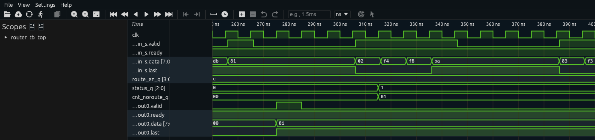
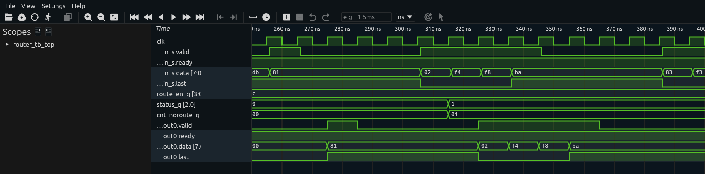

# Lab 04: The same testbench in UVM

You'll finish a UVM port of your Lab 03 testbench for the router. We've ported it for you with four
pieces missing, and you'll add them: a second copy of the output agent so the testbench watches
output 1, the scoreboard lines that check output 1, a test that stalls one output at a time, and a
factory override that sends packets to disabled routes without touching the sequence that makes
them. With them in place the testbench catches B06 and B13, which the port of Lab 03 misses, and at
the end you'll count what the UVM structure cost in lines against your Lab 02 testbench.

Package: [`labs/lab-04-the-same-testbench-in-uvm/`](https://github.com/uoftasic/dd105-a/tree/main/labs/lab-04-the-same-testbench-in-uvm)

## Before you start

- Finish Lab 02 and Lab 03 on the [Course path](../index.md#course-path). Keep your Lab 02 files,
  because Part 5 counts them.
- Read [The UVM skeleton](../guide/the-uvm-skeleton.md),
  [Sequences, sequencers and drivers](../guide/sequences-sequencers-and-drivers.md),
  [Monitors, analysis ports and scoreboards](../guide/monitors-analysis-ports-and-scoreboards.md)
  and [The factory and config_db](../guide/the-factory-and-config-db.md).
- Keep [the router's specification](../reference/router-spec.md) open, or
  [the router in one page](../reference/the-router-in-one-page.md). Parts 3 and 4 lean on its
  Routing section.
- Copy this table into your notes and fill it in as you go:

  | | Build time | `make check-all` |
  |---|---|---|
  | The port as shipped (Part 1) | | |
  | After Part 2 | | |
  | After Part 3 | | |
  | After Part 4 | | |

Time: about 2 h 30 min. About 7 minutes of that is building: on the course's 2 CPUs the first
build took us 104 s, and the rebuilds after each part's edits took 24 to 32 s and 26 to 36 s in
Part 2, then 102, 33 and 111 s.

## Part 1: Build the port

Does the port do what your Lab 03 testbench did, and which of this lab's bugs does it miss?

1. Go to the lab folder and start the build, because it's the slowest step in the lab:

   ```bash
   cd labs/lab-04-the-same-testbench-in-uvm
   make build
   ```

   The banner says a cold build takes 5 to 6 minutes, but ours took 104 s. It ends with:

   ```text
   - V e r i l a t i o n   R e p o r t: Verilator 5.050 2026-07-01 rev v5.050
   - Verilator: Built from 48.711 MB sources in 413 modules, into 26.067 MB in 2948 C++ files needing 155.800 MB
   - Verilator: Walltime 103.929 s (elab=0.820, cvt=3.293, bld=98.960); cpu 5.302 s on 2 threads; allocated 337.555 MB
   ```

   and then a line saying it built `build/sim` in 104 s. Write that in your table.

2. While it builds, open the files in `tb/`. Apart from the top module, `router_tb_top.sv`, every
   piece of your Lab 02 and Lab 03 testbench is in one of these four, rewritten as a UVM class:

   | File | What's in it |
   |---|---|
   | `router_ifs.sv` | the three interfaces, with a driver's and a monitor's clocking block each |
   | `router_agents_pkg.sv` | the packet (`router_pkt`); an agent for the input, one for the APB port, and one output agent class, `out_agent`; the sequences |
   | `router_env_pkg.sv` | the scoreboard, the coverage and `router_env`, which builds and connects everything |
   | `router_tests_pkg.sv` | the tests, from `router_smoke_test` (Lab 02) and `router_rand_test` (Lab 03) to the two this lab adds |

   Your Lab 02 testbench watched only output 0, and so does the port: `router_env` makes only one
   `out_agent`, and the scoreboard queues only output 0's beats. Find the `TODO (Part n)` comments: four in `router_env_pkg.sv`
   and three in `router_tests_pkg.sv`.

3. Run Lab 02's test, then the default test, then Lab 03's test with more packets:

   ```bash
   make run UVM_TESTNAME=router_smoke_test
   make run
   make run UVM_TESTNAME=router_rand_test PLUSARGS=+N=200
   ```

   The default is `router_inject_test`, which for now does exactly what `router_rand_test` does.
   You should see, from the first run:

   ```text
   UVM_INFO labs/lab-04-the-same-testbench-in-uvm/tb/router_env_pkg.sv(210) @ 525000: uvm_test_top.env.sb [SB] 5 packets in: 4 to output 0, 1 to output 1, 0 NOROUTE, 0 FULL
   UVM_INFO labs/lab-04-the-same-testbench-in-uvm/tb/router_env_pkg.sv(212) @ 525000: uvm_test_top.env.sb [SB] beats checked: 17 on output 0, 0 on output 1; 1 DROP_CNT reads checked
   UVM_INFO labs/lab-04-the-same-testbench-in-uvm/tb/router_env_pkg.sv(214) @ 525000: uvm_test_top.env.sb [SB] 2 beats went to output 1, which nothing watches
   DD105: TEST PASSED
   ```

   and from the second, four phases of random traffic and:

   ```text
   UVM_INFO labs/lab-04-the-same-testbench-in-uvm/tb/router_env_pkg.sv(210) @ 18245000: uvm_test_top.env.sb [SB] 243 packets in: 120 to output 0, 122 to output 1, 1 NOROUTE, 0 FULL
   UVM_INFO labs/lab-04-the-same-testbench-in-uvm/tb/router_env_pkg.sv(212) @ 18245000: uvm_test_top.env.sb [SB] beats checked: 574 on output 0, 0 on output 1; 1 DROP_CNT reads checked
   UVM_INFO labs/lab-04-the-same-testbench-in-uvm/tb/router_env_pkg.sv(214) @ 18245000: uvm_test_top.env.sb [SB] 532 beats went to output 1, which nothing watches
   ```

   ending in `ok: 0 UVM_ERROR, 0 UVM_FATAL   0.61 s`. The whole `make run` took 0.72 s, because
   `+UVM_TESTNAME` picks the test when the simulator starts and nothing is rebuilt. A plusarg
   costs no rebuild either: the third run, with `+N=200` packets in each phase, sends 803 packets
   in 1.84 s.

4. Look at the coverage of the runs you've made so far:

   ```bash
   make cov
   ```

   You should see `15 covergroup bins, 14 hit at least once`, and:

   ```text
    1 bins never hit:
       __vlAnonCG_cg.cp_fate.full
   ```

   No packet in any of these runs was dropped because its output was full. Keep that in mind for
   Part 3.

5. The port should catch what your Lab 02 and Lab 03 testbenches caught. Write down which of B05,
   B07, B08 and B09 you expect it to catch, then check:

   ```bash
   make check-all BUG_LIST="B05 B07 B08 B09"
   ```

   You should see `4 of 4 caught.`, with 50, 1, 2 and 50 `UVM_ERROR`s.

6. Now the two bugs this lab is about:

   ```bash
   make check-all
   ```

   You should see:

   ```text
         ok  the golden design                        0 UVM_ERROR, 0 UVM_FATAL        0.6s
   ------------------------------------------------------------------------
     MISSED  tier 2  B06_disabled_route_forwards      0 UVM_ERROR, 0 UVM_FATAL        0.6s
     MISSED  tier 5  B13_admission_checks_other_output 0 UVM_ERROR, 0 UVM_FATAL        0.6s
   ------------------------------------------------------------------------
    0 of 2 caught.
    Still hiding from this test:
      B06_disabled_route_forwards
         hides behind: never disabling a route
      B13_admission_checks_other_output
         hides behind: stalling both outputs together, or never letting one fill
   ```

   B06 forwards a packet for a disabled route when its output has room. B13 judges whether an
   output has room from the level of the other output. Why does this test miss each of them?

   <details>
   <summary>Answer</summary>

   `router_pkt`'s `c_dst` constraint sends random packets only to enabled routes. The one packet
   the test sends to a disabled route is in the port's version of Lab 03's directed steps
   (`lab03_steps()`), when output 0 already holds 9 beats, so there's no room and B06 drops it just as the golden router
   does.

   B13 changes a packet's fate only when one output holds more than 8 beats and the other 8 or
   fewer. In the random phases both outputs are always ready, so neither holds more than two beats.
   In the directed steps output 0 fills, but only to 9 beats: the 8-beat packet arrives at a level
   of 0 and the 1-beat packet after it at exactly 8, which B13 admits too because output 1 is
   empty, and the last packet goes to a disabled route, which is a NOROUTE drop either way. That's also why `cp_fate.full` was never hit.

   </details>

Check: `4 of 4 caught.` for Lab 02's and Lab 03's bugs, and `0 of 2 caught.` for this lab's.

## Part 2: Watch the second output

What does it take to watch output 1, when an output agent is a class you can make twice?

1. Read `out_agent`, `out_monitor` and `out_ready_driver` in `router_agents_pkg.sv`. Nothing in
   them says which output they're on: each gets its interface (`"vif"`) and its knobs (an
   `out_cfg`, with `port` and `ready_pct`) from `config_db`. The top module sets the interfaces for
   `uvm_test_top.env.out0*` and `uvm_test_top.env.out1*`, and `router_base_test` sets an `out_cfg`
   for each, so output 1's are already waiting for an agent named `out1`.

2. In `router_env`, do the two Part 2 TODOs: make `out[1]` with the name `"out1"`, and connect its
   monitor's `ap` to `sb.out_export`, as `out[0]` is. Leave the scoreboard alone for now. Before you
   build, write down what you expect `router_rand_test` to report on the golden router.

3. Rebuild and run:

   ```bash
   make build
   make run UVM_TESTNAME=router_rand_test
   ```

   The rebuild took us 24 to 32 s. The run should fail on the golden router, with 50 errors that
   start:

   ```text
   UVM_ERROR labs/lab-04-the-same-testbench-in-uvm/tb/router_env_pkg.sv(157) @ 255000: uvm_test_top.env.sb [OUT] output 1: got c0 in cycle 26, and no beat was expected
   UVM_ERROR labs/lab-04-the-same-testbench-in-uvm/tb/router_env_pkg.sv(157) @ 265000: uvm_test_top.env.sb [OUT] output 1: got ae in cycle 27, and no beat was expected
   UVM_ERROR labs/lab-04-the-same-testbench-in-uvm/tb/router_env_pkg.sv(157) @ 275000: uvm_test_top.env.sb [OUT] output 1: got aa in cycle 28, and no beat was expected
   ```

   and `DD105: TEST FAILED (50 UVM_ERROR, 0 UVM_FATAL)`. The run stops at 50 because the base test
   sets UVM's quit count to 50. What is wrong, the router or the testbench?

   <details>
   <summary>Answer</summary>

   The testbench. The new monitor reports every beat on output 1, but `write_in` still queues only
   output 0's beats (that's the scoreboard's Part 2 TODO), so the scoreboard has nothing to compare
   them with. When a check fires on the golden router, look for the bug in the check first.

   </details>

4. Do the Part 2 TODO in `router_scoreboard::write_in`: queue every forwarded beat on
   `expected[in_port]`. Rebuild (26 to 36 s for us) and run `router_rand_test` again. You should
   see:

   ```text
   UVM_INFO labs/lab-04-the-same-testbench-in-uvm/tb/router_env_pkg.sv(206) @ 18245000: uvm_test_top.env.sb [SB] 243 packets in: 120 to output 0, 122 to output 1, 1 NOROUTE, 0 FULL
   UVM_INFO labs/lab-04-the-same-testbench-in-uvm/tb/router_env_pkg.sv(208) @ 18245000: uvm_test_top.env.sb [SB] beats checked: 574 on output 0, 532 on output 1; 1 DROP_CNT reads checked
   ```

   and `ok`. The 532 beats that went unwatched in Part 1 are now checked. The number in brackets
   after each file name is a line in that file, so yours can differ by a few if your edit kept the
   TODO comment or added lines.

5. Predict whether `make check-all` catches B06 or B13 now, then run it.

   <details>
   <summary>Answer</summary>

   Neither: `0 of 2 caught.` again. The scoreboard now sees both outputs, but the stimulus hasn't
   changed, so the router never gets a packet that either bug would treat differently.

   </details>

Check: `router_rand_test` passes with beats checked on both outputs, and `make check-all` still
says `0 of 2 caught.`

## Part 3: Stall one output at a time

What does B13 need from the stimulus, and does the scoreboard know enough to judge the result?

1. Read the Routing section of the specification, and `level()` and `write_in` in the scoreboard.
   Then write down the situation in which B13, which judges an output's room from the other
   output's level, does something different from the golden router.

   <details>
   <summary>Answer</summary>

   The two outputs' levels have to be on opposite sides of 8 when a header arrives. A packet for
   the output with room is then dropped as FULL, because B13 looks at the full one, and a packet
   for the full output is admitted, because B13 looks at the one with room.

   </details>

2. Do the Part 3 TODO in `router_tests_pkg.sv`: in `router_stall_test`, override `set_sinks(k)` so
   that in phase `k` one output is ready in 5% of cycles and the other in 100%, output 0 stalling
   in even phases and output 1 in odd ones. `router_rand_test` calls `set_sinks(k)` at the start
   of each phase. Set `ocfg[p].ready_pct`: the test made those `out_cfg` objects and kept the
   handles, and each `out_ready_driver` reads its `ready_pct` again every cycle, so a change takes
   effect at the next clock edge.

3. Rebuild with `make build`. It took us 102 s, against 24 to 36 s in Part 2, because the Part 2
   edits were inside existing function bodies and this one adds a function to a class, which
   changes most of the C++ that Verilator generates (Lab 01, Part 5 measured the same thing).
   Before you run it, look at `level()` again. Phase 1 stalls output 1: what will the scoreboard
   predict for the packets routed there?

4. Run the stall test on the golden router:

   ```bash
   make run UVM_TESTNAME=router_stall_test
   ```

   You should see phase 0 pass, and then:

   ```text
   UVM_INFO labs/lab-04-the-same-testbench-in-uvm/tb/router_tests_pkg.sv(162) @ 4425000: uvm_test_top [TEST] phase 1: ROUTE EN 0011 PORT 0110; output 0 ready 100%, output 1 ready 5%
   UVM_ERROR labs/lab-04-the-same-testbench-in-uvm/tb/router_env_pkg.sv(159) @ 7645000: uvm_test_top.env.sb [OUT] output 1: got 57 in cycle 765, expected 45
   UVM_ERROR labs/lab-04-the-same-testbench-in-uvm/tb/router_env_pkg.sv(159) @ 8055000: uvm_test_top.env.sb [OUT] output 1: got f4 in cycle 806, expected c9
   ```

   The grader won't accept this test either. `make check BUG=B13 UVM_TESTNAME=router_stall_test`
   stops at the golden run:

   ```text
       FAIL  the golden design                        50 UVM_ERROR                    0.4s
           UVM_ERROR [OUT] output 1: got 57 in cycle 765, expected 45
           UVM_ERROR [OUT] output 1: got f4 in cycle 806, expected c9
           UVM_ERROR [OUT] output 1: got 08 in cycle 810, expected a8
   ------------------------------------------------------------------------
    VERDICT: FAIL -- your test does not pass the GOLDEN design.
   ```

   <details>
   <summary>Answer</summary>

   `level()` returns 0 for output 1, a shortcut that was safe while output 1 was always ready, as
   it was in every test before this one. With output 1 ready in only 5% of cycles it fills past 8, and the router drops its next
   packets as FULL, as the specification says. The scoreboard still expected them: the packet
   starting `45` (`DST` 1, routed to output 1 in this phase) was dropped, and the next header to
   come out, `57`, was compared with it.

   </details>

5. Do the Part 3 TODO in `level()`, so it gives output 1's level the way it gives output 0's.
   Rebuild (33 s for us) and run the stall test again. You should see:

   ```text
   UVM_INFO labs/lab-04-the-same-testbench-in-uvm/tb/router_env_pkg.sv(200) @ 18325000: uvm_test_top.env.sb [SB] 243 packets in: 92 to output 0, 93 to output 1, 1 NOROUTE, 57 FULL
   UVM_INFO labs/lab-04-the-same-testbench-in-uvm/tb/router_env_pkg.sv(202) @ 18325000: uvm_test_top.env.sb [SB] beats checked: 436 on output 0, 393 on output 1; 1 DROP_CNT reads checked
   ```

   and `ok`, with 57 FULL drops where the random test had none.

6. Ask for the verdict on B13:

   ```bash
   make check BUG=B13 UVM_TESTNAME=router_stall_test
   ```

   You should see:

   ```text
         ok  the golden design                        0 UVM_ERROR, 0 UVM_FATAL        0.7s
     caught  B13_admission_checks_other_output        50 UVM_ERROR                    0.2s
           UVM_ERROR [OUT] output 1: got cf in cycle 124, expected ca
           UVM_ERROR [OUT] output 1: got cb in cycle 125, expected 9b last
           UVM_ERROR [OUT] output 1: got 16 in cycle 126, expected cf
   ------------------------------------------------------------------------
    VERDICT: PASS
   ```

   Phase 0 routes `DST` 3 to output 1 and stalls output 0. What happened to the packet `ca 9b`?

   <details>
   <summary>Answer</summary>

   Its header `ca` has `DST` 3, so it went to output 1, which was always ready and nearly empty.
   B13 judged its room from output 0's level, which was above 8, and dropped it as FULL. The
   scoreboard expected `ca` and `9b` on output 1 and got the next packet, `cf cb 16 ...`, instead.

   </details>

Check: `router_stall_test` passes on the golden router with 57 FULL drops, and
`make check BUG=B13 UVM_TESTNAME=router_stall_test` prints `VERDICT: PASS`.

## Part 4: A factory override for disabled routes

How do you make a test send some packets to disabled routes, without editing the sequence that
makes them or the driver that sends them?

1. Read `router_rand_seq` in `router_agents_pkg.sv`. It makes each packet with
   `router_pkt::type_id::create("pkt")`, which asks the factory for a `router_pkt`. If a test has
   told the factory to substitute a subclass of `router_pkt`, the sequence gets the subclass
   without knowing it. Then read `router_pkt`'s `c_dst` constraint.

2. Do the first Part 4 TODO: write `router_noroute_pkt`, which extends `router_pkt` and sends one
   packet in four to a disabled route. Give it its own constraint named `c_dst`: a constraint with
   the same name as one in the parent class replaces it, and Verilator 5.050 does that as the
   standard says. Decide which packets go to a disabled route with a non-random bit set in
   `pre_randomize()` (call `super.pre_randomize()` first) with `$urandom_range`, not with a `dist`,
   which this simulator gets wrong when another constraint names the same variable
   ([Constrained random on Verilator](../guide/constrained-random-on-verilator.md)). Every routing
   table `configure_routes()` writes has at least one disabled route, so the constraint can always
   be met.

3. Do the second Part 4 TODO: in `router_inject_test`, add a `build_phase` that calls
   `router_pkt::type_id::set_type_override(router_noroute_pkt::get_type())` and then
   `super.build_phase(phase)`. Nothing else in the test changes, so it's still the stall test,
   with different packets.

4. Write down what you expect the golden run's `[SB]` line to say about NOROUTE drops. Then rebuild
   (111 s for us) and run the default test:

   ```bash
   make build
   make run
   ```

   You should see:

   ```text
   UVM_INFO labs/lab-04-the-same-testbench-in-uvm/tb/router_env_pkg.sv(200) @ 18175000: uvm_test_top.env.sb [SB] 243 packets in: 74 to output 0, 75 to output 1, 65 NOROUTE, 29 FULL
   UVM_INFO labs/lab-04-the-same-testbench-in-uvm/tb/router_env_pkg.sv(202) @ 18175000: uvm_test_top.env.sb [SB] beats checked: 357 on output 0, 320 on output 1; 1 DROP_CNT reads checked
   ```

   and `ok`. The scoreboard already knew what to do with a packet for a disabled route, since it
   was written from the specification's Routing table; until now no test sent one with room in
   its output.

5. Run the lab's verdict:

   ```bash
   make check-all
   ```

   You should see:

   ```text
         ok  the golden design                        0 UVM_ERROR, 0 UVM_FATAL        0.6s
   ------------------------------------------------------------------------
     caught  tier 2  B06_disabled_route_forwards      50 UVM_ERROR                    0.3s
     caught  tier 5  B13_admission_checks_other_output 50 UVM_ERROR                    0.2s
   ------------------------------------------------------------------------
    2 of 2 caught.
   ```

6. A factory override doesn't need a test class at all. Apply yours to Lab 03's test from the
   command line, on the golden router and then on B06, and time the first:

   ```bash
   time make run UVM_TESTNAME=router_rand_test PLUSARGS=+uvm_set_type_override=router_pkt,router_noroute_pkt
   make run UVM_TESTNAME=router_rand_test PLUSARGS=+uvm_set_type_override=router_pkt,router_noroute_pkt BUG=B06
   ```

   The first prints
   `[UVM_CMDLINE_PROC] Applying type override from the command line: +uvm_set_type_override=router_pkt,router_noroute_pkt`,
   then `65 NOROUTE, 0 FULL` and `ok`, in 0.74 s with no rebuild. The second fails, and its first
   error is:

   ```text
   UVM_ERROR labs/lab-04-the-same-testbench-in-uvm/tb/router_env_pkg.sv(147) @ 335000: uvm_test_top.env.sb [OUT] output 0: got 02 in cycle 34, and no beat was expected
   ```

   Without the plusarg, the same test on B06 says `MISSED`.

7. Record both runs from step 6 and look at the first packet that B06 forwards:

   ```bash
   make waves UVM_TESTNAME=router_rand_test PLUSARGS=+uvm_set_type_override=router_pkt,router_noroute_pkt
   make waves UVM_TESTNAME=router_rand_test PLUSARGS=+uvm_set_type_override=router_pkt,router_noroute_pkt BUG=B06
   surfer build/runs/router_rand_test-s1/waves.fst &
   surfer build/runs/router_rand_test-s1-B06/waves.fst &
   ```

   Add `valid`, `ready`, `data` and `last` from `in_s` and `out0`, and `route_en_q`, `status_q` and
   `cnt_noroute_q` from `dut.u_regs`, and look at 250 to 400 ns:

   

   *The golden router. The header `02` (`DST` 0) is accepted at the edge at 315 ns, while
   `route_en_q` is `c` (only routes 2 and 3 enabled). `STATUS.NOROUTE` and `NOROUTE_CNT` change
   at that edge, and `out0_valid` stays low.*

   

   *B06. The router counts the same NOROUTE drop, and then puts `02 f4 f8 ba` on output 0 from the
   cycle ending at 335 ns, two cycles after the header, as rule O8 says a forwarded beat appears.*

   Both pictures have the same input and the same register values, because the seed is the same and
   this is the first packet for a disabled route in the run, so B06 has changed nothing before it.

8. Close the coverage hole you found in Part 1, on five seeds:

   ```bash
   make regress SEEDS="1 2 3 4 5"
   ```

   You should see `20 ok  (20 runs)` and `covergroup : 100.0% (15/15)`. `make regress` reports only
   its own runs, which matters here: `make cov` merges every run in `build/runs`, and runs made
   before an edit moved the covergroup's lines show each bin a second time.

Check: `2 of 2 caught.` from `make check-all`, and `cp_fate.full` hit.

## Part 5: Count what the port cost

Where did the lines go, compared with your Lab 02 testbench, and what did they buy you?

1. Count both testbenches. `FILES` takes the paths of your Lab 02 files; with the monitor and
   scoreboard you wrote in Lab 02's `tb/`, that's:

   ```bash
   make loc FILES="../lab-02-a-class-testbench-without-uvm/tb/*.sv ../lab-02-a-class-testbench-without-uvm/tb/*.svh"
   ```

   With the reference solution's edits, the UVM part prints:

   ```text
   This lab's UVM testbench:
     file                      lines    code
     tb/router_ifs.sv             85      54
     tb/router_agents_pkg.sv     471     355
     tb/router_env_pkg.sv        267     189
     tb/router_tests_pkg.sv      253     179
     tb/router_tb_top.sv          64      49
     total                      1140     826
   ```

   As shipped it was 1125 lines and 806 code lines, so your four parts added about 20 code lines.
   Write both totals, yours and Lab 02's, in your notes.

2. For each piece of your Lab 02 testbench, find the UVM piece that does its job, and write down
   whether its code moved across nearly unchanged, changed shape, or had no Lab 02 counterpart
   at all.

   <details>
   <summary>Answer</summary>

   | Lab 02 | Lab 04 | What happened |
   |---|---|---|
   | `packet` | `router_pkt` | moved; it gained `` `uvm_object_utils `` and is made through the factory |
   | `generator` and the mailbox to the driver | `router_rand_seq` on the input agent's sequencer | changed shape: `start_item`/`finish_item` instead of a mailbox `put` |
   | `driver` | `src_driver` | moved; `get_next_item`/`item_done` replace the mailbox `get`, and the clocking-block drives are the same |
   | `sink` | `out_ready_driver` | moved; it reads how often to be ready from its `out_cfg` |
   | `monitor` and the mailboxes to the scoreboard | `src_monitor`, `out_monitor` and their analysis ports | changed shape: each beat goes to `ap.write()` as it moves, instead of a whole packet into a mailbox |
   | `scoreboard` and its `run()` loop | `write_in`, `write_out`, `write_apb` | changed shape: the monitors call it, and it has no thread |
   | `apb_master` | `apb_agent`, `apb_rw_seq`, `write_reg`, `read_reg` | grew: a driver, a monitor and a sequence, and it reads as well as writes |
   | `env` | `router_env` | changed shape: `build_phase` and `connect_phase` instead of a constructor that makes the mailboxes |
   | `router_class_test` | `router_base_test` and the four tests | changed shape, and `+UVM_TESTNAME` picks one at run time |
   | nothing | the agent classes, `out_cfg` and `config_db`, the factory registration lines, `router_coverage` as a subscriber | new |

   The code that touches the router (the drives, the sampling, the prediction) does the same work
   in both testbenches. What UVM changed is how the pieces find and talk to each other.

   </details>

3. Using Parts 2 to 4, what did the extra lines buy you in this lab?

   <details>
   <summary>Answer</summary>

   Watching output 1 took two lines in `router_env`, because `out_agent` is a class that
   `config_db` tells which output it's on, and one in the scoreboard, which Lab 02 had written for
   output 0 alone. Stalling one output was a short function in a new test,
   chosen at run time, because the test holds the `out_cfg` handles the drivers read. And the
   factory override changed every packet in every phase without editing the sequence or the
   driver, from a test class or from the command line in 0.74 s, where any edit to the testbench
   cost 24 to 111 s of rebuilding. Lab 02's testbench could have done each of these, but each would
   have meant editing the classes that already worked.

   </details>

Check: your table has a line count for both testbenches, and a build time and a `make check-all`
result for each part.

## Finishing

You're done when `make check-all` prints `2 of 2 caught.` with the `router_stall_test`,
`router_noroute_pkt` and `router_inject_test` you wrote.

Questions:

1. The first B13 error came in phase 0, where output 1 is always ready and the old `level()`
   shortcut gave the right answer. Why did you still have to fix `level()` before `make check`
   would give a verdict on B13?

   <details>
   <summary>Answer</summary>

   `make check` runs the golden router first and stops if your test fails it (Part 3, step 4),
   because a test that fails on a correct design tells you nothing about a broken one. The
   shortcut predicted the wrong fate for output 1's packets in the odd phases, where output 1
   stalls, and that fired on the golden router.

   </details>

2. In Part 4, step 7, why does the B06 run's `NOROUTE_CNT` agree with the golden run's?

   <details>
   <summary>Answer</summary>

   B06 changes only whether the packet is written to its output; the router still counts it as a
   NOROUTE drop. So at this point the counters agree, and the bug shows as beats on an output that
   should have stayed idle, which is where the scoreboard looks.

   </details>

Submit: nothing for this lab.

Next on the [Course path](../index.md#course-path): the reading on assertions, reactive agents and
virtual sequences, then Lab 05: Protocol rules and backpressure.
