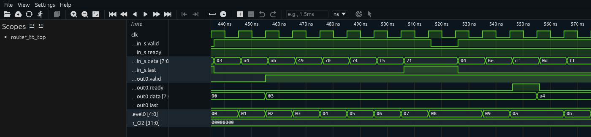

# Lab 05: Protocol rules and backpressure

In this lab you'll write assertions for the router's output rules and bind them into the design,
finish a sink driver that answers each output beat in its own time, and write a virtual sequence
that changes the routing table, the traffic and the backpressure together. The package is your
Lab 04 testbench, and it already catches two of this lab's three planted bugs, B10 and B12. Your
assertions name the rule the router broke and the cycle it broke it in, and your virtual sequence
catches the third bug, B11, by sending the packets of more than 8 beats that no Lab 04 test sends.

Package: [`labs/lab-05-protocol-rules-and-backpressure/`](https://github.com/uoftasic/dd105-a/tree/main/labs/lab-05-protocol-rules-and-backpressure)

## Before you start

- Finish [Lab 04](lab-04-the-same-testbench-in-uvm-overview.md).
- Read [Assertions for interface rules](../guide/assertions-for-interface-rules.md),
  [Reactive agents and backpressure](../guide/reactive-agents-and-backpressure.md) and
  [Virtual sequences](../guide/virtual-sequences.md).
- Keep the router specification open in another tab, at
  [Valid/ready rules](../reference/router-spec.md#validready-rules). The rule names on this page
  (O1, O2, O6, O7) are the ones there.

The package is Lab 04's testbench with our solution to Lab 04 in it: the second output agent, the
scoreboard lines for output 1, the real `level()`, `router_stall_test`, `router_noroute_pkt` and
the factory override. If your own Lab 04 printed `2 of 2 caught.`, your code did the same job,
but keep ours: your Lab 04 edits were in `router_env_pkg.sv` and `router_tests_pkg.sv`, and this
lab adds to both. What we added for you:

| File | What Lab 05 adds |
|---|---|
| `tb/router_sva.sv`, `tb/router_sva_bind.sv` | the assertion module and the `bind` that puts it in the router; you write three of its assertions (Part 2) |
| `tb/router_ifs.sv`, `tb/router_tb_top.sv` | `router_sva_if`, which carries the assertions' failure count to the scoreboard |
| `tb/router_agents_pkg.sv` | an output agent whose driver can answer each beat from a sequence (you finish it in Part 3); an oversize length kind in `router_pkt`, switched off; each output beat's wait |
| `tb/router_env_pkg.sv` | `cg_wait`, a virtual sequencer, and three scoreboard changes: it reports the assertion count, it follows route writes made while packets are coming in, and it fails a test that checked nothing |
| `tb/router_vseq_pkg.sv` | the virtual sequences; you write `router_lab05_vseq` (Part 4) |
| `tb/router_tests_pkg.sv` | `router_test` (Lab 04's `router_inject_test`, then your virtual sequence), `router_lab05_test` (the sequence alone) and `router_sink_test` (Part 3) |

Time: about 2 h. On the course's 2 CPUs our first build took 106 s, and the rebuilds after
each part's edits took 103 s, 107 s and 105 s.

## Part 1: The Lab 04 testbench against this lab's bugs

Which of this lab's bugs does the testbench you already have catch, and how close does it get to
the cycle where the router went wrong?

1. Go to the lab folder and start the build:

   ```bash
   cd labs/lab-05-protocol-rules-and-backpressure
   make build
   ```

   The banner says a cold build takes 1.5 to 2.5 minutes on 2 CPUs, and ours took 106 s. It ends
   with:

   ```text
   - V e r i l a t i o n   R e p o r t: Verilator 5.050 2026-07-01 rev v5.050
   - Verilator: Built from 59.791 MB sources in 431 modules, into 27.944 MB in 3213 C++ files needing 198.696 MB
   - Verilator: Walltime 106.395 s (elab=0.811, cvt=3.129, bld=101.669); cpu 5.091 s on 2 threads; allocated 355.551 MB
   ```

2. Run the graded test, `router_test`. It runs everything `router_inject_test` did in Lab 04 and
   then `router_lab05_vseq`, which is empty for now:

   ```bash
   make run
   ```

   You should see `ok: 0 UVM_ERROR, 0 UVM_FATAL   1.72 s`, and above it:

   ```text
   UVM_INFO labs/lab-05-protocol-rules-and-backpressure/tb/router_env_pkg.sv(257) @ 61465000: uvm_test_top.env.sb [SB] 805 packets in: 144 to output 0, 190 to output 1, 194 NOROUTE, 277 FULL; the highest level a header saw was 16
   UVM_INFO labs/lab-05-protocol-rules-and-backpressure/tb/router_env_pkg.sv(259) @ 61465000: uvm_test_top.env.sb [SB] beats checked: 648 on output 0, 799 on output 1; 5 DROP_CNT reads checked
   UVM_INFO labs/lab-05-protocol-rules-and-backpressure/tb/router_env_pkg.sv(263) @ 61465000: uvm_test_top.env.sb [SVA] the bound assertions (router_sva.sv) counted 0 failures
   ```

   The two `[SB]` lines are the ones `router_inject_test` printed at the end of Lab 04, Part 4,
   number for number, so the stimulus is unchanged. (The line numbers in brackets differ, because
   the files have grown.) The `[SVA]` line is new.

3. Look at how long the output beats waited. `cg_wait` records, for each packet an output
   delivers, the longest any of its beats waited for `ready`: `none` is 0 cycles, `short_wait` 1
   to 3, `long_wait` 4 to 20 and `stalled` more than 20. `cp_len.oversize` counts packets of 9
   beats or more.

   ```bash
   make cov
   grep -E "cg_wait.cp_wait|cp_len.oversize" build/coverage/bins.txt
   ```

   You should see:

   ```text
            0  __vlAnonCG_cg_pkt.cp_len.oversize
          257  __vlAnonCG_cg_wait.cp_wait.none
            2  __vlAnonCG_cg_wait.cp_wait.short_wait
           18  __vlAnonCG_cg_wait.cp_wait.long_wait
           57  __vlAnonCG_cg_wait.cp_wait.stalled
   ```

   Lab 04's sink flips a coin every cycle. At 100% a beat never waits, and at 5% a beat waits
   about 20 cycles on average, so a packet whose longest wait is 1 to 3 cycles is rare.

4. Run the grader against this lab's three bugs:

   ```bash
   make check-all
   ```

   You should see:

   ```text
         ok  the golden design                        0 UVM_ERROR, 0 UVM_FATAL        1.7s
   ------------------------------------------------------------------------
     MISSED  tier 4  B11_cut_packet_has_no_last       0 UVM_ERROR, 0 UVM_FATAL        1.7s
     caught  tier 4  B10_output_reloads_while_stalled 50 UVM_ERROR                    0.5s
     caught  tier 5  B12_out1_uses_out0_ready         50 UVM_ERROR                    0.1s
   ------------------------------------------------------------------------
    2 of 3 caught.
    Still hiding from this test:
      B11_cut_packet_has_no_last
         hides behind: sending only legal packets of 8 beats or fewer
   ```

   `make check`, which grades the first bug in the list, says
   `VERDICT: FAIL -- your test passes B11_cut_packet_has_no_last too.` Lab 04's stall test
   already makes the two `out_ready` signals differ and lets beats wait on a stalled output, and
   that is all B12 and B10 need. B11 needs a packet of more than 8 beats, and none of Lab 04's
   tests sends one.

5. Look at the first errors for the two bugs the testbench catches:

   ```bash
   make run BUG=B10
   make run BUG=B12
   ```

   You should see, from the first:

   ```text
    caught: 50 UVM_ERROR   0.54 s   log: build/runs/router_test-s1-B10/run.log
      UVM_ERROR [OUT] output 0: got 04 in cycle 56, expected 03
   ```

   and from the second:

   ```text
    caught: 50 UVM_ERROR   0.08 s   log: build/runs/router_test-s1-B12/run.log
      UVM_ERROR [OUT] output 1: got 80 in cycle 24, and no beat was expected
   ```

6. Predict a cycle before you go on. In phase 1 output 0 is ready in 5% of cycles. The router
   accepts the 8-beat packet `03 a4 ab 49 70 74 f5 71` in cycles 45 to 52, into an empty output
   0, and output 0's sink is first ready again in cycle 56. By rule O8, in which cycle is `03`
   first on `out0_data`? B10 loads the next beat into the output register even while `out0_ready`
   is 0. In which cycle does `out0_data` first change while `03` waits? Write that cycle down;
   Part 2 checks it.

   <details>
   <summary>Answer</summary>

   O8 puts a beat into an empty output two cycles after its input handshake, so `03` is on the
   output from cycle 47. B10 loads `a4` over it at the next edge, so `out0_data` first changes in
   cycle 48. The scoreboard sees only beats that are taken, and output 0's sink took nothing
   until cycle 56, by which time the router had moved through the whole packet and on to `04`,
   the next header. The router went wrong 8 cycles before the scoreboard could see anything.

   </details>

Check: `make check-all` printed `2 of 3 caught.`, and you've written down a cycle for B10.

## Part 2: Assertions for the output rules

Which rule did B10 break, and in which cycle?

1. Open `tb/router_sva.sv`. The module `router_sva` has two assertions written for you, `a_I1`
   and `a_I2`, for the source's rules I1 and I2, so they check your own source driver. Read `a_I1`
   with the specification's I1 beside it. The part left of `|=>` (the antecedent) picks the
   cycles the rule talks about, `|=>` means "then, in the next cycle", and `disable iff (!rst_n)`
   switches the check off during reset, which ends a beat without a handshake. A failure adds one
   to `n_I1` and calls `$error`.

2. In `router_sva_out`, which is instantiated once per output, write the three assertions the
   TODOs describe:
   - `a_O1`: once `out_valid` is 1, it stays 1 until the handshake;
   - `a_O2`: while `out_valid` is 1 and `out_ready` is 0, `out_data` and `out_last` don't change;
   - `a_O6`: a beat taken when `beats` is 7 has `out_last` = 1. This one is about the cycle of the
     handshake itself, so it uses `|->` (the same cycle).

   Count each one's failures in its own counter (`n_O1`, `n_O2`, `n_O6`) and give each one an
   `$error` message, as `a_I1` does. The outputs on this page show our messages, which are
   `a_I1`'s and `a_I2`'s with `out_` in place of `in_` for O1 and O2, and
   `O6: an output packet is longer than 8 beats`.

3. Open `tb/router_sva_bind.sv`. Why does the testbench attach the assertions with `bind`
   instead of instantiating `router_sva` in `router_tb_top`?

   <details>
   <summary>Answer</summary>

   `bind` puts an instance of `router_sva` inside every `router`, wired to the router's own ports,
   without editing the router's RTL or the top module. The same file works on the golden design
   and on the faulty build, and the checker sees exactly the pins the rules are written about.
   The top module reads the failure count back out through the router instance,
   `dut.u_sva.n_fail`, and hands it to the scoreboard through `router_sva_if`.

   </details>

4. Rebuild and run on the golden design:

   ```bash
   make build
   make run
   ```

   The rebuild took us 103 s. You should see `ok`, the same two `[SB]` lines as in Part 1, and
   `[SVA] the bound assertions (router_sva.sv) counted 0 failures`. A failure here means one of
   your assertions is wrong, because the golden router keeps all three rules.

5. Run B10 with the simulator's own error limit. `PLUSARGS=` on the command line replaces the
   Makefile's `+verilator+error+limit+100000`:

   ```bash
   make run BUG=B10 PLUSARGS=
   cat build/runs/router_test-s1-B10/exit_status
   ```

   You should see the run stop at the first failure, then `1`:

   ```text
   [475000] %Error: router_sva.sv:50: Assertion failed in router_tb_top.dut.u_sva.u_out0.a_O2: O2: out_data or out_last changed while the beat waited
   %Error: labs/lab-05-protocol-rules-and-backpressure/tb/router_sva.sv:50: Verilog $stop
   Aborting...
   ------------------------------------------------------------------------
    caught: 1 assertion   0.07 s   log: build/runs/router_test-s1-B10/run.log
      router_sva.sv:50: Assertion failed in router_tb_top.dut.u_sva.u_out0.a_O2: O2: out_data or out_last changed wh
   ------------------------------------------------------------------------
   ```

   The line number is the line of the `$error` call in your `a_O2`, so yours may differ, here
   and later. The time is in picoseconds: 475 ns. The clock's period is 10 ns and its first
   rising edge is at 5 ns, so the edge that ends cycle $n$ is at $10n - 5$ ns, and this failure
   was sampled at the edge that ends cycle 48. Compare it with your prediction from Part 1.

   Verilator's default error limit is 1, so the first failing assertion ends the run with exit
   status 1, and nothing after it is checked. That's why the Makefile raises the limit. With the
   limit raised, every failure prints, each assertion's counter keeps counting, and the
   scoreboard reports their sum at the end of the test.

6. Run B10 again with the Makefile's limit, and find the first check of each kind that fired:

   ```bash
   make run BUG=B10
   grep -m1 "%Error" build/runs/router_test-s1-B10/run.log
   grep -m1 "UVM_ERROR" build/runs/router_test-s1-B10/run.log
   ```

   You should see `caught: 50 UVM_ERROR, 244 assertions`, then:

   ```text
   [475000] %Error: router_sva.sv:50: Assertion failed in router_tb_top.dut.u_sva.u_out0.a_O2: O2: out_data or out_last changed while the beat waited
   UVM_ERROR labs/lab-05-protocol-rules-and-backpressure/tb/router_env_pkg.sv(193) @ 555000: uvm_test_top.env.sb [OUT] output 0: got 04 in cycle 56, expected 03
   ```

   The assertion fired at the edge that ends cycle 48, and the scoreboard 8 cycles later.

7. To see the rule break, record both runs and open them in Surfer:

   ```bash
   make waves
   make waves BUG=B10
   surfer build/runs/router_test-s1/waves.fst &
   surfer build/runs/router_test-s1-B10/waves.fst &
   ```

   Add `valid`, `ready`, `data` and `last` from `in_s` and `out0`, `level0` from `dut`, and `n_O2`
   from `dut.u_sva.u_out0`, and look at 435 to 575 ns:

   

   *The golden router. The packet `03 a4 ab 49 70 74 f5 71` comes in one beat per cycle from the
   edge at 445 ns. `03` reaches `out0_data` at the edge at 455 ns, in cycle 47, and stays there
   while `out0_ready` is 0; `level0` climbs as the rest of the packet arrives. `out0_ready` is 1
   in cycle 56, the sink takes `03` at the edge at 555 ns, and `a4` follows. `n_O2` stays 0.*

   

   *B10. `out0_data` changes from `03` to `a4` at the edge at 465 ns, while `out0_ready` is 0,
   and then steps through the rest of the packet, one beat per cycle. `n_O2` counts its first
   failure at the edge at 475 ns, which ends cycle 48, and one more for nearly every cycle after.
   When `out0_ready` rises in cycle 56, the beat on the output is `04`.*

8. Run the grader again:

   ```bash
   make check-all
   ```

   You should see B10 caught by your assertions as well, B12 with one assertion, and B11 still
   missed:

   ```text
     MISSED  tier 4  B11_cut_packet_has_no_last       0 UVM_ERROR, 0 UVM_FATAL        1.7s
     caught  tier 4  B10_output_reloads_while_stalled 50 UVM_ERROR, 244 assertions    0.6s
     caught  tier 5  B12_out1_uses_out0_ready         50 UVM_ERROR, 1 assertion       0.1s
   ------------------------------------------------------------------------
    2 of 3 caught.
   ```

   The one assertion on B12 is `a_O6`, on output 1, at the edge at 635 ns (cycle 64); the
   scoreboard's first error was in cycle 24. Run `grep -m1 "%Error" build/grade/B12/run.log` to see
   it. Your O6 is about B11, yet it passes on B11 and fails on B12. Why does it pass on one and
   fail on the other?

   <details>
   <summary>Answer</summary>

   An assertion checks only what the stimulus makes happen. O6 can fail only on the 8th beat of
   a packet that has a 9th, and nothing in `router_test` sends a packet longer than 8 beats, so
   on B11 the router never has a packet to cut.

   B12 moves output 1 on `out0_ready`. In phase 1 output 0 is ready in 5% of cycles and output
   1 in all of them, so output 1's buffer holds its beat while its own sink takes that beat in
   every cycle. The pins show a handshake in each of those cycles with the same data, which is
   what the scoreboard saw in cycle 24 (`got 80 ... and no beat was expected`). Each repeat is
   one more beat of the packet on output 1's pins, so once eight beats in a row have had no
   `out_last`, O6 fails. O1 and O2 are about cycles where `out_ready` is 0, and `out1_ready` is 1
   all through phase 1; the run stops at 50 errors in cycle 73, long before phase 2 stalls
   output 1.

   </details>

Check: `make check-all` prints `50 UVM_ERROR, 244 assertions` for B10, and your answer to Part 1's
prediction matches cycle 48.

## Part 3: A sink that answers each beat

What changes when each sink takes its beats at its own pace, instead of flipping a coin every
cycle?

1. Read the output agent in `tb/router_agents_pkg.sv`: `out_cfg`, `out_ready_item`,
   `out_ready_seq`, `out_ready_driver` and `out_agent`. `out_cfg.mode` picks how the sink
   answers. In `SNK_PCT`, the default, the driver is Lab 04's: every cycle `out_ready` is 1 with
   probability `ready_pct` percent. In the other modes it is a reactive driver. The router decides
   when a beat appears, and the driver answers each beat with an item from `out_ready_seq`: with
   `pre_ready` set, `ready` is already 1 when the beat appears; otherwise the sink waits `delay`
   cycles after the beat's first cycle on offer, then raises `ready`. `SNK_FAST` makes every item
   `pre_ready`, `SNK_SLOW` gives every beat a delay of 4 to 20, and `SNK_RANDOM` randomizes each
   item. The driver looks at the output at the falling edge in the middle of each cycle and drives
   the next cycle's `ready` just after the rising edge; that loop is written for you. Why does it
   ask for items with `try_next_item()` and not `get_next_item()`, as Lab 04's source driver does?

   <details>
   <summary>Answer</summary>

   `get_next_item()` blocks until the sequence hands over an item. The source driver can wait,
   because nothing happens on the input until it has a packet. The sink can't: it has to drive
   `out_ready` in every cycle, and the router may put a beat on the output whether or not an item
   is ready. `try_next_item()` returns at once, with no item if there isn't one, and the driver
   keeps `ready` at 0 for that cycle.

   </details>

2. `router_sink_test` is Lab 03's `router_rand_test` with both sinks in `SNK_RANDOM`. Run it as
   shipped, on its own, and look at its waits:

   ```bash
   rm -rf build/runs
   make run UVM_TESTNAME=router_sink_test
   make cov
   grep -E "cg_wait.cp_wait" build/coverage/bins.txt
   ```

   You should see `ok` in about 4 s, and:

   ```text
   UVM_INFO labs/lab-05-protocol-rules-and-backpressure/tb/router_env_pkg.sv(257) @ 57695000: uvm_test_top.env.sb [SB] 805 packets in: 353 to output 0, 451 to output 1, 1 NOROUTE, 0 FULL; the highest level a header saw was 9
   ```

   ```text
          803  __vlAnonCG_cg_wait.cp_wait.none
            0  __vlAnonCG_cg_wait.cp_wait.short_wait
            0  __vlAnonCG_cg_wait.cp_wait.long_wait
            1  __vlAnonCG_cg_wait.cp_wait.stalled
   ```

   Those are the numbers `router_rand_test` printed in Lab 04, Part 2, because as shipped the
   driver is always ready in the per-beat modes, whatever the item says. The one `stalled` packet
   is from `close_holes()`, which stalls output 0 in Lab 04's mode.

3. Fill in the two TODOs in `out_ready_driver::run_phase`: the countdown while a beat waits, and
   the expression for `rdy`, the next cycle's `ready`. `rdy` must be 0 while the driver has no
   item. The countdown stops at 0: `wait_left` is unsigned, and a beat whose wait is over can
   still be waiting when a virtual sequence stalls its output (Part 4), so one more count would
   wrap it round to about four billion, and in the per-beat modes the sink would never raise
   `ready` for that beat.

4. Before you rebuild, predict what happens to the `[SB]` line's `FULL` count and to the four
   `cp_wait` bins.

   <details>
   <summary>Answer</summary>

   Each beat now waits 0 cycles when its item is `pre_ready` and otherwise 1 to 13, so most
   packets land in `short_wait` or `long_wait`. A sink that waits a cycle or more on most beats
   takes them more slowly than the input can bring them, so an output sometimes fills past 8
   beats, and the packets that arrive for it then are FULL drops.

   </details>

5. Rebuild, clear the runs and look again:

   ```bash
   make build
   rm -rf build/runs
   make run UVM_TESTNAME=router_sink_test
   make cov
   grep -E "cg_wait.cp_wait" build/coverage/bins.txt
   ```

   The rebuild took us 107 s. If your driver does what the TODOs say, you should see `ok` and:

   ```text
   UVM_INFO labs/lab-05-protocol-rules-and-backpressure/tb/router_env_pkg.sv(257) @ 58285000: uvm_test_top.env.sb [SB] 805 packets in: 317 to output 0, 401 to output 1, 1 NOROUTE, 86 FULL; the highest level a header saw was 13
   ```

   ```text
          129  __vlAnonCG_cg_wait.cp_wait.none
          305  __vlAnonCG_cg_wait.cp_wait.short_wait
          283  __vlAnonCG_cg_wait.cp_wait.long_wait
            1  __vlAnonCG_cg_wait.cp_wait.stalled
   ```

   Lab 04's sinks gave 2 short waits in all of `router_test`, and yours give 305 in one run. The
   run passing also means the scoreboard predicted all 86 FULL drops, because every phase's
   `DROP_CNT` read matched.

6. Run the grader:

   ```bash
   make check-all
   ```

   You should see `2 of 3 caught.` again, with the same counts as in Part 2. `router_test` keeps
   its sinks in `SNK_PCT`, so your driver changes none of its stimulus, and B11 still needs a
   packet longer than 8 beats.

Check: `router_sink_test` passes with `305` in `short_wait`, and `make check-all` says
`2 of 3 caught.`

## Part 4: A virtual sequence

How do you make the configuration, the traffic and the backpressure change together, from one
place?

1. Read `router_vsequencer` in `tb/router_env_pkg.sv`, then `router_base_vseq` and
   `router_lab05_vseq` in `tb/router_vseq_pkg.sv`. The helpers you'll use are
   `route(n, en, port)`, `ctrl(en)`, `sink(p, mode)`, `stall(p)`, `burst(dst, n, len)`,
   `send_rand(n, gap_pct, w_over)`, `backpressure()`, `cycles(n)`, `drain()` and `rd(A_...)`.
   Most are the base test's steps from Lab 04, rewritten as a sequence's tasks on the same
   sequences. Why does the virtual sequencer hold each sink's `out_cfg`, and not only its
   sequencer?

   <details>
   <summary>Answer</summary>

   Each sink's `out_ready_seq` is started by its agent and runs for the whole test, one item per
   beat. A virtual sequence steers the backpressure by changing `mode` and `ready_pct`, which
   the sequence reads for every item and the driver every cycle. Starting another sequence on a
   sink's sequencer would compete with the one already running there.

   </details>

2. Run the test that runs your sequence alone, as it is now:

   ```bash
   make run UVM_TESTNAME=router_lab05_test
   ```

   You should see:

   ```text
    FAIL: 1 UVM_ERROR   0.07 s   log: build/runs/router_lab05_test-s1/run.log
      UVM_ERROR [SB] no packet came in and no DROP_CNT read was checked, so nothing was checked
   ```

   The scoreboard fails a test that checked nothing. `make regress`, which runs every test in the
   Makefile, fails for the same reason until you finish this part.

3. Read `write_apb` and the start of `write_in` in the scoreboard. In Lab 04 a route write
   changed the scoreboard's routing table at once, which was safe because the tests wrote routes
   only between phases. Now `write_apb` puts the write in `pending` with the cycle it completed,
   and `write_in` applies it at the first header of a later cycle. Why the cycle, and not the
   order in which the two calls arrive?

   <details>
   <summary>Answer</summary>

   The specification's Routing section says a header accepted in the cycle a register write
   completes still uses the old value. The APB monitor and the input monitor both report at the
   same clock edge, and SystemVerilog leaves the order of processes woken by the same edge to the
   simulator, so a header and a route write in the same cycle could reach the scoreboard in
   either order. The cycle stamps don't depend on that order.

   </details>

4. Write `router_lab05_vseq::body()`. The TODO lists four steps:
   1. Configure the router: every route enabled, two DSTs to each output, and `CTRL.EN` set.
   2. Stall output 1 and send packets to both outputs, then stall output 0 instead, with a
      `drain()` after each.
   3. Send oversize packets (9 beats or more) to every DST with both sinks in `SNK_RANDOM`, then
      drain.
   4. In one `fork`, run random packets with oversize ones among them (`send_rand`'s `w_over`),
      `backpressure()`, and a branch that moves two routes to the other output and back while the
      packets are in flight. Then drain, and read `DROP_CNT`.

   Step 4 has this shape. `backpressure()` loops until `traffic_done` is set:

   ```systemverilog
   traffic_done = 0;
   fork
     begin
       send_rand(...);          // the packets
       traffic_done = 1;
     end
     backpressure();            // each sink changes its mode on its own
     begin
       ...                      // route changes, with cycles() between them
     end
   join
   ```

5. Predict how each oversize packet should come out, and which bug your sequence now reaches.

   <details>
   <summary>Answer</summary>

   Cut to 8 beats, with `out_last` on the 8th; the router takes the rest from the input and throws
   them away (example E6 in the specification). With B11, the 8th beat has no `out_last`, so O6
   fails on it, and the scoreboard, which already expected the cut, sees the wrong `out_last` on
   the same beat.

   </details>

6. Rebuild, then run both tests and look at the coverage:

   ```bash
   make build
   rm -rf build/runs
   make run UVM_TESTNAME=router_lab05_test
   make run
   make cov
   grep -E "cg_wait.cp_wait|cp_len.oversize" build/coverage/bins.txt
   ```

   The rebuild took us 105 s. You should see `ok` from both runs and `oversize` above 0. The
   counts depend on your sequence. Ours were 77 for `oversize`, and `router_test` said:

   ```text
   UVM_INFO labs/lab-05-protocol-rules-and-backpressure/tb/router_env_pkg.sv(257) @ 87215000: uvm_test_top.env.sb [SB] 1122 packets in: 240 to output 0, 270 to output 1, 194 NOROUTE, 418 FULL; the highest level a header saw was 16
   UVM_INFO labs/lab-05-protocol-rules-and-backpressure/tb/router_env_pkg.sv(259) @ 87215000: uvm_test_top.env.sb [SB] beats checked: 1108 on output 0, 1219 on output 1; 6 DROP_CNT reads checked
   ```

   The first 805 packets are Lab 04's, as in Part 1; your sequence sent the other 317.

7. Run the grader:

   ```bash
   make check-all
   ```

   You should see `3 of 3 caught.` Ours:

   ```text
         ok  the golden design                        0 UVM_ERROR, 0 UVM_FATAL        2.8s
   ------------------------------------------------------------------------
     caught  tier 4  B11_cut_packet_has_no_last       33 UVM_ERROR, 26 assertions     2.8s
     caught  tier 4  B10_output_reloads_while_stalled 50 UVM_ERROR, 244 assertions    0.6s
     caught  tier 5  B12_out1_uses_out0_ready         50 UVM_ERROR, 1 assertion       0.1s
   ------------------------------------------------------------------------
    3 of 3 caught.
    Every bug in the list, each one caught by a check that fired.
   ```

   On B11 our `a_O6` failed at the edge that ends cycle 6265, and the scoreboard reported the same
   beat in the same cycle (`output 0: got a7 in cycle 6265, expected a7 last`). At the end of the
   run the scoreboard added `[SVA] the bound assertions (router_sva.sv) counted 26 failures`.
   What did O6 add?

   <details>
   <summary>Answer</summary>

   It names the rule, and it needs no model: it checks one line of the specification against the
   pins, so it would catch B11 in any testbench that binds the file, including one whose
   scoreboard didn't know that the router cuts long packets. The scoreboard knows what every
   beat should be, so it catches far more, but its message says only that a beat was wrong.

   </details>

8. Now run B12 against your sequence alone, which stalls output 1 first, and compare the first
   check of each kind:

   ```bash
   make run UVM_TESTNAME=router_lab05_test BUG=B12
   grep -m1 "%Error" build/runs/router_lab05_test-s1-B12/run.log
   grep -m1 "UVM_ERROR" build/runs/router_lab05_test-s1-B12/run.log
   ```

   Ours said `caught: 50 UVM_ERROR, 34 assertions`, and:

   ```text
   [395000] %Error: router_sva.sv:50: Assertion failed in router_tb_top.dut.u_sva.u_out1.a_O2: O2: out_data or out_last changed while the beat waited
   UVM_ERROR labs/lab-05-protocol-rules-and-backpressure/tb/router_env_pkg.sv(193) @ 3605000: uvm_test_top.env.sb [OUT] output 1: got 46 in cycle 361, expected 44
   ```

   Our O2 failed in cycle 40 and the scoreboard complained in cycle 361. In `router_test` the
   scoreboard was first. Why is it so much later here?

   <details>
   <summary>Answer</summary>

   Step 2 of the sequence stalls output 1 while output 0 takes its beats. Under B12 output 1's
   buffer moves on `out0_ready`, so its beats leave while `out1_ready` is 0. None of them has a
   handshake on output 1's pins, so its monitor reports nothing, and the scoreboard has nothing
   to compare until output 1's sink takes a beat again, after the stall ends. O2 watches the pins,
   so it fails in the first cycle the beat on output 1 changes while it waits. In `router_test`'s
   phase 1 the readies differed the other way round, output 1 ready and output 0 stalled, and
   then the scoreboard sees the extra beats at once.

   </details>

9. Check that your testbench still passes the golden design on other seeds:

   ```bash
   make seeds SEEDS="1 2 3 4 5"
   ```

   You should see `5 ok  (5 runs)`.

## Finishing

You're done when `make check-all` prints `3 of 3 caught.` with your assertions, your sink driver
and your virtual sequence in `tb/`, and `make seeds SEEDS="1 2 3 4 5"` prints `5 ok  (5 runs)`.

Questions:

1. B12 breaks rule O7: output 1 depends on `out0_ready`. Your file has no `a_O7`. Which checks
   caught B12, and why is there no assertion for O7?

   <details>
   <summary>Answer</summary>

   The scoreboard in `router_test`, from cycle 24, and O6 on output 1 in cycle 64; in
   `router_lab05_test`, O2 and O1 on output 1 first and the scoreboard much later (Part 4, step
   8). O7 says what an output does not depend on, and the specification points out that no single
   trace can show that. You can only see its consequences, when the two `out_ready` signals differ
   and output 1 then does something that O1, O2, O6 or the scoreboard's model forbids. Lab 04's
   stall test was the first test to make them differ while both outputs carried traffic, which
   is why your Lab 04 testbench already caught B12.

   </details>

2. Your O1 and O2 are disabled while `rst_n` is 0. What would O1 do on the golden design, without
   `disable iff`, in a test that resets the router while a beat waits on a stalled output?

   <details>
   <summary>Answer</summary>

   It would fail. A reset lowers `out_valid` at once, with no handshake (the specification's
   Valid/ready rules and example E8), and that is exactly what O1's consequent forbids. Rules about
   normal operation don't hold across a reset, so their assertions are switched off during one.

   </details>

Submit: nothing for this lab.

Next on the [Course path](../index.md#course-path): read [Register models](../guide/register-models.md)
and [Regressions and seeds](../guide/regressions-and-seeds.md), then do Lab 06: The register block.
