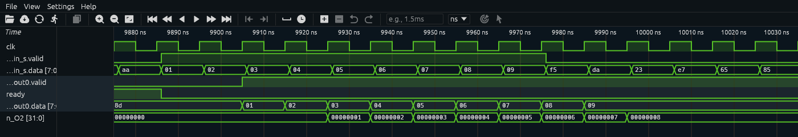

# Lab 05: Protocol rules and backpressure

In this lab you'll write assertions for the router's valid/ready rules and bind them into the
design, finish a sink agent that stalls at random, and write a virtual sequence that runs
configuration changes, traffic and backpressure at the same time. Your Lab 04 testbench already
fails on one of this lab's three planted bugs; your assertions find the cycle in which the router
broke the rule, and the sink and the sequence catch the other two.

Package: [`labs/lab-05-protocol-rules-and-backpressure/`](https://github.com/uoftasic/dd105-a/tree/main/labs/lab-05-protocol-rules-and-backpressure)

## Before you start

- Finish Lab 04.
- Read [Assertions for interface rules](../guide/assertions-for-interface-rules.md),
  [Reactive agents and backpressure](../guide/reactive-agents-and-backpressure.md) and
  [Virtual sequences](../guide/virtual-sequences.md).
- Keep the router specification open in another tab, at
  [Valid/ready rules](../reference/router-spec.md#validready-rules). The rule names on this page
  (O1, O2, O6) are the ones there.

The package is the router testbench as Lab 04 leaves it, with two changes we made for you: there's
no register model yet (that's Lab 06), so registers are read and written with plain APB
transfers, and Lab 04's steps have moved out of the test into a virtual sequence,
`router_lab04_vseq` in `tb/router_seq_pkg.sv`. You'll edit three files, one per part:
`tb/router_sva.sv`, `tb/stream_pkg.sv` and `tb/router_seq_pkg.sv`.

This lab takes about 2 hours. About 6.5 minutes of that is building: on 2 CPUs our first build took
118 s, and the rebuilds after the three edits took 119 s, 34 s and 115 s. The rest is our estimate
of the reading and writing.

```bash
mod dd105-a     # in a new terminal, load .designinit first (Lab 01, Part 1)
cd labs/lab-05-protocol-rules-and-backpressure
```

## Part 1: The Lab 04 testbench against this lab's bugs

Which of this lab's bugs does the testbench you already have catch, and how close does it get to
the cycle where the router went wrong?

1. Build and run `router_test`, which runs Lab 04's steps and then this lab's (empty for now):

   ```bash
   make
   ```

   The build takes about 2 minutes. You should see the run end with this line (your times will
   differ a little):

   ```
    ok: 0 UVM_ERROR, 0 UVM_FATAL   1.46 s   log: build/runs/router_test-s1/run.log
   ```

   A few lines above it is the scoreboard's summary:

   ```
   UVM_INFO labs/lab-05-protocol-rules-and-backpressure/tb/router_env_pkg.sv(706) @ 21205000: uvm_test_top.env.sb [SB] 2121 cycles, 0 resets; 1323 input beats in 336 packets: 302 forwarded, 32 NOROUTE, 2 FULL, 0 oversize; 1179 output beats
   UVM_INFO labs/lab-05-protocol-rules-and-backpressure/tb/router_env_pkg.sv(708) @ 21205000: uvm_test_top.env.sb [SB] 12 register reads checked, 7 writes, 0 to bad addresses; 0 assertion failures
   ```

2. Look at what the stimulus reached. `cg_wait` records, for each packet an output delivers, the
   longest any of its beats waited for `ready`: `none` is 0 cycles, `short_wait` 1 to 3, `long_wait`
   4 to 20 and `stalled` more than 20. `cp_len.oversize` counts packets of 9 beats or more.

   ```bash
   make cov
   grep -E "cg_wait.cp_wait|cp_len.oversize" build/coverage/bins.txt
   ```

   You should see:

   ```
            0  __vlAnonCG_cg_pkt.cp_len.oversize
          297  __vlAnonCG_cg_wait.cp_wait.none
            0  __vlAnonCG_cg_wait.cp_wait.short_wait
            3  __vlAnonCG_cg_wait.cp_wait.long_wait
            2  __vlAnonCG_cg_wait.cp_wait.stalled
   ```

   Lab 04's sink is ready whenever it isn't stalled, and Lab 04's steps stall both outputs
   together, only to fill one of them. So a beat either leaves at once or waits out a whole
   stall, and no packet is longer than 8 beats.

3. Run the grader against this lab's three bugs:

   ```bash
   make check-all
   ```

   You should see:

   ```
         ok  the golden design                        0 UVM_ERROR, 0 UVM_FATAL        1.5s
   ------------------------------------------------------------------------
     MISSED  tier 5  B12_out1_uses_out0_ready         0 UVM_ERROR, 0 UVM_FATAL        1.5s
     caught  tier 4  B10_output_reloads_while_stalled 50 UVM_ERROR                    4.9s
     MISSED  tier 4  B11_cut_packet_has_no_last       0 UVM_ERROR, 0 UVM_FATAL        1.6s
   ------------------------------------------------------------------------
    1 of 3 caught.
    Still hiding from this test:
      B12_out1_uses_out0_ready
         hides behind: driving both out_ready signals the same way
      B11_cut_packet_has_no_last
         hides behind: sending only legal packets of 8 beats or fewer
   ```

   The `hides behind` line under each missed bug matches what step 2 showed: Lab 04 never lets
   the two `out_ready` signals differ, and never sends a packet of more than 8 beats.

4. B10 is already caught, so run it on its own and look at how:

   ```bash
   make run BUG=B10
   ```

   You should see:

   ```
    caught: 50 UVM_ERROR   5.08 s   log: build/runs/router_test-s1-B10/run.log
      UVM_ERROR [SB] a read of LEVEL (14), completing in cycle 1004 returned 00000001; it should return 00000009, th
      UVM_ERROR [SB] a read of DROP_CNT (10), completing in cycle 1009 returned 0000001d; it should return 0000011d,
      UVM_ERROR [SB] output 0 delivered c4 with out_last = 1 in cycle 1011; it should be 01 with out_last = 1 (accep
   ```

   In the log the third line ends `(accepted in cycle 990)`. That is the first of nine 1-beat
   packets that `router_lab04_vseq` sends into output 0 while both sinks are stalled.

5. Before you go on, predict two cycles. Beat `01` was accepted in cycle 990 into an empty, stalled output 0.
   By rule O8, in which cycle is it first on `out0_data`? B10 lets the next beat into the output
   register while `out0_ready` is still 0. In which cycle did `out0_data` first change while the beat
   on it waited? Write that cycle down; Part 2 checks it.

   <details>
   <summary>Answer</summary>

   O8 puts a beat into an empty output on the pins two cycles after its input handshake, so `01`
   appears in cycle 992. Beat `02` was accepted in cycle 991, and B10 loads it over `01` in the
   next cycle, so `out0_data` first changes in cycle 993. The scoreboard noticed 11 cycles later, in
   cycle 1004, because the sequence reads `LEVEL` after the fill. It saw a wrong beat only in cycle
   1011, after the sinks were released.

   </details>

Check: `make check-all` printed `1 of 3 caught.`, and you've written down a cycle for B10.

## Part 2: Assertions for the output rules

Which rule did B10 break, and in which cycle?

1. Open `tb/router_sva.sv`. The module `router_sva` has two assertions written for you, `a_I1`
   and `a_I2`, for the source's rules I1 and I2. They check your own source driver. Read `a_I1`
   with the specification's I1 beside it: the part left of `|=>` (the antecedent) picks the cycles
   the rule talks about, `|=>` means "then, in the next cycle", and `disable iff (!rst_n)` switches
   the check off during reset, which takes a beat away without a handshake. A failure adds one to `n_I1`
   and calls `$error`.

2. In `router_sva_out`, which is instantiated once per output, write the three assertions the
   TODOs describe:
   - `a_O1`: once `out_valid` is 1, it stays 1 until the handshake;
   - `a_O2`: while `out_valid` is 1 and `out_ready` is 0, `out_data` and `out_last` don't change;
   - `a_O6`: a beat taken when `beats` is 7 has `out_last` = 1. This one is about the cycle of the
     handshake itself, so it uses `|->` (the same cycle).

   Count each one's failures in its own counter (`n_O1`, `n_O2`, `n_O6`), as `a_I1` does.

3. Open `tb/router_sva_bind.sv`. Why does the testbench attach the assertions with `bind` instead
   of instantiating `router_sva` in `router_tb_top`?

   <details>
   <summary>Answer</summary>

   `bind` puts an instance of `router_sva` inside every `router`, wired to the router's own ports,
   without editing the router's RTL or the top module. The same file works on the golden design
   and on the faulty build, and the checker sees exactly the pins the rules are written about.

   </details>

4. Rebuild and run on the golden design:

   ```bash
   make
   ```

   The rebuild took us 119 s. You should see `ok: 0 UVM_ERROR, 0 UVM_FATAL` and the same two `[SB]`
   lines as in Part 1; the second still ends `0 assertion failures`. A failure here means an
   assertion is wrong, because the golden router keeps all three rules.

5. Run B10 with the simulator's own error limit. `PLUSARGS=` on the command line replaces the
   Makefile's `+verilator+error+limit+100000`:

   ```bash
   make run BUG=B10 PLUSARGS=
   cat build/runs/router_test-s1-B10/exit_status
   ```

   You should see the run stop at the first failure, then `1`:

   ```
   [9925000] %Error: router_sva.sv:50: Assertion failed in router_tb_top.dut.u_sva.u_out0.a_O2: O2: out_data or out_last changed while the beat waited
   %Error: labs/lab-05-protocol-rules-and-backpressure/tb/router_sva.sv:50: Verilog $stop
   Aborting...
   ------------------------------------------------------------------------
    caught: 1 assertion   0.89 s   log: build/runs/router_test-s1-B10/run.log
      router_sva.sv:50: Assertion failed in router_tb_top.dut.u_sva.u_out0.a_O2: O2: out_data or out_last changed wh
   ------------------------------------------------------------------------
   ```

   The line number is wherever your `a_O2` is. The time is in picoseconds: 9925 ns. The clock's
   period is 10 ns and its first rising edge is at 5 ns, so the edge that ends cycle $n$ is at
   $10n - 5$ ns, and this failure was sampled at the edge that ends cycle 993. Compare it with your
   prediction from Part 1.

   Verilator's default error limit is 1, so the first failing assertion ends the run with exit
   status 1, and nothing after it is checked. That's why the Makefile raises the limit. With the
   limit raised, every failure prints, each assertion's counter keeps counting, and the scoreboard
   reports their sum at the end of the test.

6. Run B10 again with the Makefile's limit, and find the first two checks that fired in time order
   (the summary lists the scoreboard's errors first, whatever their order in the log):

   ```bash
   make run BUG=B10
   grep -m1 "%Error" build/runs/router_test-s1-B10/run.log
   grep -m1 "UVM_ERROR" build/runs/router_test-s1-B10/run.log
   ```

   You should see `caught: 50 UVM_ERROR, 47 assertions`, then:

   ```
   [9925000] %Error: router_sva.sv:50: Assertion failed in router_tb_top.dut.u_sva.u_out0.a_O2: O2: out_data or out_last changed while the beat waited
   UVM_ERROR labs/lab-05-protocol-rules-and-backpressure/tb/router_env_pkg.sv(644) @ 10045000: uvm_test_top.env.sb [SB] a read of LEVEL (14), completing in cycle 1004 returned 00000001; it should return 00000009, the value in cycle 1003 (its first access cycle)
   ```

7. To see the rule break, run `make waves BUG=B10`, which writes
   `build/runs/router_test-s1-B10/waves.fst`, and `make waves` for the golden run. Open both in
   Surfer between 9875 ns and 10035 ns with `in_s.valid`, `in_s.data`, `out0.valid`, `out0.ready`,
   `out0.data` and `u_out0.n_O2`. Ours look like this:

   

   

8. Run the grader again:

   ```bash
   make check-all
   ```

   You should see B10 caught by your assertions as well, and the other two still missed:

   ```
     MISSED  tier 5  B12_out1_uses_out0_ready         0 UVM_ERROR, 0 UVM_FATAL        1.5s
     caught  tier 4  B10_output_reloads_while_stalled 50 UVM_ERROR, 47 assertions     5.0s
     MISSED  tier 4  B11_cut_packet_has_no_last       0 UVM_ERROR, 0 UVM_FATAL        1.5s
   ------------------------------------------------------------------------
    1 of 3 caught.
   ```

   You've written O1 and O6, and each is about one of the missed bugs. Why do they still pass?

   <details>
   <summary>Answer</summary>

   An assertion checks only what the stimulus makes happen. O6 can fail only on the 8th beat of
   a packet that has a 9th, and Lab 04 sends no packet longer than 8 beats. B12 moves output 1
   on `out0_ready`, and Lab 04's two `out_ready` signals are always equal, so output 1 behaves
   exactly as it should and O1 has nothing to see.

   </details>

## Part 3: A sink that stalls at random

What happens to the outputs once each sink takes its beats at its own pace?

1. Read the sink in `tb/stream_pkg.sv`. Each `stream_ready_item` answers one beat: with
   `pre_ready` set, `ready` is already 1 when `valid` appears; otherwise the sink waits `delay`
   cycles after the first cycle `valid` is 1 for that beat, then raises `ready`. `stream_snk_seq`
   makes one item per beat, forever, in the mode `cfg.mode` names, and `cfg.stall` holds `ready` at
   0 whatever the item says. The driver decides at the falling edge in the middle of each cycle,
   once that cycle's `valid` has settled, and drives the next cycle's `ready` through the clocking
   block just after the rising edge. That loop is written for you.

2. Fill in the two TODOs in `stream_snk_driver::run_phase`: the countdown while a beat waits, and
   the expression for `rdy`, the next cycle's `ready`. `rdy` must be 0 while the sink is stalled
   or has no item.

3. Before you rebuild, predict which of B12, B10 and B11 `make check-all` will catch with your
   sink, and why. The sinks start in `SNK_RANDOM`, and Lab 04's first random traffic runs before
   anything changes that.

   <details>
   <summary>Answer</summary>

   B12 and B10. In `SNK_RANDOM` each sink draws its own delays, so the two `out_ready` signals
   differ in most cycles while both outputs carry traffic, which is what B12 needs, and B10 now
   shows up wherever a beat waits with another behind it. B11 still needs a packet of more than
   8 beats, which no step sends yet.

   </details>

4. Rebuild, clear the old runs (`make cov` merges every run in `build/runs`), and look at the
   waits again:

   ```bash
   make build
   rm -rf build/runs
   make
   make cov
   grep -E "cg_wait.cp_wait|cp_len.oversize" build/coverage/bins.txt
   ```

   The rebuild took us 34 s. You should see `ok`, and `short_wait` and `long_wait` above 0. If
   your driver does exactly what the TODOs say, your numbers match ours:

   ```
            0  __vlAnonCG_cg_pkt.cp_len.oversize
          193  __vlAnonCG_cg_wait.cp_wait.none
           38  __vlAnonCG_cg_wait.cp_wait.short_wait
           54  __vlAnonCG_cg_wait.cp_wait.long_wait
            2  __vlAnonCG_cg_wait.cp_wait.stalled
   ```

   The `[SB]` summary now says `17 FULL` where Part 1 said `2 FULL`: a slow sink lets its output
   fill during the random traffic.

5. Run the grader, then compare the first two checks that fired on B12:

   ```bash
   make check-all
   grep -m1 "%Error" build/grade/B12/run.log
   grep -m1 "UVM_ERROR" build/grade/B12/run.log
   ```

   You should see `2 of 3 caught.`, with B12 and B10 caught and B11 missed. Ours:

   ```
     caught  tier 5  B12_out1_uses_out0_ready         50 UVM_ERROR, 37 assertions     0.5s
     caught  tier 4  B10_output_reloads_while_stalled 50 UVM_ERROR, 45 assertions     0.2s
     MISSED  tier 4  B11_cut_packet_has_no_last       0 UVM_ERROR, 0 UVM_FATAL        1.4s
   ```

   ```
   [325000] %Error: router_sva.sv:45: Assertion failed in router_tb_top.dut.u_sva.u_out1.a_O1: O1: out_valid fell without a handshake
   UVM_ERROR labs/lab-05-protocol-rules-and-backpressure/tb/router_env_pkg.sv(670) @ 915000: uvm_test_top.env.sb [SB] output 1 delivered 4a with out_last = 0 in cycle 91; it should be 41 with out_last = 1 (accepted in cycle 30)
   ```

   O1 failed at the edge that ends cycle 33, and the scoreboard complained in cycle 91. Why so
   much later?

   <details>
   <summary>Answer</summary>

   With B12, output 1 dropped beat `41` on a cycle when `out0_ready` was 1 and `out1_ready` was 0.
   That beat never had a handshake on output 1, so no monitor ever reported it, and the
   scoreboard had nothing to compare until the next beat came out of output 1, in cycle 91. O1
   watches the pins, so it fails in the cycle `out1_valid` falls without a handshake.

   </details>

## Part 4: A virtual sequence

How do you make the configuration, the traffic and the backpressure change together, from one
place?

1. Read `router_vsequencer` in `tb/router_env_pkg.sv`, then `router_base_vseq` and
   `router_lab04_vseq` in `tb/router_seq_pkg.sv`. The helpers you'll use are `route(n, en, port)`,
   `ctrl(en)`, `sink(p, mode, stall)`, `burst(dst, n, len, tag0)`, `send_rand(n, mask, gap_pct,
   w_over)`, `cycles(n)`, `drain()` and `rd(A_...)`. Why does the virtual sequencer hold each
   sink's configuration object, and not only its sequencer?

   <details>
   <summary>Answer</summary>

   The sinks' sequences are started by the test and run forever, one item per beat. A virtual
   sequence steers the backpressure by changing `mode` and `stall`, which the sequence and the
   driver read for every beat. Starting another sequence on a sink's sequencer would compete with
   the one already running there.

   </details>

2. Run the test that runs your sequence alone, as it is now:

   ```bash
   make run UVM_TESTNAME=router_lab05_test
   ```

   You should see:

   ```
    FAIL: 1 UVM_ERROR   0.09 s   log: build/runs/router_lab05_test-s1/run.log
      UVM_ERROR [SB] the router accepted no beats and no register was read, so nothing was checked
   ```

   The scoreboard fails a test that checked nothing. `make regress`, which runs every test in
   the Makefile, fails for the same reason until you finish this part.

3. Write `router_lab05_vseq::body()`. The TODO lists four steps:
   1. Reset the router, then configure it: every route enabled, two DSTs to each output, and
      `CTRL.EN` set.
   2. Stall one output while packets go to the other, then the other way round, with a `drain()`
      after each.
   3. Send oversize packets (9 beats or more) to every DST with both sinks in `SNK_RANDOM`, then
      drain.
   4. In one `fork`, run random packets with oversize ones among them (`send_rand`'s `w_over`),
      `backpressure()`, and a branch that moves two routes to the other output and back while the
      packets are in flight. Then drain, and read `DROP_CNT`, `STATUS` and `LEVEL`.

   Step 4 has this shape. `backpressure()` loops until `traffic_done` is set:

   ```systemverilog
   traffic_done = 0;
   fork
     begin
       send_rand(...);          // the packets
       traffic_done = 1;
     end
     backpressure();            // each sink changes its mode on its own
     begin
       ...                      // route changes, with cycles() between them
     end
   join
   ```

4. Predict how each oversize packet should come out, and which bug your sequence now reaches.

   <details>
   <summary>Answer</summary>

   Cut to 8 beats, with `out_last` on the 8th; the router takes the rest from the input and throws
   them away (example E6 in the specification). With B11, the 8th beat has no `out_last`, so O6
   fails on it and the scoreboard sees the wrong `out_last` on the same beat.

   </details>

5. Rebuild, then run both tests and look at the coverage:

   ```bash
   make build
   rm -rf build/runs
   make run UVM_TESTNAME=router_lab05_test
   make
   make cov
   grep -E "cg_wait.cp_wait|cp_len.oversize" build/coverage/bins.txt
   ```

   The rebuild took us 115 s. You should see `ok` from both runs, and `oversize` above 0. The
   counts depend on your sequence; ours were 76 for `oversize`, and the `[SB]` summary of
   `router_test` said `4404 cycles, 1 resets; 2939 input beats in 653 packets: 456 forwarded, 32 NOROUTE, 165 FULL, 40 oversize; 1923 output beats`.

6. Run the grader:

   ```bash
   make check-all
   ```

   You should see `3 of 3 caught.` Ours:

   ```
         ok  the golden design                        0 UVM_ERROR, 0 UVM_FATAL        3.1s
   ------------------------------------------------------------------------
     caught  tier 5  B12_out1_uses_out0_ready         50 UVM_ERROR, 37 assertions     0.4s
     caught  tier 4  B10_output_reloads_while_stalled 50 UVM_ERROR, 45 assertions     0.2s
     caught  tier 4  B11_cut_packet_has_no_last       23 UVM_ERROR, 19 assertions     2.9s
   ------------------------------------------------------------------------
    3 of 3 caught.
    Every bug in the list, each one caught by a check that fired.
   ```

   On B11, our `a_O6` failed at the edge that ends cycle 2258, and the scoreboard reported the
   same beat in the same cycle. At the end of the run the scoreboard added `[SVA] the bound
   assertions (router_sva.sv) counted 19 failures`. What did O6 add?

   <details>
   <summary>Answer</summary>

   It names the rule, and it needs no model: it checks one line of the specification against the
   pins, so it would catch B11 in any testbench that binds the file, including one whose
   scoreboard didn't know that the router cuts long packets. The scoreboard knows what every
   beat should be, so it catches far more, but its message says only that a beat was wrong.

   </details>

7. Check that your testbench still passes the golden design on other seeds:

   ```bash
   make seeds SEEDS="1 2 3 4 5"
   ```

   You should see `5 ok  (5 runs)`.

## Finishing

You're done when `make check-all` prints `3 of 3 caught.` with your assertions, your sink driver
and your virtual sequence in `tb/`, and `make seeds SEEDS="1 2 3 4 5"` prints `5 ok  (5 runs)`.

Questions:

1. B12 breaks rule O7: output 1 depends on `out0_ready`. Your file has no `a_O7`. Which checks
   caught B12, and why is there no assertion for O7?

   <details>
   <summary>Answer</summary>

   O1 and O2 on output 1, and the scoreboard. O7 says what an output does not depend on, and the
   specification points out that no single trace can show that. You can only see its
   consequences, when the two `out_ready` signals differ and output 1 then does something that
   O1, O2 or the scoreboard's model forbids. That's why your sink has to make them differ.

   </details>

2. Your O1 and O2 are disabled while `rst_n` is 0. What would O1 do on the golden design, without
   `disable iff`, in a test that resets the router while a beat waits on a stalled output?

   <details>
   <summary>Answer</summary>

   It would fail. A reset lowers `out_valid` at once, with no handshake (the specification's
   Valid/ready rules and example E8), and that is exactly what O1's consequent forbids. Rules about
   normal operation don't hold across a reset, so their assertions are switched off during one.

   </details>

Submit: nothing for this lab.

Next on the [Course path](../index.md#course-path): read [Register models](../guide/register-models.md)
and [Regressions and seeds](../guide/regressions-and-seeds.md), then do Lab 06: The register block.
