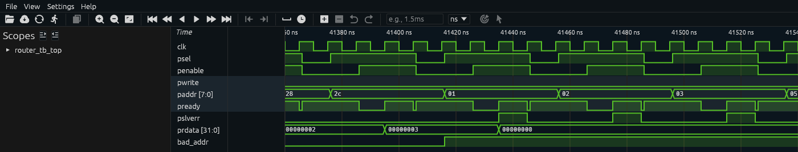

# Lab 06: The register block

You'll give the router's UVM testbench a register model. You write the fields of four registers
and the adapter that turns register operations into APB transfers, connect a predictor, and run
UVM's built-in reset and bit-bash sequences. Then you test the addresses the model can't reach, and
make the scoreboard check the interrupt against `STATUS` and `INT_EN`. Lab 05's testbench misses
all five register bugs this lab hunts (B01, B02, B03, B04 and B14), and yours will catch them.

Package: [`labs/lab-06-the-register-block/`](https://github.com/uoftasic/dd105-a/tree/main/labs/lab-06-the-register-block)

## Before you start

- Finish [Lab 05](lab-05-protocol-rules-and-backpressure-overview.md). This lab's testbench is
  Lab 05's finished one with a register model added, and it uses the same makefile and course folder.
- Read [Register models](../guide/register-models.md) and
  [Regressions and seeds](../guide/regressions-and-seeds.md).
- Keep the [specification](../reference/router-spec.md) open at its Register map, APB, INT_EN and
  Reset sections.

Time: about 2 h. You'll build the simulator seven times. On 2 CPUs those builds took us 136 s,
122 s, 126 s, 136 s, 51 s, 32 s and 39 s, about 11 minutes in all, and each `make check-all` runs
six simulations of 3 to 5.3 s each.

## Part 1: The starter

What does Lab 05's testbench check about the registers?

1. Open a terminal on the workbench desktop, go to the lab folder and start the build, which is
   the slowest step:

   ```bash
   . /foss/designs/common/.designinit   # in every new terminal
   mod dd105-a
   cd labs/lab-06-the-register-block
   make build
   ```

   With an empty ccache it took us 136 s, and it ended with:

   ```text
    built /w/labs/lab-06-the-register-block/build/sim in 136 s (65M; the 1.2G of generated C++ was deleted, SLIM=0 keeps it)
    ccache:  Hits: 0 / 38 ( 0.00%)  Misses: 38 / 38 (100.0%)
   ```

   We ran it with the course folder mounted at `/w`, so your paths start with
   `/foss/designs/modules/dd105-a` instead.

2. While it builds, look at what this lab adds to Lab 05's files:

   | File | New in this lab |
   |---|---|
   | `tb/router_ral_pkg.sv` | the register model and its adapter. `ID`, `CTRL` and `INT_EN` are written; the fields of `STATUS`, `DROP_CNT`, `LEVEL` and `ROUTEn` and the adapter are yours. |
   | `tb/router_env_pkg.sv` | the environment makes the model, the adapter and a predictor. Connecting the predictor and the scoreboard's `irq` check are yours. |
   | `tb/router_seq_pkg.sv` | helpers that go through the model (`wr_reg`, `rd_reg`, `check_reg`, `rd_all_regs`), `router_lab06_vseq` with one `TODO` per part, and `router_backdoor_vseq` |
   | `tb/router_test_pkg.sv` | `router_test` runs Lab 04's, Lab 05's and Lab 06's steps; `router_lab06_test` runs this lab's alone |
   | `tb/apb_pkg.sv` | the driver reports every transfer it finishes on `done_ap` (Part 3 says why) |
   | `tb/router_regs.vlt` | five register signals made visible to the back door (Part 6) |

3. Run the test and pull the scoreboard's summary out of the log:

   ```bash
   make run
   grep -o '\[SB\] [0-9i].*' build/runs/router_test-s1/run.log
   ```

   You should see `ok: 0 UVM_ERROR, 0 UVM_FATAL   3.07 s` from `make run`, and from `grep`:

   ```text
   [SB] 4758 cycles, 2 resets; 3030 input beats in 653 packets: 509 forwarded, 32 NOROUTE, 112 FULL, 44 oversize; 2212 output beats
   [SB] 15 register reads checked, 16 writes, 0 to bad addresses; 0 assertion failures
   [SB] irq checked in 0 cycles, wrong in 0
   ```

4. `make check-all` runs `router_test` on the golden router and on the five bugs. Find the five in
   the list that `python3 ../common/bugs.py` prints, which has all 15 bugs, and read their "hides
   behind" hints. Write down how many you expect the starter to catch, then run it:

   ```bash
   make check-all
   ```

   You should see:

   ```text
         ok  the golden design                        0 UVM_ERROR, 0 UVM_FATAL        3.1s
   ------------------------------------------------------------------------
     MISSED  tier 1  B01_status_write_clears_all      0 UVM_ERROR, 0 UVM_FATAL        3.0s
     MISSED  tier 1  B02_irq_ignores_int_en           0 UVM_ERROR, 0 UVM_FATAL        3.0s
     MISSED  tier 1  B03_route3_readback_swapped      0 UVM_ERROR, 0 UVM_FATAL        3.0s
     MISSED  tier 1  B04_misaligned_address_accepted  0 UVM_ERROR, 0 UVM_FATAL        3.0s
     MISSED  tier 6  B14_enable_resets_to_one         0 UVM_ERROR, 0 UVM_FATAL        3.0s
   ------------------------------------------------------------------------
    0 of 5 caught.
   ```

   The scoreboard has compared every register read with its model since Lab 04, and B14 makes
   `CTRL.EN` reset to 1 instead of 0. Why did none of the 15 reads catch it?

   <details>
   <summary>Answer</summary>

   A wrong reset value shows only between the reset and the first write to the register. A read
   of `CTRL` in that window would show it, and so would a packet offered then, because the
   specification says `in_ready` stays 0 after reset until software sets `CTRL.EN`. Neither
   Lab 04's steps nor Lab 05's do either. Both reset the router, write the routing table and
   `CTRL` straight away, and later read only `DROP_CNT`, `STATUS` and `LEVEL`. B02 hides for
   a simpler reason, which the third line of the summary gives: nothing checks `irq` yet.

   </details>

Check: `0 of 5 caught.`, and `irq checked in 0 cycles`.

## Part 2: The register model

What does UVM need to know about each register, and what does the reset sequence do with it?

1. Open `tb/router_ral_pkg.sv` and read `router_reg_ctrl`, `router_reg_int_en` and
   `router_reg_block::build()`. Each register is a `uvm_reg` whose `build()` creates its fields and
   configures each one with a width, a position, an access policy, whether it's volatile, and a
   reset value. The block puts each register at its address in a map. The specification's Register
   map section has a table that gives each field's UVM access policy, and says which are volatile:
   the ones the router changes on its own.

2. Write `build()` for `router_reg_status`, `router_reg_drop_cnt`, `router_reg_level` and
   `router_reg_route`, following the `TODO`s and the comment at the top of the file. Pass `is_rand`
   as 1 only for a field that software sets to a value it chooses, which here is an `RW` field.

3. Write the adapter's two functions at the bottom of the file. `reg2bus()` fills in an `apb_item`
   from a register operation, and `bus2reg()` does the reverse for a finished transfer. A transfer
   that ended with `PSLVERR` has the status `UVM_NOT_OK`.

4. In `tb/router_seq_pkg.sv`, write the Part 2 step of `router_lab06_vseq`: create a
   `uvm_reg_hw_reset_seq`, set its `model` to `regs`, and start it with `start(null, this)`. It
   reads every register it can check, through the model and so through your adapter, and compares
   each with its reset value. Run `make lint`, which takes seconds and prints any syntax error with
   its line. It also lists the width warnings that the build turns off, 24 of them from the shipped
   files alone, so look for lines that start with `%Error`. Then run `make build` (122 s for us).

5. Write down which of the ten registers you expect the reset sequence to read. Then run the test
   and list the ones it did:

   ```bash
   make run
   grep -o 'Verifying reset value of register [^ ]*' build/runs/router_test-s1/run.log
   ```

   You should see `ok` and seven lines:

   ```text
   Verifying reset value of register regs.ID
   Verifying reset value of register regs.CTRL
   Verifying reset value of register regs.INT_EN
   Verifying reset value of register regs.ROUTE0
   Verifying reset value of register regs.ROUTE1
   Verifying reset value of register regs.ROUTE2
   Verifying reset value of register regs.ROUTE3
   ```

   Why are `STATUS`, `DROP_CNT` and `LEVEL` missing?

   <details>
   <summary>Answer</summary>

   Every field in them is volatile. UVM doesn't compare a volatile field when it reads one, since
   the design may have changed it since the model last looked, and the reset sequence skips a
   register in which no field would be compared. If your list has more than seven, one of your
   fields in those three registers isn't marked volatile.

   </details>

6. Run `make check-all`. With the reference code, B14's row became

   ```text
     caught  tier 6  B14_enable_resets_to_one         2 UVM_ERROR                     3.0s
   ```

   and the others stayed `MISSED`, for `1 of 5 caught.`. Look at the two errors:

   ```bash
   grep '^UVM_ERROR' build/grade/B14/run.log | grep -o '\[[A-Za-z_]*\] .*'
   ```

   ```text
   [RegModel] Register "regs.CTRL" value read from DUT (0x0000000000000001) does not match mirrored value (0x0000000000000000) (valid bit mask = 0x0000000000000001)
   [SB] a read of CTRL (04), completing in cycle 4765 returned 00000001; it should return 00000000, the value in cycle 4764 (its first access cycle)
   ```

   The scoreboard reported the read too. So what did the register model add?

   <details>
   <summary>Answer</summary>

   The read itself. The reset sequence made, from the description you wrote, the read of `CTRL`
   after reset that no hand-written step had made, and then both the model's mirror and the
   scoreboard saw that it was wrong. The built-in sequences are stimulus that you get from the
   register description, for every register in it, without writing a step for each one.

   </details>

Check: `B14` is `caught`, and the other four are `MISSED`.

## Part 3: The predictor and the bit bash

How does the register model keep its mirror in step with the router, and what does the bit-bash
sequence test?

1. Write the first half of the Part 3 step: run a `uvm_reg_bit_bash_seq` the way you ran the reset
   sequence. It works through every bit of every register. For each bit it writes the register
   twice, each time with that bit the opposite of what the model expects it to hold, reads the
   register after each write, and compares what it read with what the model says the register
   should hold. A read-write bit that starts at 0 is written with 1 and then with 0.

2. Write the second half. Lab 04 and Lab 05 set up the router with raw APB transfers, which go
   around the model, and so do `route()` and `ctrl()` here. After the five writes the `TODO`
   lists, read `CTRL` and the four `ROUTEn` with `check_reg()`, which compares each read with the
   model's mirror.

3. The predictor isn't connected yet, and the model's auto-predict is off (`set_auto_predict(0)`
   in `router_env::connect_phase`). Predict what `router_test` does on the golden router, then
   build (126 s for us) and run it:

   ```bash
   make build
   make run
   grep '^UVM_ERROR' build/runs/router_test-s1/run.log | grep -o '\[[A-Za-z_]*\] .*'
   ```

   You should see `FAIL: 5 UVM_ERROR   4.71 s` and:

   ```text
   [RegModel] Register "regs.CTRL" value read from DUT (0x0000000000000001) does not match mirrored value (0x0000000000000000) (valid bit mask = 0x0000000000000001)
   [RegModel] Register "regs.ROUTE0" value read from DUT (0x0000000000000001) does not match mirrored value (0x0000000000000000) (valid bit mask = 0x0000000000000003)
   [RegModel] Register "regs.ROUTE1" value read from DUT (0x0000000000000003) does not match mirrored value (0x0000000000000000) (valid bit mask = 0x0000000000000003)
   [RegModel] Register "regs.ROUTE2" value read from DUT (0x0000000000000002) does not match mirrored value (0x0000000000000000) (valid bit mask = 0x0000000000000003)
   [RegModel] Register "regs.ROUTE3" value read from DUT (0x0000000000000003) does not match mirrored value (0x0000000000000000) (valid bit mask = 0x0000000000000003)
   ```

   The golden router fails. Which side is wrong, and would turning auto-predict on fix it?

   <details>
   <summary>Answer</summary>

   The mirror is wrong; the router returned what was written. The mirror changes only when
   something tells the model about a transfer. Auto-predict updates it after each operation the
   model itself sends, but `route()` and `ctrl()` sent raw transfers, so with auto-predict on the
   mirror would still hold the reset values and the five errors would stay. A failure on the
   golden design is a testbench bug, and here the missing piece is a predictor, which watches
   every transfer on the bus whoever started it.

   </details>

4. Write the Part 3 `TODO` in `router_env::connect_phase`: give the predictor the map and the
   adapter, connect `apb.drv.done_ap` to its `bus_in`, and turn on the map's check-on-read, so the
   predictor compares every read it sees with the mirror.

   The usual place for a predictor to listen is the monitor, because a monitor sees every transfer
   on the bus, including those from other masters. Here it listens to the driver. When we
   connected it to the monitor instead, the run on the golden router failed with 19 `UVM_ERROR`s,
   18 of them from the bit bash, and the first was:

   ```text
   [uvm_reg_bit_bash_seq] Writing a 0 in bit #0 of register "regs.CTRL" with initial value 'h0000000000000001 yielded 'h0000000000000000 instead of 'h0000000000000001
   ```

   Read `apb_driver` in `tb/apb_pkg.sv`: it ends a transfer at the falling edge in the middle of
   its last cycle, and the monitor reports it at the rising edge after that. Why does half a cycle
   break the bit bash?

   <details>
   <summary>Answer</summary>

   The bit bash compares each read with the model's desired value, the one the last write set, and
   a prediction overwrites that value. With the predictor on the monitor, the read of 1 that ended
   the previous step was predicted half a cycle late, after the bit bash had already started the
   write of 0 and set the desired value to 0. The late prediction put it back to 1, and the read of
   0 then looked wrong. The driver's `done_ap` reports a transfer just before it hands the item back
   to its sequence, so the mirror is up to date before the sequence moves on. In a testbench whose
   driver and monitor finish a transfer at the same clock edge, the monitor works and is the usual
   choice.

   </details>

5. Build (136 s for us) and run:

   ```bash
   make build
   make run
   grep -o 'Verifying bits in register [^ ]*' build/runs/router_test-s1/run.log
   ```

   You should see `ok: 0 UVM_ERROR, 0 UVM_FATAL   4.61 s`, and ten lines, from
   `Verifying bits in register regs.ID` to `Verifying bits in register regs.ROUTE3`. Every field of
   `STATUS` is volatile, so the bit bash skips them as the reset sequence did. What does it still
   test in `STATUS`?

   <details>
   <summary>Answer</summary>

   Bits 3 to 31, which hold no field. The bit bash treats a bit with no field as read-only. The
   model expects it to read 0, so both writes set it to 1, and after each one the bit bash checks
   that it still reads 0. That way it tests the reserved bits of every register, the volatile ones
   included.

   </details>

6. Run `make check-all`. You should see `caught` on B03 (6 `UVM_ERROR`s) and B14 (3), and
   `2 of 5 caught.`. B14 has one error more than in Part 2, because the predictor now checks the
   reset sequence's read of `CTRL` as well. Look at B03's first two errors:

   ```bash
   grep '^UVM_ERROR' build/grade/B03/run.log | grep -o '\[[A-Za-z_]*\] .*' | head -2
   ```

   ```text
   [RegModel] Register "regs.ROUTE3" value read from DUT (0x0000000000000002) does not match mirrored value (0x0000000000000001) (valid bit mask = 0x0000000000000003)
   [uvm_reg_bit_bash_seq] Writing a 1 in bit #0 of register "regs.ROUTE3" with initial value 'h0000000000000000 yielded 'h0000000000000002 instead of 'h0000000000000001
   ```

   Where did the 1 written to `EN` come back, and why did Lab 05's random traffic never notice B03?

   <details>
   <summary>Answer</summary>

   It came back in bit 1, `PORT`: `ROUTE3` reads back with its two fields swapped. The route itself
   works, because B03 is in the read path only, so every packet still went where `ROUTE3` sent it.
   Lab 04's and Lab 05's steps never read `ROUTE3`, and a bug in a read path is invisible to a test
   that doesn't read. The bit bash reads after every write, with one bit different each time.

   </details>

Check: `2 of 5 caught.`, with B03 and B14 caught.

## Part 4: The addresses outside the map

Which part of the bus can the register model never test?

1. The map holds ten registers at ten addresses out of 256. Every other address is bad: the
   specification says a transfer to one completes with `PSLVERR`, a bad read returns 0, and a bad
   write changes nothing. The model can't send a transfer to an address it has no register for, so
   these 246 need raw transfers. Write the Part 4 step: read every bad address with `raw(0, a)`,
   write every bad address with `raw(1, a, 32'hFFFF_FFFF)`, then read every register with
   `rd_all_regs()`. `router_model::good_addr(a)` is 1 for the ten good addresses.

2. Write down what the golden router should return for a read of `0x01`, and what `pslverr` should
   be. Then build (51 s for us), run `make check-all`, and look at the scoreboard's summary in the
   golden run, whose log `make check-all` keeps in `build/grade/golden/`:

   ```bash
   make build
   make check-all
   grep -o '\[SB\] [0-9i].*' build/grade/golden/run.log
   ```

   You should see B04 `caught` with `50 UVM_ERROR` (the run stops at 50) and `3 of 5 caught.`, and
   the second of the three `[SB]` lines should be:

   ```text
   [SB] 865 register reads checked, 849 writes, 492 to bad addresses; 0 assertion failures
   ```

3. Look at B04's first errors:

   ```bash
   grep '^UVM_ERROR' build/grade/B04/run.log | grep -o '\[[A-Za-z_]*\] .*' | head -2
   ```

   ```text
   [SB] a read of a bad address (01), completing in cycle 8883: pslverr is 0, but 01 is a bad address
   [SB] a read of a bad address (01), completing in cycle 8883 returned d1050001; it should return 00000000, as every bad read does
   ```

   `d1050001` is `ID`'s value. Why did a read of `0x01` return it?

   <details>
   <summary>Answer</summary>

   The registers are 4 bytes apart, so the router finds the register from `paddr[7:2]`, and for
   `0x01` that's 0, the word `ID` lives at. B04 drops the second half of the bad-address test, that
   `paddr[1:0]` must be `00`, so a misaligned address reaches the register below it, reads and
   writes alike.

   </details>

4. Record the same read in `router_lab06_test`, which runs this lab's steps alone, on the golden
   router and on B04:

   ```bash
   make waves UVM_TESTNAME=router_lab06_test
   make waves UVM_TESTNAME=router_lab06_test BUG=B04
   surfer build/runs/router_lab06_test-s1-B04/waves.fst &
   ```

   Add `clk` from `router_tb_top`, `psel`, `penable`, `pwrite`, `paddr`, `pready`, `pslverr` and
   `prdata` from `apb`, and `bad_addr` from `dut.u_regs`. With the reference code the read of `01`
   runs from 41616 to 41645 ns. To find yours, look for the first error in
   `build/runs/router_lab06_test-s1-B04/run.log`: it's printed at the rising edge after the read
   completes.

   

   *The golden router, 41560 to 41720 ns. `pslverr` is 1 at the end of the reads of `01`, `02`
   and `03`, and `prdata` reads 0.*

   

   *B04. `bad_addr` stays 0, `pslverr` never rises, and the read of `01` returns `d1050001`.*

   How many cycles does each read take, and in which of them does the router decide what `prdata`
   will be?

   <details>
   <summary>Answer</summary>

   Three: a setup cycle (`psel` 1, `penable` 0), a first access cycle with `pready` 0, and a second
   with `pready` 1, in which the read completes. The router copies the register into `prdata` at
   the edge that ends the first access cycle (rule A8), which is why `prdata` changes in the middle
   of each read. `pslverr` is 1 only in the cycle a bad transfer completes (rule A7), so it pulses
   for one cycle in each bad read.

   </details>

Check: `3 of 5 caught.`, with B03, B04 and B14 caught.

## Part 5: The interrupt

Does `irq` follow `STATUS` and `INT_EN` in every cycle?

1. The specification's INT_EN section defines `irq` as the OR of `STATUS[i] & INT_EN[i]`, with
   no delay: it changes in the same cycle as the register bit that changes it. The scoreboard's
   model already keeps `STATUS` and `INT_EN`, updating them from every write it sees and from
   every drop, and `router_model::irq()` combines them. Write the two Part 5 `TODO`s in
   `router_scoreboard::process()`: in a reset cycle `irq` must be 0, and in every other cycle it
   must equal `m.irq()`.

2. You haven't written any stimulus for `irq`. Write down which of B01 and B02 the check will catch
   with the stimulus you already have, then build (32 s for us), run `make check-all` and look at
   B02's errors:

   ```bash
   make build
   make check-all
   grep '^UVM_ERROR' build/grade/B02/run.log | grep -o '\[[A-Za-z_]*\] .*'
   ```

   You should see `4 of 5 caught.`, with B01 still `MISSED` and B02 caught by two errors. You
   chose the wording of your message; in the reference code's wording the two errors are:

   ```text
   [SB] irq is 1 from cycle 22, but STATUS = 001 and INT_EN = 000 make it 0
   [SB] irq is 1 from cycle 2369, but STATUS = 100 and INT_EN = 000 make it 0
   ```

   The golden run's scoreboard (the `grep` in Part 4, step 2) now says
   `[SB] irq checked in 10142 cycles, wrong in 0`. Why does Lab 04's traffic catch B02 in
   cycle 22, and why does B01 still hide?

   <details>
   <summary>Answer</summary>

   Lab 04's and Lab 05's steps never write `INT_EN`, so it is 0 all through them, and `irq` must
   stay 0 whatever `STATUS` holds. Lab 04's steps disable `DST` 2, so the first packet to it is a
   NOROUTE drop that sets `STATUS.NOROUTE`, and B02, which ignores `INT_EN`, raises `irq`. B01
   shows only when a write to `STATUS` clears one bit while another is set. The only writes to
   `STATUS` so far are the bit bash's, right after a reset, when every bit is 0.

   </details>

3. Write the Part 5 step of `router_lab06_vseq`:

   - disable `DST` 1 with `route(1, 0, 0)` and make both sinks fast with `sink(p, SNK_FAST)`;
   - with `INT_EN` still 0, set all three `STATUS` bits: one 1-beat packet to `DST` 1 (NOROUTE),
     one 9-beat packet to `DST` 0 (OVERSIZE), then stall output 0 with `sink(0, SNK_FAST, 1)` and
     send ten 1-beat packets to `DST` 0, which ends in a FULL drop (`burst()` sends them);
   - read `STATUS`;
   - turn each `INT_EN` bit on by itself, waiting two cycles after each write;
   - set `INT_EN` to `3'b111`, then clear the `STATUS` bits one at a time by writing `3'b001`,
     `3'b100` and `3'b010`, and read `STATUS` after each write;
   - `drain()`, then `rd_all_regs()`.

   Write the registers with `wr_reg()` and read them with `rd_reg()`. The model doesn't check
   `STATUS` when it reads it, since it's volatile, but the scoreboard does.

4. Build (39 s for us) and run `make check-all`. You should see:

   ```text
         ok  the golden design                        0 UVM_ERROR, 0 UVM_FATAL        5.3s
   ------------------------------------------------------------------------
     caught  tier 1  B01_status_write_clears_all      3 UVM_ERROR                     5.3s
     caught  tier 1  B02_irq_ignores_int_en           3 UVM_ERROR                     5.3s
     caught  tier 1  B03_route3_readback_swapped      6 UVM_ERROR                     5.3s
     caught  tier 1  B04_misaligned_address_accepted  50 UVM_ERROR                    5.0s
     caught  tier 6  B14_enable_resets_to_one         3 UVM_ERROR                     5.3s
   ------------------------------------------------------------------------
    5 of 5 caught.
   ```

   B01's first two errors, with the reference code, are:

   ```text
   [SB] irq is 0 from cycle 10203, but STATUS = 110 and INT_EN = 111 make it 1
   [SB] a read of STATUS (08), completing in cycle 10205 returned 00000000; it should return 00000006, the value in cycle 10204 (its first access cycle)
   ```

   The first write of `3'b001` cleared `NOROUTE` and, with B01, `FULL` and `OVERSIZE` too.

5. The register model has a mirror of `INT_EN` and `STATUS` as well. Why does the scoreboard keep
   its own copy of both, instead of reading the mirror?

   <details>
   <summary>Answer</summary>

   The mirror of `STATUS` is out of date most of the time: the router sets its bits on its own,
   and the model learns their value only when something reads the register. And even for `INT_EN`
   the mirror changes at the wrong moment. The predictor updates it when the write's transfer
   finishes, but the router uses the new value only from the next cycle, and the scoreboard works
   through each cycle after it has ended, so the mirror would hand it the new `INT_EN` for the
   cycle in which the router still used the old one. A scoreboard that is exact to the cycle has
   to follow the registers the way the router does.

   </details>

Check: `5 of 5 caught.`, and `irq checked in` more than 10,000 cycles on the golden router.

## Part 6: The back door

What can peek and poke do on this simulator?

1. A back-door access reads (`peek`) or writes (`poke`) a register by the name of the signal that
   holds it, with no bus transfer and no simulation time. Read the HDL paths at the end of
   `router_reg_block::build()`, which say that `CTRL` is `en_q` inside `router_regs`, for example,
   and `tb/router_regs.vlt`, which marks those five signals public. UVM reaches a signal through
   VPI, and Verilator lets VPI see only signals marked public. Then read `router_backdoor_vseq` in
   `tb/router_seq_pkg.sv`.

2. The sequence writes `CTRL` with 1 through the front door and peeks it as soon as the write
   returns, then one rising edge later. It peeks `STATUS` and `DROP_CNT` after a NOROUTE drop, and
   then pokes `CTRL`, `INT_EN` and `DROP_CNT`, peeking each at once, one rising edge later and two.
   Write down what you expect each peek to return, then run the test and pull out its lines:

   ```bash
   make run UVM_TESTNAME=router_backdoor_test
   sed -n 's/.*@ \([0-9]*\): .*\[BACKDOOR\] /\1 ps  /p' build/runs/router_backdoor_test-s1/run.log
   ```

   You should see `ok: 0 UVM_ERROR, 0 UVM_FATAL   0.12 s` and:

   ```text
   90000 ps  peek CTRL as the write of 1 returns:   0     (UVM_IS_OK)
   95000 ps  peek CTRL one rising edge later:       1     (UVM_IS_OK)
   155000 ps  peek STATUS after a NOROUTE drop:      1     (UVM_IS_OK)
   155000 ps  peek DROP_CNT:                         1     (UVM_IS_OK)
   155000 ps  poke CTRL with                         0     (UVM_IS_OK)
   155000 ps    peek at once:                        0     (UVM_IS_OK)
   165000 ps    peek one rising edge later:          0     (UVM_IS_OK)
   175000 ps    peek two rising edges later:         0     (UVM_IS_OK)
   175000 ps  poke INT_EN with                       6     (UVM_IS_OK)
   175000 ps    peek at once:                        6     (UVM_IS_OK)
   185000 ps    peek one rising edge later:          6     (UVM_IS_OK)
   195000 ps    peek two rising edges later:         6     (UVM_IS_OK)
   195000 ps  poke DROP_CNT with                     505   (UVM_IS_OK)
   195000 ps    peek at once:                        505   (UVM_IS_OK)
   205000 ps    peek one rising edge later:          505   (UVM_IS_OK)
   215000 ps    peek two rising edges later:         505   (UVM_IS_OK)
   ```

   Why does the first peek read 0, when the write of 1 has returned?

   <details>
   <summary>Answer</summary>

   A write takes effect at the rising edge that ends its access cycle, and `wr_reg()` returns half
   a cycle before that edge, when the driver sees `pready` at the falling edge. So at 90000 ps
   `en_q` still holds 0, and at the edge at 95000 ps it becomes 1. The peek read the signal
   correctly both times; it's the testbench's timing, not the back door, that makes the first
   value look wrong.

   </details>

   On this router the pokes stick: every poked value is still there two rising edges later, in
   `CTRL`, which changes only on a write, and in `DROP_CNT`, which the router rewrites from its own
   value in every cycle. The course's earlier research saw a poke on a different design read back
   its old value at the next front-door read, so before you rely on a poke in another design,
   peek the register after a rising edge, as this test does.

3. The test pokes every register back as it was before anything reads it through the front door.
   `+BACKDOOR_READBACK` adds one front-door read of `INT_EN` first, while it still holds the poked
   6:

   ```bash
   make run UVM_TESTNAME=router_backdoor_test PLUSARGS="+verilator+error+limit+100000 +BACKDOOR_READBACK"
   ```

   The `sed` command now prints one more line,

   ```text
   260000 ps  front-door read of INT_EN:             6     (UVM_IS_OK)
   ```

   and `make run` ends with:

   ```text
    FAIL: 1 UVM_ERROR   0.12 s   log: build/runs/router_backdoor_test-s1/run.log
      UVM_ERROR [SB] a read of INT_EN (0c), completing in cycle 27 returned 00000006; it should return 00000000, the
   ```

   The router returned what was poked. Why does the scoreboard call it wrong?

   <details>
   <summary>Answer</summary>

   The scoreboard learns register values only from the transfers it sees on the bus, and a poke
   isn't one, so as far as the scoreboard knows, `INT_EN` is still 0. The register model's mirror
   does hold 6, because a poke updates it. A testbench that sets registers up through the back door
   has to tell every model that keeps its own copy, or it reports the design as wrong. Reading
   through the back door has no such cost, which makes `peek` the safer half: it shows you the
   volatile registers, such as `STATUS` and `DROP_CNT`, without a bus transfer and without
   disturbing anything.

   </details>

Check: the sixteen lines above and `ok` from the shipped test, and the one `[SB]` error with
`+BACKDOOR_READBACK`.

## Finishing

You're done when `make check-all` prints `5 of 5 caught.` with the register fields, adapter,
predictor connections, `irq` check and `router_lab06_vseq` steps you wrote in `tb/`.

Questions:

1. Before this lab, the scoreboard already compared every register read with its own model. What
   did the register model add, and what did it leave for you to do by hand?

   <details>
   <summary>Answer</summary>

   It added stimulus made from the register description: the reset sequence read every register
   it could check, and the bit bash wrote and read every bit it could check, which caught B14 and
   B03 without a step written for either. It added access by name (`wr_reg(regs.int_en, ...)`
   instead of an address), a mirror that checks reads of the registers that don't change on their
   own, and the back door. It left the 246 bad addresses (B04), the volatile registers, and
   everything the registers do to the rest of the router, such as `irq` (B01 and B02), to raw
   transfers and the scoreboard.

   </details>

Submit: nothing for this lab.

## Going further (optional)

Run your testbench against every bug in the catalogue:

```bash
make check-all BUG_LIST="B01 B02 B03 B04 B05 B06 B07 B08 B09 B10 B11 B12 B13 B14 B15"
```

The reference solution catches 14 of the 15. The one it misses is B15, which hides behind
"resetting only at time 0, when every buffer is already empty"; you'll meet it in Lab 07.

Next on the [Course path](../index.md#course-path): the reading on verification plans and sign-off
and on writing the verification report, then Lab 07: Capstone.
