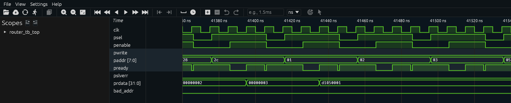

# Lab 06: The register block

In this lab you'll give your Lab 05 testbench a register model. You write the fields of four
registers and the adapter that turns register operations into APB transfers, connect a predictor,
and run UVM's built-in reset and bit-bash sequences. Then you test the 246 addresses the model
can't reach, and make the scoreboard check the interrupt against `STATUS` and `INT_EN`. Your Lab 05
testbench misses all five of this lab's planted bugs (B01, B02, B03, B04 and B14), and by the end
yours catches them.

Package: [`labs/lab-06-the-register-block/`](https://github.com/uoftasic/dd105-a/tree/main/labs/lab-06-the-register-block)

## Before you start

- Finish [Lab 05](lab-05-protocol-rules-and-backpressure-overview.md).
- Read [Register models](../guide/register-models.md) and
  [Regressions and seeds](../guide/regressions-and-seeds.md).
- Keep the router specification open at its [Register map](../reference/router-spec.md#register-map),
  [APB](../reference/router-spec.md#apb), [INT_EN](../reference/router-spec.md#int_en) and
  [Reset](../reference/router-spec.md#reset) sections, and the
  [UVM register layer](../reference/register-layer.md) page beside it, which has the arguments,
  policies and messages this lab uses.

The package is your Lab 05 testbench with our solution to Lab 05 in it: the three assertions, the
sink driver's answer to each beat, and `router_lab05_vseq`'s body. If your own Lab 05 printed `3 of 3 caught.`, your
code did the same job, but keep ours, because this lab adds to the files you edited. What we added
for you:

| File | What Lab 06 adds |
|---|---|
| `tb/router_ral_pkg.sv` | the register model and its adapter; four registers' fields and the adapter are yours (Part 2) |
| `tb/router_ifs.sv`, `tb/router_tb_top.sv`, `tb/router_agents_pkg.sv` | `router_sys_if` and `sys_monitor`, which report `rst_n` and `irq` every cycle |
| `tb/router_env_pkg.sv` | the register model, adapter and predictor in the environment, which you connect (Part 3); a scoreboard model of `STATUS` and `INT_EN` with checks on `STATUS` reads, `PSLVERR` and bad reads, and an `irq` check for you to write (Part 5) |
| `tb/router_vseq_pkg.sv` | helpers that go through the model (`wr_reg`, `rd_reg`, `check_reg`, `rd_all_regs`), `router_lab06_vseq` with one `TODO` per part, and `router_backdoor_vseq` |
| `tb/router_tests_pkg.sv` | `router_test` runs `router_lab06_vseq` first, then everything Lab 05's `router_test` ran; `router_lab06_test` and `router_backdoor_test` |
| `tb/router_regs.vlt` | the five register signals the back door reaches (Part 6) |

Time: about 2 h. You'll build the simulator seven times. On the course's 2 CPUs our first build
took 127 s, and the rebuilds after each part's edits took 107 s (Part 2), 108 s and 113 s (Part 3),
35 s (Part 4), and 105 s and 107 s (Part 5), about 12 minutes in all. Each `make check-all` runs six
simulations of about 5 s or less each.

## Part 1: The Lab 05 testbench against the registers

What does your Lab 05 testbench check about the registers?

1. Go to the lab folder and start the build:

   ```bash
   cd labs/lab-06-the-register-block
   make build
   ```

   Ours took 127 s. Near the end it prints Verilator's report:

   ```text
   - V e r i l a t i o n   R e p o r t: Verilator 5.050 2026-07-01 rev v5.050
   - Verilator: Built from 63.624 MB sources in 449 modules, into 29.574 MB in 3440 C++ files needing 213.243 MB
   - Verilator: Walltime 126.831 s (elab=0.857, cvt=3.307, bld=121.710); cpu 5.400 s on 2 threads; allocated 369.230 MB
   ```

2. Run the graded test, `router_test`, and pull the scoreboard's summary out of the log:

   ```bash
   make run
   grep -o '\[SB\] [0-9a-z].*' build/runs/router_test-s1/run.log
   ```

   You should see `ok: 0 UVM_ERROR, 0 UVM_FATAL   3.44 s` from `make run`, and from `grep`:

   ```text
   [SB] 1123 packets in: 287 to output 0, 355 to output 1, 192 NOROUTE, 289 FULL; the highest level a header saw was 16
   [SB] beats checked: 1281 on output 0, 1552 on output 1; 6 DROP_CNT reads checked
   [SB] registers: 6 reads, 0 of STATUS checked; 0 transfers to bad addresses; irq checked in 0 cycles, wrong in 0
   ```

   The third line is new in this lab. The six reads are `router_inject_test`'s five `DROP_CNT`
   reads and the one at the end of your Lab 05 sequence. Nothing checks `irq` yet, so it was
   checked in 0 cycles.

3. At the end of Lab 05 (Part 4, step 6), `router_test` printed `1122 packets in: 240 to output 0,
   270 to output 1, 194 NOROUTE, 418 FULL` on the same seed. Your Lab 05 code hasn't changed, and
   `router_lab06_vseq`, which `router_test` now starts first, does nothing yet. Why are the
   numbers different?

   <details>
   <summary>Answer</summary>

   Making a sequence and starting it both draw from the random state of the thread that does it.
   That thread goes on to pick Lab 04's routing tables and to start the sequences that randomize
   its packets, so their random choices change, even though `router_lab06_vseq` does nothing.
   Lab 05's `router_test` made and started its own sequence after Lab 04's steps for this reason.
   We checked the other half too: with `router_lab06_vseq` left out, this lab's `router_test`
   printed Lab 05's two lines number for number, so nothing else this lab added changes the
   stimulus. The checks are the same either way.

   </details>

4. `make check-all` runs `router_test` on the golden router and on the five bugs. Find the five in
   the list that `python3 ../common/bugs.py` prints, which has all 15 bugs, and read their "hides
   behind" hints. Write down how many you expect the starter to catch, then run it:

   ```bash
   make check-all
   ```

   You should see:

   ```text
         ok  the golden design                        0 UVM_ERROR, 0 UVM_FATAL        3.6s
   ------------------------------------------------------------------------
     MISSED  tier 1  B01_status_write_clears_all      0 UVM_ERROR, 0 UVM_FATAL        3.6s
     MISSED  tier 1  B02_irq_ignores_int_en           0 UVM_ERROR, 0 UVM_FATAL        3.6s
     MISSED  tier 1  B03_route3_readback_swapped      0 UVM_ERROR, 0 UVM_FATAL        3.6s
     MISSED  tier 1  B04_misaligned_address_accepted  0 UVM_ERROR, 0 UVM_FATAL        3.6s
     MISSED  tier 6  B14_enable_resets_to_one         0 UVM_ERROR, 0 UVM_FATAL        3.6s
   ------------------------------------------------------------------------
    0 of 5 caught.
   ```

   `make check`, which grades the first bug in the list, says
   `VERDICT: FAIL -- your test passes B01_status_write_clears_all too.`

   B14 makes `CTRL.EN` reset to 1 instead of 0. Why doesn't your testbench see it?

   <details>
   <summary>Answer</summary>

   A wrong reset value shows only between the reset and the first write to the register. A read
   of `CTRL` in that window would show it, and so would a packet offered then, because
   `in_ready` stays 0 after reset until software sets `CTRL.EN`. Lab 04's steps write `CTRL`
   before any packet, and nothing reads it: the scoreboard checks only `DROP_CNT` reads. B02 hides
   for the reason the third `[SB]` line gives: nothing checks `irq`.

   </details>

Check: `0 of 5 caught.`, and `irq checked in 0 cycles`.

## Part 2: The register model

What does UVM need to know about each register, and what does the reset sequence do with it?

1. Open `tb/router_ral_pkg.sv` and read `router_reg_ctrl`, `router_reg_int_en` and
   `router_reg_block::build()`. Each register's `build()` creates its fields and configures each
   one with a width, a position, an access policy, whether it's volatile (changed by the router on
   its own), and a reset value; the block puts each register at its address in a map. The
   specification's Register map section gives each field's policy and volatility, and the
   [register layer](../reference/register-layer.md#configuring-a-field) page explains each
   argument of `configure()`.

2. Write `build()` for `router_reg_status`, `router_reg_drop_cnt`, `router_reg_level` and
   `router_reg_route`, as their `TODO`s describe. Pass `is_rand` as 1 only for an `RW` field.

3. Write the adapter's two functions at the bottom of the file. `reg2bus()` fills in an `apb_item`
   from a register operation, and `bus2reg()` does the reverse for a finished transfer. A transfer
   that ended with `PSLVERR` has the status `UVM_NOT_OK`.

4. In `tb/router_vseq_pkg.sv`, write the Part 2 step of `router_lab06_vseq`: create a
   `uvm_reg_hw_reset_seq`, set its `model` to `regs`, and start it with `start(null, this)`. It
   reads every register it can check, through the model and so through your adapter, and compares
   each with its reset value. Run `make lint`, which takes seconds and prints any syntax error
   with its line; ours printed `0 warnings`. Then run `make build` (107 s for us).

5. Write down which of the ten registers you expect the reset sequence to read. Then run the test
   and list the ones it did:

   ```bash
   make run
   grep -o 'Verifying reset value of register [^ ]*' build/runs/router_test-s1/run.log
   ```

   You should see `ok` and seven lines:

   ```text
   Verifying reset value of register regs.ID
   Verifying reset value of register regs.CTRL
   Verifying reset value of register regs.INT_EN
   Verifying reset value of register regs.ROUTE0
   Verifying reset value of register regs.ROUTE1
   Verifying reset value of register regs.ROUTE2
   Verifying reset value of register regs.ROUTE3
   ```

   Why are `STATUS`, `DROP_CNT` and `LEVEL` missing?

   <details>
   <summary>Answer</summary>

   Every field in them is volatile. UVM doesn't compare a volatile field when it reads one, since
   the design may have changed it since the model last looked, and the reset sequence skips a
   register in which no field would be compared. If your list has more than seven, one of your
   fields in those three registers isn't marked volatile.

   </details>

6. Run `make check-all`. B14's row becomes

   ```text
     caught  tier 6  B14_enable_resets_to_one         1 UVM_ERROR                     3.4s
   ```

   and the other four stay `MISSED`, for `1 of 5 caught.` The error is the register model's:

   ```bash
   grep '^UVM_ERROR' build/grade/B14/run.log | grep -o '\[[A-Za-z_]*\] .*'
   ```

   ```text
   [RegModel] Register "regs.CTRL" value read from DUT (0x0000000000000001) does not match mirrored value (0x0000000000000000) (valid bit mask = 0x0000000000000001)
   ```

   `router_test` runs `router_lab06_vseq` before Lab 04's steps. What would the reset sequence
   report on the golden router if it ran after them?

   <details>
   <summary>Answer</summary>

   It would report errors on a router that is right. The sequence resets the model to the reset
   values and then compares every read with them, but the router is reset only once, at time 0, and Lab 04's
   steps and your Lab 05 sequence leave `CTRL.EN` at 1 and the routing table set. So `CTRL` and
   at least some of the `ROUTEn` would read back what those steps wrote, and the sequence would
   call each one wrong. A reset sequence has to run while the registers still hold their reset
   values, which in this testbench means first.

   </details>

Check: B14 is `caught`, and the other four are `MISSED`.

## Part 3: The predictor and the bit bash

How does the register model keep its mirror in step with the router, and what does the bit-bash
sequence test?

1. Write the first half of the Part 3 step: run a `uvm_reg_bit_bash_seq` the way you ran the reset
   sequence. The [register layer](../reference/register-layer.md#the-built-in-sequences) page says
   what it writes and reads for each bit, and what it skips.

2. Write the second half. Lab 04 and Lab 05 set up the router with raw APB transfers, which go
   around the model, and so do `route()` and `ctrl()` here. After the five writes the `TODO`
   lists, read `CTRL` and the four `ROUTEn` with `check_reg()`, which compares each read with the
   model's mirror.

3. The predictor isn't connected yet, and the model's auto-predict is off
   (`set_auto_predict(0)` in `router_env::connect_phase`). Predict what `router_test` does on the
   golden router, then build (108 s for us) and run it:

   ```bash
   make build
   make run
   grep '^UVM_ERROR' build/runs/router_test-s1/run.log | grep -o '\[[A-Za-z_]*\] .*'
   ```

   You should see `FAIL: 5 UVM_ERROR   4.33 s` from `make run`, and from `grep`:

   ```text
   [RegModel] Register "regs.CTRL" value read from DUT (0x0000000000000001) does not match mirrored value (0x0000000000000000) (valid bit mask = 0x0000000000000001)
   [RegModel] Register "regs.ROUTE0" value read from DUT (0x0000000000000001) does not match mirrored value (0x0000000000000000) (valid bit mask = 0x0000000000000003)
   [RegModel] Register "regs.ROUTE1" value read from DUT (0x0000000000000003) does not match mirrored value (0x0000000000000000) (valid bit mask = 0x0000000000000003)
   [RegModel] Register "regs.ROUTE2" value read from DUT (0x0000000000000002) does not match mirrored value (0x0000000000000000) (valid bit mask = 0x0000000000000003)
   [RegModel] Register "regs.ROUTE3" value read from DUT (0x0000000000000003) does not match mirrored value (0x0000000000000000) (valid bit mask = 0x0000000000000003)
   ```

   The golden router fails. Which side is wrong, and would turning auto-predict on fix it?

   <details>
   <summary>Answer</summary>

   The mirror is wrong; the router returned what was written. The mirror changes only when
   something tells the model about a transfer. Auto-predict updates it after each operation the
   model itself sends, but `route()` and `ctrl()` sent raw transfers, so with auto-predict on the
   mirror would still hold the reset values and the five errors would stay. A failure on the
   golden design is a testbench bug, and here the missing piece is a predictor, which watches
   every transfer on the bus whoever started it.

   </details>

4. Write the Part 3 `TODO` in `router_env::connect_phase`: give the predictor the map and the
   adapter, connect the APB monitor's analysis port, `apb.mon.ap`, to its `bus_in`, and turn on
   the map's check-on-read, so the predictor compares every read it sees with the mirror. The
   monitor is the usual place for a predictor, because it sees every transfer on the bus, and the
   scoreboard listens there too.

5. Build (113 s for us) and run:

   ```bash
   make build
   make run
   grep -o 'Verifying bits in register [^ ]*' build/runs/router_test-s1/run.log
   ```

   You should see `ok: 0 UVM_ERROR, 0 UVM_FATAL   4.45 s`, and ten lines, from
   `Verifying bits in register regs.ID` to `Verifying bits in register regs.ROUTE3`. Every field
   of `STATUS` is volatile, so the bit bash skips them, as the reset sequence did. What does it
   still test in `STATUS`?

   <details>
   <summary>Answer</summary>

   Bits 3 to 31, which hold no field. The bit bash treats a bit with no field as read-only. The
   model expects it to read 0, so both writes set it to 1, and after each one the bit bash checks
   that it still reads 0. That way it tests the reserved bits of every register, the volatile ones
   included.

   </details>

6. Run `make check-all`. You should see `caught` on B03 (4 `UVM_ERROR`s) and B14 (2), and the
   other three `MISSED`, for `2 of 5 caught.` B14 has one error more than in Part 2, because the
   predictor now checks the reset sequence's read of `CTRL` as well. Look at B03's first two
   errors:

   ```bash
   grep '^UVM_ERROR' build/grade/B03/run.log | grep -o '\[[A-Za-z_]*\] .*' | head -2
   ```

   ```text
   [RegModel] Register "regs.ROUTE3" value read from DUT (0x0000000000000002) does not match mirrored value (0x0000000000000001) (valid bit mask = 0x0000000000000003)
   [uvm_reg_bit_bash_seq] Writing a 1 in bit #0 of register "regs.ROUTE3" with initial value 'h0000000000000000 yielded 'h0000000000000002 instead of 'h0000000000000001
   ```

   Where did the 1 written to `EN` come back, and why did your Lab 05 traffic never notice B03?

   <details>
   <summary>Answer</summary>

   It came back in bit 1, `PORT`: `ROUTE3` reads back with its two fields swapped. The route itself
   works, because B03 is in the read path only, so every packet still went where `ROUTE3` sent it.
   Lab 04's steps and your Lab 05 sequence never read a `ROUTEn`, and a bug in a read path is
   invisible to a test that doesn't read. The bit bash reads after every write, with one bit
   different each time.

   </details>

Check: B03 and B14 are `caught`, and B01, B02 and B04 are `MISSED`.

## Part 4: The addresses outside the map

Which part of the bus can the register model never test?

1. The map holds ten registers out of 256 addresses. A transfer to any of the other 246 completes
   with `PSLVERR`; a bad read returns 0 and a bad write changes nothing. The model can't send a
   transfer to an address it has no register for, so these need raw transfers. Write the Part 4
   step: read every bad address with `rd(a)`, write each with `wr(a, 32'hFFFF_FFFF)`, then read
   every register with `rd_all_regs()`. `good_addr(a)` is 1 for the ten good addresses, and the
   scoreboard already checks `PSLVERR` and the data of every bad read.

2. Write down what the golden router should return for a read of `0x01`, and what `pslverr`
   should be. Then build (35 s for us), run `make check-all`, and look at the scoreboard's summary
   in the golden run, whose log `make check-all` keeps in `build/grade/golden/`:

   ```bash
   make build
   make check-all
   grep -o '\[SB\] [0-9a-z].*' build/grade/golden/run.log
   ```

   You should see B04 `caught` with `50 UVM_ERROR` (the run stops at 50) and `3 of 5 caught.`,
   and the last of the three `[SB]` lines should be:

   ```text
   [SB] registers: 856 reads, 59 of STATUS checked; 492 transfers to bad addresses; irq checked in 0 cycles, wrong in 0
   ```

3. Look at B04's first errors:

   ```bash
   grep '^UVM_ERROR' build/grade/B04/run.log | grep -o '\[[A-Za-z_]*\] .*' | head -2
   ```

   ```text
   [APB] a read of 01, completing in cycle 4145: pslverr is 0, but 01 is a bad address
   [APB] a read of 01, completing in cycle 4145 returned d1050001; a read of a bad address returns 0
   ```

   `d1050001` is `ID`'s value. Why did a read of `0x01` return it?

   <details>
   <summary>Answer</summary>

   The registers are 4 bytes apart, so the router finds the register from `paddr[7:2]`, and for
   `0x01` that's 0, the word `ID` lives at. B04 drops the second half of the bad-address test, that
   `paddr[1:0]` must be `00`, so a misaligned address reaches the register below it, reads and
   writes alike.

   </details>

4. Record the same reads in `router_lab06_test`, which runs your sequence alone. It is the first
   part of `router_test` cycle for cycle, so the read of `01` completes in cycle 4145 there too.
   Record it on the golden router and on B04:

   ```bash
   make waves UVM_TESTNAME=router_lab06_test
   make waves UVM_TESTNAME=router_lab06_test BUG=B04
   surfer build/runs/router_lab06_test-s1-B04/waves.fst &
   ```

   Add `clk` from `router_tb_top`, `psel`, `penable`, `pwrite`, `paddr`, `pready`, `pslverr` and
   `prdata` from `apb`, and `bad_addr` from `dut.u_regs`. Cycle n ends at the rising edge at
   10n − 5 ns, so the read of `01` takes cycles 4143 to 4145, from 41415 to 41445 ns; the first
   error in the B04 run's log is printed at 41445000 ps.

   

   *The golden router, 41360 to 41540 ns. `pslverr` is 1 in the last cycle of the reads of `01`,
   `02` and `03`, and `prdata` reads 0.*

   

   *B04. `bad_addr` stays 0, `pslverr` never rises, and the reads of `01`, `02` and `03` all
   return `d1050001`.*

   How many cycles does each read take, and in which of them does the router decide what `prdata`
   will be?

   <details>
   <summary>Answer</summary>

   Three: a setup cycle (`psel` 1, `penable` 0), a first access cycle with `pready` 0, and a second
   with `pready` 1, in which the read completes. The router copies the register into `prdata` at
   the edge that ends the first access cycle (rule A8), so `prdata` changes in the middle of each
   read, and `pslverr` is 1 only in the cycle a bad transfer completes (rule A7). The cycle with
   `psel` 0 between reads is the APB driver's: it waits for a clock edge before each transfer.

   </details>

Check: B03, B04 and B14 are `caught`, and B01 and B02 are `MISSED`.

## Part 5: The interrupt

Does `irq` follow `STATUS` and `INT_EN` in every cycle?

1. The specification's INT_EN section defines `irq` as the OR of `STATUS[i] & INT_EN[i]`, with no
   delay. The scoreboard already keeps both registers cycle by cycle: each drop, oversize packet
   or write waits in `changes` until `advance()` reaches the cycle it takes effect in, as route
   writes waited in `pending` in Lab 05, and `irq()` combines the two. Write the two Part 5
   `TODO`s in `router_scoreboard::write_sys()`, which the sys monitor calls every cycle: in a
   reset cycle `irq` must be 0, and in every other cycle it must equal `irq()`.

2. You haven't written any stimulus for `irq`. Write down which of B01 and B02 the check will
   catch with the stimulus you already have, then build (105 s for us), run `make check-all` and
   look at B02's error:

   ```bash
   make build
   make check-all
   grep '^UVM_ERROR' build/grade/B02/run.log | grep -o '\[[A-Za-z_]*\] .*'
   ```

   You should see `4 of 5 caught.`, with B01 still `MISSED` and B02 caught by one `UVM_ERROR`.
   You chose the wording of your message; in the reference code's wording it is:

   ```text
   [IRQ] irq is 1 from cycle 5921, but STATUS = 001 and INT_EN = 000 make it 0
   ```

   The golden run's scoreboard (the `grep` in Part 4, step 2) now says
   `irq checked in 14681 cycles, wrong in 0`. Why does B02 show up in Lab 04's traffic, and why
   does B01 still hide?

   <details>
   <summary>Answer</summary>

   Your `router_lab06_vseq` sends no packets yet, so the drop that set `STATUS.NOROUTE` was in
   Lab 04's traffic. `INT_EN` is 0 all through it: Lab 04's steps and your Lab 05 sequence never
   write it, and the bit bash puts each bit back the way it found it. So `irq` must stay 0, and
   B02, which ignores `INT_EN`, raises it at the first NOROUTE drop; every phase of
   `router_inject_test` disables a route and sends packets to it (the first phase uses `010-`).
   Nothing clears `STATUS`, so `irq` stays wrong and the check reports it once. B01 shows only when
   a write to `STATUS` clears one bit while another stays set, and the only writes to `STATUS` so
   far are the bit bash's, right after reset, when every bit is 0.

   </details>

3. Write the Part 5 step of `router_lab06_vseq`:

   - disable `DST` 1 with `route(1, 0, 0)` and make both sinks fast with `sink(p, SNK_FAST)`;
   - with `INT_EN` still 0, set all three `STATUS` bits: one 1-beat packet to `DST` 1 (NOROUTE)
     and one 9-beat packet to `DST` 0 (OVERSIZE), then `drain()`, stall output 0 with `stall(0)`
     and send ten 1-beat packets to `DST` 0, which ends in a FULL drop (`burst()` sends them);
   - read `STATUS`;
   - turn each `INT_EN` bit on by itself, waiting two cycles after each write;
   - set `INT_EN` to `'b111`, then clear the `STATUS` bits one at a time by writing `'b001`,
     `'b100` and `'b010`, and read `STATUS` after each write;
   - `drain()`, then `rd_all_regs()`.

   Write the registers with `wr_reg()` and read them with `rd_reg()`. The model doesn't check
   `STATUS` when it reads it, since it's volatile, but the scoreboard does.

4. Build (107 s for us) and run `make check-all`. You should see:

   ```text
         ok  the golden design                        0 UVM_ERROR, 0 UVM_FATAL        4.8s
   ------------------------------------------------------------------------
     caught  tier 1  B01_status_write_clears_all      3 UVM_ERROR                     4.8s
     caught  tier 1  B02_irq_ignores_int_en           1 UVM_ERROR                     4.7s
     caught  tier 1  B03_route3_readback_swapped      4 UVM_ERROR                     4.7s
     caught  tier 1  B04_misaligned_address_accepted  50 UVM_ERROR                    1.4s
     caught  tier 6  B14_enable_resets_to_one         2 UVM_ERROR                     4.7s
   ------------------------------------------------------------------------
    5 of 5 caught.
    Every bug in the list, each one caught by a check that fired.
   ```

   B01's first two errors, with the reference code, are:

   ```text
   [IRQ] irq is 0 from cycle 5969, but STATUS = 110 and INT_EN = 111 make it 1
   [STATUS] a read of 08, completing in cycle 5972 returned 00000000; it should return 00000006, STATUS in cycle 5971
   ```

   The first write of `'b001` cleared `NOROUTE` and, with B01, `FULL` and `OVERSIZE` too. B02 is
   still caught by one error, but now it is `irq is 1 from cycle 5909`, in your own step. Why
   doesn't Lab 04's traffic catch B02 any more?

   <details>
   <summary>Answer</summary>

   Your step ends with `INT_EN` at `'b111`, and nothing writes it again, so Lab 04's traffic and
   your Lab 05 sequence run with every enable on. Then `|(STATUS & INT_EN)` and `|STATUS` are the
   same thing, and B02 makes no difference to `irq`. That is the hiding place `bugs.py` names for
   B02: "turning on every interrupt enable before looking at irq". Your step catches it in the
   cycles before it turns the enables on.

   </details>

5. The register model has a mirror of `INT_EN` and `STATUS` as well. Why does the scoreboard keep
   its own copy of both, instead of reading the mirror?

   <details>
   <summary>Answer</summary>

   The mirror of `STATUS` is out of date most of the time: the router sets its bits on its own,
   and the model learns their value only when something reads the register. And even for
   `INT_EN` the mirror changes at the wrong moment. The predictor updates it when the monitor
   reports the write, at the edge that ends the cycle the write completes in, and the router uses
   the new value from the next cycle. The scoreboard checks `irq` for a cycle at the same edge, so it
   would get the old or the new `INT_EN` depending on which monitor the simulator woke first,
   the same race your Lab 05 scoreboard avoided with cycle stamps on route writes. A scoreboard
   that is exact to the cycle has to follow the registers the way the router does.

   </details>

Check: `5 of 5 caught.`, and `irq checked in 14840 cycles, wrong in 0` in the golden run.

## Part 6: The back door

What do peek and poke do on this router?

1. A back-door access reads (`peek`) or writes (`poke`) a register through the signal that holds
   it, with no bus transfer and no simulation time. Read the HDL paths at the end of
   `router_reg_block::build()`, `tb/router_regs.vlt` (the
   [register layer](../reference/register-layer.md#the-back-door) page says how they fit
   together), and `router_backdoor_vseq` in `tb/router_vseq_pkg.sv`.

2. The sequence writes `CTRL` with a raw transfer and peeks it twice, peeks `STATUS` and
   `DROP_CNT` after a NOROUTE drop, then pokes `CTRL`, `INT_EN` and `DROP_CNT`, peeking each at
   once, one rising edge later and two. Write down what you expect each peek to return, then run
   the test and pull out its lines:

   ```bash
   make run UVM_TESTNAME=router_backdoor_test
   sed -n 's/.*@ \([0-9]*\): .*\[BACKDOOR\] /\1 ps  /p' build/runs/router_backdoor_test-s1/run.log
   ```

   You should see `ok: 0 UVM_ERROR, 0 UVM_FATAL   0.09 s` and:

   ```text
   65000 ps  peek CTRL as the write of 1 returns:   1     (UVM_IS_OK)
   75000 ps  peek CTRL one rising edge later:       1     (UVM_IS_OK)
   125000 ps  peek STATUS after a NOROUTE drop:      1     (UVM_IS_OK)
   125000 ps  peek DROP_CNT:                         1     (UVM_IS_OK)
   125000 ps  poke CTRL with                         0     (UVM_IS_OK)
   125000 ps    peek at once:                        0     (UVM_IS_OK)
   135000 ps    peek one rising edge later:          0     (UVM_IS_OK)
   145000 ps    peek two rising edges later:         0     (UVM_IS_OK)
   145000 ps  poke INT_EN with                       6     (UVM_IS_OK)
   145000 ps    peek at once:                        6     (UVM_IS_OK)
   155000 ps    peek one rising edge later:          6     (UVM_IS_OK)
   165000 ps    peek two rising edges later:         6     (UVM_IS_OK)
   165000 ps  poke DROP_CNT with                     505   (UVM_IS_OK)
   165000 ps    peek at once:                        505   (UVM_IS_OK)
   175000 ps    peek one rising edge later:          505   (UVM_IS_OK)
   185000 ps    peek two rising edges later:         505   (UVM_IS_OK)
   ```

   On this router every poke stuck: each poked value is still there two rising edges later. That
   is what we measured here, on these three registers; before you rely on a poke in another
   design, peek the register after a rising edge, as this test does. `CTRL` and `INT_EN` change
   only on a write or a reset, but the router assigns both `DROP_CNT` counters at every rising
   edge. Why does the poked `505` survive?

   <details>
   <summary>Answer</summary>

   `router_regs.sv` computes each counter's next value from its present one, in the function
   `bump()`: it clears the counter only on a write to `DROP_CNT`, and adds one only on a drop.
   With neither, the next value is the present value, and after a poke the present value is the
   poked one.

   </details>

3. The test pokes every register back as it was before anything reads it through the front door.
   `+BACKDOOR_READBACK` adds one front-door read of `DROP_CNT` first, while it still holds the
   poked `505`:

   ```bash
   make run UVM_TESTNAME=router_backdoor_test PLUSARGS="+verilator+error+limit+100000 +BACKDOOR_READBACK"
   ```

   The `sed` command now prints one more line,

   ```text
   225000 ps  front-door read of DROP_CNT:           505   (UVM_IS_OK)
   ```

   and `make run` prints:

   ```text
    FAIL: 1 UVM_ERROR   0.09 s   log: build/runs/router_backdoor_test-s1/run.log
      UVM_ERROR [DROP_CNT] read 00000505, expected 00000001 (FULL_CNT 0, NOROUTE_CNT 1)
   ```

   The router returned what was poked. Why does the scoreboard call it wrong?

   <details>
   <summary>Answer</summary>

   The scoreboard learns register values only from the transfers it sees on the bus, and a poke
   isn't one. It has seen one NOROUTE drop and no write to `DROP_CNT`, so as far as it knows
   `DROP_CNT` holds `00000001`. A testbench that sets registers through the back door has to tell
   every model that keeps its own copy. Reading through it has no such cost, which makes `peek`
   the safer half: it shows you `STATUS` and `DROP_CNT` without a bus transfer and without
   disturbing anything.

   </details>

Check: the sixteen lines above and `ok` from the shipped test, and the one `[DROP_CNT]` error
with `+BACKDOOR_READBACK`.

## Finishing

You're done when `make check-all` prints `5 of 5 caught.` with the register fields, adapter,
predictor connections, `irq` check and `router_lab06_vseq` steps you wrote in `tb/`, and
`make seeds SEEDS="1 2 3 4 5"` prints `5 ok  (5 runs)`.

Questions:

1. Before this lab, the scoreboard checked one register, `DROP_CNT`. What did the register model
   add, and what did it leave for the scoreboard and for raw transfers?

   <details>
   <summary>Answer</summary>

   Stimulus made from the register description: the reset sequence and the bit bash read and
   wrote every register and bit they could check, which caught B14 and B03 without a step written
   for either. It also added access by name (`wr_reg(regs.int_en, ...)`), a mirror that checks
   reads of the registers that don't change on their own, and the back door. It left the 246 bad
   addresses (B04), the volatile registers, and what the registers do to the rest of the router,
   such as `irq` (B01 and B02), to raw transfers and the scoreboard.

   </details>

Submit: nothing for this lab.

## Going further (optional)

Run your testbench against every bug in the catalogue:

```bash
make check-all BUG_LIST="B01 B02 B03 B04 B05 B06 B07 B08 B09 B10 B11 B12 B13 B14 B15"
```

The reference solution catches 14 of the 15:

```text
  caught  tier 6  B14_enable_resets_to_one         2 UVM_ERROR                     4.8s
  MISSED  tier 6  B15_output_valid_survives_reset  0 UVM_ERROR, 0 UVM_FATAL        4.9s
------------------------------------------------------------------------
 14 of 15 caught.
```

The one it misses is B15, which hides behind "resetting only at time 0, when every buffer is
already empty"; you'll meet it in Lab 07.

Next on the [Course path](../index.md#course-path): the reading on verification plans and sign-off
and on writing the verification report, then Lab 07: Capstone.
