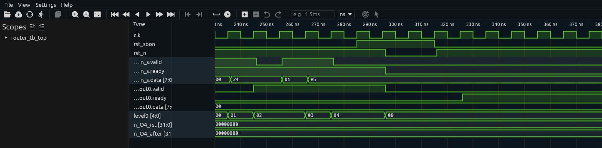

# Lab 07: Capstone

You'll take your Lab 06 testbench to sign-off. You write a verification plan from the
specification, run a seed regression and read its coverage, and hunt mystery builds dealt from all
fifteen bugs in the catalogue. Then you close the holes that the plan and the coverage show you:
assertions for the rules about reset, resets with traffic in flight, and drop counters at 255,
until `make check-all` prints `15 of 15 caught.`, and you write a verification report. The plan,
the report and the code you write go into a GitHub repository of your own.

Package: [`labs/lab-07-capstone/`](https://github.com/uoftasic/dd105-a/tree/main/labs/lab-07-capstone)

## Before you start

- Finish [Lab 06](lab-06-the-register-block-overview.md).
- Read [Verification plans and sign-off](../guide/verification-plans-and-sign-off.md) and
  [Writing the verification report](../guide/writing-the-verification-report.md), and reread
  [Regressions and seeds](../guide/regressions-and-seeds.md).
- Keep [the router's specification](../reference/router-spec.md) open for the whole lab, with
  [the router in one page](../reference/the-router-in-one-page.md) beside it if you like. The plan
  you write in Part 2 is a list of the specification's rules.
- You need a GitHub account, and a token the workbench can push with. If you made one in
  [IC102-A Lab 01, Part 2](https://uoftasic.com/ic102-a/labs/lab-01-your-repo-from-the-template-overview.html#part-2-your-github-settings)
  and it hasn't expired, use it. Otherwise make one the way that part describes. This lab needs
  only the Contents permission, read and write, because your repository has no workflows.
- In a terminal on the workbench desktop:

  ```bash
  . /foss/designs/common/.designinit
  mod dd105-a
  cd labs/lab-07-capstone
  ```

The package is your Lab 06 testbench with our solution to Lab 06 in it: the four registers'
fields and the adapter, the predictor's connections, the `irq` check and `router_lab06_vseq`'s
steps. If your own Lab 06 printed `5 of 5 caught.`, your code did the same job, but keep ours,
because this lab adds to the files you edited. Until now the router has been reset only at time 0,
and nothing in the testbench could reset it again. What we added for you:

| File | What Lab 07 adds |
|---|---|
| `tb/router_ifs.sv`, `tb/router_tb_top.sv` | a reset the testbench can drive: `rst_req_n` and `rst_soon` in `router_sys_if`, and `rst_n` made from them and the reset at time 0 |
| `tb/router_agents_pkg.sv` | the reset driver (`sys_agent`, `router_reset_seq`); a source driver that abandons its packet at a reset (rule I3), and an APB driver that keeps `psel` at 0 during one and starts an interrupted transfer again (rule A4) |
| `tb/router_env_pkg.sv` | in the scoreboard, `reset_model()`: at a reset it throws away every beat it expected and puts its own models and the register model's mirror back to their reset values; four corners, with the covergroup `cg_corner` |
| `tb/router_sva.sv`, `tb/router_sva_bind.sv` | the APB port and `irq` in the bound module, and a counter for each rule about reset; the assertions are yours (Part 5) |
| `tb/router_vseq_pkg.sv` | `reset()` in the base sequence; `router_reset_vseq` and `router_saturate_vseq`, whose bodies are yours (Parts 5 and 6); `router_lab07_vseq`, four phases of random traffic whose resets are yours (Part 5) |
| `tb/router_tests_pkg.sv` | `router_test` runs `router_lab07_vseq` last; `router_lab07_test`, `router_reset_test` and `router_saturate_test` |
| `Makefile` | `BUG_LIST`: all fifteen bugs, B15 first, because `make check` grades the first |

Time: about 3 h 30 min. About 20 minutes of that is the machine working, which we measured on the
course's 2 CPUs: the first build took 130 s, the three rebuilds after your edits 114 to 118 s
each, a regression about 4 minutes and `make check-all` about 75 s. Most of the rest is writing:
the plan, eight assertions, two sequences and the report.

## Part 1: Your repository and the first build

1. Start the build, because it's the slowest step in the lab:

   ```bash
   make build
   ```

   The banner says a cold build takes 1.5 to 2.5 minutes. Ours, with an empty ccache, took 130 s
   and ended with:

   ```text
   - Verilator: Walltime 130.147 s (elab=0.929, cvt=3.622, bld=124.720); cpu 5.833 s on 2 threads; allocated 382.234 MB
   ```

   and then a line saying it built `build/sim` in 130 s.

2. While it builds, make the repository. On GitHub, create a new repository under your own
   account named `dd105-capstone`, with a README so that it starts with one commit. It can be
   private, because nobody needs to read it yet.

3. Clone it beside the course, and tell git who you are in it:

   ```bash
   mkdir -p /foss/designs/projects && cd /foss/designs/projects
   git clone https://github.com/YOUR-USERNAME/dd105-capstone.git
   cd dd105-capstone
   git config user.name "Your Name"
   git config user.email "ID+USERNAME@users.noreply.github.com"
   git config credential.helper 'cache --timeout=28800'
   cd /foss/designs/modules/dd105-a/labs/lab-07-capstone
   ```

   Use your GitHub no-reply address, and leave out `--global`: the container's home folder is
   thrown away when the workbench restarts, but `.git/config` is inside your repository, on your
   own disk, so it stays.
   [IC102-A Lab 01, Part 3](https://uoftasic.com/ic102-a/labs/lab-01-your-repo-from-the-template-overview.html#part-3-make-the-repository)
   explains both. Your plan and your report live in the repository from the start. The testbench
   stays here in the course clone while you work on it, because it builds only from inside
   `labs/`, and Part 8 copies it across.

4. When the build has finished, run the graded test, `router_test`, and pull the scoreboard's
   summary out of the log:

   ```bash
   make run
   grep -o '\[SB\] [0-9a-z].*' build/runs/router_test-s1/run.log
   ```

   You should see `ok: 0 UVM_ERROR, 0 UVM_FATAL   7.38 s` from `make run`, and from `grep`:

   ```text
   [SB] 1733 packets in: 479 to output 0, 381 to output 1, 260 NOROUTE, 613 FULL; the highest level a header saw was 16
   [SB] beats checked: 2183 on output 0, 1700 on output 1; 45 DROP_CNT reads checked
   [SB] registers: 884 reads, 65 of STATUS checked; 492 transfers to bad addresses; irq checked in 19951 cycles, wrong in 0
   [SB] resets: 0 after the one at time 0, 0 expected beats lost; corners hit: reset_with_beats=0 reset_mid_packet=0 noroute_saturated=0 full_saturated=0
   ```

5. At the end of Lab 06 your `router_test` checked `irq` in 14840 cycles. This one checks it in
   19951. What ran in the other 5111 cycles, and did anything before them change?

   <details>
   <summary>Answer</summary>

   `router_lab07_vseq`, which `router_test` now starts after everything Lab 06's `router_test`
   ran. Its four phases of random traffic (150 packets each, on a random routing table and random
   interrupt enables, with both sinks changing their modes) take those cycles; it doesn't run
   your two sequences yet. It goes last so that the random choices it makes can't move anything
   before it. We checked: with `router_lab07_vseq` left out, `router_test` printed
   Lab 06's lines number for number (`1133 packets in: 282 to output 0, 226 to output 1, 195
   NOROUTE, 430 FULL`, and `irq checked in 14840 cycles`), so nothing we added changes a run that
   has no reset in it.

   </details>

Check: `make run` passes, and `git -C /foss/designs/projects/dd105-capstone log --oneline` shows
the one commit that GitHub made.

## Part 2: The verification plan

Which of the specification's rules does this environment check, and which does it never make
happen?

1. Copy the template into your repository:

   ```bash
   cp PLAN-template.md /foss/designs/projects/dd105-capstone/PLAN.md
   ```

   It has a row for each rule in the specification. The input, output and APB rules keep the
   specification's numbers (I1 to I7, O1 to O8, A1 to A9), and the template gives labels of its own
   (RT1, DR2, RS2 and so on) to the rules that the specification states in prose. Three rows, O1,
   RT1 and A7, are filled in as examples.

2. Fill in the table under "How the environment checks". There are three checkers: the
   scoreboard (`write_in`, `write_out`, `write_apb` and `write_sys` in `router_scoreboard`, in
   `tb/router_env_pkg.sv`), the register model's mirror (the predictor and `set_check_on_read(1)`
   in `router_env::connect_phase`, which you connected in Lab 06), and the assertions in
   `tb/router_sva.sv`. The comment at the top of each file says what it covers.

3. For every row, fill in "Checked by" and "Made to happen by", and write "nothing" where nothing
   does. Every virtual sequence in `tb/router_vseq_pkg.sv` has a comment over each step saying what
   it sets up, and `router_test` in `tb/router_tests_pkg.sv` lists what the graded test runs. Run
   `grep -n TODO tb/*.sv` first, because the parts this lab leaves out are marked that way.

4. Mark the rows you think `router_test` never reaches. Then look at what the scoreboard says
   about resets in your Part 1 run:

   ```bash
   grep -o '\[SB\] resets.*' build/runs/router_test-s1/run.log
   ```

   You saw the line in Part 1: `resets: 0 after the one at time 0`, and every corner at 0. Which
   rows of your plan can't be done with only the reset at time 0, and which have no checker?

   <details>
   <summary>Answer</summary>

   At time 0 the router holds nothing, so RS2 and RS3 (a reset with beats in a buffer, and a
   reset in the middle of an input packet), the second half of O4 and the source's rule I3 all
   need a reset with traffic in flight. I7, O4, the first half of A4 and RS1 have no assertion
   yet, because theirs are the `TODO (Part 5)` comments in `tb/router_sva.sv`; of RS1, only `irq`
   is checked, by the scoreboard. DR2, a counter that stops at 255, needs 255 drops with no clear
   or reset between them, and `router_inject_test`'s phases clear `DROP_CNT` after each phase.

   The rest of the list is about the environment itself. Nothing checks `in_ready` (I4, I5, I6,
   RT5), the cycle a beat appears (O3, O8), what `CTRL.EN` does (EN1), the APB master's rules (A1
   to A3) or `pready` (A5, A6), or `LEVEL` (RG4). Those rows stay "nothing" through this lab. Put
   them in the plan's Open items, because Part 8's report has to say what the environment doesn't
   show.

   </details>

Check: every row of your plan has an entry in "Checked by" and "Made to happen by", and the rows
that say "nothing" include the ones in the answer above.

## Part 3: A seed regression

Does a regression that passes on every seed tell you the environment is finished?

1. `make regress` runs every test in `TESTS` on seeds 1 to 10. Look at `TESTS` in the Makefile,
   and write down how many runs you expect and how many will pass.

2. Run it, and time it:

   ```bash
   time make regress
   ```

   It took us 3 min 57 s. You should see `110 ok  (110 runs)` and then the coverage of those runs:

   ```text
    verilator_coverage: covergroup : 81.7% (49/60)
   ```

   with, at the end of the bin list:

   ```text
    11 bins never hit:
       __vlAnonCG_cg_corner.cp_corner.reset_with_beats
       __vlAnonCG_cg_corner.cp_corner.reset_mid_packet
       __vlAnonCG_cg_corner.cp_corner.noroute_saturated
       __vlAnonCG_cg_corner.cp_corner.full_saturated
       __vlAnonCG_cg_pkt.x_fate_level.full_x_at_8
       __vlAnonCG_cg_pkt.x_fate_level.full_x_empty
       __vlAnonCG_cg_pkt.x_fate_level.full_x_low
       __vlAnonCG_cg_pkt.x_fate_level.out0_x_at_9
       __vlAnonCG_cg_pkt.x_fate_level.out0_x_high
       __vlAnonCG_cg_pkt.x_fate_level.out1_x_at_9
       __vlAnonCG_cg_pkt.x_fate_level.out1_x_high
   ```

3. `cg_corner` counts the four corners in `corner_e`, near the top of `tb/router_env_pkg.sv`, and
   the scoreboard reports each one as it happens. Which of the eleven empty bins could any test
   ever hit, and which rows of your plan are they?

   <details>
   <summary>Answer</summary>

   Only the four in `cg_corner`. The seven in `x_fate_level` are ones the specification rules out,
   as they were in Labs 04 to 06: a packet is FULL only at a level of 9 or more, and written to an
   output only at 8 or less. `noroute_saturated` and `full_saturated` are drops whose counter is
   already 255 (row DR2), and `reset_with_beats` and `reset_mid_packet` are a reset with beats in
   a buffer and a reset with a packet half accepted (RS2 and RS3). You found the same rows in
   Part 2 by reading, and the regression found them by counting. So the answer to this part's
   question is no: 110 passes mean that no check fired in 110 runs, and the four empty bins are
   situations that none of those checks was ever shown.

   </details>

4. Fill in "Seen in coverage" for every row, from the bin list
   (`build/coverage/regress/bins.txt` has every bin with its count) or from the `corners hit:` part
   of the `[SB] resets` line at the end of each run's log. Then write your sign-off criteria under
   "Sign-off criteria", each one a command and the output it must print.

5. Commit and push the plan:

   ```bash
   cd /foss/designs/projects/dd105-capstone
   git add PLAN.md && git commit -m "Verification plan for the router" && git push
   cd -
   ```

   git asks for your username and, as the password, the token.

Check: `110 ok  (110 runs)` and `81.7% (49/60)`, and your plan on GitHub with its sign-off
criteria written.

## Part 4: Mystery hunts

Can you tell which rule a design breaks from your environment's log alone?

1. Deal a mystery bug, and run `router_test` against it:

   ```bash
   make new
   make hunt
   ```

   `make new` seals one of the fifteen bugs in `.hunt` without telling you which, and `make hunt`
   runs the graded test with that bug switched on, which takes about 7 s, or less for a bug that
   piles up 50 UVM_ERRORs early, because UVM stops a run at its 50th. On one of our deals, the
   hunt printed:

   ```text
     caught  the mystery bug                          1 UVM_ERROR                     7.4s
           UVM_ERROR [IRQ] irq is 1 from cycle 5909, but STATUS = 001 and INT_EN = 000 make it 0
   ```

2. Copy `REPORT-template.md` into your repository as `REPORT.md`:

   ```bash
   cp REPORT-template.md /foss/designs/projects/dd105-capstone/REPORT.md
   ```

   Before you ask for a verdict, fill in the first three columns of its hunt table: the first
   check that fired, copied from the hunt, and your diagnosis, which is the rule the router broke
   and the file in `labs/common/rtl/` you'd look in. The specification's
   [Building the router](../reference/router-spec.md#building-the-router) section says what each
   file holds, and in the log from `make hunt VERBOSE=1` the `[VSEQ]` lines say which sequence was
   running when the first error came. What would you write for the hunt above?

   <details>
   <summary>Answer</summary>

   The rule is IRQ1, that `irq` is the OR of `STATUS & INT_EN`. In cycle 5909 `STATUS.NOROUTE`
   is set and its enable is 0, and the router raises `irq` anyway, so it isn't masking with
   `INT_EN`. The interrupt is in `router_regs.sv`, with the registers. In the whole log the error
   comes between `starting router_lab06_vseq` and `router_lab06_vseq is done`: it is the step you
   wrote in Lab 06, Part 5, which drops a packet while `INT_EN` is still 0.

   </details>

3. Ask for the grade:

   ```bash
   make verdict
   ```

   It runs the golden design first (row 1) and then the mystery bug (row 2), about 15 s in all.
   For the hunt above you should see:

   ```text
         ok  1. the golden design  must PASS          0 UVM_ERROR, 0 UVM_FATAL        7.4s
     caught  2. the mystery bug    must FAIL          1 UVM_ERROR                     7.3s
   ```

   then the same error, and:

   ```text
    VERDICT: PASS
      The bug was B02_irq_ignores_int_en.
      It hides behind: turning on every interrupt enable before looking at irq
      It teaches: an enable is a mask, and a mask has to be tested off as well as on
   ```

   Fill in the last two columns of the row.

4. Deal again, until the table has three rows. If a hunt prints this instead:

   ```text
      quiet  the mystery bug                          0 UVM_ERROR, 0 UVM_FATAL        7.4s
   ------------------------------------------------------------------------
    Nothing your test drives tells this design from a correct one. The
    bug is in there; your stimulus or your checks have not reached it.
    `make cov` shows what the stimulus covered.
   ```

   keep that one. `make new` replaces whatever is in `.hunt`, so copy the file aside
   (`cp .hunt hunt-quiet.sealed`) before you deal again, and copy it back to `.hunt` when you come
   to its verdict in Part 7. In its row, write which rows of your plan could hide a bug from
   `router_test`. `make reveal` would tell you the bug's name, and then remind you that the name
   isn't the deliverable, because `make verdict` still needs row 2 to fire.

Check: your report's hunt table has three rows, each with its diagnosis written before its
verdict.

## Part 5: Reset with traffic in flight

What does the environment need before it can check a reset that happens while the router is
busy?

1. Read `reset_model()` and `write_sys()` in `router_scoreboard`. Lab 06's `write_sys()` reset
   only its model of `STATUS` and `INT_EN`, because the router was never reset after time 0. Write
   down what the Lab 06 scoreboard would have reported, on the golden router, after a reset with
   a beat waiting on a stalled output.

   <details>
   <summary>Answer</summary>

   It would have reported errors on a router that is right. The beats it expected would still be
   queued, so the first beats out of that output after the reset would be compared with beats
   from before it, and any it never matched would be reported at the end as `[LEFT]`. Its routing
   table and drop counts would still hold the values from before the reset, so the next packets
   would be predicted wrongly, and the register model's mirror would still say `CTRL.EN` is 1, so
   the first read of `CTRL` after the reset would fail. `reset_model()` throws all of that away in
   the first reset cycle. The drivers need changing too: the source driver would go on offering
   the rest of its packet after the reset, and the APB driver would keep `psel` at 1 through a
   reset that came in the middle of a transfer.

   </details>

2. Write the assertions marked `TODO (Part 5)` in `tb/router_sva.sv`: `a_I7`, `a_O4_rst`,
   `a_O4_after` and `a_A4`, and `a_R_pready`, `a_R_pslverr`, `a_R_prdata` and `a_R_irq` for the
   specification's Reset table. All but `a_O4_after` are rules about reset itself, so unlike
   Lab 05's they have no `disable iff (!rst_n)`, and the specification's
   [Valid/ready rules](../reference/router-spec.md#validready-rules) section says why.
   `a_O4_after` checks the cycles after a reset, so it keeps the `disable iff`, and it needs the
   two flip-flops its comment describes. Each failure increments its counter and calls `$error`
   with the rule's name, as `a_O1` does.

3. Predict which of the eight will fail on the golden router. Then rebuild and run:

   ```bash
   make build
   make run
   ```

   The rebuild took us 118 s. You should see the same `[SB]` lines as in Part 1 and
   `DD105: TEST PASSED`. None of the assertions fails, because the golden router obeys every one
   of these rules, so if one does fail, its `%Error` line names it and the mistake is in the
   assertion. So far they have checked only the three cycles of the reset at time 0.

4. Write `router_reset_vseq::body()` in `tb/router_vseq_pkg.sv`. Its `TODO` lists the situations
   to reach, and the first is the specification's example E8: output 0 stalled with a packet in
   its buffer, and the next packet half accepted, when `rst_n` falls. Fork the reset beside the
   traffic, the way `router_lab05_vseq` forks its route writes beside its random packets, and
   after each reset let the sink take beats, call `setup()` and send more. `reset()` gives the APB
   driver a cycle's warning and then holds `rst_n` low, so a reset starts two cycles after you
   call it.

5. Do the other two `TODO (Part 5)`s in `router_lab07_vseq`: the line that runs your sequence, and
   the reset thread in the random phases. Then add `router_reset_test` to `TESTS` in the Makefile.

6. Write down what you expect the `corners hit:` part of the `[SB] resets` line to say for your
   test. Then rebuild (114 s for us) and run it:

   ```bash
   make build
   make run UVM_TESTNAME=router_reset_test
   grep -E 'reset from|abandoned|\[SB\] resets' build/runs/router_reset_test-s1/run.log
   ```

   With the reference solution's sequence the first lines are the E8 reset:

   ```text
   UVM_INFO labs/lab-07-capstone/tb/router_env_pkg.sv(397) @ 305000: uvm_test_top.env.sb [SB] reset from cycle 31: 4 expected beats are lost, 2 beats of the packet coming in
   UVM_INFO labs/lab-07-capstone/tb/router_agents_pkg.sv(202) @ 305000: uvm_test_top.env.src.drv [SRC] reset: abandoned dst 0, 8 beats: 01 e5 9f 2b 57 45 55 fe after 2 beats
   ```

   then, in the reset during register traffic,

   ```text
   UVM_INFO labs/lab-07-capstone/tb/router_agents_pkg.sv(591) @ 1435000: uvm_test_top.env.apb.drv [APB] reset: abandoned a read of 08; it will start again after the reset
   ```

   and the run ends with `[SB] resets: 4 after the one at time 0, 11 expected beats lost; corners
   hit: reset_with_beats=3 reset_mid_packet=1 ...` and `DD105: TEST PASSED`, in 0.35 s. If your
   log has no `[APB] ... abandoned` line, your reset fell between two transfers, and rule A4 hasn't
   been tried. In ours, each read and write together take 7 cycles, idle cycles included, and
   `cycles(8)` before `reset(1)` put the warning in the setup cycle of the second read; move your
   reset a cycle at a time until it lands in a transfer.

Check: `router_reset_test` passes on the golden router, with `reset_with_beats` and
`reset_mid_packet` above 0, and an `[APB] ... abandoned` line in its log.

## Part 6: Counters at 255

Does each drop counter stop at 255, and how will you know that the regression got there?

1. Write `router_saturate_vseq::body()`. Its `TODO` names the two corners, and the specification's
   [Sizes](../reference/router-spec.md#sizes) section says how quickly a stream of 1-beat packets
   for a disabled route gets a counter there: one drop per cycle. Read `DROP_CNT` on the way past
   255, but only between bursts. The scoreboard compares a read with the drops it has counted
   when the read completes, and a read returns the counter as it was a cycle earlier, so while
   drops are still coming in the two can differ, and the check would report an error that isn't
   the router's. Then clear the counters with a write and read them again.

2. Add the line that runs it to `router_lab07_vseq` and `router_saturate_test` to `TESTS`,
   rebuild (116 s for us) and run it:

   ```bash
   make build
   make run UVM_TESTNAME=router_saturate_test
   ```

   With the reference solution you should see `noroute_saturated=5 full_saturated=5` in the
   `[SB] resets` line, and `DD105: TEST PASSED`, in 0.45 s.

3. Will closing these two bins catch a bug that your environment misses now? Write down your
   answer. Then run the regression again, keeping its output:

   ```bash
   mkdir -p results
   time make regress | tee results/regress.txt
   ```

   It took us 4 min 12 s. You should see `130 ok  (130 runs)` and:

   ```text
    verilator_coverage: covergroup : 88.3% (53/60)
   ```

   with only the seven bins of `x_fate_level` never hit.

   <details>
   <summary>Answer</summary>

   No. We ran `make check-all` with Part 5's work in and none of Part 6's, and it printed
   `15 of 15 caught.` on seed 1, with B15 at `50 UVM_ERROR, 18 assertions`: none of the fifteen
   bugs changes what a counter does at 255. The new sequence gives a check you already had
   something to look at: the scoreboard compares every `DROP_CNT` read with its counts, saturated
   at 255, so the reads past 255 would catch a counter that wraps. Until now row DR2 of your plan
   had no evidence either way.

   </details>

4. Update the Status column of your plan, then commit and push it.

Check: `130 ok  (130 runs)` and `88.3% (53/60)`.

## Part 7: Sign-off

Does your environment meet the plan's sign-off criteria, and what did your work in Parts 5 and 6
add?

1. If you kept a quiet mystery bug, copy its file back to `.hunt`, run `make verdict`, and fill in
   its row.

2. Write down how many of the fifteen you expect `router_test` to catch now. Then run the
   catalogue on three seeds, keeping the output:

   ```bash
   make check-all | tee results/check-all-s1.txt
   make check-all SEED=2 | tee results/check-all-s2.txt
   make check-all SEED=3 | tee results/check-all-s3.txt
   ```

   Each took us about 74 s. B15 comes first because the Makefile's `BUG_LIST` puts it there. With
   the reference solution, seed 1 printed:

   ```text
         ok  the golden design                        0 UVM_ERROR, 0 UVM_FATAL        7.6s
   ------------------------------------------------------------------------
     caught  tier 6  B15_output_valid_survives_reset  50 UVM_ERROR, 45 assertions     6.6s
     caught  tier 1  B01_status_write_clears_all      3 UVM_ERROR                     7.6s
     caught  tier 1  B02_irq_ignores_int_en           6 UVM_ERROR                     7.6s
     caught  tier 1  B03_route3_readback_swapped      5 UVM_ERROR                     7.7s
     caught  tier 1  B04_misaligned_address_accepted  50 UVM_ERROR                    1.3s
     caught  tier 2  B05_dst_field_off_by_one         50 UVM_ERROR                    1.7s
     caught  tier 2  B06_disabled_route_forwards      50 UVM_ERROR                    1.8s
     caught  tier 2  B07_full_counted_on_disabled_route 6 UVM_ERROR                     7.6s
     caught  tier 3  B08_admission_off_by_one         50 UVM_ERROR                    1.8s
     caught  tier 3  B09_write_pointer_power_of_two   50 UVM_ERROR                    1.7s
     caught  tier 4  B10_output_reloads_while_stalled 50 UVM_ERROR, 256 assertions    1.8s
     caught  tier 4  B11_cut_packet_has_no_last       48 UVM_ERROR, 45 assertions     7.6s
     caught  tier 5  B12_out1_uses_out0_ready         50 UVM_ERROR, 3 assertions      1.6s
     caught  tier 5  B13_admission_checks_other_output 50 UVM_ERROR, 1 assertion       1.7s
     caught  tier 6  B14_enable_resets_to_one         4 UVM_ERROR, 23 assertions      7.6s
   ------------------------------------------------------------------------
    15 of 15 caught.
   ```

   Seeds 2 and 3 printed `15 of 15 caught.` too, with B15 at `10 UVM_ERROR, 53 assertions` and
   `5 UVM_ERROR, 23 assertions`. Your error counts will differ, because your sequences aren't ours.

3. As shipped, the package caught 14 of the 15. Which one did it miss, and which check fires first
   on it now?

   <details>
   <summary>Answer</summary>

   We ran `make check-all` on the package before Parts 5 and 6, and it printed:

   ```text
     MISSED  tier 6  B15_output_valid_survives_reset  0 UVM_ERROR, 0 UVM_FATAL        7.4s
   ```

   and, after the other fourteen rows,

   ```text
    14 of 15 caught.
    Still hiding from this test:
      B15_output_valid_survives_reset
         hides behind: resetting only at time 0, when every buffer is already empty
   ```

   With B15 on, a reset doesn't clear an output's register, so a beat that was waiting on a
   stalled output when `rst_n` fell is still there afterwards. Until Part 5 the only reset came at
   time 0, with both buffers empty, which left B15 nothing to keep. After your last run,
   `build/grade/B15/run.log` holds seed 3, and in ours the first failure came in the E8 step of
   the reset sequence:

   ```text
   [146155000] %Error: router_sva.sv:81: Assertion failed in router_tb_top.dut.u_sva.u_out0.a_O4_rst: O4: out_valid is 1 during reset
   ```

   That was followed by `a_O4_rst` once more, `a_O4_after` twice, and three cycles after the first
   failure, by the scoreboard:

   ```text
   UVM_ERROR labs/lab-07-capstone/tb/router_env_pkg.sv(274) @ 146185000: uvm_test_top.env.sb [OUT] output 0: got 00 in cycle 14619, and no beat was expected
   ```

   </details>

4. B14, `CTRL.EN` resetting to 1, was caught before this lab too, by the register model in
   Lab 06, Part 2. Which check fires first on it now?

   ```bash
   grep -m1 -E '%Error|UVM_ERROR [^:]' build/grade/B14/run.log
   ```

   <details>
   <summary>Answer</summary>

   In the starter the first check was the register model's, in cycle 12, when Lab 06's reset
   sequence read `CTRL`: `[RegModel] Register "regs.CTRL" value read from DUT (0x0000000000000001)
   does not match mirrored value (0x0000000000000000)`. Now it's your assertion, in cycle 2,
   during the reset at time 0: `[15000] %Error: ... a_I7: I7: in_ready is 1 during reset`. With
   `CTRL.EN` at 1 the router is ready even while `rst_n` is 0. The register model catches B14 ten
   cycles later and says which register is wrong; `a_I7` catches it at once and names the rule the
   router breaks.

   </details>

5. Look at B15 beside the golden router, in the E8 step of the reset sequence:

   ```bash
   make waves UVM_TESTNAME=router_reset_test
   make waves UVM_TESTNAME=router_reset_test BUG=B15
   surfer build/runs/router_reset_test-s1/waves.fst &
   surfer build/runs/router_reset_test-s1-B15/waves.fst &
   ```

   Add `clk` from `router_tb_top`, `rst_soon` and `rst_n` from `sys`, `valid`, `ready` and `data`
   from `in_s` and `out0`, `level0` from `dut`, and `n_O4_rst` and `n_O4_after` from
   `dut.u_sva.u_out0`, and look at 230 to 380 ns:

   

   *The golden router, with the reference solution's sequence. Output 0 has been stalled since
   226 ns. The 2-beat packet `00 24` went in first, and its header `00` has been on `out0_data`
   since 245 ns; the next packet's first two beats, `01 e5`, went in after it, so `level0` is 4.
   (After 276 ns `in_valid` is 0, because that packet's third beat waits out a 3-cycle gap.)
   `rst_soon` rises at 285 ns, a cycle before the reset, and `rst_n` falls at 296 ns;
   `out0_valid`, `in_ready` and `level0` fall with it, without waiting for a clock edge. The sink
   is ready from 326 ns, and nothing comes out, as example E8 says.*

   

   *B15, from the same seed. The reset empties the buffer behind the output but not the output
   register, so `out0_valid` stays 1 through the reset with `00` still on `out0_data`, and
   `level0` reads 1, because the level counts the beat on the pins. `a_O4_rst` counts a failure
   at each of the two rising edges inside the reset (305 and 315 ns), and `a_O4_after` at the next
   two. The sink takes `00` at the edge at 335 ns, and the scoreboard reports it:
   `[OUT] output 0: got 00 in cycle 34, and no beat was expected`.*

6. Go through your plan's sign-off criteria one at a time, against the files in `results/`.

Check: `15 of 15 caught.` on three seeds, from the reset assertions and the two sequences you
wrote.

## Part 8: The report

Can someone else check your claim without redoing your work?

1. Fill in `REPORT.md` section by section. Paste each number as the tool printed it, from
   `results/` and from your notes. Section 7, what your environment doesn't show, is the one that
   gets skipped, and it's the one that a reader who has to rely on your claim needs most. Your
   plan's Open items from Part 2 belong there.

2. Copy your testbench and its outputs into the repository, and push:

   ```bash
   R=/foss/designs/projects/dd105-capstone
   mkdir -p $R/tb $R/results
   cp Makefile $R/ && cp tb/*.sv tb/*.vlt $R/tb/ && cp results/*.txt $R/results/
   cd $R
   git add -A && git commit -m "The capstone environment, its results and the report" && git push
   cd -
   ```

   The last line takes you back to the lab folder. The copy is safe to repeat from there, so run
   the block again whenever you change a file and want the repository to have it.

3. Open the repository on GitHub, and check that a reader who has only that page could find the
   command behind every number in your report.

Check: your repository on GitHub has `PLAN.md`, `REPORT.md`, `Makefile`, `tb/` and `results/`.

## Finishing

You're done when `make check-all` prints `15 of 15 caught.` with the reset assertions and the reset
and saturation sequences that you wrote, and the `REPORT.md` in your GitHub repository quotes
that run.

Questions:

1. B15 was caught by an assertion and by the scoreboard. If you could keep only one of the two
   checks, which would you keep?

   <details>
   <summary>Answer</summary>

   Either can be defended. `a_O4_rst` fired in the reset cycle itself and names the rule it
   checks. It needs no model, so it fires whether or not the sink ever takes the stale beat. In
   our seed 3 log the scoreboard fired three cycles later, and only because the sink took the
   beat, but its message says what the bug does to whoever uses the router: a beat from before
   the reset is delivered as if it were new.

   </details>

2. Part 3's regression passed 110 runs out of 110. What would a reader who saw only that line have
   believed, and what did your plan say at the time?

   <details>
   <summary>Answer</summary>

   That the router worked. At the time the plan had no assertion for I7, O4, the first half of A4
   or RS1, nothing that made RS2, RS3 or DR2 happen, and a list of rows with no checker at all;
   the coverage had four empty bins that a test could hit; and, as Part 7 showed, the graded test
   passed on one of the fifteen planted bugs.

   </details>

Submit: nothing yet. Your repository is the record of your capstone. We plan a certification
process that will review capstone repositories, but it doesn't exist yet.

## Going further (optional)

- Close one of the reference plan's open items (`solutions/PLAN.md`). Assertions for I5 and I6,
  with `CTRL.EN` as written over APB kept beside them, would give the `in_ready` rows a checker,
  and a check of `LEVEL` reads against the levels the scoreboard already counts would close RG4.
  Run `make check-all` afterwards: a new check that fires on the golden router is a bug in the
  check.
- Run more seeds, with `make regress NSEEDS=50`. The simulator is built at `-O0` to keep builds
  short, and `uvm.mk` says to use `OPT_FAST=-Os` for long regressions, at the cost of a longer
  build.
- Deal more mystery bugs, until you've had one from every tier.

Next on the [Course path](../index.md#course-path): this is the last lab.
