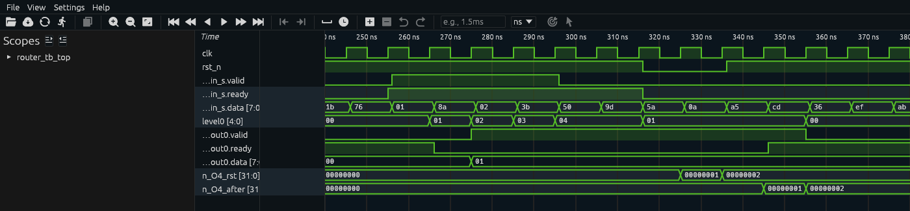

# Lab 07: Capstone

You'll take the router's UVM environment to sign-off. You write a verification plan from the
specification, run a seed regression and read its coverage, and hunt mystery builds dealt from all
fifteen bugs in the catalogue. Then you close the holes that the plan and the coverage show you, a
reset with traffic in flight and drop counters at 255, until `make check-all` prints
`15 of 15 caught.`, and you write a verification report. The plan, the report and the code you
write go into a GitHub repository of your own.

Package: [`labs/lab-07-capstone/`](https://github.com/uoftasic/dd105-a/tree/main/labs/lab-07-capstone)

## Before you start

- Finish Labs 01 to 06 on the [Course path](../index.md#course-path). This lab's package ships the
  whole environment, the course's own version of everything those labs built, so you don't need
  your files from them.
- Read [Verification plans and sign-off](../guide/verification-plans-and-sign-off.md) and
  [Writing the verification report](../guide/writing-the-verification-report.md), and reread
  [Regressions and seeds](../guide/regressions-and-seeds.md).
- Keep [the router's specification](../reference/router-spec.md) open for the whole lab, with
  [the router in one page](../reference/the-router-in-one-page.md) beside it if you like. The plan
  you write in Part 2 is a list of the specification's rules.
- You need a GitHub account, and a token the workbench can push with. If you made one in
  [IC102-A Lab 01, Part 2](https://uoftasic.com/ic102-a/labs/lab-01-your-repo-from-the-template-overview.html#part-2-your-github-settings)
  and it hasn't expired, use it. Otherwise make one the way that part describes. This lab needs
  only the Contents permission, read and write, because your repository has no workflows.
- In a terminal on the workbench desktop:

  ```bash
  . /foss/designs/common/.designinit
  mod dd105-a
  cd labs/lab-07-capstone
  ```

Time: about 3 h 30 min. About 20 minutes of that is the machine working, which we measured on the
course's 2 CPUs: the first build took 135 s, the three rebuilds after your edits took 129 to
141 s each, a regression takes 2 to 3 minutes and `make check-all` about 65 s. Most of the rest
is writing: the plan, two sequences, eight assertions and the report.

## Part 1: Your repository and the first build

1. Start the build, because it's the slowest step in the lab:

   ```bash
   make build
   ```

   The banner says a cold build takes 5 to 6 minutes. Ours, with an empty ccache, took 135 s and
   ended with:

   ```text
   - Verilator: Walltime 134.065 s (elab=0.912, cvt=3.600, bld=128.625); cpu 5.787 s on 2 threads; allocated 391.230 MB
   ```

   and then a line saying it built `build/sim` in 135 s.

2. While it builds, make the repository. On GitHub, create a new repository under your own
   account named `dd105-capstone`, with a README so that it starts with one commit. It can be
   private, because nobody needs to read it yet.

3. Clone it beside the course, and tell git who you are in it:

   ```bash
   mkdir -p /foss/designs/projects && cd /foss/designs/projects
   git clone https://github.com/YOUR-USERNAME/dd105-capstone.git
   cd dd105-capstone
   git config user.name "Your Name"
   git config user.email "ID+USERNAME@users.noreply.github.com"
   git config credential.helper 'cache --timeout=28800'
   cd /foss/designs/modules/dd105-a/labs/lab-07-capstone
   ```

   Use your GitHub no-reply address, and leave out `--global`: the container's home folder is
   thrown away when the workbench restarts, but `.git/config` is inside your repository, on your
   own disk, so it stays.
   [IC102-A Lab 01, Part 3](https://uoftasic.com/ic102-a/labs/lab-01-your-repo-from-the-template-overview.html#part-3-make-the-repository)
   explains both. Your plan and your report live in the repository from the start. The testbench
   stays here in the course clone while you work on it, because it builds only from inside
   `labs/`, and Part 8 copies it across.

4. When the build has finished, run the default test, `router_all_test`. It runs every directed
   sequence in turn and then four phases of random traffic:

   ```bash
   make run
   ```

   Near the end you should see:

   ```text
   UVM_INFO labs/lab-07-capstone/tb/router_env_pkg.sv(720) @ 110280000: uvm_test_top.env.sb [SB] 11028 cycles, 8 resets; 4198 input beats in 1109 packets: 673 forwarded, 166 NOROUTE, 270 FULL, 81 oversize; 2409 output beats
   UVM_INFO labs/lab-07-capstone/tb/router_env_pkg.sv(722) @ 110280000: uvm_test_top.env.sb [SB] 1191 register reads checked, 774 writes, 995 to bad addresses; irq wrong in 0 cycles
   ```

   then `DD105: TEST PASSED`, and `ok: 0 UVM_ERROR, 0 UVM_FATAL` in about 6 s.

Check: `make run` passes, and `git -C /foss/designs/projects/dd105-capstone log --oneline` shows
the one commit that GitHub made.

## Part 2: The verification plan

Which of the specification's rules does this environment check, and which does it never make
happen?

1. Copy the template into your repository:

   ```bash
   cp PLAN-template.md /foss/designs/projects/dd105-capstone/PLAN.md
   ```

   It has a row for each rule in the specification. The input, output and APB rules keep the
   specification's numbers (I1 to I7, O1 to O8, A1 to A9), and the template gives labels of its own
   (RT1, DR2, RS2 and so on) to the rules that the specification states in prose. Three rows are
   filled in as examples.

2. Fill in the table under "How the environment checks". There are three checkers: the
   scoreboard (`process()` and `check_out()` in `tb/router_env_pkg.sv`), the register model's
   mirror (`set_check_on_read(1)` in `router_env::connect_phase`), and the assertions in
   `tb/router_sva.sv`. The comment at the top of each file says what it covers.

3. For every row, fill in "Checked by" and "Made to happen by", and write "nothing" where nothing
   does. The sequences in `tb/router_seq_pkg.sv` have a comment over each step saying what it sets
   up, and `router_all_vseq`, at the bottom of the file, lists the ones the graded test runs. Run
   `grep -n TODO tb/*.sv` first, because the parts this lab leaves out are marked that way.

4. Mark the rows you think no sequence in `router_all_vseq` reaches. Then look at what each reset
   in your Part 1 run found in the buffers:

   ```bash
   grep "expected beats are lost" build/runs/router_all_test-s1/run.log
   ```

   You should see eight lines, which start:

   ```text
   UVM_INFO labs/lab-07-capstone/tb/router_env_pkg.sv(549) @ 4925000: uvm_test_top.env.sb [SB] reset from cycle 492: 0 expected beats are lost
   UVM_INFO labs/lab-07-capstone/tb/router_env_pkg.sv(549) @ 29975000: uvm_test_top.env.sb [SB] reset from cycle 2997: 0 expected beats are lost
   ```

   and all eight end `0 expected beats are lost`. Which rows of your plan can't be done with
   resets like these, and which have no checker?

   <details>
   <summary>Answer</summary>

   Each sequence starts with a reset (and `router_regs_vseq` has one more in the middle), and at
   each of them the traffic before it has already drained, so both buffers are empty and no packet
   is half accepted. RS2 and RS3 (a reset
   with beats in a buffer, and a reset in the middle of an input packet) need a reset with traffic
   in flight, and so does the second half of O4. I7, O4, the first half of A4 and RS1 have no
   assertion yet, because theirs are the `TODO (Part 5)` comments in `tb/router_sva.sv`; of RS1,
   only `irq` is checked, by the scoreboard. DR2, a counter that stops at 255, needs 255 drops
   with no clear or reset between them, and only the empty `router_saturate_vseq` was meant to
   send them.

   </details>

Check: every row of your plan has an entry in "Checked by" and "Made to happen by", and the rows
that say "nothing" include the ones in the answer above.

## Part 3: A seed regression

Does a regression that passes on every seed tell you the environment is finished?

1. `make regress` runs every test in `TESTS` on seeds 1 to 10. Look at `TESTS` in the Makefile,
   and write down how many runs you expect and how many will pass.

2. Run it, and time it:

   ```bash
   time make regress
   ```

   It took us 2 min 33 s. You should see `90 ok  (90 runs)` and then the coverage of those runs:

   ```text
    verilator_coverage: covergroup : 97.2% (141/145)
   ```

   with, at the end of the bin list:

   ```text
    4 bins never hit:
       __vlAnonCG_cg_corner.cp_kind.corner[11]
       __vlAnonCG_cg_corner.cp_kind.corner[12]
       __vlAnonCG_cg_corner.cp_kind.corner[5]
       __vlAnonCG_cg_corner.cp_kind.corner[6]
   ```

3. `cg_corner` counts the corners listed in `corner_e`, near the top of the reference model in
   `tb/router_env_pkg.sv`. A bin's number is the corner's place in that list, where the first
   corner is number 0. Which four corners did ninety passing runs never reach, and which rows of
   your plan are they?

   <details>
   <summary>Answer</summary>

   Corners 5 and 6 are `C_NOROUTE_SATURATED` and `C_FULL_SATURATED`, a drop whose counter is already
   255 (row DR2). Corners 11 and 12 are `C_RESET_WITH_BEATS` and `C_RESET_MID_PACKET`, a reset
   with beats in a buffer and a reset with a packet half accepted (RS2 and RS3). You found the
   same rows in Part 2 by reading, and the regression found them by counting. So the answer to this
   part's question is no: ninety passes mean that no check fired in ninety runs, and the four empty
   bins are situations that none of those checks was ever shown.

   </details>

4. Fill in "Seen in coverage" for every row, from the bin list
   (`build/coverage/regress/bins.txt` has every bin with its count) or from the `corners hit:` line
   that the scoreboard prints at the end of each run's log. Then write your sign-off criteria
   under "Sign-off criteria", each one a command and the output it must print.

5. Commit and push the plan:

   ```bash
   cd /foss/designs/projects/dd105-capstone
   git add PLAN.md && git commit -m "Verification plan for the router" && git push
   cd -
   ```

   git asks for your username and, as the password, the token.

Check: `90 ok  (90 runs)` and `97.2% (141/145)`, and your plan on GitHub with its sign-off
criteria written.

## Part 4: Mystery hunts

Can you tell which rule a design breaks from your environment's log alone?

1. Deal a mystery bug, and run `router_all_test` against it:

   ```bash
   make new
   make hunt
   ```

   `make new` seals one of the fifteen bugs in `.hunt` without telling you which, and `make hunt`
   runs the graded test with that bug switched on, which takes about 6 s. On one of our deals, the
   hunt printed:

   ```text
     caught  the mystery bug                          21 UVM_ERROR                    5.8s
           UVM_ERROR [SB] irq is 1 from cycle 4436, but STATUS = 001 and INT_EN = 010 make it 0
           UVM_ERROR [SB] irq is 1 from cycle 5116, but STATUS = 100 and INT_EN = 000 make it 0
           UVM_ERROR [SB] irq is 1 from cycle 5539, but STATUS = 001 and INT_EN = 000 make it 0
   ```

2. Copy `REPORT-template.md` into your repository as `REPORT.md`. Before you ask for a verdict,
   fill in the first three columns of its hunt table: the first check that fired, copied from the
   hunt, and your diagnosis, which is the rule the router broke and the file in
   `labs/common/rtl/` you'd look in. The specification's
   [Building the router](../reference/router-spec.md#building-the-router) section says what each
   file holds, and in the log from `make hunt VERBOSE=1` the `[VSEQ] starting ...` lines say which
   sequence was running when the first error came. What would you write for the hunt above?

   <details>
   <summary>Answer</summary>

   The rule is IRQ1, that `irq` is the OR of `STATUS & INT_EN`. In each of these cycles a `STATUS`
   bit is set whose enable is 0, and the router raises `irq` anyway, so it isn't masking with
   `INT_EN`. The interrupt is in `router_regs.sv`, with the registers. In the whole log the first
   error comes after `starting router_full_vseq`, the sequence that writes `INT_EN` = `010`,
   enabling only the FULL interrupt, so its NOROUTE drops set a bit that shouldn't raise `irq`.

   </details>

3. Ask for the grade:

   ```bash
   make verdict
   ```

   It runs the golden design first (row 1) and then the mystery bug (row 2), about 12 s in all.
   For the hunt above you should see:

   ```text
         ok  1. the golden design  must PASS          0 UVM_ERROR, 0 UVM_FATAL        5.8s
     caught  2. the mystery bug    must FAIL          21 UVM_ERROR                    5.9s
   ```

   then the same three errors, and:

   ```text
    VERDICT: PASS
      The bug was B02_irq_ignores_int_en.
      It hides behind: turning on every interrupt enable before looking at irq
   ```

   Fill in the last two columns of the row.

4. Deal again, until the table has three rows. If a hunt prints this instead:

   ```text
      quiet  the mystery bug                          0 UVM_ERROR, 0 UVM_FATAL        5.9s
   ------------------------------------------------------------------------
    Nothing your test drives tells this design from a correct one. The
    bug is in there; your stimulus or your checks have not reached it.
   ```

   keep that one. `make new` replaces whatever is in `.hunt`, so copy the file aside
   (`cp .hunt hunt-quiet.sealed`) before you deal again, and copy it back to `.hunt` when you come
   to its verdict in Part 7. In its row, write which rows of your plan could hide a bug from
   `router_all_test`. `make reveal` would tell you the bug's name, and then remind you that the
   name isn't the deliverable, because `make verdict` still needs row 2 to fire.

Check: your report's hunt table has three rows, each with its diagnosis written before its
verdict.

## Part 5: Reset with traffic in flight

What does the environment need before it can check a reset that happens while the router is
busy?

1. Write the assertions marked `TODO (Part 5)` in `tb/router_sva.sv`: `a_I7`, `a_O4_rst`,
   `a_O4_after` and `a_A4`, and `a_R_pready`, `a_R_pslverr`, `a_R_prdata` and `a_R_irq` for the
   specification's Reset table. These are the rules about reset itself, so unlike the others in the
   file they have no `disable iff (!rst_n)`, and the specification's
   [Valid/ready rules](../reference/router-spec.md#validready-rules) section says why. `a_O4_after`
   needs the two flip-flops its comment describes. Each failure increments its counter and calls
   `$error` with the rule's name, as `a_O1` does.

2. Predict which of the eight will fail on the golden design. Then rebuild and run:

   ```bash
   make build
   make run
   ```

   The rebuild took us 141 s. You should see the same `[SB]` lines as in Part 1 and
   `DD105: TEST PASSED`. None of the assertions fails, because the golden router obeys every one
   of these rules, so if one does fail, its `%Error` line names it and the mistake is in the
   assertion.

3. Write `router_reset_vseq::body()` in `tb/router_seq_pkg.sv`. Its `TODO` lists the situations to
   reach, and the first is the specification's example E8: output 0 stalled with a packet in its
   buffer, and the next packet half accepted, when `rst_n` falls. Fork the reset beside the
   traffic, the way `router_ctrl_vseq` forks its `CTRL` writes beside a burst, and after each reset
   let the sink take beats, call `setup()` and send more.

4. Do the other two `TODO (Part 5)`s, the reset thread in `router_rand_vseq`'s fork and the line in
   `router_all_vseq` that runs your sequence, and add `router_reset_test` to `TESTS` in the
   Makefile.

5. Write down what you expect the `corners hit:` line to say for your test. Then rebuild (133 s for
   us) and run it:

   ```bash
   make build
   make run UVM_TESTNAME=router_reset_test
   ```

   With the reference solution's sequence the first reset prints:

   ```text
   UVM_INFO labs/lab-07-capstone/tb/router_env_pkg.sv(549) @ 335000: uvm_test_top.env.sb [SB] reset from cycle 33: 4 expected beats are lost
   ```

   and the run ends with `[SB] 700 cycles, 4 resets; ...`, a `corners hit:` line that includes
   `C_RESET_WITH_BEATS=3 C_RESET_MID_PACKET=2`, and `DD105: TEST PASSED`, in 0.46 s.

Check: `router_reset_test` passes on the golden design, with `C_RESET_WITH_BEATS` and
`C_RESET_MID_PACKET` above 0.

## Part 6: Counters at 255

Does each drop counter stop at 255, and how will you know that the regression got there?

1. Write `router_saturate_vseq::body()`. Its `TODO` names the two corners, and the specification's
   [Sizes](../reference/router-spec.md#sizes) section says how quickly a stream of 1-beat packets
   for a disabled route gets a counter there: one drop per cycle. Read `DROP_CNT` on the way past
   255, and clear it with a write.

2. Add the sequence to `router_all_vseq` and `router_saturate_test` to `TESTS`, rebuild (129 s for
   us) and run it:

   ```bash
   make build
   make run UVM_TESTNAME=router_saturate_test
   ```

   With the reference solution you should see `C_NOROUTE_SATURATED=13 C_FULL_SATURATED=15` in the
   `corners hit:` line, and `DD105: TEST PASSED`.

3. Will closing these two bins catch a bug that your environment misses now? Write down your
   answer. Then run the regression again, keeping its output:

   ```bash
   mkdir -p results
   time make regress | tee results/regress.txt
   ```

   It took us 2 min 44 s. You should see `110 ok  (110 runs)` and:

   ```text
    verilator_coverage: covergroup : 100.0% (145/145)
   ```

   <details>
   <summary>Answer</summary>

   No. We ran `make check-all` with Part 5's work in and none of Part 6's, and it printed
   `15 of 15 caught.` on seed 1, with B15 at `9 UVM_ERROR, 55 assertions`: none of the fifteen
   bugs changes what a counter does at 255. What the new sequence adds is a check that has been
   shown its situation. The scoreboard compares every `DROP_CNT` read with its model, so the reads
   on the way past 255 would catch a counter that wraps, and until now row DR2 of your plan had no
   evidence either way.

   </details>

4. Update the Status column of your plan, then commit and push it.

Check: `110 ok  (110 runs)` and `100.0% (145/145)`.

## Part 7: Sign-off

Does your environment meet the plan's sign-off criteria, and what did your work in Parts 5 and 6
add?

1. If you kept a quiet mystery bug, copy its file back to `.hunt`, run `make verdict`, and fill in
   its row.

2. Write down how many of the fifteen you expect `router_all_test` to catch now. Then run the
   catalogue on three seeds, keeping the output:

   ```bash
   make check-all | tee results/check-all-s1.txt
   make check-all SEED=2 | tee results/check-all-s2.txt
   make check-all SEED=3 | tee results/check-all-s3.txt
   ```

   Each took us about 65 s. With the reference solution, seed 1 printed:

   ```text
         ok  the golden design                        0 UVM_ERROR, 0 UVM_FATAL        6.3s
   ------------------------------------------------------------------------
     caught  tier 1  B01_status_write_clears_all      17 UVM_ERROR                    6.2s
     caught  tier 1  B02_irq_ignores_int_en           22 UVM_ERROR                    6.3s
     caught  tier 1  B03_route3_readback_swapped      20 UVM_ERROR                    6.3s
     caught  tier 1  B04_misaligned_address_accepted  50 UVM_ERROR, 40 assertions     0.8s
     caught  tier 2  B05_dst_field_off_by_one         50 UVM_ERROR                    0.2s
     caught  tier 2  B06_disabled_route_forwards      50 UVM_ERROR                    0.3s
     caught  tier 2  B07_full_counted_on_disabled_route 33 UVM_ERROR                    6.3s
     caught  tier 3  B08_admission_off_by_one         50 UVM_ERROR                    5.1s
     caught  tier 3  B09_write_pointer_power_of_two   50 UVM_ERROR                    0.2s
     caught  tier 4  B10_output_reloads_while_stalled 50 UVM_ERROR, 35 assertions     0.2s
     caught  tier 4  B11_cut_packet_has_no_last       38 UVM_ERROR, 30 assertions     6.3s
     caught  tier 5  B12_out1_uses_out0_ready         50 UVM_ERROR, 28 assertions     3.0s
     caught  tier 5  B13_admission_checks_other_output 50 UVM_ERROR, 1 assertion       5.0s
     caught  tier 6  B14_enable_resets_to_one         25 UVM_ERROR, 1793 assertions    6.2s
     caught  tier 6  B15_output_valid_survives_reset  46 UVM_ERROR, 49 assertions     6.1s
   ------------------------------------------------------------------------
    15 of 15 caught.
   ```

   Seeds 2 and 3 printed `15 of 15 caught.` too, with B15 at `4 UVM_ERROR, 24 assertions` and
   `5 UVM_ERROR, 43 assertions`. Your error counts will differ, because your sequences aren't ours.

3. As shipped, the package caught 14 of the 15. Which one did it miss, and which check fires first
   on it now?

   <details>
   <summary>Answer</summary>

   We ran `make check-all` on the package before Parts 5 and 6, and it printed:

   ```text
     MISSED  tier 6  B15_output_valid_survives_reset  0 UVM_ERROR, 0 UVM_FATAL        5.8s
   ------------------------------------------------------------------------
    14 of 15 caught.
    Still hiding from this test:
      B15_output_valid_survives_reset
         hides behind: resetting only at time 0, when every buffer is already empty
   ```

   With B15 on, a reset doesn't clear an output's register, so a beat that was waiting on a
   stalled output when `rst_n` fell is still there afterwards. Until Part 5, every reset in the
   graded test came with both buffers empty, which left B15 nothing to keep. After your last run,
   `build/grade/B15/run.log` holds seed 3, and in ours the first failure came in the E8 step of
   the reset sequence:

   ```text
   [71045000] %Error: router_sva.sv:70: Assertion failed in router_tb_top.dut.u_sva.u_out0.a_O4_rst: O4: out_valid is 1 during reset
   ```

   That was followed by `a_O4_rst` once more, `a_O4_after` twice, and four cycles after the first
   failure, by the scoreboard:

   ```text
   UVM_ERROR labs/lab-07-capstone/tb/router_env_pkg.sv(679) @ 71085000: uvm_test_top.env.sb [SB] output 0 delivered 01 (offered from cycle 7107, taken in cycle 7108), but no beat was waiting for it there
   ```

   </details>

4. Look at B15 beside the golden router, in the E8 step of the reset sequence:

   ```bash
   make waves UVM_TESTNAME=router_reset_test
   make waves UVM_TESTNAME=router_reset_test BUG=B15
   surfer build/runs/router_reset_test-s1/waves.fst &
   surfer build/runs/router_reset_test-s1-B15/waves.fst &
   ```

   Add `rst_n` from `sys`, `valid`, `ready` and `data` from `in_s` and `out0`, `level0` from
   `dut`, and `n_O4_rst` and `n_O4_after` from `dut.u_sva.u_out0`, and look at 240 to 380 ns:

   

   *The golden router. Output 0 has been stalled since 266 ns, with beat `01` on its pins from
   275 ns and `level0` at 4: the 2-beat packet `01 8a`, and `02 3b`, the first two beats of a
   packet that is still coming in. (After 296 ns `in_valid` is 0, and what `in_data` shows is the
   source's filler.) `rst_n` falls at 316 ns, and `out0_valid`, `in_ready` and
   `level0` fall with it, without waiting for a clock edge. The sink is ready again from 346 ns,
   and nothing comes out, as example E8 says.*

   

   *B15, from the same seed. The reset empties the buffer behind the output but not the output
   register, so `out0_valid` stays 1 through the reset with `01` still on `out0_data`, and
   `level0` reads 1, because the level counts the beat on the pins. `a_O4_rst` counts a failure
   at each of the two rising edges inside the reset (325 and 335 ns), and `a_O4_after` at the next
   two. The sink takes `01` at the edge at 355 ns, and the scoreboard reports it:
   `output 0 delivered 01 (offered from cycle 35, taken in cycle 36), but no beat was waiting for it there`.*

5. Go through your plan's sign-off criteria one at a time, against the files in `results/`.

Check: `15 of 15 caught.` on three seeds, from the reset assertions and the two sequences you
wrote.

## Part 8: The report

Can someone else check your claim without redoing your work?

1. Fill in `REPORT.md` section by section. Paste each number as the tool printed it, from
   `results/` and from your notes. Section 7, what your environment doesn't show, is the one that
   gets skipped, and it's the one that a reader who has to rely on your claim needs most.

2. Copy your testbench and its outputs into the repository, and push:

   ```bash
   R=/foss/designs/projects/dd105-capstone
   mkdir -p $R/tb $R/results
   cp Makefile $R/ && cp tb/*.sv $R/tb/ && cp results/*.txt $R/results/
   cd $R
   git add -A && git commit -m "The capstone environment, its results and the report" && git push
   ```

   The copy is safe to repeat, so run it again whenever you change a file and want the
   repository to have it.

3. Open the repository on GitHub, and check that a reader who has only that page could find the
   command behind every number in your report.

Check: your repository on GitHub has `PLAN.md`, `REPORT.md`, `Makefile`, `tb/` and `results/`.

## Finishing

You're done when `make check-all` prints `15 of 15 caught.` with the reset assertions and the reset
and saturation sequences that you wrote, and the `REPORT.md` in your GitHub repository quotes
that run.

Questions:

1. B15 was caught by an assertion and by the scoreboard. If you could keep only one of the two
   checks, which would you keep?

   <details>
   <summary>Answer</summary>

   Either can be defended. `a_O4_rst` fired in the reset cycle itself and names the rule it
   checks. It needs no model, so it fires whether or not the sink ever takes the stale beat. In
   our seed 3 log the scoreboard fired four cycles later, and only because the sink took the beat,
   but its message
   says what the bug does to whoever uses the router: a beat from before the reset is delivered as
   if it were new. The assertion points at the cycle where the rule broke, and the scoreboard
   says what that cost.

   </details>

2. Part 3's regression passed 90 runs out of 90. What would a reader who saw only that line have
   believed, and what did your plan say at the time?

   <details>
   <summary>Answer</summary>

   That the router worked. At the time the plan had no assertion for I7, O4, the first half of A4
   or RS1, and nothing that made RS2, RS3 or DR2 happen; the coverage had four empty bins; and, as
   Part 7 showed, the graded test passed on one of the fifteen planted bugs.

   </details>

Submit: nothing yet. Your repository is the record of your capstone. We plan a certification
process that will review capstone repositories, but it doesn't exist yet.

## Going further (optional)

- Close the open items in the reference plan, `solutions/PLAN.md`. A cross of `cp_act` with
  `cp_level` in `cg_pkt`, for example, would show row RT3, a NOROUTE drop for a route whose output
  is full, which only one directed step reaches now.
- Run more seeds, with `make regress NSEEDS=50`. The simulator is built at `-O0` to keep builds
  short, and `uvm.mk` says to use `OPT_FAST=-Os` for long regressions, at the cost of a longer
  build.
- Deal more mystery bugs, until you've had one from every tier.

Next on the [Course path](../index.md#course-path): this is the last lab.
